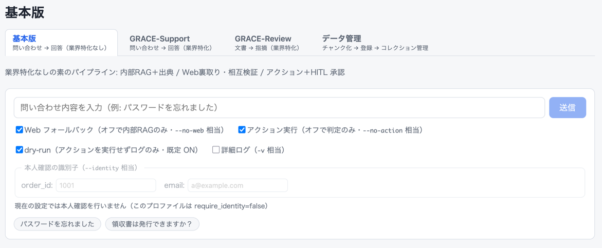
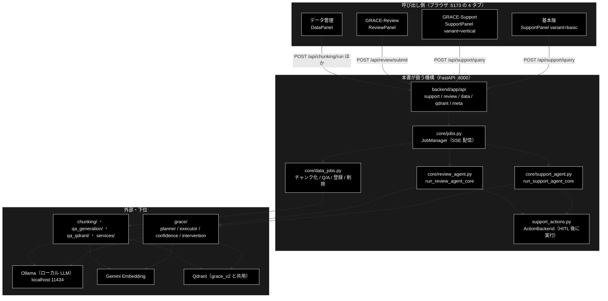
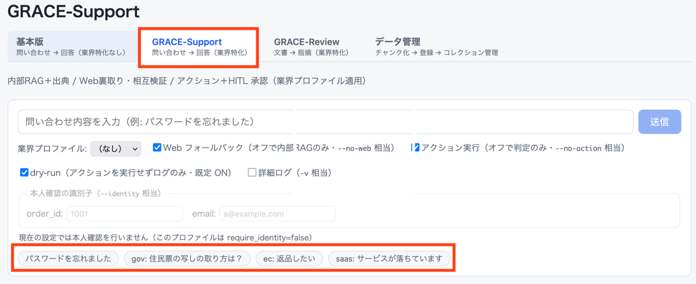
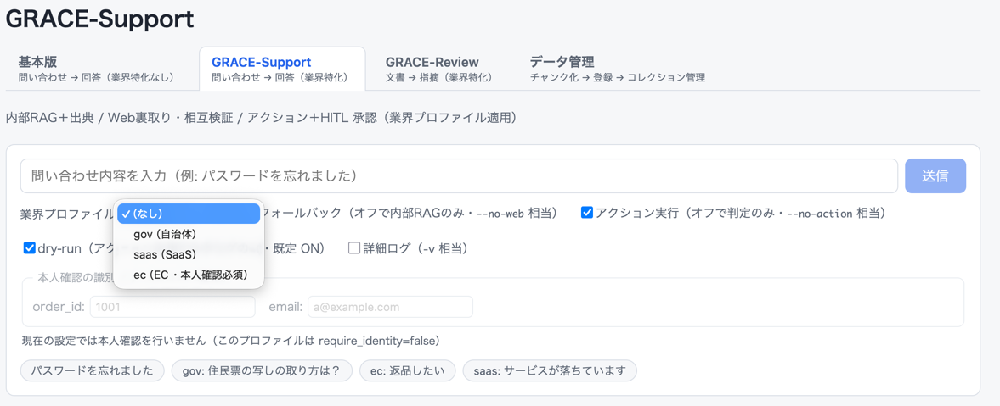
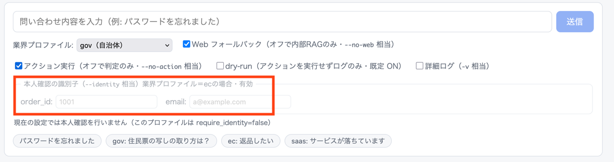
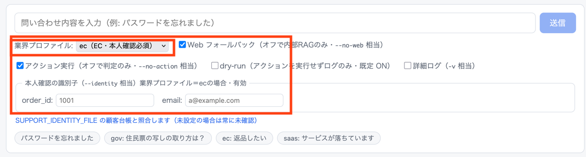
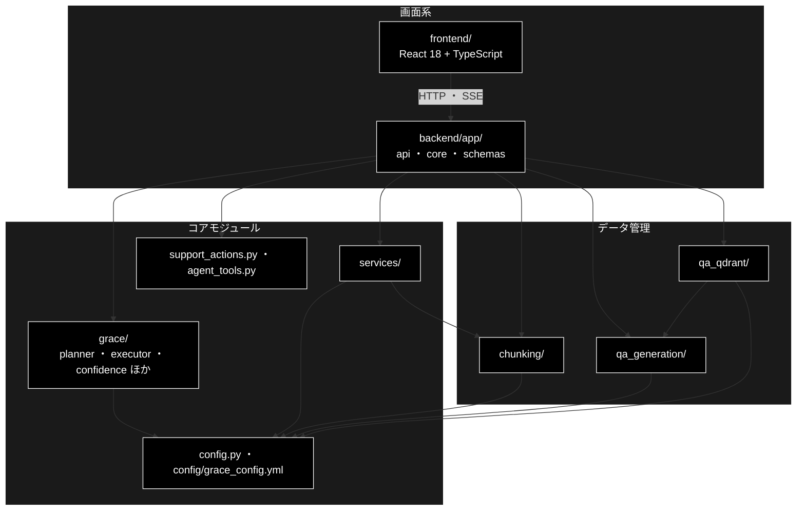

# GRACE（grace_v2_local）- ローカル LLM 版 業界特化・自律型エージェント基盤 ドキュメント

**Version 4.2** | 最終更新: 2026-10-14

> 日本語 RAG に、根拠検証（groundedness）・Web 裏取り・HITL（Human-In-The-Loop）承認を組み合わせた、
> 業界特化の自律型エージェント。**LLM はローカルの Ollama で動く**（LLM 用の API キーは不要。Embedding だけ Gemini）。
> `./run_dev.sh` で起動し、ブラウザ（http://localhost:5173）の 4 タブから使う。



---

## 目次

- [ドキュメント構成](#ドキュメント構成)
- [概要](#概要)
  - [主な責務](#主な責務)
  - [各責務対応のモジュール](#各責務対応のモジュール)
  - [アーキテクチャ構成図](#アーキテクチャ構成図)
- [1. アプリの 4 タブ（`./run_dev.sh`）](#1-アプリの-4-タブrun_devsh)
- [2. 基本版 — 問い合わせ ＋ RAG](#2-基本版--問い合わせ--rag)
- [3. GRACE-Support — 問い合わせ ＋ RAG ＋ 業界プロファイル](#3-grace-support--問い合わせ--rag--業界プロファイル)
- [4. GRACE-Review — 規程 RAG ＋ 根拠検証で広告表示を点検](#4-grace-review--規程-rag--根拠検証で広告表示を点検)
- [5. データ管理 — チャンキング → Q/A 作成 → Qdrant 登録 → コレクション管理](#5-データ管理--チャンキング--qa-作成--qdrant-登録--コレクション管理)
- [6. 処理概要（主要な処理モジュール）](#6-処理概要主要な処理モジュール)
- [7. 起動と設定](#7-起動と設定)
- [8. 全タブ共通の仕組み](#8-全タブ共通の仕組み)
- [9. 検証（CI と同じゲート）](#9-検証ci-と同じゲート)
- [10. うまく動かないとき](#10-うまく動かないとき)
- [11. 関連ドキュメント](#11-関連ドキュメント)
- [12. 変更履歴](#12-変更履歴)

---

## ドキュメント構成

本書はアプリ全体の入口である。各領域の詳細は次の文書にある。まずその領域の README で全体と索引を見て、
処理の順序は `*_process_flow.md`、データの形と置き場所は `*_data_flow.md` で確かめる。

| 領域 | 文書 | 概要 |
|---|---|---|
| `backend/` | [`backend/app/api/docs/README_backend_api.md`](backend/app/api/docs/README_backend_api.md) | FastAPI のルーター 5 本・25 エンドポイントの入口。SSE のワイヤ形式・HITL の往復・HTTP ステータス（API 契約の正本） |
| | [`backend/app/core/docs/README_backend_core.md`](backend/app/core/docs/README_backend_core.md) | Support / Review のパイプライン本体と、3 系統が共有するジョブ基盤（`JobManager`・SSE・HITL の橋渡し）の入口 |
| `frontend/` | [`frontend/docs/README_frontend.md`](frontend/docs/README_frontend.md) | 画面の責務・構成・コンポーネントツリー・`state/` 純関数・テスト件数の入口と棚卸し |
| `grace/` | [`grace/docs/grace_process_flow.md`](grace/docs/grace_process_flow.md) | 1 クエリの処理の流れ（計画 → 実行 → 根拠検証 → 介入・再計画）と、Support / Review が使う grace モジュールの対応表 |
| | [`grace/docs/grace_data_flow.md`](grace/docs/grace_data_flow.md) | 外部 API（Ollama・Gemini・Qdrant・Web）に渡るデータ・プロンプトの所在・実行メモリに残るデータ |
| `helper/` | [`helper/docs/README_helper.md`](helper/docs/README_helper.md) | LLM クライアント（`create_llm_client`・既定 `"ollama"`）・Embedding（Gemini・sparse）・テキスト整形の入口 |
| `services/` | [`services/docs/README_services.md`](services/docs/README_services.md) | データ管理タブが使うサービス層（チャンク化・Qdrant 管理・Q/A 生成・トークン計数）の入口 |
| `chunking/` | [`chunking/docs/README_chunking.md`](chunking/docs/README_chunking.md) | CSV / テキストをセマンティックチャンクへ分ける CLI とモジュール（データ管理 ①）の入口 |
| `qa_generation/` | [`qa_generation/docs/README_qa_generation.md`](qa_generation/docs/README_qa_generation.md) | チャンクから Q/A を作る `QAPipeline` / `SmartQAGenerator` とカバレッジ（データ管理 ②）の入口 |
| | [`qa_generation/docs/qa_generation_process_flow.md`](qa_generation/docs/qa_generation_process_flow.md) | 3 つの入口から `QAPipeline.run()` までの順序・同期と Celery・失敗と再開 |
| | [`qa_generation/docs/qa_generation_data_flow.md`](qa_generation/docs/qa_generation_data_flow.md) | チャンク dict → 構造化出力 → Q/A dict → 4 ファイル、途中経過の JSONL とカバレッジの JSON の形 |
| `qa_qdrant/` | [`qa_qdrant/docs/README_qa_qdrant.md`](qa_qdrant/docs/README_qa_qdrant.md) | Q/A 生成と Qdrant 登録の CLI（データ管理 ③）の入口 |
| | [`qa_qdrant/docs/qa_qdrant_process_flow.md`](qa_qdrant/docs/qa_qdrant_process_flow.md) | CLI から Q/A 生成・登録までの順序・分岐・再開 |
| | [`qa_qdrant/docs/qa_qdrant_data_flow.md`](qa_qdrant/docs/qa_qdrant_data_flow.md) | チャンク CSV → Q/A CSV → Qdrant のポイント（ID・payload）と UI 用 CSV の形・置き場所 |

そのほかの入口: backend 全体の構成とモデル解決は [`backend/app/docs/README_app.md`](backend/app/docs/README_app.md)、
Support / Review の流れの正本は [`backend/app/core/docs/core_process_flow.md`](backend/app/core/docs/core_process_flow.md)、
直下 `docs/` の横断文書は [`docs/README.md`](docs/README.md)、運用・計測ツールは [`scripts/docs/README_scripts.md`](scripts/docs/README_scripts.md)、
開発の指針は [`CLAUDE.md`](CLAUDE.md)。文書の書き方は `.claude/skills/grace-agent-docs/` の仕様に従う。

---

## 概要

**GRACE** は、問い合わせや文書を受け取り、社内ナレッジ（Qdrant に登録した RAG コレクション）を根拠に
**回答**または**指摘**を返すエージェント基盤である。出した回答・指摘が出典で裏付けられるかを検証し、
支持率で「そのまま出す / 注意つきで出す / 人へ引き継ぐ」を決め、起票や返信などの副作用は
**人が承認するまで実行しない**。

本リポジトリ（grace_v2_local）は、姉妹リポジトリ grace_v2 と同じ構造のまま **LLM をローカルの Ollama に置き換えた版**である。
Embedding（Gemini `gemini-embedding-001`）と Qdrant は grace_v2 と共用する。

本書はリポジトリの入口として、画面の 4 タブそれぞれの「**業界特化**」「**処理フロー**」「**回答（出力）**」と、
それを支える**主要な処理モジュール**をまとめる。各モジュールの詳細（IPO）・各画面部品の詳細は
それぞれの `docs/` に置き、本書からはリンクする（[11. 関連ドキュメント](#11-関連ドキュメント)）。

| タブ | 情報の流れ | 業界特化 | コア関数 |
|---|---|---|---|
| **基本版** | 問い合わせ → 回答 | なし（全コレクションを検索） | `run_support_agent_core`（`vertical=None`） |
| **GRACE-Support** | 問い合わせ → 回答 | 業界の How-to（`VerticalProfile`：`gov` / `saas` / `ec`） | `run_support_agent_core`（`vertical` 指定） |
| **GRACE-Review** | 文書 → 指摘 | 業界の法令遵守（`RuleSet`：`ec_ad`） | `run_review_agent_core` |
| **データ管理** | CSV → チャンク → Q/A → Qdrant | — | `backend/app/core/data_jobs.py` の各ランナー |

技術スタック:

| 用途 | 採用 | 既定 |
|---|---|---|
| LLM（回答生成・推論・根拠検証・Q/A 生成・チャンキングほか） | Ollama（ローカル LLM・API キー不要） | `gemma4:26b-a4b-it-qat`（軽量・判定系も同じモデル。実体は `config.py::get_default_ollama_model()`） |
| Embedding（検索） | Gemini | `gemini-embedding-001`（3072 次元。`GOOGLE_API_KEY`） |
| ベクトル DB | Qdrant（grace_v2 と共用） | `docker-compose/docker-compose.yml` |
| Web API | FastAPI（SSE でステップ進捗を配信） | :8000 |
| フロントエンド | Vite + React 18 + TypeScript | :5173 |

### 主な責務

- 問い合わせに、登録済みの全コレクションを根拠として回答する（基本版）
- 問い合わせに、業界プロファイルで絞った社内ナレッジと業界の方針で回答する（GRACE-Support）
- 広告文書を EC 広告表示ルールと規程 RAG で点検し、条文つきの指摘を出す（GRACE-Review）
- 回答・指摘が出典で裏付けられるかを検証し、支持率で確定・要確認・有人対応に振り分ける
- 副作用のあるアクション（起票・返信）を、人間の承認（HITL CONFIRM）を得るまで実行しない
- RAG の元データを、チャンク化 → Q/A 生成 → Qdrant 登録の 3 工程で用意し、コレクションを管理する（データ管理）
- 画面からの実行をジョブとして受け付け、各ステップの進捗を SSE で画面へ配信する

### 各責務対応のモジュール

| # | 責務 | 対応モジュール | 説明 |
|---|------|--------------|------|
| 1 | 全コレクションを根拠とした回答（基本版） | `backend/app/core/support_agent.py` | `run_support_agent_core` を `vertical=None` で実行。画面は `SupportPanel`（`variant="basic"`） |
| 2 | 業界プロファイル適用の回答（GRACE-Support） | `backend/app/core/verticals.py` | `PROFILES`（`gov` / `saas` / `ec`）。コアは 1 と同じ関数（`variant="vertical"`） |
| 3 | 広告文書の点検と条文つき指摘（GRACE-Review） | `backend/app/core/review_agent.py` | `run_review_agent_core`。ルールは `backend/app/core/rulesets.py::EC_AD`（23 ルール） |
| 4 | 根拠検証と確定・要確認・有人対応の振り分け | `grace/confidence.py` | `GroundednessVerifier`（両エージェント共用）。判定は `backend/app/core/gates.py` / `backend/app/core/review_gates.py` |
| 5 | アクションの HITL 承認 | `support_actions.py` | `ActionBackend`（両エージェント共用）。承認待ちは `grace/intervention.py` ⇄ `backend/app/core/intervention_bridge.py` ⇄ 画面の `ConfirmModal` |
| 6 | RAG データの準備とコレクション管理 | `backend/app/core/data_jobs.py` | 工程ごとのランナーが `chunking/` / `qa_generation/` / `qa_qdrant/` / `services/` を呼ぶ（CLI と同じ関数） |
| 7 | ジョブの受付と SSE 配信 | `backend/app/core/jobs.py` | `JobManager`。ルーターは `backend/app/api/`、画面側の購読は `frontend/src/api/client.ts::subscribeStream` |

### アーキテクチャ構成図



**データフロー**:

1. 画面は実行をジョブとして投入し（`202 Accepted` で `job_id` が返る）、`GET .../stream/{job_id}`（SSE）で各ステップの進捗を受け取る
2. 基本版と GRACE-Support は**同じコア関数**へ入る。違いは `vertical` を渡すかどうかだけ。GRACE-Review は別のコア関数で、ルールセットを適用する
3. コアは `grace/` の部品で Qdrant を検索し（Gemini で Embedding）、Ollama のローカル LLM で回答・指摘を生成し、`GroundednessVerifier` で根拠を検証する
4. ゲートが支持率で結果を振り分け、副作用のあるアクションは画面の承認（`POST .../confirm/{job_id}`）を待ってから `ActionBackend` が実行する
5. データ管理は、3 タブが検索するコレクションを用意する側である。チャンク化と Q/A 生成で Ollama を、登録で Gemini Embedding を使う

---

## 1. アプリの 4 タブ（`./run_dev.sh`）

| | 基本版 | GRACE-Support | GRACE-Review | データ管理 |
|---|---|---|---|---|
| 画面の説明文 | 問い合わせ → 回答（業界特化なし） | 問い合わせ → 回答（業界特化） | 文書 → 指摘（業界特化） | チャンク化 → 登録 → コレクション管理 |
| 入力 | 短い質問 | 短い質問 ＋ 業界（`gov` / `saas` / `ec`） | 広告文書（LP など）＋ ルールセット | CSV / テキスト・コレクション名 |
| 業界特化 | **なし**（RAG のコレクション情報のみ） | **業界の How-to**（`VerticalProfile`） | **業界の法令遵守**（`RuleSet`） | — |
| 検索する知識 | **全コレクション** | 業界の専用コレクション | 規程・条文のコレクション | — |
| 出力 | 回答 1 件 ＋ 出典 | 回答 1 件 ＋ 出典 | 指摘 N 件（条文・重大度つき） | チャンク CSV / Q/A CSV / コレクション |
| 確からしさの指標 | groundedness（支持率）・全体信頼度 | 同左 | 指摘ごとの支持率 → 確定 / 要確認 / 抑止 | — |
| ステップ数 | 9（0-(B) はスキップ） | 9 | 9 | 工程ごと |
| 1 回の所要（実測） | 25〜41 秒 | 52〜65 秒（範囲外は 2 秒） | 84〜220 秒 | 工程・件数による |

- タブの並びは「**業界特化を足していく順**」である。基本版が素のパイプラインで、GRACE-Support は
  `VerticalProfile`、GRACE-Review は `RuleSet` を差し替えたものにあたる
- 基本版と GRACE-Support は**同じ画面部品**（`SupportPanel`）に `variant` を渡しているだけで、別実装ではない
- どのタブも操作の型は同じである：入力 → 実行 → ステップトレースが逐次流れる →（必要なら）承認モーダル → 結果
- **ローカル LLM なので 1 回の実行に数十秒〜数分かかる**（上表の所要は §2.3・§3.3・§4.3 の実行例）。
  進捗はステップごとに SSE で流れるので、待っている間もどこを処理しているかが見える
- 3 タブの見え方の正本は本書 §2〜§4、ステップの対照表とモード別のガードレールの正本は [`core_process_flow.md` §4](backend/app/core/docs/core_process_flow.md) にある

**業界定義の 2 つはほぼ同型**である。Support の `VerticalProfile` と Review の `RuleSet` は 9 フィールド中 6 つが同名・同役で、
「共通パイプライン ＋ 差し替え可能な業界定義」がこのアプリの設計の芯にあたる。

| 概念 | Support: `VerticalProfile` | Review: `RuleSet` |
|---|---|---|
| 表示名 | `name` | `name` |
| 検索スコープ | `collections` | `collections` |
| 危険語 | `escalate_keywords` | `critical_keywords` |
| アクション対応 | `action_map` | `action_map` |
| しきい値 | `notify_th` / `confirm_th` | `notify_th` / `confirm_th` |
| 方針注入 | `prompt_addendum` | `prompt_addendum` |
| 固有 | `require_identity` / `preferred_domains` | `rules` / `always_check_rules` |

**読み違えやすい点**:

| 誤解しやすい点 | 実際 |
|---|---|
| 基本版は「RAG のコレクションを絞っている」 | 逆で、**絞らない**（全コレクションが対象）。絞るのは GRACE-Support の業界プロファイル |
| 基本版でも 0-(B) 業界プロファイル適用が走る | **スキップ**される（タイムラインには表示されるが状態はスキップ） |
| 基本版と GRACE-Support は別実装 | **同じ関数**（`run_support_agent_core`）。画面も同じ `SupportPanel` を `variant` で切り替えている |
| Review の番号順 ＝ 実行順 | 違う。⑥ Web 裏取りは ⑤ Severity より**先**に実行される（番号は Support との対応を示す呼称） |
| `tools.py` は共通モジュール | grace のコアモジュール **8 つ目**（ツール実行）として数える。共通（基盤）は `config.py` / `schemas.py` / `llm_compat.py` |
| コレクション名が `_anthropic` なので LLM も Anthropic | 違う。Qdrant を grace_v2 と**共用**しているための命名で、本リポジトリの LLM は Ollama |

---

## 2. 基本版 — 問い合わせ ＋ RAG

業界プロファイルを使わない**素のパイプライン**。画面のリード文は
「業界特化なしの素のパイプライン: 内部RAG＋出典 / Web裏取り・相互検証 / アクション＋HITL 承認」。
業界由来のガードレールが効かないので、パイプライン本体の挙動を確かめる用途に向く。

### 2.1 業界特化

**なし。** RAG のコレクション情報だけで答える。

- 検索スコープを絞らない（`allowed_collections = []` → **登録済みの全コレクション**が対象）
- しきい値はグローバル既定（`config/grace_config.yml` の `confidence.thresholds`：notify 0.7 / confirm 0.4）
- 担当範囲の判定・強制エスカレのキーワード・本人確認・業界方針のプロンプト注入は**行わない**
  （業界プロファイル由来のガードレール GA'・G3 のキーワード・G8 がすべて無効。[`core_process_flow.md` §4.2](backend/app/core/docs/core_process_flow.md)）

### 2.2 処理フロー

画面のステップトレースの表示名（`frontend/src/state/jobReducer.ts::STEP_LABELS`）を実行順に並べる。

| 実行順 | ステップ（画面の表示名） | ステップ ID | 何をするか |
|:--:|---|---|---|
| 1 | 0-(A) 入力・質問分析（複数質問の検知） | `analyze` | 1 つの入力に質問が複数あれば、主質問を利用者に選ばせて再構成する |
| 2 | 0-(B) 業界プロファイル適用 | `profile` | **スキップ**（基本版はプロファイルなし） |
| 3 | ① Plan（planner） | `plan` | 実行計画を作る（通常は rag_search → reasoning の 2 ステップ） |
| 4 | ② Execute（内部RAG → reasoning） | `execute` | 全コレクションを検索し、回答を生成する |
| 5 | ③ Groundedness（根拠検証） | `confidence` | 回答の各主張が出典で裏付けられるかを検証し、支持率を出す |
| 6 | ④ 回答ゲート＋強制エスカレ＋救済 | `gate` | 支持率・出典数で answer / 注意つき answer / escalate を決める |
| 7 | ⑤ Web フォールバック | `web` | 内部回答で確定できなかったときだけ Web を検索し、相互検証する |
| 8 | ④' 情報なし回答検知 | `no_info` | 「情報が見つかりません」のような実質のない回答を見分ける |
| 9 | ⑥ Action（本人確認 → HITL CONFIRM → 実行） | `action` | アクションが要る問い合わせなら承認を経て実行（本人確認は行わない） |

- **0-(A)** で 1 つの入力に複数の質問があると検知したら、主質問を選ぶモーダル（`QuestionSelectModal`）を出して再構成する
  （`judges.multi_question: true`。補助判定 `judges.enabled` とは独立に動く）
- **④** は支持率 ≥ notify かつ出典 1 件以上で answer、confirm 以上なら注意つきの answer、
  それ未満・未検証・出典 0 件なら escalate（有人対応）にする。救済判定は、根拠の弱い回答を一律に落とさないための例外である
- **⑤** は内部回答で確定しなかったときだけ Web を検索する。画面の「Web フォールバック」を OFF にすると、
  ⑤ だけでなく ② の中の Web 検索も止まる（内部 RAG のみ）
- **④'** は「情報がありません」のような実質のない回答を検知し、escalate に倒す

### 2.3 回答

画面例文「領収書は発行できますか？」の実行例（`docs/examples/領収書を発行できますか.txt`・2026-08-21・`gemma4:26b-a4b-it-qat`・所要 41 秒）:

```
answer（回答）
はい、領収書の発行は可能です。
社内ナレッジ (ec_policy.csv) によると、以下の通りです。
    マイページの注文履歴から、領収書（PDF）をダウンロードできます。
    発行時に宛名や但し書きを指定することが可能です。

出典                     社内 ec_policy.csv
groundedness（支持率）   1.00（判定可能 3 主張）
全体信頼度               0.99
```

- **groundedness（支持率）** = supported ÷（supported ＋ contradicted）。neutral（出典から判定できない主張）は分母から除く
  （＝答えていない内容を減点しない）
- **全体信頼度**は支持率とは別の指標で、② の各ステップの信頼度（検索の質・情報源の一致度など）を
  集約した値である（`grace/executor.py` が `grace/confidence.py` の部品で計算する）
- 基本版は全コレクションを検索するので、この質問でも EC のコレクション（`ec_policy.csv`）が当たっている

> 実行例の数値は一例である。ローカル LLM は揺れが大きく、同じ質問の 2 回目は全体信頼度 0.97・所要 25 秒だった（同ファイル）。

### 2.4 画面操作とプログラムの対応

基本版と GRACE-Support は**同じ表**である（`SupportPanel` を `variant` で共用しているため）。
違いは業界プロファイル関連の 2 行（#2・#4）だけで、基本版ではこの 2 行が存在しない（`vertical` は常に `null`）。

| # | 画面上の操作 | UI コンポーネント | API | バックエンド |
|---|---|---|---|---|
| 1 | タブを押す | `App.tsx` | — | — |
| 2 | 画面表示時（自動）**※Support のみ** | `SupportPanel` | `GET /api/verticals` | `api/meta.py` |
| 3 | 問い合わせを入力（複数行。Ctrl+Enter / ⌘+Enter で送信） | `QueryForm` | — | — |
| 4 | 業界プロファイルを選ぶ **※Support のみ** | `QueryForm` | — | `verticals.py::PROFILES`（表示元） |
| 5 | Web フォールバック（既定 ON）/ アクション実行（既定 ON）/ dry-run（既定 OFF）/ 詳細ログ（既定 ON）を切り替え | `QueryForm` | — | `run_support_agent_core(use_web, do_action, dry_run, verbose)` |
| 6 | 本人確認の識別子（注文番号・メール）を入力 | `QueryForm` | — | `support_actions.IdentityVerifier`（[3.4](#34-本人確認の識別子が効く条件)） |
| 7 | 例文チップを押す（基本版 2 種・Support 4 種） | `QueryForm` | — | — |
| 8 | **「送信」を押す** | `QueryForm` → `SupportPanel` | `POST /api/support/query` | `api/support.py` → `JobManager` → `run_support_agent_core` |
| 9 | （自動）進捗を受信 | `StepTimeline` | `GET /api/support/stream/{job_id}`（SSE） | `Job.stream_events` |
| 10 | **承認 / 拒否を押す** | `ConfirmModal`（主質問の選択は `QuestionSelectModal`） | `POST /api/support/confirm/{job_id}` | `JobManager.confirm` → `InterventionBridge` |
| 11 | 結果を読む | `AnswerCard` | （`result` イベント） | `run_support_agent_core` の戻り値 |

モデルはフォームではなく**ヘッダーのセレクタ**で選ぶ（[7.4](#74-利用モデル)）。
旧 CLI（`agent_support_example.py`・2026-09-20 削除）の引数は、すべて上の操作に置き換わっている
（`--vertical` → #4、`--no-web` / `--no-action` / `--dry-run` / `-v` → #5、`--identity` → #6、`--model` → ヘッダー）。

部品ごとの詳細は [`frontend/docs/SupportPanel.md`](frontend/docs/SupportPanel.md) /
[`QueryForm.md`](frontend/docs/QueryForm.md) / [`StepTimeline.md`](frontend/docs/StepTimeline.md) /
[`AnswerCard.md`](frontend/docs/AnswerCard.md)。

---

## 3. GRACE-Support — 問い合わせ ＋ RAG ＋ 業界プロファイル

基本版と**同じパイプライン**に、業界プロファイルを適用したもの。画面のリード文は
「内部RAG＋出典 / Web裏取り・相互検証 / アクション＋HITL 承認（業界プロファイル適用）」。



### 3.1 業界特化

**業界の How-to 情報**で答える。`backend/app/core/verticals.py::PROFILES` に 3 業界がある。

| 業界 | 検索スコープ | 強制エスカレ語（例） | 本人確認 | しきい値 | 業界の方針（プロンプトへ注入） |
|---|---|---|:--:|---|---|
| `gov` 自治体 | `gov_faq_anthropic` / `gov_laws_anthropic` | 法的・訴訟・減免・不服 | — | notify 0.8 / confirm 0.5（厳しめ） | 条例・公式案内に基づき、該当ページ・担当課を明示。Web は `go.jp` / `lg.jp` を優先 |
| `saas` SaaS | `saas_docs_anthropic` / `saas_api_anthropic` | 障害・ダウン・落ち・課金 | — | 既定 | 製品バージョン・再現手順・公式ドキュメント URL を添える |
| `ec` EC | `ec_policy_anthropic` / `ec_faq_anthropic` | 決済・返金・破損・クレーム | ✅ | 既定 | 注文情報の照会・変更は本人確認必須。返品・交換は規定の版に基づく |

> 📝 コレクション名の `_anthropic` は、grace_v2 と**共用している Qdrant** の命名である（Embedding は両リポジトリとも Gemini 3072 次元）。
> 本リポジトリの LLM が Anthropic という意味ではない。実データの名前なので変えない。

このほか、各業界は**担当範囲**（`scope_description`）を持ち、範囲外の質問（天気・ニュースなど）には
回答せずに窓口を案内する。基本版との差の全項目は [`core_process_flow.md` §1.7](backend/app/core/docs/core_process_flow.md)、
業界プロファイルの設計は [`backend/app/core/docs/verticals.md`](backend/app/core/docs/verticals.md)。



### 3.2 処理フロー

ステップは基本版と同じ 9 つ。違いは **0-(B) が実行される**ことと、②〜⑥ が業界プロファイルの値で動くこと。

| 実行順 | ステップ（画面の表示名） | 業界プロファイルが効く点 |
|:--:|---|---|
| 1 | 0-(A) 入力・質問分析（複数質問の検知） | 複数の質問を検知したとき、**担当範囲外の主質問を選択肢から外し**、断りと窓口案内に回す（GA'） |
| 2 | 0-(B) 業界プロファイル適用 | 検索スコープ・しきい値・方針を適用する（例: `gov` は 0.8 / 0.5） |
| 3 | ① Plan（planner） | 実行計画を作る |
| 4 | ② Execute（内部RAG → reasoning） | 業界のコレクションだけを検索し、業界の方針つきで回答を生成する。単独の範囲外質問は、ここで方針（`SCOPE_POLICY`）に従って断る |
| 5 | ③ Groundedness（根拠検証） | 基本版と同じ検証 |
| 6 | ④ 回答ゲート＋強制エスカレ＋救済 | 業界のしきい値で判定し、強制エスカレ語があれば有人対応へ |
| 7 | ⑤ Web フォールバック | Web 検索で業界の優先ドメインに加点する（`gov` は `go.jp` / `lg.jp`） |
| 8 | ④' 情報なし回答検知 | 基本版と同じ |
| 9 | ⑥ Action（本人確認 → HITL CONFIRM → 実行） | `gov` の「申請・手続・様式」なら返信アクションを承認待ちにする。`ec` は先に本人確認 |

### 3.3 回答

例文「住民票の写しの取り方は？」（`gov`）の実行例（`docs/examples/住民票の写しの取り方は.txt`・2026-08-21・`gemma4:26b-a4b-it-qat`・所要 52 秒）:

```
answer（回答）  vertical: gov
住民票の写しの取得方法について、社内ナレッジによると以下の通りです。
社内ナレッジ(gov_faq.csv)によると、住民票の写しは以下の方法で取得できます。
    取得方法  市役所本庁舎・各区役所の窓口 / 郵送 / コンビニ交付（マイナンバーカードが必要）
    手数料    窓口・コンビニ：1通300円 / 郵送：定額小為替での支払い
    必要なもの 本人確認書類
出典: gov_faq.csv

groundedness（支持率）   1.00（判定可能 6 主張）
全体信頼度               0.99
```

基本版との見え方の違いは、**出典が業界のナレッジ（ここでは `gov_faq.csv`）に限られる**ことと、
業界の方針（担当窓口の案内など）に沿った文面になることである。

画面の例文 3 業界と範囲外の質問 1 件をまとめて流した実行例（`docs/examples/GRACE-Support_例文4件.txt`・2026-10-07・
`gemma4:26b-a4b-it-qat`・Web フォールバック OFF・アクションは dry-run。画面と同じ `run_support_agent_core` を E2E から呼んだもの）:

| 業界 | 質問 | 判定 | 出典 | 支持率（判定可能な主張） | アクション | 所要 |
|---|---|---|---|---|---|---:|
| `gov` | 住民票の写しの取り方は？ | answer | `gov_faq.csv` | 1.00（6） | なし | 61 秒 |
| `saas` | サービスが落ちています | **escalate**（強制エスカレ語「落ち」） | `saas_docs.csv` | 1.00（7） | `escalate_to_human` | 61 秒 |
| `ec` | 返品したい | answer | `ec_policy.csv` | 1.00（8） | `create_ticket`（本人確認つき） | 65 秒 |
| `gov` | 明日の東京の天気を教えてください（範囲外） | **escalate**（回答なし・出典 0 件で ④ が escalate） | なし | 0.00（0） | `escalate_to_human` | 2 秒 |

- `saas` は根拠つきの回答を作れているのに escalate になる。強制エスカレ語は回答の出来より優先される（④）
- `ec` は回答できたのでチケット起票、回答できなければ有人引き継ぎになる（判定とアクションが食い違わない）
- `GRACE_E2E_REPEAT=3` で 3 回流しても（同日）、4 ケースとも 3/3 合格・判定と出典とアクションは 3 回同じだった。
  回答の文面は毎回変わり、入る項目も回によって違った（`saas` の SLA が 1 回だけ無い等。元ログの「揺れの計測」）
- 範囲外の質問は、Web OFF では回答を作らずに escalate になる（Web を ON にした 2026-08-21 の
  `docs/examples/明日の東京の天気は.txt` では、天気予報サイトを出典に回答していた）

### 3.4 本人確認の識別子が効く条件

識別子欄（注文番号・メール）は常に表示するが、実際に照合される経路は狭い。画面は欄の下に状態を必ず出す。

| 状態 | 欄 | 照合 |
|---|:--:|---|
| 基本版タブ / プロファイル未選択 | disabled | 行わない |
| `gov` / `saas`（`require_identity=false`） | disabled | 行わない（識別子は送らない） |
| `ec` ＋ dry-run ON | 有効 | デモ照合（入力値は使わない） |
| `ec` ＋ dry-run OFF | 有効 | `SUPPORT_IDENTITY_FILE` の顧客台帳と照合（未設定なら常に未確認＝安全側） |

入力値が本当に使われるのは **`ec` ＋ `dry_run=false` ＋ `SUPPORT_IDENTITY_FILE` 設定**の 1 経路だけである。
判定は `frontend/src/state/queryParams.ts`（画面）と `support_actions.py::create_identity_verifier`（バックエンド）。

| 識別子欄が無効（`gov`） | 識別子欄が有効（`ec`） |
|---|---|
|  |  |

---

## 4. GRACE-Review — 規程 RAG ＋ 根拠検証で広告表示を点検

規程 RAG ＋ 根拠検証（groundedness）で広告表示を点検し、**条文つきの指摘**を出すタブ。
入出力の向きが Support と逆で、**文書 → 指摘**である。コア関数は別だが、Retrieve・Ground・誤検知抑止・Action は
Support と同じ機構を再利用している（新規実装は Segment / Detect / Severity の 3 つ）。設計は
[`core_process_flow.md` §2](backend/app/core/docs/core_process_flow.md)。

### 4.1 業界特化

**業界の法令遵守**を点検する。`backend/app/core/rulesets.py::EC_AD`（EC 広告表示）を使う。

| 項目 | 内容 |
|---|---|
| 対象法令 | 景品表示法（12）/ 医薬品医療機器等法（4）/ 特定商取引法（6）/ 社内規程（1）＝ **23 ルール** |
| 常時チェック | **7 件**（特定商取引法 6 ＋ 社内規程 1）。キーワードに関係なく必ず判定する＝**表記漏れの検出** |
| 指摘の自動確定 | 支持率 **0.85 以上**（要確認は 0.60 以上）。誤指摘のコストが高いので Support（`gov` 0.8）より厳しい |
| 重大リスク語 | 「No.1」「日本一」「最安」「完治」「治る」「副作用がない」「絶対」「100%」など。一致すると重大度を high に引き上げる |
| 検索スコープ | `ec_ad_rules_anthropic`（規程・条文。**grace_v2 と 1 個を共用**）/ `ec_policy_anthropic`（社内規程） |

> ⚠️ 規程コレクションの元データ（`qa_output/ec_ad_rules_statutes_template.csv`）は **grace_v2 にだけ置く**。
> 本リポジトリへコピーしない（2 か所にあると片方だけに条文を足す食い違いが起き、登録すると両方の Review が黙って変わる）。
> 登録し直すときは `--input-file ../grace_v2/qa_output/ec_ad_rules_statutes_template.csv` を指す（[`CLAUDE.md`](CLAUDE.md) §5）。

画面の例文は 3 つ：**NG 例（優良誤認・薬機法）**／**NG 例（表記漏れ・規程不一致）**／**OK 例（指摘 0 件を期待）**。

| オプション | 既定 | 意味 |
|---|:--:|---|
| Web で法改正を裏取り | OFF | ⑥ を実行する。結果は信頼度を**下げる方向にだけ**使う |
| dry-run | OFF | 起票せずログのみ |
| 詳細ログ | ON | 各段の判断根拠をステップトレースに出す |

文書の上限は **50,000 字**。超えるとカウンタが赤くなり、送信ボタンが無効になる（サーバへ送る前に画面で止める）。

### 4.2 処理フロー

`REVIEW_STEP_IDS` の順に実行する。番号は Support との**対応を示す呼称**なので、⑥ が ⑤ より先に来る。
表示名は `frontend/src/state/reviewReducer.ts::REVIEW_STEP_LABELS`。

| 実行順 | ステップ（画面の表示名） | ステップ ID | 何をするか |
|:--:|---|---|---|
| 1 | S1 ルールセット適用 | `ruleset` | EC広告表示ルール 23 件・検索スコープ・しきい値・重大リスク語を適用する |
| 2 | ① Segment（文書を検査単位へ分割） | `segment` | 文書を検査単位へ分ける（決定的・原文の位置を保持） |
| 3 | ② Retrieve（規程を RAG 検索） | `retrieve` | セグメントごとに規程を検索する |
| 4 | ③ Detect（二段判定で違反候補を検出） | `detect` | 第 1 段でルールのキーワードに当たるセグメントを絞り、第 2 段で LLM が違反かどうかを判定する |
| 5 | ④ Ground（指摘の根拠を検証） | `ground` | 指摘が規程で裏付けられるかを検証し、支持率を出す |
| 6 | ④' Suppress（誤検知抑止 + 救済） | `suppress` | 支持率の低い指摘を抑止し、矛盾の無いものは救済する |
| 7 | ⑥ Web 裏取り（法改正・ガイドライン更新） | `web` | 既定 OFF。ON なら法改正を検索し、信頼度を下げる方向にだけ使う |
| 8 | ⑤ Severity（重大度の確定＋強制 high） | `severity` | 重大度（重大 / 中 / 軽微）を決め、重大リスク語があれば high に引き上げる |
| 9 | ⑦ Action（レポート → HITL CONFIRM → 実行） | `action` | 指摘があればレポートを作って起票（次節） |

- **③ Detect の二段判定**: 常時チェックの 7 件はキーワード不問で第 2 段へ進む
- ②〜④' は**セグメントごとに並行して流れる**（画面では 4 つのステップが同時に始まる）
- **④' Suppress**: 支持率で状態を決める（0.85 以上 = **確定**、0.60 以上 = **要確認**、それ未満 = **抑止**）。
  未検証・根拠 0 件の指摘は消さずに**要確認**にする（Support が escalate に倒すのとは逆）
- **⑦ Action**: 指摘があればレポートを作る。重大（high）の指摘があれば承認なしで有人対応へ引き継ぎ
  （`escalate_to_human`）、なければ HITL 承認のあとに起票する（`create_ticket`）。指摘 0 件ならスキップ

### 4.3 回答（指摘）

```
指摘 N 件   重大 n  中 n  軽微 n | 確定 n  要確認 n  抑止 n

原文（指摘箇所がハイライトされる）
指摘カード（条文・重大度・状態・根拠）
```

指摘がある場合は、左ペインの原文の該当箇所がハイライトされ、右ペインの指摘カードに**条文・重大度（重大 / 中 / 軽微）・状態**が付く。
ハイライトとカードは相互に選択が連動する。特商法の表示漏れ（書かれていないこと自体が違反）は該当箇所が無いので、原文はハイライトされない。

画面の 3 例文の実行例（`docs/examples/GRACE-Review_例文3件.txt`・2026-10-07・`gemma4:26b-a4b-it-qat`・Web 裏取り OFF。
画面と同じ `run_review_agent_core` を E2E から呼んだもの）:

| 例文 | 指摘 | 重大 / 中 / 軽微 | 確定 / 要確認 / 抑止 | 主な指摘 | 所要 |
|---|---:|---|---|---|---:|
| NG 例（優良誤認・薬機法）`化粧品LP案` | 10 | 7 / 3 / 0 | 6 / 4 / 0 | No.1 の根拠（keihyo-03）・二重価格（keihyo-04）・「シミが治る」（yakki-02）・「副作用がない」（yakki-04）・特商法の表示漏れ 5 件 | 220 秒 |
| NG 例（表記漏れ・規程不一致）`表記漏れLP案` | 4 | 1 / 3 / 0 | 4 / 0 / 0 | 送料・支払方法・引渡時期の表示漏れ（tokusho-01〜03）・返品 8 日 < 規程 14 日（policy-01） | 144 秒 |
| OK 例（指摘 0 件を期待）`適正LP案` | 0 | 0 / 0 / 0 | 0 / 0 / 1 | 候補 1 件を ④' が誤検知として抑止し、0 件 | 84 秒 |

- `化粧品LP案` の重大 7 件のうち 3 件は重大リスク語（No.1 / 治る / 副作用がない）による強制 high
- `GRACE_E2E_REPEAT=3` で 3 回流しても（同日）、3 例文とも 3/3 合格で、指摘はルール・重大度・状態・該当箇所・指摘文まで
  3 回とも完全に同じだった（元ログの「揺れの計測」）

### 4.4 画面操作とプログラムの対応

| # | 画面上の操作 | UI コンポーネント | API | バックエンド |
|---|---|---|---|---|
| 1 | 画面表示時（自動） | `ReviewPanel` | `GET /api/rulesets` | `api/meta.py` |
| 2 | 文書タイトル・文書を入力（例文チップでも可。Ctrl+Enter / ⌘+Enter で送信） | `ReviewForm` | — | — |
| 3 | ルールセット・Web 裏取り・dry-run・詳細ログを選ぶ | `ReviewForm` | — | `rulesets.py::RULESETS`（表示元） |
| 4 | **「表示チェックを実行」を押す** | `ReviewForm` → `ReviewPanel` | `POST /api/review/submit` | `api/review.py` → `JobManager` → `run_review_agent_core` |
| 5 | （自動）進捗を受信 | `ReviewTimeline` | `GET /api/review/stream/{job_id}`（SSE） | `Job.stream_events` |
| 6 | ハイライト / 指摘カードを押す | `DocumentView` / `FindingList` | — | — |
| 7 | **承認 / 拒否を押す** | `ConfirmModal` | `POST /api/review/confirm/{job_id}` | `JobManager.confirm` → `InterventionBridge` |

部品ごとの詳細は [`frontend/docs/ReviewPanel.md`](frontend/docs/ReviewPanel.md) /
[`ReviewForm.md`](frontend/docs/ReviewForm.md) / [`DocumentView.md`](frontend/docs/DocumentView.md) /
[`FindingList.md`](frontend/docs/FindingList.md) / [`review_ui.md`](frontend/docs/review_ui.md)。

---

## 5. データ管理 — チャンキング → Q/A 作成 → Qdrant 登録 → コレクション管理

3 タブが検索するコレクションを用意するタブ。サブタブ 4 つが RAG データ準備の工程に対応する。
**CLI と同じ関数を呼ぶ**ので、画面から実行しても CLI から実行しても結果は変わらない。設計は
[`data_jobs.md`](backend/app/core/docs/data_jobs.md)、文書の索引は [`README_DATA.md`](README_DATA.md)。

### 5.1 4 工程

| サブタブ | 入力 → 出力 | API | バックエンド → 処理モジュール | 既定モデル |
|---|---|---|---|---|
| ① チャンキング | CSV / テキスト → セマンティックチャンク CSV | `POST /api/chunking/run` | `data_jobs._chunking_runner` → `services/data_pipeline_service.py::run_chunking_sync` → `chunking/` | `gemma4:26b-a4b-it-qat` |
| ② Q/A 作成 | チャンク CSV → Q/A ペア CSV（LLM で生成） | `POST /api/qa/generate` | `data_jobs._qa_runner` → `qa_generation/pipeline.py::QAPipeline`（Celery 並列も可） | `gemma4:26b-a4b-it-qat` |
| ③ Qdrant 登録 | Q/A CSV → Qdrant コレクション（Embedding 生成つき） | `POST /api/qdrant/register` | `data_jobs._register_runner` → `qa_qdrant/register_to_qdrant.py` | Gemini `gemini-embedding-001` |
| ④ コレクション管理 | 一覧・プレビュー・削除 | `GET /api/qdrant/collections` ほか・`POST /api/qdrant/delete` | `api/qdrant.py` → `services/qdrant_service.py` / `data_jobs._delete_runner` | — |

- 4 工程とも**ジョブ**として走り、進捗は `GET /api/data/stream/{job_id}`（SSE）で画面に出る。
  既存モジュールの `logging` は `core/job_logs.py` が横取りしてステップトレースへ流す
- ① と ② は LLM ループの**前に** Ollama の疎通とモデルの pull 状況を確かめ、だめならジョブを `failed` にする
  （`services/data_pipeline_service.py::ollama_unreachable_message` / `model_not_pulled_message`。
  未 pull のモデルで走らせると、チャンク化は 404 をリトライしながらフォールバック分割で**止まらずにゴミを作り続ける**ため）
- ③ は既存コレクションを作り直す（recreate）ときだけ、④ の削除は常に **HITL CONFIRM** を出す（`POST /api/data/confirm/{job_id}`）。
  削除を HTTP の `DELETE` にしていないのは、承認を経ずに消える経路を作らないため
- 入力ファイルの選択肢は `GET /api/files` が返す（許可されたディレクトリの外は読まない）
- ① と ② のモデルは、ヘッダーの「① チャンキング：」「② Q/A 作成：」で工程ごとに変えられる（[7.4](#74-利用モデル)）

### 5.2 CLI（大規模バッチ向け）

`--resume` つきの大規模バッチは、引き続き CLI の方が向いている。

```bash
python -m chunking.csv_text_to_chunks_text_csv        # 1. チャンク化（出力は output_chunked/<入力名>_chunks.csv）
python qa_qdrant/make_qa_register_qdrant.py           # 2-3. Q/A 生成 + Qdrant 登録
python qa_qdrant/register_to_qdrant.py                # 3. 登録のみ
./start_celery.sh                                     # Q/A 生成を Celery 並列で走らせるときのワーカー
```

環境構築（Ollama / MeCab / Docker / Celery）は [`docs/data_prep_install.md`](docs/data_prep_install.md)。

> ⚠️ **エージェント（基本版 / GRACE-Support / GRACE-Review）の実行に CLI は無い。** 唯一の入口は Web API である
> （`agent_support_example.py` と `grace/step_trace/s*.py` は 2026-09-20 に削除）。挙動は画面か `tests/` で確かめる。

---

## 6. 処理概要（主要な処理モジュール）

### 6.1 コアモジュール — `grace/` ・ `services/` ・ `config.py`

| モジュール | 役割 | 詳細 |
|---|---|---|
| `grace/` | 自律エージェント基盤。コア 8 つ：`planner`（計画）/ `executor`（実行）/ `confidence`（根拠検証 `GroundednessVerifier`）/ `calibration`（信頼度の較正）/ `memory`（実行メモリ）/ `intervention`（HITL）/ `replan`（再計画）/ `tools`（RAG 検索・Web 検索）。基盤は `config.py`（設定の読み込み・検証）/ `schemas.py`（データ契約）/ `llm_compat.py`（Ollama 呼び出しの薄いアダプタ。思考タグの除去・JSON の取り出し・`parse_score`） | [`grace/docs/README_grace.md`](grace/docs/README_grace.md) |
| `services/` | アプリ横断のサービス層。データ管理タブが使う `data_pipeline_service.py`（入力ファイル解決・チャンク化・コレクション削除・Ollama の事前確認）と `qdrant_service.py`（コレクション一覧・健全性）、Q/A 生成の `qa_service.py`、トークン計数の `token_service.py` ほか | [`services/docs/README_services.md`](services/docs/README_services.md) |
| `config.py` | アプリ全体の定数。`get_default_ollama_model()`（**既定モデル名の唯一の定義**）/ `ModelConfig`（選択肢・上限）/ `OllamaConfig`（接続先と tool calling 対応表）/ `GeminiConfig`（Embedding 用途）/ `QdrantConfig` | [`README_app.md` §4.3](backend/app/docs/README_app.md) |

使い方は 2 つのエージェントで違う。**基本版・GRACE-Support** は `planner` → `executor` の計画→実行ループを
まるごと使い、**GRACE-Review** は `planner` / `executor` を通らず `tools`・`confidence`・`intervention`・`llm_compat` を
直接呼ぶ。ステップごとのモジュール対応表の正本は [`grace/docs/grace_process_flow.md` §2.3](grace/docs/grace_process_flow.md#23-grace-support--grace-review-での使われ方)。

リポジトリ直下には、エージェントが使う共用部品として `support_actions.py`（`ActionBackend`・本人確認）/
`agent_tools.py` / `qdrant_client_wrapper.py`、Embedding・LLM のクライアントとして `helper/`（[`helper/docs/README_helper.md`](helper/docs/README_helper.md)）がある。

### 6.2 画面系 — `backend/` ・ `frontend/`

| モジュール | 役割 | 詳細 |
|---|---|---|
| `backend/app/api/` | FastAPI のルーター。`support.py`（`/api/support/*`）/ `review.py`（`/api/review/*`）/ `data.py`・`qdrant.py`（データ管理）/ `meta.py`（`/api/models`・`/api/model`・`/api/verticals`・`/api/rulesets`・`/api/health`） | [`README_backend_api.md` §4](backend/app/api/docs/README_backend_api.md) |
| `backend/app/core/` | パイプライン本体。`support_agent.py` / `gates.py` / `verticals.py`（Support）、`review_agent.py` / `review_gates.py` / `rulesets.py`（Review）、`data_jobs.py`（データ管理）、`jobs.py`（ジョブと SSE）/ `job_logs.py`（ログの取り込み）/ `intervention_bridge.py`（HITL の橋渡し） | [`README_backend_core.md`](backend/app/core/docs/README_backend_core.md) |
| `backend/app/schemas.py` | API のリクエスト・レスポンスの型（Pydantic）。`frontend/src/types.ts` と対で保つ | [`backend/app/docs/schemas.md`](backend/app/docs/schemas.md) |
| `frontend/src/components/` | 画面部品。`App.tsx`（ヘッダー・タブ）/ `SupportPanel`・`QueryForm`・`StepTimeline`・`AnswerCard` / `ReviewPanel`・`ReviewForm`・`DocumentView`・`FindingList` / `DataPanel`・`DataJobPanel`・`CollectionPanel` / `ConfirmModal`・`QuestionSelectModal` ほか | [`frontend/docs/README_frontend.md`](frontend/docs/README_frontend.md) |
| `frontend/src/state/` | 判断ロジックの純関数（送信ペイロード・送信キー・タブ移動・入力退避・モデル選択・SSE の監視）と 3 つの reducer。コンポーネントは入力の保持と描画だけを持つ | [`frontend/docs/README_frontend.md`](frontend/docs/README_frontend.md) |
| `frontend/src/api/client.ts` | API クライアント（ジョブ投入・SSE 購読・承認・メタ取得） | 同上 |

### 6.3 データ管理 — `chunking/` ・ `qa_generation/` ・ `qa_qdrant/`

| モジュール | 役割 | 詳細 |
|---|---|---|
| `chunking/` | CSV / テキストをセマンティックチャンクへ分割する（階層分割 → 意味的チャンク化 → 連続性チェック。文書境界を保証し、1 チャンク 512 トークン以下） | [`chunking/docs/README_chunking.md`](chunking/docs/README_chunking.md) |
| `qa_generation/` | チャンクから Q/A ペアを LLM で生成する（`QAPipeline` / `SmartQAGenerator`・評価） | [`qa_generation/docs/README_qa_generation.md`](qa_generation/docs/README_qa_generation.md) |
| `qa_qdrant/` | Q/A 生成と Qdrant 登録の CLI と登録処理（`make_qa_register_qdrant.py` / `make_qa.py` / `register_to_qdrant.py`） | [`qa_qdrant/docs/README_qa_qdrant.md`](qa_qdrant/docs/README_qa_qdrant.md) |

### 6.4 依存の向き



### 6.5 エージェントの階層と一般用語の対応

一般的なエージェント用語（ReAct・LLM-as-a-Judge など）が、このリポジトリのどこに当たるかの見取り図。
**Agent はモデルの中ではなく、アプリが組む構造**である。

| 層 | 単位 | 終了条件を決めるのは | 本リポジトリの実体 |
|---|---|---|---|
| L0 | API 1 回 | なし（1 往復） | `helper/helper_llm.py`（既定 `"ollama"`）/ `grace/llm_compat.py` / `helper/helper_embedding.py`（Gemini） |
| L0.5 | 1 回の LLM 判定 | なし（出力は判定値） | `core/gates.py` / `core/review_gates.py` / `grace/confidence.py`（**厚い層**。ただし補助判定は既定で `judges.enabled: false`） |
| L1 | ツールループ（ReAct） | LLM | `grace/executor.py::execute_react_generator` ＋ `grace/tools.py` |
| L2 | 独立文脈のサブエージェント | LLM | **無い**。Support / Review の選択は API ルートによる静的な振り分け |
| L3 | 固定パイプライン | アプリのコード | `core/support_agent.py` / `core/review_agent.py` / `grace/`（planner・executor・replan・intervention）（**厚い層**） |
| L4 | 常駐プロセス・UI | 外部イベント | `frontend/` / `backend/app/api/` / `core/jobs.py` / `celery_tasks.py` |

L2 を持たないのは設計判断で、パイプラインが決定的になりテストしやすい。代償として共用部品
（`GroundednessVerifier` / `InterventionBridge` / `ActionBackend`）は L3 で共有されるので、**Support の変更が Review を壊しうる**。

**ローカル LLM であることが効く箇所**（grace_v2 と構造は同じで前提が違う所。移植の前に読む）:

| 層 | 論点 | 本リポジトリ |
|---|---|---|
| L0 | API キー | **不要**。`ollama serve` が動いていることが前提 |
| L0 | 出力上限 | **`max_tokens` のみ**（`OllamaClient` が自動変換） |
| L0 | 構造化出力 | `response_format={"type":"json_schema"}` を使う。`json_object` は**スキーマをオウム返しされる**ことがあり `SchemaEchoError` が検知 |
| L0 | 拡張思考（thinking） | **存在しない**。思考モデルが思考だけ返して本文を返さないのを防ぐため、既定で `reasoning_effort=none`（`OLLAMA_REASONING_EFFORT`） |
| L0 | Embedding | **Gemini のまま**（3072 次元）。`nomic-embed-text`（768 次元）へ変えると全コレクション再作成が要る |
| L0.5 | モデル階層 | `model` と `light_model` が**既定で同じ**。重い / 軽いの階層は無い |
| L1 | tool calling | **モデルによっては非対応**（`phi3` / `gemma2`）。`OllamaConfig.supports_tool_calls()` で判定し、非対応はセレクタに出さない |
| L3 | コスト計算 | **ローカル実行は 0**。トークン課金を前提にしたコードは持たない |
| L4 | 事前確認 | `data_pipeline_service.ollama_unreachable_message()` / `model_not_pulled_message()` が**ジョブ開始前**に弾く |
| 全域 | レイテンシ | 1 周が長い。内訳と予算は [`docs/local_llm_timeout_budget.md`](docs/local_llm_timeout_budget.md) が正本 |

| 一般用語 | 実装 | 層 |
|---|---|:--:|
| Provider abstraction | `helper/helper_llm.py::create_llm_client`（既定 `"ollama"`） | L0 |
| Structured Output / Output repair | `generate_structured` ＋ `_resolve_schema_refs` / `grace/llm_compat.py::_strip_think`・`_strip_to_json`・`parse_score` | L0 |
| Tool use | ネイティブの tool calling は使わず、`executor.py::_decide_next_action` が構造化出力（`AgentThought`）で次のツールを選ぶ | L1 |
| LLM-as-a-Judge | `core/gates.py::create_*` / `core/review_gates.py::create_violation_detector` | L0.5 |
| Faithfulness / Groundedness | `grace/confidence.py::GroundednessVerifier` | L0.5 |
| Answer relevance / Self-consistency / Self-evaluation | 同 `QueryCoverageCalculator` / `SourceAgreementCalculator` / `LLMSelfEvaluator` | L0.5 |
| ReAct / Scratchpad / Tool registry | `executor.py::execute_react_generator` / `schemas.py::Scratchpad` / `tools.py::ToolRegistry` | L1 |
| Planner-Executor | `grace/planner.py` ＋ `grace/executor.py` | L3 |
| Guardrail | `core/gates.py` / `core/review_gates.py`（一覧は [`core_process_flow.md` §4.2](backend/app/core/docs/core_process_flow.md)） | L3 |
| Replanning / HITL / Calibration | `grace/replan.py::ReplanManager` / `grace/intervention.py::InterventionHandler` / `grace/calibration.py::Calibrator` | L3 |
| Episodic memory | `grace/memory.py::ExecutionMemory` | L3 |
| System prompt injection | `core/verticals.py::VerticalProfile` | L3 |
| Streaming / Job orchestration / HITL bridge / Log forwarding | `core/jobs.py::Job.emit`・`JobManager` / `core/intervention_bridge.py` / `core/job_logs.py::JobLogHandler` | L4 |

---

## 7. 起動と設定

### 7.1 前提

| 前提 | 内容 |
|---|---|
| **ローカル LLM（Ollama）** | 別ターミナルで `ollama serve` を常駐させ、既定モデルを `ollama pull gemma4:26b-a4b-it-qat`（約 15 GB）。**LLM 用の API キーは不要**。接続先は `OLLAMA_BASE_URL`（既定 `http://localhost:11434/v1`） |
| `.env`（リポジトリルート） | **`GOOGLE_API_KEY`（Embedding）のみ必須**。任意で `QDRANT_URL`（既定 `http://localhost:6333`）。`ANTHROPIC_API_KEY` は不要（Anthropic の LLM 経路は削除済み）。**コミットしない** |
| Qdrant | `docker-compose -f docker-compose/docker-compose.yml up -d`（Redis も起動する。Web アプリに要るのは Qdrant だけで、Redis は Q/A 生成の Celery 並列用）。**grace_v2 と同じ Qdrant を共用**する |
| Python | **3.11 以上**（`pyproject.toml` の `requires-python`）と `uv` |
| Node.js | **18 以上**（Vite 5 の要件）と npm |

依存の導入（初回のみ）:

```bash
uv sync --extra dev               # バックエンド（.venv を作る。以降は uv run <cmd>）
cd frontend && npm install && cd ..
```

> 📝 コレクションが未登録でもアプリは起動する（業界プロファイルの検索スコープは未登録のコレクションを無視し、警告ログを出す）。

### 7.2 起動

```bash
# 1) ローカル LLM（別ターミナルで常駐）
ollama serve
ollama pull gemma4:26b-a4b-it-qat   # 既定モデル（初回のみ）

# 2) Qdrant（初回 / 停止後のみ）
docker-compose -f docker-compose/docker-compose.yml up -d

# 3) アプリ（backend :8000 + frontend :5173）
./run_dev.sh
#   ==> [1/3] uv sync --extra dev（バックエンド依存）
#   ==> [2/3] frontend 依存の確認
#   ==> [3/3] 開発サーバを起動します（停止は Ctrl+C）
#       backend : http://localhost:8000  (docs: /docs)
#       frontend: http://localhost:5173  ← ブラウザで開くのはこちら

# バックエンド単体
uvicorn backend.app.main:app --reload --port 8000
```

- `run_dev.sh` は起動時に Qdrant へ疎通確認を行い、**繋がらなくても警告を出して続行**する
- 起動前に :8000（`BACKEND_PORT`）と :5173 が使用中なら、使っているプロセスを停止する（止めたくない場合は `RUN_DEV_FREE_PORTS=0 ./run_dev.sh`）
- Ctrl+C では子プロセス（uvicorn・vite）まで止める

### 7.3 ポート

| 用途 | URL | 備考 |
|---|---|---|
| **UI** | http://localhost:5173 | **ブラウザで開くのはこちら** |
| API | http://localhost:8000 | `/docs` で自動ドキュメント。`/` は 404 が正常。`BACKEND_PORT` で変更可 |
| Qdrant | http://localhost:6333 | `QDRANT_URL` で変更可 |
| Ollama | http://localhost:11434 | `OLLAMA_BASE_URL` で変更可 |

### 7.4 利用モデル

ヘッダーのモデル欄で、そのタブで使うモデルを選べる（選んだ値はそのリクエストだけに効き、他のジョブへは漏れない）。

| ヘッダーの欄 | 表示されるタブ | 既定 |
|---|---|---|
| 利用モデル名： | 基本版 / GRACE-Support / GRACE-Review | `gemma4:26b-a4b-it-qat` |
| ① チャンキング： | データ管理 | 同上 |
| ② Q/A 作成： | データ管理 | 同上 |

- **既定モデル名の定義は `config.py::get_default_ollama_model()` の 1 箇所だけ**である。画面の既定値も `GET /api/model` から取り、
  フロント側には持たない。`config/grace_config.yml` と直下 `config.yml` にはモデル名を**書かない**（[`CLAUDE.md`](CLAUDE.md) §3）
- 選択肢は `GET /api/models` が返す 6 つ（`gemma4:26b-a4b-it-qat` / `gemma4:12b-mlx` / `gemma4:e4b-mlx` / `gemma4:26b-mlx` /
  `qwen3.8:27b-mlx` / `llama3.2:latest`）。`config.py::get_selectable_ollama_models()` が **tool calling 非対応のモデルを外す**。
  ラベルには `supports_tool_calls` / `notes` が畳み込まれる（`frontend/src/state/modelLabel.ts`）。選ぶモデルは手元に pull 済みであること
- 判定系（意図分類・情報なし判定など）の `light_model` も**既定で同じモデル**。`llm.heavy_model` を設定したときだけ、
  エージェント 3 タブのセレクタ横に `（論理層: …）` を併記する
- ⚠️ 環境変数 **`OLLAMA_DEFAULT_MODEL` はアプリ全体の既定を変える**（`.env` だけでなくシェルの `export` も効く）。
  意図せず残っていると全体が黙ってそのモデルになるので、通常は書かない。1 回だけ別モデルで動かしたいときは `GRACE_LLM_MODEL` を使う
- タイムアウトは `llm.timeout`（180 秒）< `planner.step_timeout_seconds`（240 秒）の順を保つ（`tests/test_timeout_budget.py` が検査）。
  補助の LLM 判定（`judges.enabled`）は速度のため既定 OFF（複数質問の検知 `judges.multi_question` は ON）
- Embedding は `gemini-embedding-001`（3072 次元）。**変えると既存コレクションが使えなくなる**（エラーにならず検索結果だけが壊れる）

---

## 8. 全タブ共通の仕組み

### 8.1 HITL CONFIRM（承認モーダル）

副作用のある処理は、画面の承認を得るまで実行しない。バックエンドは `InterventionBridge` で処理を止めて
`confirm` イベントを送り、画面の `ConfirmModal` が「承認 / 拒否」を返す。無条件承認はテスト用であり、Web 経路には持ち込まない。

| 出る場面 | 承認すると |
|---|---|
| 基本版 / GRACE-Support の ⑥ Action | 起票・返信などのアクションを実行 |
| GRACE-Review の ⑦ Action | 指摘レポートを起票 |
| データ管理 ③ の作り直し・④ の削除 | コレクションを作り直す / 削除する |

- **dry-run（副作用なし）では承認を求めない**（`ActionBackend.has_side_effects` が False のとき。起票も送信もしない実行で承認を待つと、
  押されないまま `intervention.default_timeout`（300 秒）待って有人対応へ倒れるため）
- 承認せずに放置するとタイムアウトで**安全側**（実行しない・有人対応へ）に倒れる
- 0-(A) で複数の質問を検知したときは、承認の代わりに主質問を選ぶモーダル（`QuestionSelectModal`）が出る

### 8.2 タブを離れても入力を保持する

タブ切替は画面部品を作り直す（アンマウント方式。離れた側の SSE 購読を確実に閉じるため）が、
入力（問い合わせ・文書・トグル）は `frontend/src/state/formMemory.ts` が退避・復元する。
モデルの選択は `App` が持つので、タブを切り替えても残る。離れたタブのジョブはサーバ側では走り続ける。

### 8.3 実行時間の表示

送信した時刻をフォームの直下に、決着した時刻と所要時間を結果の一番下に出す（失敗時も出す）。
部品は `JobClock`、整形は `frontend/src/state/elapsed.ts` の純関数。ローカル LLM では所要が分単位になるので、
モデルや設定を変えたときの比較にそのまま使える。

---

## 9. 検証（CI と同じゲート）

`claude/*` ブランチの PR は、次の 4 ゲートがすべて緑になると自動で master へマージされる。

```bash
uvx ruff@0.12.11 check . --no-cache                      # lint
PYTHONPATH=. uv run pytest tests -q -rs                  # backend（Ollama・API キー・Qdrant 不要）
python -m compileall -q -x '\.venv|/\.git/|/logs/' .     # 構文
cd frontend && npm run lint && npm test && npm run build # frontend
```

| 種類 | 置き場所 | 実行条件 |
|---|---|---|
| 単体テスト（スタブ） | `tests/` ・ `frontend/src/**/*.test.ts` | 常に（CI） |
| 結合テスト（実 Qdrant / Redis） | `tests/integration/` | 起動していれば走る。未起動なら skip |
| E2E（実 Ollama・実 Embedding・実データ） | `tests/e2e/` | `GRACE_E2E=1` のときだけ（Mac 専用。クラウド VM には Ollama が無い） |

詳細は [`docs/testing.md`](docs/testing.md)（結合テストは §4.1、E2E は §4.2）。

---

## 10. うまく動かないとき

| 症状 | 原因 | 対処 |
|---|---|---|
| 業界プロファイル / ルールセットが選べない（セレクタが空） | backend（:8000）が起動していない | 画面上部のメタ取得エラーバナーに理由と手順が出る。`./run_dev.sh` で起動し直し、「再取得」を押す |
| 画面は出るが実行するとエラーバナー | **`ollama serve` が起動していない** / 既定モデルが未取得 | `ollama serve` を起動し `ollama list` で `gemma4:26b-a4b-it-qat` を確認。接続先は `OLLAMA_BASE_URL` |
| 「model not found」（404） | 選んだモデルが**未 pull**（モデル名の誤りではない） | `ollama pull <モデル名>`。データ管理タブはジョブ開始前に pull 済みの一覧つきで知らせる |
| 検索は動くが Embedding だけ失敗する | `GOOGLE_API_KEY` 未設定 | `.env` に設定して backend を再起動。`GET /api/health` が `google_api_key: false` を返すので確認できる |
| 実行が極端に遅い / 本文が返らない | 思考モデルが思考だけ返して本文を返さない / 補助 LLM 判定の多重呼び出し | 既定で `reasoning_effort=none`（`OLLAMA_REASONING_EFFORT`）と `judges.enabled=false` が入っている。変更した場合は戻す。実測の内訳（34:19 → 1:58）は [`docs/local_llm_timeout_budget.md`](docs/local_llm_timeout_budget.md) |
| 意図しないモデルで動いている | 環境変数 `OLLAMA_DEFAULT_MODEL` が残っている（シェルの `export` を含む） | 外して backend を再起動する（[7.4](#74-利用モデル)） |
| 「進捗ストリームが切断されました」 | backend が落ちた / 再起動中 | ターミナルの uvicorn ログを確認 |
| 検索結果が空・情報なし回答が続く | Qdrant 未起動 or データ未登録 | `docker-compose ... up -d` ＋ データ管理タブ（[5](#5-データ管理--チャンキング--qa-作成--qdrant-登録--コレクション管理)）で登録 |
| Review で送信できない / 422 | 文書が 50,000 字超 | 分割して実行（文字数カウンタが赤くなる） |
| `:8000` を開いても 404 | 仕様 | UI は **:5173**。:8000 は API 専用（`/docs` は開ける） |
| `Address already in use` | 前回の uvicorn / vite が残っている | `./run_dev.sh` は起動時に止める。手動なら `lsof -i tcp:8000` で PID を確かめて止める |
| `uv: command not found` / `npm run dev` が失敗 | uv 未導入 / Node が 18 未満 | [7.1](#71-前提) の前提をそろえる |
| 終わったジョブの結果が消える | 仕様（メモリ上に保持・完了 50 件まで。`jobs.py::MAX_FINISHED_JOBS`） | 永続化はしない。シングルプロセス前提 |
| 承認モーダルを放置すると止まる | HITL の承認待ち（既定 300 秒でタイムアウト） | 承認か拒否を押す。タイムアウトは安全側（実行しない・有人対応へ） |

開発時の落とし穴（共用部品・ランナー登録・ログ取り込み・Ollama 固有の罠など）は [`backend/app/core/docs/README_backend_core.md`](backend/app/core/docs/README_backend_core.md) §5.2 と [`CLAUDE.md`](CLAUDE.md) §3。

---

## 11. 関連ドキュメント

| 文書 | 何の正本か |
|---|---|
| [`docs/README.md`](docs/README.md) | 直下 `docs/` の索引と、文書の配置ルール |
| [`backend/app/core/docs/core_process_flow.md`](backend/app/core/docs/core_process_flow.md) | Support / Review の流れ・複数質問の扱い（§1.6）・3 モードの対照・ガードレール GA〜G9 と失敗時の既定（§4）・生成ステップ・閾値 |
| [`backend/app/docs/README_app.md`](backend/app/docs/README_app.md) | backend の索引（全体構成・モデル解決・Ollama の事前確認。API は `api/docs/README_backend_api.md`、Support / Review の流れは `core/docs/core_process_flow.md`） |
| [`grace/docs/README_grace.md`](grace/docs/README_grace.md) | grace の概要・設計の考え方・モジュール索引・使い方（Support / Review が使うモジュールの対応表は `grace_process_flow.md` §2.3） |
| [`frontend/docs/README_frontend.md`](frontend/docs/README_frontend.md) | 画面部品の索引（各コンポーネントの props・状態・SSE） |
| [`README_DATA.md`](README_DATA.md) ・ [`docs/data_prep_install.md`](docs/data_prep_install.md) | データ準備の文書索引と、環境構築（Ollama / MeCab / Docker / Celery） |
| [`chunking/docs/README_chunking.md`](chunking/docs/README_chunking.md) ・ [`qa_generation/docs/README_qa_generation.md`](qa_generation/docs/README_qa_generation.md) ・ [`qa_qdrant/docs/README_qa_qdrant.md`](qa_qdrant/docs/README_qa_qdrant.md) ・ [`services/docs/README_services.md`](services/docs/README_services.md) | データ準備とサービス層の各モジュール（IPO） |
| [`docs/local_llm_timeout_budget.md`](docs/local_llm_timeout_budget.md) ・ [`docs/performance_levers.md`](docs/performance_levers.md) | ローカル LLM の遅さとタイムアウト予算・性能チューニングの改善候補 |
| [`docs/port_from_grace_v2_todo.md`](docs/port_from_grace_v2_todo.md) | grace_v2 からの移植の記録（プロバイダ差の扱い） |
| [`CLAUDE.md`](CLAUDE.md) | 開発の指針（プロバイダ方針・Ollama 固有の落とし穴・CI・姉妹リポジトリとの関係） |

姉妹リポジトリ `grace_v2` は同じ構造で、LLM に Anthropic Claude を使う版である（Embedding と Qdrant は共用）。
両方向に片側だけの機能があるので、ファイルを丸ごとコピーして移植しない（[`CLAUDE.md`](CLAUDE.md) §5）。

---

## 12. 変更履歴

| バージョン | 日付 | 変更内容 |
|---|---|---|
| 1.0〜3.13 | 〜2026-10-13 | **旧構成（「画面・操作・プログラム対応」の画面別 IPO 形式）の時期の改訂 25 版を 1 行にまとめた**（2026-10-14）。主な節目: 1.0 リポジトリ全体の README として作成 → 2.0 `./run_dev.sh` アプリの README へ全面改訂（画面操作とプログラムの対応表・画面別 IPO・画面ショット枠）→ 2.4 タブを 3 つにし CLI と同等の操作を画面に載せた → 2.6 記述をローカル LLM（Ollama）構成へそろえた → 2.8 モデル選択をヘッダーへ → 3.4 既定モデルを `gemma4:26b-a4b-it-qat` へ変更 → 3.6 Anthropic 予備経路の削除に追随 → 3.13 タブの見え方とエージェント階層の対応を統合。各版の詳細は `git log -p -- README.md` で読める |
| 4.0 | 2026-10-13 | **grace_v2 の README（v4.x）と同じタブ単位の構成へ組み直した**（2026-10-13）。番号なしの `## 概要` に主な責務（7）・各責務対応のモジュール（1 対 1）・3 層のアーキテクチャ構成図を置き、本文を §1 4 タブ → §2 基本版 → §3 GRACE-Support → §4 GRACE-Review → §5 データ管理（各タブとも業界特化・処理フロー・回答・画面操作との対応）→ §6 処理概要（エージェント階層とローカル LLM の差を含む）→ §7 起動と設定 → §8 全タブ共通 → §9 検証 → §10 うまく動かないとき → §11 関連ドキュメントの順にした。記述はすべて本リポジトリ（Ollama 版）の事実で書いた：既定モデルは `config.py::get_default_ollama_model()` の 1 箇所、選択肢は tool calling 対応の 6 つ、実行例と所要は `docs/examples/` の `gemma4:26b-a4b-it-qat` の実測。旧版の画面別 IPO 詳細・API クライアント関数一覧・付録の依存関係図は `frontend/docs/` と §6.4 へ委ねて外し、撮影していない画面ショットのスロット（19 枠）と撮影手順を削除した（掲載は撮影済みの 5 枚のみ）。基本版 / Support の dry-run と主要機能一覧に残っていた「既定 ON」は実装（`formMemory.ts`・既定 OFF）に合わせた。他の文書から旧節番号（§3.1・§4.2.2・§4.5・§5.1・§6.1）への参照を新しい節へ付け替えた |
| 4.1 | 2026-10-14 | 変更履歴の 1.0〜3.13（25 版）を 1 行に要約した（grace_v2 の README v4.14 と同じ扱い） |
| 4.2 | 2026-10-14 | 冒頭に「ドキュメント構成」を新設し、主要モジュールの文書（backend・frontend・grace・helper・services・chunking・qa_generation・qa_qdrant）を 1 行の概要とリンクで並べた（grace_v2 の README v4.14 と同じ）。索引の改名（`frontend/docs/README_frontend.md`・`backend/app/api/docs/README_backend_api.md`・`backend/app/core/docs/README_backend_core.md`）に追随した |
