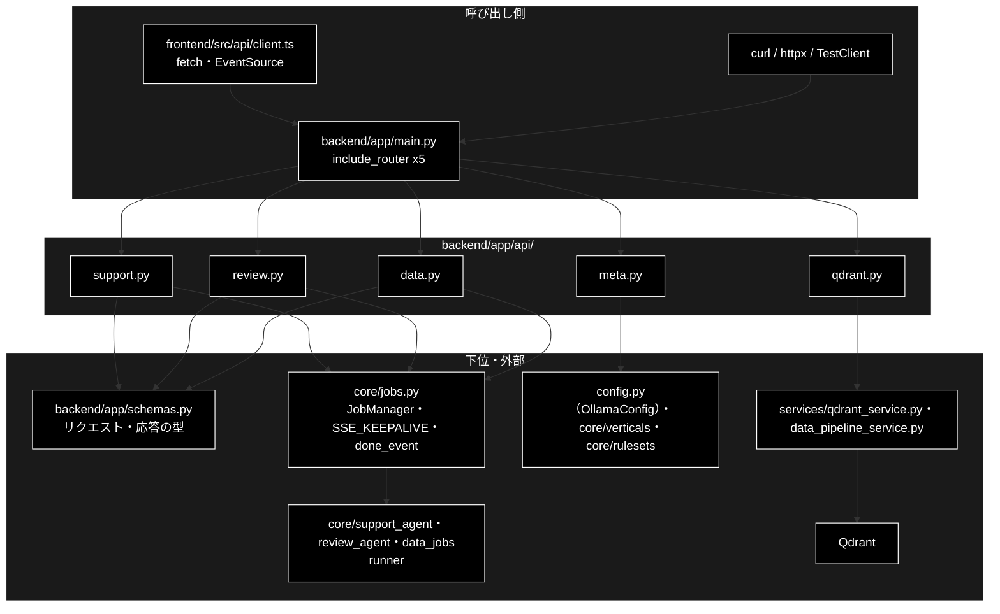

# README_api.md - backend/app/api/ ディレクトリ概要

**Version 1.1** | 最終更新: 2026-10-12

`backend/app/api/` の入口となる文書。FastAPI のルーター 5 本（25 エンドポイント）を置く。各エンドポイントの引数・戻り値は
各モジュールの文書（IPO）に置き、ここには書かない。アプリの組み立ては [`../../docs/README_app.md`](../../docs/README_app.md)、
ジョブ基盤とパイプライン本体は [`../../core/docs/README_core.md`](../../core/docs/README_core.md)。

> ⚠️ **本リポジトリは Ollama 版。** 姉妹リポジトリ `grace_v2`（Anthropic 版）の同名ファイルとは中身が違うので、
> 文書をコピーで持ち込まない（CLAUDE.md §5）。

---

## 目次

- [概要](#概要)
  - [主な責務](#主な責務)
  - [各責務対応のモジュール](#各責務対応のモジュール)
  - [アーキテクチャ構成図](#アーキテクチャ構成図)
- [1. モジュール一覧（索引）](#1-モジュール一覧索引)
- [2. 使い方（代表的なワークフロー）](#2-使い方代表的なワークフロー)
- [3. 公開 API（__init__.py）](#3-公開-api__init__py)
- [4. 処理フロー・データフロー](#4-処理フローデータフロー)
- [5. 既知の制約・残課題](#5-既知の制約残課題)
- [6. 変更履歴](#6-変更履歴)

---

## 概要

`backend/app/api/` は HTTP を受けて `core/` へ渡す**薄い層**である。ジョブを伴う 3 系統（Support / Review / データ準備）は
**同じ形の 4 本**（起動 → `GET /stream/{job_id}`（SSE）→ `POST /confirm/{job_id}`（HITL）→ `GET /result/{job_id}`）を持ち、
違うのはパラメータ型と結果の形だけである。残り 2 本は読み取り専用（メタ情報・Qdrant の参照）。

### 主な責務

- GRACE-Support の問い合わせジョブを受け付け、進捗を SSE で流し、承認と結果を返す
- GRACE-Review の文書レビューのジョブを同じ形で受け付ける
- データ準備（チャンク化 / Q/A 生成 / Qdrant 登録 / 削除）のジョブを同じ形で受け付ける（破壊的な操作は CONFIRM を通す）
- Qdrant の状態・コレクション・入力ファイルを読み取り専用で返す（落ちていても 500 にしない）
- 画面のセレクタとヘッダーが読むメタ情報（モデル・業界プロファイル・ルールセット・ヘルスチェック）を返す

### 各責務対応のモジュール

| # | 責務 | 対応モジュール | 説明 |
|---|------|--------------|------|
| 1 | Support のジョブ | `support.py` | `POST /api/support/query` ほか 4 本。`JobParams` → `core/jobs.py` |
| 2 | Review のジョブ | `review.py` | `POST /api/review/submit` ほか 4 本。`ReviewParams`（`core/review_agent.py`） |
| 3 | データ準備のジョブ | `data.py` | 起動 4 本＋共通の `/api/data/stream`・`confirm`・`result`。削除は常に、登録は `recreate=True` のときだけ承認待ち |
| 4 | Qdrant の参照 | `qdrant.py` | `/api/qdrant/health`・`collections`・`collections/{name}`・`points`・`/api/files`。健康診断は落ちていても 200 |
| 5 | メタ情報 | `meta.py` | `/api/models`・`/api/model`・`/api/verticals`・`/api/rulesets`・`/api/health` |

### アーキテクチャ構成図



**データフロー（要点）**: 起動の `POST` は `schemas.py` で検証して `job_manager.start(params)` を呼び、すぐ `202`（`job_id` / `stream_url`）を返す。
進捗は `job.stream_events()` を `data: {JSON}` の SSE に変換し（keepalive は `SSE_KEEPALIVE`、終端は `done_event()`）、承認は
`job_manager.confirm()` で runner の待ちへ注入する。詳細は §4。

---

## 1. モジュール一覧（索引）

| モジュール | 文書 | 種別 | 行数 | Ver | 概要 |
|---|---|---|---:|---|---|
| `support.py`（90 行） | [`support.md`](support.md) | E | 482 | 1.6 | GRACE-Support のジョブ（4 本） |
| `review.py`（105 行） | [`review.md`](review.md) | E | 578 | 1.6 | GRACE-Review のジョブ（4 本） |
| `data.py`（196 行） | [`data.md`](data.md) | E | 346 | 1.4 | データ準備のジョブ（起動 4 本＋共通 3 本） |
| `qdrant.py`（200 行） | [`qdrant.md`](qdrant.md) | E | 322 | 1.3 | Qdrant の参照（読み取り専用・5 本） |
| `meta.py`（109 行） | [`meta.md`](meta.md) | E | 454 | 1.8 | メタ情報（5 本） |

> 行数は文書の行数（実測）。`__init__.py` は空（§3）。全エンドポイントの一覧・SSE のワイヤ形式・HTTP ステータスの使い分けは §4 にある。

---

## 2. 使い方（代表的なワークフロー）

> 📝 **確かめ方（2026-10-11）**: §2.1 は VM で uvicorn（`:8000`）を起動し、実物の Qdrant に作った空の一時コレクションに対して実行した。
> 各モジュールの例（`TestClient`・uvicorn＋httpx）は、それぞれの文書の §4.1（`data.md` / `qdrant.md` は §3.1）にある。

| やりたいこと | 入口 | 使用例 |
|---|---|---|
| 問い合わせを投げて回答を受け取る（SSE・承認） | `POST /api/support/query` | [`support.md`](support.md) §4.1.1 |
| 文書を投げて指摘を受け取る | `POST /api/review/submit` | [`review.md`](review.md) §4.1.1 |
| チャンク化・Q/A 生成・登録・削除を流す | `POST /api/chunking/run` ほか | §2.1・[`data.md`](data.md) §3.1 |
| Qdrant の状態とコレクションの中身を見る | `GET /api/qdrant/*` | [`qdrant.md`](qdrant.md) §3.1 |
| モデル・業界プロファイル・ルールセットの選択肢を取る | `GET /api/models` ほか | [`meta.md`](meta.md) §4.1 |

### 2.1 受付 → SSE → 承認 → 結果（curl・コレクションの削除）

3 系統とも同じ 4 段で動く。下は承認が必ず入る「コレクションの削除」で、Ollama も Embedding も要らない。

```bash
# 前提: uvicorn backend.app.main:app --port 8000 と Qdrant が起動済み。readme_demo は消してよいコレクション
# 1. 受付（202 + job_id）
JOB=$(curl -s -X POST localhost:8000/api/qdrant/delete \
  -H 'Content-Type: application/json' -d '{"collections": ["readme_demo"]}' | python3 -c 'import json,sys; print(json.load(sys.stdin)["job_id"])')
# 2. SSE（承認待ちで止まるので 2 秒で切る。intervention_id を拾う）
IID=$(curl -sN --max-time 2 localhost:8000/api/data/stream/$JOB | grep '"intervention"' | head -1 \
  | sed 's/^data: //' | python3 -c 'import json,sys; print(json.load(sys.stdin)["data"]["intervention_id"])')
# 3. 承認
curl -s -X POST localhost:8000/api/data/confirm/$JOB -H 'Content-Type: application/json' \
  -d "{\"intervention_id\": \"$IID\", \"approve\": true}"; echo
# 4. 結果（SSE の代わりにポーリングでもよい）
sleep 1; curl -s localhost:8000/api/data/result/$JOB | python3 -c 'import json,sys; r=json.load(sys.stdin); print(r["status"], r["result"]["deleted"])'

# 出力例:
# {"status":"resolved"}
# completed ['readme_demo']
```

> ⚠️ **SSE は承認待ちで止まる**（ジョブが終わるまで接続が開いたまま）。curl では `--max-time` で切り、`intervention_id` を拾ってから
> `confirm` を送る。画面（`EventSource`）は接続を開いたまま承認モーダルを出す。`TestClient` は応答を最後まで溜めるので、
> 承認待ちの SSE はタイムアウト（安全側＝実行しない）まで返らない（[`support.md`](support.md) §4.1.1）。
> 承認しない（`"approve": false`）と `result.cancelled` が `true` で `completed` になる（[`data.md`](data.md) §3.1.2）。

---

## 3. 公開 API（__init__.py）

公開 API なし（`backend/app/api/__init__.py` は空）。各モジュールの `router`（`APIRouter`）を `main.py` が
`from backend.app.api import data, meta, qdrant, review, support` で読んで結線する。

> ⚠️ `review` / `data` の import には副作用がある（`core/review_agent.py` / `core/data_jobs.py` が読まれ、runner が `register_runner()` で登録される）。
> パラメータ型を使う以上この import は必ず起きるので、登録漏れは構造的に起きない。

---

## 4. 処理フロー・データフロー

ジョブの機構（ライフサイクル・リプレイ・runner 注入・HITL・失敗の扱い）は 3 系統で共通で、
[`core/docs/core_process_flow.md`](../../core/docs/core_process_flow.md) §3 にある。ここには **API の外から見える約束**（契約）を書く。

| 経路 | 流れ | 詳細 |
|---|---|---|
| ジョブ（support / review / data） | 起動 `POST` → `job_manager.start(params)` → `202` → `GET stream`（`seq` 0 から全件リプレイ・keepalive・`done`）→ `POST confirm`（`resolved` / `not_waiting` / 404）→ `GET result` | §4.1〜§4.3 |
| 参照（qdrant / meta） | `GET` → `services/qdrant_service.py`・`config.py`・`core/verticals.py`・`core/rulesets.py` を読んで整形して返す（ジョブにしない） | [`qdrant.md`](qdrant.md)・[`meta.md`](meta.md) |

| データ | 形式 | 作る側 | 使う側 |
|---|---|---|---|
| SSE の 1 イベント | `data: {SupportEventModel の JSON}`（`seq` / `ts` / `type` / `step` / `status` / `title` / `message` / `data`）。keepalive は `event: keepalive` | `core/jobs.py`（`Job.emit`） | 画面の `state/streamWatch.ts`・`jobReducer` |
| 終端 | `type: "done"`（`status` / `ts` / `started_at`。`seq` なし） | `core/jobs.py::done_event` | 画面（`EventSource` を閉じる） |
| 結果 | `JobStatusResponse` / `ReviewJobStatusResponse` / `DataJobStatusResponse` | runner の dict を `schemas.py` で検証 | 画面・ポーリング |

### 4.0 エンドポイント一覧

全 25 エンドポイント。ベース URL は `http://localhost:8000`。**認証は無い。**

#### GRACE-Support（`api/support.py`）

| Method | パス | 状態 | 説明 |
|---|---|---:|---|
| POST | `/api/support/query` | 202 | 問い合わせジョブ起動 → `{job_id, stream_url}`。`model` は任意 |
| GET | `/api/support/stream/{job_id}` | 200 | SSE でステップ進捗（0-(A)〜⑥） |
| POST | `/api/support/confirm/{job_id}` | 200 | HITL 応答（承認 / 拒否 / 選択肢） |
| GET | `/api/support/result/{job_id}` | 200 | 状態と `SupportResult`（ポーリング用） |

#### GRACE-Review（`api/review.py`）

| Method | パス | 状態 | 説明 |
|---|---|---:|---|
| POST | `/api/review/submit` | 202 | レビュージョブ起動（文書は最大 `MAX_DOCUMENT_CHARS` = 50,000 字）。`model` は任意 |
| GET | `/api/review/stream/{job_id}` | 200 | SSE でステップ進捗（S1・①〜⑦） |
| POST | `/api/review/confirm/{job_id}` | 200 | HITL 応答 |
| GET | `/api/review/result/{job_id}` | 200 | 状態と `ReviewResult` |

#### データ準備ジョブ（`api/data.py`）

起動は 4 本に分かれるが、**SSE / CONFIRM / 結果取得は 1 組を共用**する。

| Method | パス | 状態 | CONFIRM | 説明 |
|---|---|---:|---|---|
| POST | `/api/chunking/run` | 202 | なし | チャンク化（非破壊） |
| POST | `/api/qa/generate` | 202 | なし | Q/A 生成（非破壊・出力は新規ファイル） |
| POST | `/api/qdrant/register` | 202 | `recreate=true` のときだけ | Q/A CSV を Qdrant へ登録 |
| POST | `/api/qdrant/delete` | 202 | **常に** | コレクション削除 |
| GET | `/api/data/stream/{job_id}` | 200 | — | 4 種共通の SSE |
| POST | `/api/data/confirm/{job_id}` | 200 | — | 4 種共通の HITL 応答 |
| GET | `/api/data/result/{job_id}` | 200 | — | 4 種共通の結果取得 |

#### Qdrant 参照系（`api/qdrant.py`）— 読み取り専用

| Method | パス | 状態 | 説明 |
|---|---|---:|---|
| GET | `/api/qdrant/health` | **200 固定** | 稼働確認（落ちていても 200・本文の `available` で判定） |
| GET | `/api/qdrant/collections` | 200 / 503 | コレクション一覧 |
| GET | `/api/qdrant/collections/{name}` | 200 / 404 / 503 | コレクション詳細 |
| GET | `/api/qdrant/collections/{name}/points` | 200 / 404 / 503 | ポイントのプレビュー（`limit` 1〜500・既定 50） |
| GET | `/api/files` | 200 / 400 | 入力ファイル候補（許可ディレクトリのみ・絶対パスは返さない） |

#### メタ情報（`api/meta.py`）

| Method | パス | 状態 | 説明 |
|---|---|---:|---|
| GET | `/api/models` | 200 | **モデルセレクタの選択肢**（`id` / `supports_tool_calls` / `notes`）。`get_selectable_ollama_models()` で絞り込み済み |
| GET | `/api/model` | 200 | **現在の利用モデル**（`provider` / `model` / `light_model` / `heavy_model`）。`get_config().llm` の**解決済みの値**を返す |
| GET | `/api/verticals` | 200 | 業界プロファイル一覧（gov / saas / ec） |
| GET | `/api/rulesets` | 200 | ルールセット一覧（**ルール本文は返さない**） |
| GET | `/api/health` | 200 | 稼働確認と `GOOGLE_API_KEY` の有無（**LLM 用のキーは無い**） |

> ⚠️ **`GET /api/model` に表示用の固定文字列を返さないこと。**
> `config/grace_config.yml` や環境変数（`OLLAMA_DEFAULT_MODEL` / `GRACE_LLM_MODEL`）で
> 上書きされうるため、解決済みの値を返さないと**画面の表示と実挙動がずれる**。

#### モデル選択の契約（詳細は [`README_app.md`](../../docs/README_app.md) §4.3）

- 選択肢は `config.py::get_selectable_ollama_models()` の 1 か所で決まる（`ModelConfig.AVAILABLE_MODELS` から tool calling 非対応を除いたもの）
- `QueryRequest.model` / `ReviewRequest.model` / `ChunkingRequest.model` / `QaGenerationRequest.model` はどれも**省略可**。
  `null` / 省略（データ準備の 2 つは空文字も）=「サーバーの既定値を使う」。既定はスキーマに焼き付けず、
  データ準備は `core/data_jobs.py::_resolve_model()` の 1 か所で解決する（`GET /api/model` と同じ値になる）
- 選択肢に無いモデル名は **422**。Ollama へそのまま投げると、ジョブが起動してから実行時に失敗して原因が分かりにくいため、受付時に弾く
- ⚠️ **Embedding はこの契約の外。** `RegisterRequest.provider` は `gemini` 固定で、`/api/models` にも出てこない（次元が変わると Qdrant の再作成が要る）

### 4.1 非同期ジョブの 3 点セットと SSE のワイヤ形式

Support / Review / データ準備は**同じ 3 点セット**で動く。

```
POST   …/query|submit|run     → 202 {job_id, stream_url}
GET    {stream_url}           → SSE（進捗・介入・結果・done 番兵）
POST   …/confirm/{job_id}     → HITL 応答（必要なときだけ）
GET    …/result/{job_id}      → ポーリング用フォールバック
```

`stream_url` は**サーバが返す**（クライアントで組み立てない。系統ごとに `/api/support/stream/…` `/api/review/stream/…` `/api/data/stream/…` と違う）。
SSE の形式は 3 系統で**完全に同一**で、画面は同じパーサ（`frontend/src/api/client.ts::subscribeStream`）を使う。

```
data: {"seq":0,"ts":1758000000.0,"type":"step","step":"plan","status":"started", ...}

event: keepalive
data: {}

data: {"type":"done","status":"completed","ts":...,"started_at":...}
```

| 約束 | 内容 |
|---|---|
| イベント名 | 進捗イベントには**付けない**（`event:` 行を出さない。`onmessage` で受ける）。種別は JSON の `type`（`step` / `log` / `intervention` / `result` / `error`、終端の `done`）。名前付きは keepalive だけ |
| メッセージ | `data: ` + `SupportEventModel` の JSON 1 行（`ensure_ascii=False`） |
| keepalive | `event: keepalive` + `data: {}` の**名前付きイベント**（15 秒新イベントが無いとき。`jobs.py::SSE_KEEPALIVE`）。⚠️ **コメント行（`: keepalive`）に戻さない** — `EventSource` はコメントを捨てるので JS から見えず、画面が黙って止まった接続を検知できない（`test_sse_keepalive.py`） |
| 終端 | `type:"done"` の番兵 1 通。失敗しても必ず送る（`status` に `failed`） |
| リプレイ | **常に seq=0 から**配信する。画面は張り直したとき、渡し済みの `seq` 以下を読み飛ばす |
| ヘッダ | `Cache-Control: no-cache` / `X-Accel-Buffering: no` |

| 系統 | ステップ ID の定数 | 値（実行順） |
|---|---|---|
| Support | `STEP_IDS` | `analyze` `profile` `plan` `execute` `confidence` `gate` `web` `no_info` `action` |
| Review | `REVIEW_STEP_IDS` | `ruleset` `segment` `retrieve` `detect` `ground` `suppress` `web` `severity` `action` |
| チャンク化 / Q/A 生成 / 登録 / 削除 | `CHUNKING_STEP_IDS` / `QA_STEP_IDS` / `REGISTER_STEP_IDS` / `DELETE_STEP_IDS` | `load chunk save` / `load generate coverage save` / `prepare confirm embed upsert` / `inspect confirm delete` |

> ⚠️ **ステップ ID の並びは実行順であって、CLAUDE.md の番号（①〜⑦）とは一致しない。** Support の `no_info`（④'）は `web`（⑤）の後、
> Review の `severity`（⑤）は `web`（⑥）の後に来る。表示順は定数の定義順に合わせる。

### 4.2 HITL CONFIRM の往復

```
SSE  → {"type":"intervention","status":"waiting","data":{"intervention_id":"...","timeout_seconds":300, ...}}
POST → /api/{support|review|data}/confirm/{job_id}
       {"intervention_id":"...","approve":true,"selected_option":null}
SSE  → {"type":"intervention","status":"resolved","data":{"action":"proceed"}}
```

| `ConfirmResponse.status` | 意味 | HTTP |
|---|---|---|
| `resolved` | 応答を注入できた | 200 |
| `not_waiting` | その `intervention_id` は待機中でない（タイムアウト済み・ID 違い） | **200**（エラーにしない。タイムアウト済みの応答は異常ではない） |
| `not_found` | ジョブが存在しない | 404 |

無応答のまま `timeout_seconds` を過ぎると `status:"timeout"` が流れ、**アクションは実行されない**（安全側）。`selected_option` は選択肢つきの介入
（0-(A) 主質問の選択）でのみ使う。

### 4.3 HTTP ステータスの使い分け

| ステータス | 使う場面 |
|---|---|
| **200** | 参照系・SSE・CONFIRM 応答（`not_waiting` を含む） |
| **202** | ジョブ起動（実処理はワーカースレッドへ委ねる） |
| **400** | 許可ディレクトリ外の指定（`GET /api/files`） |
| **404** | ジョブ ID が無い / コレクションが無い |
| **422** | Pydantic のバリデーション違反（文書長の超過・**選択肢に無いモデル名**など。FastAPI が自動で返す） |
| **503** | Qdrant へ接続できない（**参照系のみ**） |

> ⚠️ **`/api/qdrant/health` だけは Qdrant が落ちていても 200** で、本文の `available: false` と理由で伝える。503 にすると、画面で
> 「通信エラー」と「Qdrant を起動してください」を出し分けられなくなる。一覧・詳細は Qdrant が必須なので 503 を返す。
>
> 📌 `api/review.py` が `api/support.py` とほぼ同じなのは**意図的な対称性**である。共通化するとジョブ種別の差が読めなくなる。

### 4.4 スキーマ ↔ `types.ts` 対応表

`backend/app/schemas.py` の Pydantic モデルと `frontend/src/types.ts` の対応。**片方だけ変えると frontend ゲート（`tsc`）で落ちる。**
応答モデルに無いキーは黙って落ちるので、runner の戻り値に項目を足したら両方に足す（[`schemas.md`](../../docs/schemas.md)）。

| backend（`schemas.py`） | frontend（`types.ts`） | 使う画面 |
|---|---|---|
| `QueryRequest` / `SupportResultModel`（`model_used` を含む） | `QueryParams` / `SupportResult` | SupportPanel |
| `SupportEventModel` | `SupportEvent` | 全パネル（SSE 共通） |
| `VerticalInfo` | `VerticalInfo` | SupportPanel（プロファイル選択） |
| `ReviewRequest` / `ReviewResultModel` / `ReviewFindingModel` / `SegmentModel` / `FindingSummaryModel` | `ReviewParams` / `ReviewResult` / `ReviewFinding` / `Segment` / `FindingSummary` | ReviewPanel |
| `RuleSetInfo` | `RuleSetInfo` | ReviewPanel（ルールセット選択） |
| `ModelChoice` / `ModelInfo` | `ModelChoice` / `ModelInfo` | ヘッダーのモデルセレクタ |
| `QdrantHealth` / `CollectionInfo` / `CollectionDetail` / `CollectionPoints` | 同名 | CollectionPanel |
| `InputFileInfo` / `InputFileListResponse` | 同名 | DataJobPanel（入力選択） |
| `ChunkingRequest` / `QaGenerationRequest` / `RegisterRequest` | `ChunkingParams` / `QaParams` / `RegisterParams` | DataJobPanel |
| `DataJobStatusResponse` | `DataJobStatusResponse` / `DataJobResult` / `DataJobKind` | DataJobPanel / CollectionPanel |
| `ConfirmRequest` / `ConfirmResponse` | `InterventionInfo` 経由 | ConfirmModal / QuestionSelectModal |

---

## 5. 既知の制約・残課題

| # | 内容 | 詳細 |
|---|------|------|
| 1 | **入力ファイルの誤りは 400 ではなく、ジョブの失敗で返る**（`POST /api/chunking/run` 等は常に 202。検証は runner 側）。`schemas.py` のコメント「許可ディレクトリ外は 400」は実装と食い違う | [`data.md`](data.md) §3.1.1・[`README_app.md`](../../docs/README_app.md) §5 |
| 2 | ジョブはインメモリ（`JobManager`）。プロセスを再起動すると消え、完了ジョブは 50 件を超えると古いものから消える（404 になる） | [`core/docs/jobs.md`](../../core/docs/jobs.md)・[`core_process_flow.md`](../../core/docs/core_process_flow.md) §3.3 |
| 3 | `/api/qdrant/collections` は Qdrant が落ちていると空配列を返す（0 件と区別できない）。先に `/api/qdrant/health` を見る | [`qdrant.md`](qdrant.md) §3.1.1 |
| 4 | 承認待ちのある SSE は `TestClient` で読めない（応答を溜める）。テスト・例は uvicorn＋httpx か、`job_manager.confirm()` を直接呼ぶ | [`support.md`](support.md) §4.1.1 |

### 5.1 テスト件数

2026-10-11 に `pytest` で実行した値（Ollama・Qdrant 不要。`OLLAMA_DEFAULT_MODEL` を外して実行）:

| テストファイル | 件数 | 対象 |
|---|---:|---|
| `tests/test_review_api.py` | 21 | `review.py`（起動・SSE・HITL・結果・エラー応答） |
| `tests/test_sse_keepalive.py` | 5 | 3 つの SSE ストリームの keepalive（名前付きイベント） |
| `tests/test_data_jobs.py` | 57 | `data.py` と `core/data_jobs.py`（パラメータ・承認の要否・runner） |

```bash
PYTHONPATH=. .venv/bin/python -m pytest tests/test_review_api.py tests/test_sse_keepalive.py tests/test_data_jobs.py -q
# 2026-10-11 実測: 83 passed
```

> `support.py` / `meta.py` は `tests/test_api.py`（11 件）と `tests/test_model_info_api.py`（15 件）が `main.py` 経由で通す（[`README_app.md`](../../docs/README_app.md) §5.1）。

---

## 6. 変更履歴

| バージョン | 日付 | 変更内容 |
|---|---|---|
| 1.0 | 2026-10-11 | 新規作成（`a_cross_doc_md_format.md` §1.1.2・§1.2）。`backend/docs/reference/api_*.md` の 5 本を本ディレクトリへ移し（接頭辞を外した）、索引・使い方・既知の制約をまとめた。§2.1 は uvicorn と実物の Qdrant で確かめた |
| 1.1 | 2026-10-12 | backend/docs/ の廃止にあわせ §4 を書き直した（§4.0 エンドポイント一覧とモデル選択の契約・§4.1 3 点セットと SSE・§4.2 HITL・§4.3 HTTP ステータス・§4.4 schemas と types.ts の対応。旧 api_contract.md から移した） |
