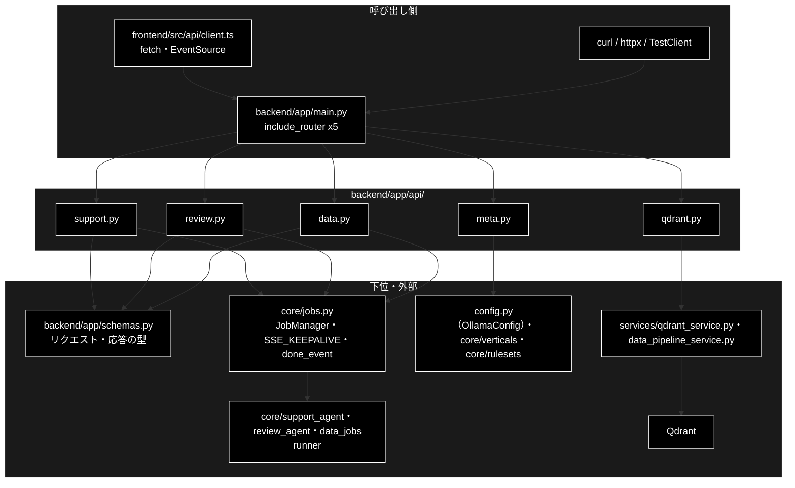

# README_api.md - backend/app/api/ ディレクトリ概要

**Version 1.0** | 最終更新: 2026-10-11

`backend/app/api/` の入口となる文書。FastAPI のルーター 5 本（25 エンドポイント）を置く。各エンドポイントの引数・戻り値は
各モジュールの文書（IPO）に置き、ここには書かない。アプリの組み立ては [`../../docs/README_app.md`](../../docs/README_app.md)、
ジョブ基盤とパイプライン本体は [`../../core/docs/README_core.md`](../../core/docs/README_core.md)。

> ⚠️ **本リポジトリは Ollama 版。** 姉妹リポジトリ `grace_v2`（Anthropic 版）の同名ファイルとは中身が違うので、
> 文書をコピーで持ち込まない（CLAUDE.md §5）。

---

## 目次

- [概要](#概要)
  - [主な責務](#主な責務)
  - [各責務対応のモジュール](#各責務対応のモジュール)
  - [アーキテクチャ構成図](#アーキテクチャ構成図)
- [1. モジュール一覧（索引）](#1-モジュール一覧索引)
- [2. 使い方（代表的なワークフロー）](#2-使い方代表的なワークフロー)
- [3. 公開 API（__init__.py）](#3-公開-api__init__py)
- [4. 処理フロー・データフロー](#4-処理フローデータフロー)
- [5. 既知の制約・残課題](#5-既知の制約残課題)
- [6. 変更履歴](#6-変更履歴)

---

## 概要

`backend/app/api/` は HTTP を受けて `core/` へ渡す**薄い層**である。ジョブを伴う 3 系統（Support / Review / データ準備）は
**同じ形の 4 本**（起動 → `GET /stream/{job_id}`（SSE）→ `POST /confirm/{job_id}`（HITL）→ `GET /result/{job_id}`）を持ち、
違うのはパラメータ型と結果の形だけである。残り 2 本は読み取り専用（メタ情報・Qdrant の参照）。

### 主な責務

- GRACE-Support の問い合わせジョブを受け付け、進捗を SSE で流し、承認と結果を返す
- GRACE-Review の文書レビューのジョブを同じ形で受け付ける
- データ準備（チャンク化 / Q/A 生成 / Qdrant 登録 / 削除）のジョブを同じ形で受け付ける（破壊的な操作は CONFIRM を通す）
- Qdrant の状態・コレクション・入力ファイルを読み取り専用で返す（落ちていても 500 にしない）
- 画面のセレクタとヘッダーが読むメタ情報（モデル・業界プロファイル・ルールセット・ヘルスチェック）を返す

### 各責務対応のモジュール

| # | 責務 | 対応モジュール | 説明 |
|---|------|--------------|------|
| 1 | Support のジョブ | `support.py` | `POST /api/support/query` ほか 4 本。`JobParams` → `core/jobs.py` |
| 2 | Review のジョブ | `review.py` | `POST /api/review/submit` ほか 4 本。`ReviewParams`（`core/review_agent.py`） |
| 3 | データ準備のジョブ | `data.py` | 起動 4 本＋共通の `/api/data/stream`・`confirm`・`result`。削除は常に、登録は `recreate=True` のときだけ承認待ち |
| 4 | Qdrant の参照 | `qdrant.py` | `/api/qdrant/health`・`collections`・`collections/{name}`・`points`・`/api/files`。健康診断は落ちていても 200 |
| 5 | メタ情報 | `meta.py` | `/api/models`・`/api/model`・`/api/verticals`・`/api/rulesets`・`/api/health` |

### アーキテクチャ構成図



**データフロー（要点）**: 起動の `POST` は `schemas.py` で検証して `job_manager.start(params)` を呼び、すぐ `202`（`job_id` / `stream_url`）を返す。
進捗は `job.stream_events()` を `data: {JSON}` の SSE に変換し（keepalive は `SSE_KEEPALIVE`、終端は `done_event()`）、承認は
`job_manager.confirm()` で runner の待ちへ注入する。詳細は §4。

---

## 1. モジュール一覧（索引）

| モジュール | 文書 | 種別 | 行数 | Ver | 概要 |
|---|---|---|---:|---|---|
| `support.py`（90 行） | [`support.md`](support.md) | E | 481 | 1.5 | GRACE-Support のジョブ（4 本） |
| `review.py`（105 行） | [`review.md`](review.md) | E | 577 | 1.5 | GRACE-Review のジョブ（4 本） |
| `data.py`（196 行） | [`data.md`](data.md) | E | 345 | 1.3 | データ準備のジョブ（起動 4 本＋共通 3 本） |
| `qdrant.py`（200 行） | [`qdrant.md`](qdrant.md) | E | 321 | 1.2 | Qdrant の参照（読み取り専用・5 本） |
| `meta.py`（109 行） | [`meta.md`](meta.md) | E | 453 | 1.7 | メタ情報（5 本） |

> 行数は文書の行数（実測）。`__init__.py` は空（§3）。全エンドポイントの一覧・SSE のワイヤ形式・HTTP ステータスの使い分けは
> [`backend/docs/api_contract.md`](../../../docs/api_contract.md) が正本。

---

## 2. 使い方（代表的なワークフロー）

> 📝 **確かめ方（2026-10-11）**: §2.1 は VM で uvicorn（`:8000`）を起動し、実物の Qdrant に作った空の一時コレクションに対して実行した。
> 各モジュールの例（`TestClient`・uvicorn＋httpx）は、それぞれの文書の §4.1（`data.md` / `qdrant.md` は §3.1）にある。

| やりたいこと | 入口 | 使用例 |
|---|---|---|
| 問い合わせを投げて回答を受け取る（SSE・承認） | `POST /api/support/query` | [`support.md`](support.md) §4.1.1 |
| 文書を投げて指摘を受け取る | `POST /api/review/submit` | [`review.md`](review.md) §4.1.1 |
| チャンク化・Q/A 生成・登録・削除を流す | `POST /api/chunking/run` ほか | §2.1・[`data.md`](data.md) §3.1 |
| Qdrant の状態とコレクションの中身を見る | `GET /api/qdrant/*` | [`qdrant.md`](qdrant.md) §3.1 |
| モデル・業界プロファイル・ルールセットの選択肢を取る | `GET /api/models` ほか | [`meta.md`](meta.md) §4.1 |

### 2.1 受付 → SSE → 承認 → 結果（curl・コレクションの削除）

3 系統とも同じ 4 段で動く。下は承認が必ず入る「コレクションの削除」で、Ollama も Embedding も要らない。

```bash
# 前提: uvicorn backend.app.main:app --port 8000 と Qdrant が起動済み。readme_demo は消してよいコレクション
# 1. 受付（202 + job_id）
JOB=$(curl -s -X POST localhost:8000/api/qdrant/delete \
  -H 'Content-Type: application/json' -d '{"collections": ["readme_demo"]}' | python3 -c 'import json,sys; print(json.load(sys.stdin)["job_id"])')
# 2. SSE（承認待ちで止まるので 2 秒で切る。intervention_id を拾う）
IID=$(curl -sN --max-time 2 localhost:8000/api/data/stream/$JOB | grep '"intervention"' | head -1 \
  | sed 's/^data: //' | python3 -c 'import json,sys; print(json.load(sys.stdin)["data"]["intervention_id"])')
# 3. 承認
curl -s -X POST localhost:8000/api/data/confirm/$JOB -H 'Content-Type: application/json' \
  -d "{\"intervention_id\": \"$IID\", \"approve\": true}"; echo
# 4. 結果（SSE の代わりにポーリングでもよい）
sleep 1; curl -s localhost:8000/api/data/result/$JOB | python3 -c 'import json,sys; r=json.load(sys.stdin); print(r["status"], r["result"]["deleted"])'

# 出力例:
# {"status":"resolved"}
# completed ['readme_demo']
```

> ⚠️ **SSE は承認待ちで止まる**（ジョブが終わるまで接続が開いたまま）。curl では `--max-time` で切り、`intervention_id` を拾ってから
> `confirm` を送る。画面（`EventSource`）は接続を開いたまま承認モーダルを出す。`TestClient` は応答を最後まで溜めるので、
> 承認待ちの SSE はタイムアウト（安全側＝実行しない）まで返らない（[`support.md`](support.md) §4.1.1）。
> 承認しない（`"approve": false`）と `result.cancelled` が `true` で `completed` になる（[`data.md`](data.md) §3.1.2）。

---

## 3. 公開 API（__init__.py）

公開 API なし（`backend/app/api/__init__.py` は空）。各モジュールの `router`（`APIRouter`）を `main.py` が
`from backend.app.api import data, meta, qdrant, review, support` で読んで結線する。

> ⚠️ `review` / `data` の import には副作用がある（`core/review_agent.py` / `core/data_jobs.py` が読まれ、runner が `register_runner()` で登録される）。
> パラメータ型を使う以上この import は必ず起きるので、登録漏れは構造的に起きない。

---

## 4. 処理フロー・データフロー

ジョブの機構（ライフサイクル・リプレイ・runner 注入・HITL・ログ転送）は 3 系統で共通で、[`backend/docs/job_runtime.md`](../../../docs/job_runtime.md) が正本。
このディレクトリ固有の流れは次の 2 つだけである。

| 経路 | 流れ | 正本 |
|---|---|---|
| ジョブ（support / review / data） | 起動 `POST` → `job_manager.start(params)` → `202` → `GET stream`（`seq` 0 から全件リプレイ・keepalive・`done`）→ `POST confirm`（`resolved` / `not_waiting` / 404）→ `GET result` | [`api_contract.md`](../../../docs/api_contract.md) §1〜§4 |
| 参照（qdrant / meta） | `GET` → `services/qdrant_service.py`・`config.py`・`core/verticals.py`・`core/rulesets.py` を読んで整形して返す（ジョブにしない） | [`qdrant.md`](qdrant.md)・[`meta.md`](meta.md) |

| データ | 形式 | 作る側 | 使う側 |
|---|---|---|---|
| SSE の 1 イベント | `data: {SupportEventModel の JSON}`（`seq` / `ts` / `type` / `step` / `status` / `title` / `message` / `data`）。keepalive は `event: keepalive` | `core/jobs.py`（`Job.emit`） | 画面の `state/streamWatch.ts`・`jobReducer` |
| 終端 | `type: "done"`（`status` / `ts` / `started_at`。`seq` なし） | `core/jobs.py::done_event` | 画面（`EventSource` を閉じる） |
| 結果 | `JobStatusResponse` / `ReviewJobStatusResponse` / `DataJobStatusResponse` | runner の dict を `schemas.py` で検証 | 画面・ポーリング |

---

## 5. 既知の制約・残課題

| # | 内容 | 詳細 |
|---|------|------|
| 1 | **入力ファイルの誤りは 400 ではなく、ジョブの失敗で返る**（`POST /api/chunking/run` 等は常に 202。検証は runner 側）。`schemas.py` のコメント「許可ディレクトリ外は 400」は実装と食い違う | [`data.md`](data.md) §3.1.1・[`README_app.md`](../../docs/README_app.md) §5 |
| 2 | ジョブはインメモリ（`JobManager`）。プロセスを再起動すると消え、完了ジョブは 50 件を超えると古いものから消える（404 になる） | [`core/docs/jobs.md`](../../core/docs/jobs.md) |
| 3 | `/api/qdrant/collections` は Qdrant が落ちていると空配列を返す（0 件と区別できない）。先に `/api/qdrant/health` を見る | [`qdrant.md`](qdrant.md) §3.1.1 |
| 4 | 承認待ちのある SSE は `TestClient` で読めない（応答を溜める）。テスト・例は uvicorn＋httpx か、`job_manager.confirm()` を直接呼ぶ | [`support.md`](support.md) §4.1.1 |

### 5.1 テスト件数

2026-10-11 に `pytest` で実行した値（Ollama・Qdrant 不要。`OLLAMA_DEFAULT_MODEL` を外して実行）:

| テストファイル | 件数 | 対象 |
|---|---:|---|
| `tests/test_review_api.py` | 21 | `review.py`（起動・SSE・HITL・結果・エラー応答） |
| `tests/test_sse_keepalive.py` | 5 | 3 つの SSE ストリームの keepalive（名前付きイベント） |
| `tests/test_data_jobs.py` | 57 | `data.py` と `core/data_jobs.py`（パラメータ・承認の要否・runner） |

```bash
PYTHONPATH=. .venv/bin/python -m pytest tests/test_review_api.py tests/test_sse_keepalive.py tests/test_data_jobs.py -q
# 2026-10-11 実測: 83 passed
```

> `support.py` / `meta.py` は `tests/test_api.py`（11 件）と `tests/test_model_info_api.py`（15 件）が `main.py` 経由で通す（[`README_app.md`](../../docs/README_app.md) §5.1）。

---

## 6. 変更履歴

| バージョン | 日付 | 変更内容 |
|---|---|---|
| 1.0 | 2026-10-11 | 新規作成（`a_cross_doc_md_format.md` §1.1.2・§1.2）。`backend/docs/reference/api_*.md` の 5 本を本ディレクトリへ移し（接頭辞を外した）、索引・使い方・既知の制約をまとめた。§2.1 は uvicorn と実物の Qdrant で確かめた |
