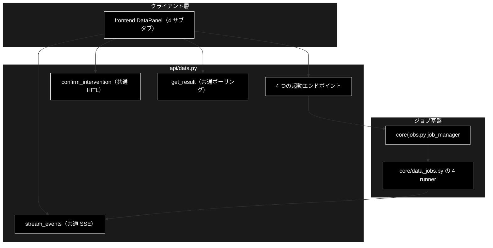
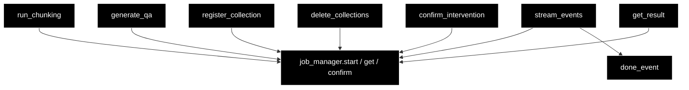

# api/data.py - データ準備ジョブ API ドキュメント

**Version 1.6** | 最終更新: 2026-10-14

> **本書の位置づけ**: `backend/app/api/data.py`（データ準備 4 ジョブの起動と共通 SSE / HITL）の **IPO リファレンス**。
> 引くための文書であり、**設計の「なぜ」と処理の流れは上位の文書が正本**である。
>
> | 知りたいこと | 参照先 |
> |---|---|
> | エンドポイント一覧と CONFIRM の要否 | [`README_backend_api.md` §4.0](README_backend_api.md) |
> | パイプラインの中身 | [`data_jobs.md`](../../core/docs/data_jobs.md) |
> | ジョブ基盤・SSE・HITL の機構 | [`core_process_flow.md` §3](../../core/docs/core_process_flow.md) |
> | runner の実装 | [`core/docs/data_jobs.md`](../../core/docs/data_jobs.md) |
> | 文書全体の地図 | [`README_backend_app.md`](../../docs/README_backend_app.md) |

---

## 目次

1. [概要](#概要)
2. [アーキテクチャ構成図](#1-アーキテクチャ構成図)
3. [モジュール構成図](#2-モジュール構成図)
4. [関数一覧表](#3-関数一覧表)
5. [関数 IPO詳細](#4-関数-ipo詳細)
6. [設定・定数](#5-設定定数)
7. [落とし穴](#6-落とし穴)
8. [変更履歴](#7-変更履歴)

---

## 概要

`backend/app/api/data.py`（197 行）は、データ準備パイプラインの 4 ジョブを起動し、
**進捗の SSE・HITL 応答・結果取得を 1 組で共用**する薄い層である。

`api/support.py` `api/review.py` と**構造は同一**で、違うのはジョブのパラメータ型と結果の形だけ。
ジョブ基盤・SSE・HITL ブリッジは `core/jobs.py` をそのまま使う。

### 主な責務

- 4 種のリクエスト（`ChunkingRequest` / `QaGenerationRequest` / `RegisterRequest` / `DeleteCollectionsRequest`）を params へ詰め替えてジョブを起動する
- 4 種で**共通**の SSE（`/api/data/stream/{job_id}`）・HITL 応答（`/api/data/confirm/{job_id}`）・結果取得（`/api/data/result/{job_id}`）を提供する

### 各責務対応のモジュール

| # | 責務 | 対応モジュール | 説明 |
|---|------|--------------|------|
| 1 | 4 種のリクエストを params へ詰め替えてジョブを起動する | `backend/app/api/data.py::run_chunking` / `generate_qa` / `register_collection` / `delete_collections` → `backend/app/core/jobs.py` | リクエストの型は `backend/app/schemas.py`、params の定義と実処理は `backend/app/core/data_jobs.py`。`job_manager.start(...)` が params の型から runner を引く |
| 2 | 4 種で共通の SSE・HITL 応答・結果取得を提供する | `backend/app/api/data.py::stream_events` / `confirm_intervention` / `get_result` → `backend/app/core/jobs.py` | SSE のイベント列はジョブ基盤、HITL 承認の橋渡しは `backend/app/core/intervention_bridge.py`。結果は `DataJobStatusResponse`（`schemas.py`）。ジョブが無ければ 404 |

### 主要機能一覧

| エンドポイント | 関数 | CONFIRM |
|---|---|---|
| `POST /api/chunking/run` | `run_chunking()` | なし（非破壊） |
| `POST /api/qa/generate` | `generate_qa()` | なし（非破壊） |
| `POST /api/qdrant/register` | `register_collection()` | `recreate=True` のときだけ |
| `POST /api/qdrant/delete` | `delete_collections()` | **常に** |
| `GET /api/data/stream/{job_id}` | `stream_events()` | — |
| `POST /api/data/confirm/{job_id}` | `confirm_intervention()` | — |
| `GET /api/data/result/{job_id}` | `get_result()` | — |

---

## 1. アーキテクチャ構成図

### 1.1 システム全体構成



### 1.2 データフロー

1. `POST` が対応する params を作り `job_manager.start(params)`（型から runner が解決される）
2. **202** と `{job_id, stream_url}` を即返す（`stream_url` は 4 種とも `/api/data/stream/{job_id}`）
3. フロントが SSE を購読し、`step` / `log` / `intervention` / `result` を受け取る
4. CONFIRM が出たら `POST /api/data/confirm/{job_id}` で応答を注入する
5. 終端の `done` 番兵で `EventSource` を閉じる

---

## 2. モジュール構成図



### 2.2 外部依存関係

| 依存 | 用途 |
|---|---|
| `backend.app.core.data_jobs`（4 params） | **import に副作用**: `register_runner()` が 4 件走る |
| `backend.app.core.jobs`（`job_manager` / `done_event`） | ジョブ起動・イベント列・終端番兵 |
| `backend.app.schemas` | リクエスト / レスポンスの Pydantic モデル |
| `fastapi` / `fastapi.responses.StreamingResponse` | ルータと SSE |

---

## 3. 関数一覧表

| 関数 | シグネチャ | 戻り |
|---|---|---|
| `run_chunking` | `(request: ChunkingRequest) -> QueryAccepted` | 202 |
| `generate_qa` | `(request: QaGenerationRequest) -> QueryAccepted` | 202 |
| `register_collection` | `(request: RegisterRequest) -> QueryAccepted` | 202 |
| `delete_collections` | `(request: DeleteCollectionsRequest) -> QueryAccepted` | 202 |
| `stream_events` | `(job_id: str) -> StreamingResponse` | SSE（404 あり） |
| `confirm_intervention` | `(job_id: str, request: ConfirmRequest) -> ConfirmResponse` | 200 / 404 |
| `get_result` | `(job_id: str) -> DataJobStatusResponse` | 200 / 404 |

---

## 4. 関数 IPO詳細

### 4.1 使用例

| # | パターン | いつ使うか | 例 |
|---|---------|-----------|----|
| 1 | **基本**: 入力ファイルの確認 → ジョブ起動 → SSE → 結果 | 非破壊のジョブ（チャンク化・Q/A 生成）を動かす | 4.1.1 |
| 2 | 破壊的な操作は CONFIRM を通る（拒否 → 承認） | 削除・`recreate=True` の登録 | 4.1.2 |

> 📝 **確かめ方（2026-10-11）**: どちらも `PYTHONPATH=. python3 <例>.py` で実行した。4.1.1 は LLM（Ollama）を呼ぶ手前で失敗する入力にしてある。
> 4.1.2 は VM の実物の Qdrant（`docker compose` で起動）に 4 次元の一時コレクションを作り、本物の削除ジョブで消した。

#### 4.1.1 基本: 入力ファイルの確認 → ジョブ起動 → SSE → 結果

```python
import json
from fastapi.testclient import TestClient
from backend.app.main import app

c = TestClient(app)

# 1. 入力候補を見る（許可ディレクトリの中だけ。?dir= で切り替える）
files = c.get("/api/files", params={"dir": "OUTPUT"}).json()
print(files["allowed_dirs"], [f["path"] for f in files["files"]][:2])

# 2. ジョブを起動する（入力の検証は runner 側。ここでは常に 202 + job_id）
r = c.post("/api/chunking/run", json={"input_file": "../etc/passwd"})
print(r.status_code, r.json()["stream_url"].rsplit("/", 1)[0])
job_id = r.json()["job_id"]

# 3. SSE を読む（承認待ちの無いジョブなら TestClient でも最後まで読める）
with c.stream("GET", f"/api/data/stream/{job_id}") as s:
    for line in s.iter_lines():
        if line.startswith("data: "):
            ev = json.loads(line[6:])
            print(ev["type"], ev.get("status"), ev.get("message", "")[:60])

# 4. 結果を取る
res = c.get(f"/api/data/result/{job_id}").json()
print(res["status"], res["kind"], res["result"])

# 実行結果（入力パスの検証で止まる）:
# ['OUTPUT', 'output_chunked', 'qa_output', 'datasets'] ['OUTPUT/cc_news_2ken.csv', 'OUTPUT/cc_news_2per_768.csv']
# 202 /api/data/stream
# step started
# error None ❌ 入力ファイルを開けません: 入力パスは 'ディレクトリ名/ファイル名' の形式で指定してください: '../etc/
# done failed
# failed chunking None
```

> ⚠️ **入力ファイルの誤りは 400 ではなく、ジョブの失敗（`error` イベント → `status: failed`）で返る。** 検証は runner（`core/data_jobs.py`）が行い、
> 4 種の API を同じ形（常に 202）にそろえている。許可ディレクトリの外・`../` を含む指定は `services/data_pipeline_service.py` のホワイトリストで弾く。
> 実際にチャンク化まで進めると Ollama を呼ぶ（`ollama serve` とモデルの pull が要る）。画面から流す手順は [`data_jobs.md` §5.3](../../core/docs/data_jobs.md)。

#### 4.1.2 破壊的操作は CONFIRM を通る

削除は常に、登録は `recreate=True` のときだけ承認待ちになる。承認しなければ（拒否・タイムアウト）実行しない。

> ⚠️ **承認待ちになるジョブの SSE は本物のサーバで読む。** `TestClient` は応答を最後まで溜めてから返すので、承認を送れないまま
> タイムアウト（安全側＝実行しない）まで待つことになる（[`support.md` §4.1.1](support.md#41-使用例)）。

```python
import json, threading, time

import httpx
import uvicorn
from qdrant_client import QdrantClient
from qdrant_client.models import Distance, VectorParams

from backend.app.main import app

# 例のための一時コレクション（4 次元・空）
q = QdrantClient(url="http://localhost:6333")
q.create_collection("datadoc_demo", vectors_config=VectorParams(size=4, distance=Distance.COSINE))

# SSE を逐次読むため本物のサーバで起動する（TestClient は応答を溜めてから返す）
server = uvicorn.Server(uvicorn.Config(app, port=8768, log_level="warning"))
threading.Thread(target=server.run, daemon=True).start()
while not server.started:
    time.sleep(0.05)


def delete(c, approve):
    """削除ジョブを起動し、承認待ちが来たら approve を返して、結果を返す。"""
    job_id = c.post("/api/qdrant/delete", json={"collections": ["datadoc_demo"]}).json()["job_id"]
    with c.stream("GET", f"/api/data/stream/{job_id}") as s:
        for line in s.iter_lines():
            if not line.startswith("data: "):
                continue
            ev = json.loads(line[6:])
            if ev["type"] == "intervention" and ev["status"] == "waiting":
                print("  承認待ち:", ev["message"].splitlines()[0])
                c.post(f"/api/data/confirm/{job_id}",
                       json={"intervention_id": ev["data"]["intervention_id"], "approve": approve})
    return c.get(f"/api/data/result/{job_id}").json()


with httpx.Client(base_url="http://127.0.0.1:8768", trust_env=False) as c:
    for approve in (False, True):
        res = delete(c, approve)
        print(f"approve={approve}:", res["status"], res["result"],
              "残っている" if q.collection_exists("datadoc_demo") else "消えた")
server.should_exit = True

# 実行結果:
#   承認待ち: コレクション 1 件（datadoc_demo）を削除します。合計 0 件のデータが失われ、元に戻せません。実行してよろしいですか？
# approve=False: completed {'kind': 'delete', 'deleted': [], 'failed': [], 'missing': [], 'cancelled': True, 'reason': '承認されませんでした'} 残っている
#   承認待ち: コレクション 1 件（datadoc_demo）を削除します。合計 0 件のデータが失われ、元に戻せません。実行してよろしいですか？
# approve=True: completed {'kind': 'delete', 'deleted': ['datadoc_demo'], 'failed': [], 'missing': [], 'cancelled': False, 'total_points': 0} 消えた
```

> 📌 拒否しても `status` は `completed`（ジョブ自体は正常に終わり、`result.cancelled` が `True`）。承認待ちのメッセージには失われる件数が入る。

### 4.2 `run_chunking` / `generate_qa`（非破壊ジョブ）

| 項目 | 内容 |
|---|---|
| **Input** | `ChunkingRequest` / `QaGenerationRequest`（`model` は `GET /api/models` の選択肢のみ。外れると **422**） |
| **Process** | params へ詰め替えて `job_manager.start()` |
| **Output** | `QueryAccepted(job_id, stream_url)`（**202**） |

> 入力ファイルの検証は**起動時に行わず runner 側で行う**（許可ディレクトリ外・不在なら
> `error` イベントでジョブが失敗する）。4 種の API を同じ形に保つための設計判断である。
>
> ⚠️ `use_celery=True` を渡すなら Celery ワーカーが起動していること。落ちていれば
> **実行時**に `error` で失敗する（起動から実行までの間に生死が変わりうるため、起動時には弾かない）。

### 4.3 `register_collection` / `delete_collections`（破壊しうるジョブ）

| 項目 | 内容 |
|---|---|
| **Input** | `RegisterRequest`（`recreate` を含む）/ `DeleteCollectionsRequest`（`collections`） |
| **Process** | params へ詰め替えて `job_manager.start()`。**CONFIRM は runner 側で出す** |
| **Output** | `QueryAccepted`（**202**） |

`recreate=True` のとき、および削除は**必ず** `intervention` イベントが流れる。
フロントは既存の `ConfirmModal` で承認を返す。

### 4.4 `stream_events`

| 項目 | 内容 |
|---|---|
| **Input** | `job_id` |
| **Process** | `job_manager.get()`（無ければ **404**）→ `job.stream_events()` を `data: {JSON}` 行へ変換。`None` は keepalive（`SSE_KEEPALIVE` = `event: keepalive` の名前付きイベント） |
| **Output** | `StreamingResponse`（`text/event-stream`・`Cache-Control: no-cache`・`X-Accel-Buffering: no`）。末尾に `done` 番兵 |

### 4.5 `confirm_intervention` / `get_result`

| 項目 | 内容 |
|---|---|
| **Input** | `job_id` ＋ `ConfirmRequest`（`intervention_id` / `approve`）／ `job_id` |
| **Process** | `job_manager.confirm()` の戻り（`resolved` / `not_waiting` / `not_found`）／ `job_manager.get()` |
| **Output** | `ConfirmResponse`（`not_found` のみ **404**、`not_waiting` は **200**）／ `DataJobStatusResponse` |

---

## 5. 設定・定数

| 定数 | 値 | 用途 |
|---|---|---|
| `_STREAM_URL` | `"/api/data/stream/{job_id}"` | 4 種の起動で共通に返す SSE の URL |
| `router` | `APIRouter(prefix="/api", tags=["data"])` | 起動系は `/api/chunking/...` `/api/qdrant/...`、共通系は `/api/data/...` |

---

## 6. 落とし穴

| 罠 | 実際は |
|---|---|
| `core.data_jobs` の import を「未使用」と判断して消す | `register_runner()` が走らなくなり、`start()` が `TypeError: 未登録の params 型です` になる |
| 起動時に入力ファイルを検証したくなる | 4 種の API の形が崩れる。検証は runner 側に寄せてある |
| `not_waiting` をエラー（4xx）にしたくなる | タイムアウト済みの応答は異常ではない。**200** で返す |

---

## 7. 変更履歴

| バージョン | 日付 | 変更内容 |
|---|---|---|
| 1.0 | 2026-09-16 | 新規作成（文書再編 Phase 3）。実装（197 行）から IPO を書き起こした |
| 1.1 | 2026-10-08 | SSE の keepalive を名前付きイベントへ変更したのに追随（チャンク化の長い無音で画面が固まった件。フロントは 60 秒無音で張り直す） |
| 1.2 | 2026-10-10 | 概要の「各責務対応のモジュール」を「主な責務」（2 項目）と 1:1 に揃え、列を共通骨格の `# \| 責務 \| 対応モジュール \| 説明` にした（モジュール単位の 4 行を、責務ごとの説明へ移した）。変更履歴を 3 列へ移した |
| 1.3 | 2026-10-11 | `backend/docs/reference/api_data.md` から移した（`a_cross_doc_md_format.md` §1.1.2。リンクを付け替えた）。§4.1 を、実行できなかった断片・出力の無い例から、本リポジトリで実行して確かめた例に作り直した。4.1.1 は入力の誤りが 400 ではなくジョブの失敗で返ること、4.1.2 は実物の Qdrant に一時コレクションを作って削除ジョブの拒否 → 承認を通した |
| 1.4 | 2026-10-12 | backend/docs/ の廃止（2026-10-12）に追随し、参照先を backend/app/docs/README_app.md・backend/app/api/docs/README_api.md・backend/app/core/docs/core_process_flow.md などへ付け替えた（テストの地図は docs/testing.md、実行例の txt は docs/examples/） |
| 1.5 | 2026-10-14 | 索引の改名（frontend/docs/README.md → README_frontend.md、README_api.md → README_backend_api.md、README_core.md → README_backend_core.md）に合わせて参照を付け替えた |
| 1.6 | 2026-10-14 | 索引の改名（backend/app/docs/README_app.md → README_backend_app.md）に合わせて参照を付け替えた |
