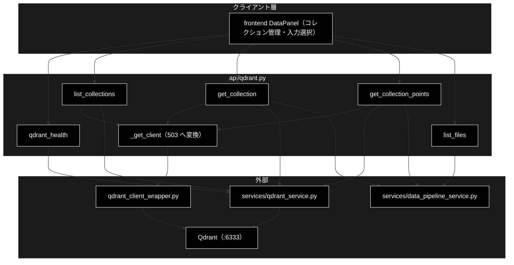
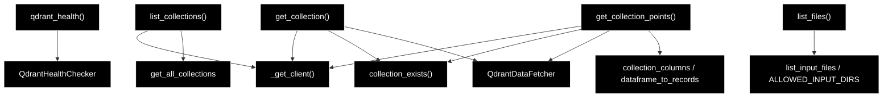

# api/qdrant.py - Qdrant 参照 API ドキュメント

**Version 1.4** | 最終更新: 2026-10-14

> **本書の位置づけ**: `backend/app/api/qdrant.py`（Qdrant 参照系・読み取り専用）の **IPO リファレンス**。
> 引くための文書であり、**設計の「なぜ」は上位の文書が正本**である。
>
> | 知りたいこと | 参照先 |
> |---|---|
> | エンドポイント一覧とステータス方針 | [`README_backend_api.md` §4.0・§4.3](README_backend_api.md) |
> | コレクションの作り方 | [`data_jobs.md`](../../core/docs/data_jobs.md) |
> | 登録・削除（副作用あり）の API | [`api/docs/data.md`](./data.md) |
> | 文書全体の地図 | [`README_app.md`](../../docs/README_app.md) |

---

## 目次

1. [概要](#概要)
2. [アーキテクチャ構成図](#1-アーキテクチャ構成図)
3. [モジュール構成図](#2-モジュール構成図)
4. [関数一覧表](#3-関数一覧表)
5. [関数 IPO詳細](#4-関数-ipo詳細)
6. [設定・定数](#5-設定定数)
7. [落とし穴](#6-落とし穴)
8. [変更履歴](#7-変更履歴)

---

## 概要

`backend/app/api/qdrant.py`（200 行）は、データ準備パイプラインのうち
**副作用のない参照系だけ**を持つ。登録・削除はジョブ基盤と HITL CONFIRM を経由するため
別ルータ（[`api/docs/data.md`](./data.md)）になる。

実処理は `services/qdrant_service.py` が持ち、本モジュールは
`services/data_pipeline_service.py` を挟んで**JSON 化するだけの薄い層**である。

### 主な責務

- Qdrant の稼働確認（**落ちていても 200**）・コレクション一覧・詳細・ポイントのプレビュー
- 入力ファイル候補の列挙（許可ディレクトリのみ・**絶対パスを返さない**）

### 各責務対応のモジュール

| # | 責務 | 対応モジュール | 説明 |
|---|------|--------------|------|
| 1 | Qdrant の稼働確認・一覧・詳細・ポイントのプレビュー | `backend/app/api/qdrant.py` / `services/data_pipeline_service.py` / `services/qdrant_service.py` | ルータは JSON 化だけを行い、実処理は `services/` が持つ |
| 2 | 入力ファイル候補の列挙 | `backend/app/api/qdrant.py` / `services/data_pipeline_service.py` | 許可ディレクトリのみ・絶対パスを返さない |

### 主要機能一覧

| エンドポイント | 関数 | 主なステータス |
|---|---|---|
| `GET /api/qdrant/health` | `qdrant_health()` | **200 固定** |
| `GET /api/qdrant/collections` | `list_collections()` | 200 / 503 |
| `GET /api/qdrant/collections/{name}` | `get_collection()` | 200 / 404 / 503 |
| `GET /api/qdrant/collections/{name}/points` | `get_collection_points()` | 200 / 404 / 503 |
| `GET /api/files` | `list_files()` | 200 / 400 |

---

## 1. アーキテクチャ構成図

### 1.1 システム全体構成



### 1.2 データフロー

1. 画面が参照系を叩く（**ジョブは作らない**。同期で応答する）
2. `_get_client()` が Qdrant クライアントを取得（失敗は **503** へ変換）
3. `services/` の関数で取得し、Pydantic モデルへ詰め替えて返す

---

## 2. モジュール構成図



### 2.2 外部依存関係

| 依存 | 用途 |
|---|---|
| `qdrant_client_wrapper.get_qdrant_client` | クライアント生成（**生成時点では接続確認をしない**） |
| `services.qdrant_service`（`QdrantHealthChecker` / `QdrantDataFetcher` / `get_all_collections` / `QDRANT_CONFIG`） | 稼働確認・一覧・ポイント取得 |
| `services.data_pipeline_service`（`collection_exists` / `collection_columns` / `dataframe_to_records` / `list_input_files` / `ALLOWED_INPUT_DIRS` / `PathNotAllowedError`） | 存在確認・整形・入力ファイル列挙 |

> すべて**関数内 import**（遅延 import）である。起動時に Qdrant 関連モジュールを
> 読み込まないことで、Qdrant が無い環境でもアプリ自体は起動する。

---

## 3. 関数一覧表

| 関数 | シグネチャ | 戻り |
|---|---|---|
| `_get_client()` | `() -> QdrantClient` | クライアント（失敗時 `HTTPException(503)`） |
| `qdrant_health` | `() -> QdrantHealth` | **常に 200** |
| `list_collections` | `() -> List[CollectionInfo]` | 一覧（`name` / `points_count` / `status`） |
| `get_collection` | `(name: str) -> CollectionDetail` | ベクトル設定 ＋ データ元の集計 |
| `get_collection_points` | `(name: str, limit: int = 50) -> CollectionPoints` | プレビュー（`limit` は 1〜500） |
| `list_files` | `(dir: str = "OUTPUT") -> InputFileListResponse` | 入力ファイル候補 |

---

## 4. 関数 IPO詳細

### 4.1 使用例

| # | パターン | いつ使うか | 例 |
|---|---------|-----------|----|
| 1 | **基本**: 疎通 → コレクション一覧（起動時・未起動時） | 画面のデータ管理タブを開いたときと同じ順 | 4.1.1 |
| 2 | 1 コレクションの詳細とポイントのプレビュー | 登録した中身を確かめる | 4.1.2 |

> 📝 **確かめ方（2026-10-11）**: どちらも `PYTHONPATH=. python3 <例>.py` で実行した。4.1.1 は VM の Qdrant（`docker compose`）を起動した状態と、
> `docker stop` で止めた状態の 2 回。4.1.2 は 4 次元の一時コレクションを作って実行し、最後に消した。

#### 4.1.1 基本: 疎通 → コレクション一覧

本モジュールは**読み取り専用**。Qdrant が落ちていても 500 にせず、「使えない」ことを返す（画面を白くしないため）。

```python
from fastapi.testclient import TestClient
from backend.app.main import app

c = TestClient(app)

# 1. まず疎通を見る（未起動でも 200 で available=False が返る）
h = c.get("/api/qdrant/health")
print(h.status_code, h.json()["available"], h.json()["message"], h.json()["collections_count"])

# 2. コレクション一覧（未起動なら空配列。例外を投げない）
r = c.get("/api/qdrant/collections")
print(r.status_code, [x["name"] for x in r.json()][:2])

# 実行結果（Qdrant を起動した状態。コレクションは VM にあった 5 個）:
# 200 True Connected 5
# 200 ['document_chunks_test', 'document_qa']
#
# 実行結果（docker stop で止めた状態）:
# 200 False Connection refused (port closed) None
# 200 []
```

> ⚠️ **未起動と「コレクションが 0 件」は一覧だけでは区別できない。** 先に `/api/qdrant/health` を見ること。
> 画面もこの順で呼び、`available=False` ならバナーを出す。

#### 4.1.2 コレクションの中身をのぞく

```python
from fastapi.testclient import TestClient
from qdrant_client import QdrantClient
from qdrant_client.models import Distance, PointStruct, VectorParams

from backend.app.main import app

# 例のための一時コレクション（4 次元・2 件。本物は 3072 次元）
q = QdrantClient(url="http://localhost:6333")
q.create_collection("qdrantdoc_demo", vectors_config=VectorParams(size=4, distance=Distance.COSINE))
q.upsert("qdrantdoc_demo", points=[
    PointStruct(id=1, vector=[1, 0, 0, 0], payload={"question": "送料はいくら？", "answer": "全国一律600円"}),
    PointStruct(id=2, vector=[0, 1, 0, 0], payload={"question": "返品できる？", "answer": "到着後14日以内"}),
])

c = TestClient(app)
# 1. 詳細（件数・次元・距離）
print(c.get("/api/qdrant/collections/qdrantdoc_demo").json())
# 2. ポイントのプレビュー（payload を表にした形。limit は 1〜500）
pts = c.get("/api/qdrant/collections/qdrantdoc_demo/points", params={"limit": 5}).json()
print({k: v for k, v in pts.items() if k != "rows"}, pts["rows"][0])
# 3. 存在しないコレクションは 404、limit の範囲外は 422
print(c.get("/api/qdrant/collections/nope").status_code,
      c.get("/api/qdrant/collections/qdrantdoc_demo/points", params={"limit": 0}).status_code)

q.delete_collection("qdrantdoc_demo")

# 実行結果:
# {'name': 'qdrantdoc_demo', 'points_count': 2, 'vectors_count': 2, 'indexed_vectors': 0, 'status': 'green', 'vector_size': 4, 'distance': 'Cosine', 'sources': {'unknown': {'sample_count': 2, 'method': 'unknown', 'domain': 'unknown', 'estimated_total': 2, 'percentage': 100.0}}, 'sample_size': 2, 'error': None}
# {'name': 'qdrantdoc_demo', 'columns': ['ID', 'question', 'answer'], 'limit': 5} {'ID': 1, 'question': '送料はいくら？', 'answer': '全国一律600円'}
# 404 422
```

> 📌 `sources` は先頭からのサンプル（`sample_size` 件）を payload の `source` で数えた内訳（`generation_method` / `domain` も添える）。項目が無ければ `unknown` にまとまる。
> プレビューの `columns` は payload のキーを `ID` の後ろに並べたもの（画面の表の見出し）。

### 4.2 `qdrant_health()`

| 項目 | 内容 |
|---|---|
| **Input** | なし（接続先は `QDRANT_CONFIG`） |
| **Process** | `QdrantHealthChecker.check_qdrant()` を呼び、例外も捕まえて本文へ載せる |
| **Output** | `QdrantHealth(available, message, url, …)`。**Qdrant が落ちていても 200** |

> ⚠️ **503 にしない。** 画面側で「通信エラー」と「Qdrant を起動してください」を
> 出し分けられなくなるため。一覧・詳細は Qdrant が必須なので 503 を返す。

### 4.3 `list_collections()` / `get_collection(name)` / `get_collection_points(name, limit)`

| 項目 | 内容 |
|---|---|
| **Input** | `name`（コレクション名）、`limit`（1〜500・既定 50） |
| **Process** | 1. `_get_client()`（接続不可は 503）<br>2. 詳細・ポイントは `collection_exists()` で存在確認（無ければ **404**）<br>3. `QdrantDataFetcher` で取得し、`dataframe_to_records()` で JSON 化 |
| **Output** | `CollectionInfo[]` / `CollectionDetail` / `CollectionPoints`（`columns` を別に返す） |

> payload のキーはコレクションごとに違うため、**列名を `columns` として別に返す**
> （画面はこの順で列を並べる）。長い文字列は取得側で 200 文字に切り詰められている。

### 4.4 `list_files(dir)`

| 項目 | 内容 |
|---|---|
| **Input** | `dir`（許可ディレクトリ名・既定 `OUTPUT`） |
| **Process** | `list_input_files(dir)`。ホワイトリスト外は `PathNotAllowedError` → **400** |
| **Output** | `InputFileListResponse(dir, allowed_dirs, files)` |

> ⚠️ **絶対パスを返さない。** `ディレクトリ名/ファイル名` 形式に限定している。

---

## 5. 設定・定数

| 定数 | 値 | 用途 |
|---|---|---|
| `router` | `APIRouter(prefix="/api", tags=["qdrant"])` | `/api/qdrant/*` と `/api/files` |
| `limit`（points） | `Query(default=50, ge=1, le=500)` | プレビュー件数の上限 |
| `ALLOWED_INPUT_DIRS` | `services/data_pipeline_service.py` 側 | 入力ファイルのホワイトリスト |

---

## 6. 落とし穴

| 罠 | 実際は |
|---|---|
| `/api/qdrant/health` を 503 にする | 画面のエラー出し分けが壊れる（§4.2） |
| クライアント生成の成功を「接続できた」と解釈する | `get_qdrant_client()` は**生成時点で接続確認をしない**。実リクエストで初めて失敗する |
| 参照系をジョブ化する | 不要。副作用が無いので同期で返す（ジョブ化するのは登録・削除だけ） |

---

## 7. 変更履歴

| バージョン | 日付 | 変更内容 |
|---|---|---|
| 1.0 | 2026-09-16 | 新規作成（文書再編 Phase 3）。実装（200 行）から IPO を書き起こした |
| 1.1 | 2026-09-24 | 概要に「各責務対応のモジュール」（主な責務と 1:1）を追加（基本フォーマット §2.4。2026-09-24） |
| 1.2 | 2026-10-11 | `backend/docs/reference/api_qdrant.md` から移した（`a_cross_doc_md_format.md` §1.1.2。リンクを付け替えた）。§4.1 を、実行できなかった断片・出力の無い例から、本リポジトリで実行して確かめた例に作り直した。4.1.1 は Qdrant の起動時と停止時（`docker stop`）の両方で、4.1.2 は一時コレクションで詳細とプレビューを確かめた |
| 1.3 | 2026-10-12 | backend/docs/ の廃止（2026-10-12）に追随し、参照先を backend/app/docs/README_app.md・backend/app/api/docs/README_api.md・backend/app/core/docs/core_process_flow.md などへ付け替えた（テストの地図は docs/testing.md、実行例の txt は docs/examples/） |
| 1.4 | 2026-10-14 | 索引の改名（frontend/docs/README.md → README_frontend.md、README_api.md → README_backend_api.md、README_core.md → README_backend_core.md）に合わせて参照を付け替えた |
