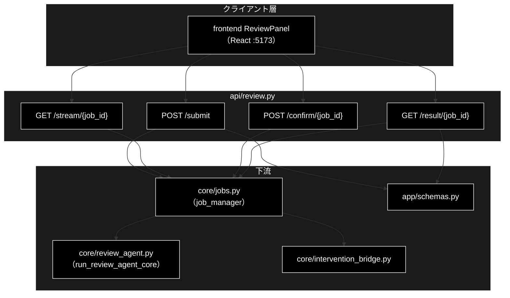
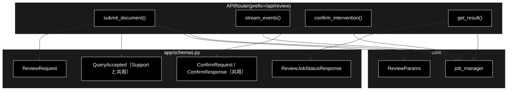
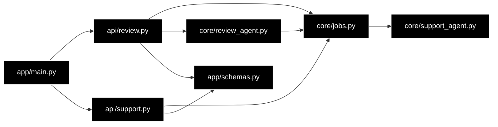

# api/review.py - 文書レビュー API ドキュメント

**Version 1.6** | 最終更新: 2026-10-12

> **本書の位置づけ**: `backend/app/api/review.py`（Review のジョブ起動 / SSE / HITL / 結果取得）の **IPO リファレンス**。
> 引くための文書であり、**設計の「なぜ」と処理の流れは上位の文書が正本**である。
>
> | 知りたいこと | 参照先 |
> |---|---|
> | エンドポイントと SSE の契約 | [`README_api.md` §4.0](README_api.md) |
> | ジョブ・SSE・HITL の機構 | [`core_process_flow.md` §3](../../core/docs/core_process_flow.md) |
> | パイプラインの中身（S1・①〜⑦） | [`core_process_flow.md` §2](../../core/docs/core_process_flow.md) |
> | 文書全体の地図 | [`README_app.md`](../../docs/README_app.md) |

---

## 目次

1. [概要](#概要)
2. [アーキテクチャ構成図](#1-アーキテクチャ構成図)
3. [モジュール構成図](#2-モジュール構成図)
4. [クラス・関数一覧表](#3-クラス関数一覧表)
5. [クラス・関数 IPO詳細](#4-クラス関数-ipo詳細)
6. [エクスポート](#5-エクスポート)
7. [変更履歴](#6-変更履歴)
8. [付録: 依存関係図](#付録-依存関係図)

---

## 概要

`backend/app/api/review.py` は、GRACE-Review の**文書レビュー API**（`/api/review/*`）を
提供する FastAPI ルーターモジュール。

`api/support.py` と**構造は同一**で、違うのはジョブのパラメータ型（`ReviewParams`）と
結果の型（`ReviewResultModel`）だけ。ジョブ基盤・SSE・HITL ブリッジは汎用化済みの
`core/jobs.py` をそのまま使う（`job_manager.start(ReviewParams(...))` で runner が
型解決される）。SSE の形式も Support と完全に同一なので、フロントは同じパーサを使える。

### 主な責務

- レビュージョブの起動（`POST /api/review/submit`）
- ステップ進捗の SSE 配信（`GET /api/review/stream/{job_id}`）
- HITL CONFIRM 応答の注入（`POST /api/review/confirm/{job_id}`）
- ジョブ状態・最終結果の取得（`GET /api/review/result/{job_id}`）
- 存在しないジョブへの 404 応答

### 各責務対応のモジュール

| # | 責務 | 対応モジュール | 説明 |
|---|------|--------------|------|
| 1 | レビュージョブの起動 | `api/review.py::submit_document` → `core/jobs.py` | `ReviewRequest`（`schemas.py`）を `ReviewParams` にして `job_manager.start(...)`。実行するのは `core/review_agent.py::run_review_agent_core` |
| 2 | ステップ進捗の SSE 配信 | `api/review.py::stream_events` → `core/jobs.py` | `job.stream_events()` を SSE 整形（keepalive は `SSE_KEEPALIVE`） |
| 3 | HITL CONFIRM 応答の注入 | `api/review.py::confirm_intervention` → `core/jobs.py` | `job_manager.confirm(...)` |
| 4 | ジョブ状態・最終結果の取得 | `api/review.py::get_result` → `core/jobs.py` | `job_manager.get(job_id)` を `ReviewJobStatusResponse`（`schemas.py`）で返す |
| 5 | 存在しないジョブへの 404 応答 | `api/review.py` | stream / confirm / result の 3 つで、ジョブが無ければ `HTTPException(404, "job not found")` |

### 主要機能一覧

| 機能 | 説明 |
|------|------|
| `router` | `APIRouter(prefix="/api/review")` |
| `submit_document()` | POST /submit（ジョブ起動、202 Accepted） |
| `stream_events()` | GET /stream/{job_id}（SSE 進捗配信） |
| `confirm_intervention()` | POST /confirm/{job_id}（HITL 応答） |
| `get_result()` | GET /result/{job_id}（結果取得） |

### エンドポイント一覧

| メソッド | パス | ステータス | 内容 |
|---|---|:---:|---|
| `POST` | `/api/review/submit` | 202 | 文書を投入しジョブ起動 |
| `GET` | `/api/review/stream/{job_id}` | 200 | SSE で進捗配信 |
| `POST` | `/api/review/confirm/{job_id}` | 200 | HITL CONFIRM への応答 |
| `GET` | `/api/review/result/{job_id}` | 200 | 状態と `ReviewResult` |

関連: `GET /api/rulesets`（ルールセット一覧）は `api/meta.py` にある。

---

## 1. アーキテクチャ構成図

### 1.1 システム全体構成



### 1.2 データフロー

1. フロントが `POST /submit` で文書を投入し、`{job_id, stream_url}` を受け取る
2. `job_manager.start(ReviewParams(...))` がワーカースレッドで `run_review_agent_core` を実行する
3. フロントが `stream_url` を `EventSource` で購読し、ステップ進捗を受け取る
4. ⑦ で承認が必要なら `intervention`（`status=waiting`）イベントが届く
5. フロントが `POST /confirm/{job_id}` で承認/拒否を返し、`InterventionBridge` が解決する
6. 完了時に `result` イベント → `done` 番兵の順で届く。`GET /result/{job_id}` でも取れる

### 1.3 HITL を含む往復（sequenceDiagram）


---

## 2. モジュール構成図

### 2.1 内部モジュール構成



### 2.2 外部依存関係

| ライブラリ | バージョン | 用途 |
|-----------|-----------|------|
| `fastapi` | >=0.116 | `APIRouter` / `HTTPException` |
| `starlette`（fastapi 同梱） | — | `StreamingResponse`（SSE） |

### 2.3 内部依存モジュール

| モジュール | 用途 |
|-----------|------|
| `backend.app.core.jobs` | `job_manager`（起動・参照・HITL 注入） |
| `backend.app.core.review_agent` | `ReviewParams`（**import に副作用あり**・後述） |
| `backend.app.schemas` | リクエスト/レスポンスモデル |

> ⚠️ **`review_agent` の import には副作用がある。** import 時に
> `register_runner(ReviewParams, _review_runner, "review")` が走る。`ReviewParams` を
> 使う以上この import は必ず発生するので、**登録漏れは構造的に起きない**。

---

## 3. クラス・関数一覧表

### 3.1 クラス一覧

本モジュールにクラスは無い（ルーター関数のみ）。スキーマは `app/schemas.py` にある。

### 3.2 関数一覧（カテゴリ別）

#### エンドポイント

| 関数名 | 概要 |
|-------|------|
| `submit_document(request)` | レビュージョブを起動する（202） |
| `stream_events(job_id)` | SSE で進捗を配信する |
| `confirm_intervention(job_id, request)` | HITL 応答を注入する |
| `get_result(job_id)` | 状態と結果を返す |

---

## 4. クラス・関数 IPO詳細

### 4.1 使用例

| # | パターン | いつ使うか | 例 |
|---|---------|-----------|----|
| 1 | **基本**: 文書を投げる → SSE で 9 ステップ → 指摘一覧 | 1 回のレビューの往復を確かめる | 4.1.1 |
| 2 | ルールセット一覧とエラー応答 | セレクタの選択肢・入力の誤りを確かめる | 4.1.2 |

> 📝 **確かめ方（2026-10-11）**: 4.1.1・4.1.2 はどちらも `PYTHONPATH=. python3 <例>.py` で実行した。4.1.1 は、Ollama・Gemini Embedding・Qdrant が要る本物の runner を
> **同じ契約 `(params, emit, confirm) -> dict` の偽物**に差し替え（`register_runner()`。[`core/docs/jobs.md`](../../core/docs/jobs.md)）、
> ルーター・ジョブ基盤・SSE・HITL の橋渡しは本物のまま通した。

#### 4.1.1 基本的なワークフロー（文書を投げて指摘を受け取る）

> ⚠️ **SSE を逐次読むには本物のサーバが要る。** `fastapi.testclient.TestClient` は応答を最後まで溜めてから返すので、
> 承認待ちで止まるジョブの SSE を `TestClient` で読むと、承認を送れないままタイムアウト（安全側の CANCEL）まで待つことになる
> （2026-10-11 に実測）。下の例は同じプロセスで uvicorn を起動し、`httpx` で読む。画面（`EventSource`）と同じ読み方である。

```python
import json, threading, time

import httpx
import uvicorn

from backend.app.core.review_agent import REVIEW_STEP_IDS, ReviewParams
from backend.app.core.jobs import register_runner
from backend.app.core.support_agent import SupportEvent
from backend.app.main import app


# 本物の runner（run_review_agent_core）は Ollama・Embedding・Qdrant が要るので、
# 同じ契約 (params, emit, confirm) -> dict の偽物へ差し替える
def fake_runner(params, emit, confirm):
    for step in REVIEW_STEP_IDS:
        emit(SupportEvent(type="step", step=step, status="finished"))
    doc = params.document
    i = doc.index("業界最高")
    return {"document_title": "例文", "ruleset": params.ruleset,
            "findings": [{"finding_id": "f1", "segment_id": "s1", "excerpt": "業界最高",
                          "start": i, "end": i + 4, "rule_id": "keihyo-01",
                          "rule_title": "優良誤認表示", "category": "優良誤認",
                          "law": "景品表示法", "article": "第5条第1号",
                          "message": "根拠の無い最上級表現", "suggestion": "根拠を示す",
                          "severity": "high", "status": "confirmed"}],
            "summary": {"high": 1, "confirmed": 1}}

register_runner(ReviewParams, fake_runner, "review")

# SSE は本物のサーバでないと逐次届かない（TestClient は応答を最後まで溜めてから返す）
server = uvicorn.Server(uvicorn.Config(app, port=8767, log_level="warning"))
threading.Thread(target=server.run, daemon=True).start()
while not server.started:
    time.sleep(0.05)

with httpx.Client(base_url="http://127.0.0.1:8767", trust_env=False) as c:
    # 1. 文書とルールセットを指定してジョブを起動する（202）
    r = c.post("/api/review/submit", json={"document": "業界最高の保湿力を実現しました。",
                                           "ruleset": "ec_ad"})
    job_id = r.json()["job_id"]
    print(r.status_code, r.json()["stream_url"].rsplit("/", 1)[0])

    # 2. 進捗を SSE で購読する（S1・①〜⑦ の 9 ステップ → 終端の done）
    with c.stream("GET", f"/api/review/stream/{job_id}") as s:
        steps = [json.loads(l[6:]).get("step") or json.loads(l[6:])["type"]
                 for l in s.iter_lines() if l.startswith("data: ")]
    print(steps)

    # 3. 最終結果（指摘一覧とサマリ）
    result = c.get(f"/api/review/result/{job_id}").json()["result"]
    f = result["findings"][0]
    print(result["summary"], f["rule_id"], f["severity"], f["excerpt"], (f["start"], f["end"]))
server.should_exit = True

# 実行結果:
# 202 /api/review/stream
# ['ruleset', 'segment', 'retrieve', 'detect', 'ground', 'suppress', 'web', 'severity', 'action', 'done']
# {'high': 1, 'medium': 0, 'low': 0, 'confirmed': 1, 'review_required': 0, 'suppressed': 0} keihyo-01 high 業界最高 (0, 4)
```

> 📌 ステップの順は `review_agent.REVIEW_STEP_IDS`（S1・①〜⑦。番号は Support との対応を示す呼称で、実行順とは一致しない）。
> 結果の `result` は `ReviewResultModel` で検証される（`summary` の欠けた件数は 0 で埋まる）。`start` / `end` は原文の文字オフセットで、画面のハイライトに使う。

#### 4.1.2 ルールセット一覧とエラー応答

```python
from fastapi.testclient import TestClient
from backend.app.main import app

c = TestClient(app)

# 1. 画面のセレクタが読むメタ（提供は api/meta.py）
print(sorted(c.get("/api/rulesets").json()[0]))

# 2. エラー応答
print(c.post("/api/review/submit", json={}).status_code)     # document 必須
print(c.get("/api/review/stream/unknown-id").status_code)
print(c.get("/api/review/result/unknown").status_code)

# 出力例:
# ['action_map', 'always_check_count', 'collections', 'confirm_th', 'critical_keywords',
#  'id', 'laws', 'name', 'notify_th', 'prompt_addendum', 'rule_count']
# 422
# 404
# 404
```


### 4.2 エンドポイント関数

#### `submit_document`

**概要**: レビュージョブを起動する。進捗は `stream_url` の SSE で配信される。

```python
@router.post("/submit", response_model=QueryAccepted, status_code=202)
def submit_document(request: ReviewRequest) -> QueryAccepted
```

| パラメータ | 型 | デフォルト | 説明 |
|------------|------|-----------|------|
| `request` | ReviewRequest | - | 文書とオプション（`app/schemas.py`） |

| 項目 | 内容 |
|------|------|
| **Input** | `request: ReviewRequest`（`document` / `document_title` / `ruleset` / `use_web` / `do_action` / `dry_run` / `verbose`） |
| **Process** | 1. Pydantic が `document` の長さ（1〜50,000）と `ruleset` の値域を検証（違反は 422）<br>2. `ReviewParams` へ詰め替える<br>3. `job_manager.start()` でワーカースレッドを起動する |
| **Output** | `QueryAccepted`: `{job_id, stream_url}`（HTTP 202） |

**戻り値例**:
```python
{
    "job_id": "a1b2c3d4e5f6",
    "stream_url": "/api/review/stream/a1b2c3d4e5f6"
}
```

```bash
# 使用例
curl -s -X POST http://127.0.0.1:8000/api/review/submit \
  -H 'Content-Type: application/json' \
  -d '{"document":"当社の化粧品は業界No.1の実力です。","document_title":"LP案"}'
# {"job_id":"a1b2c3d4e5f6","stream_url":"/api/review/stream/a1b2c3d4e5f6"}
```

**エラー**:

| 状況 | ステータス | 備考 |
|---|:---:|---|
| `document` が空 | 422 | `min_length=1` |
| `document` が 50,000 文字超 | 422 | `MAX_DOCUMENT_CHARS`。組合せ爆発を入力段で止める |
| `ruleset` が未知の値 | 422 | `Literal["ec_ad"]` |

#### `stream_events`

**概要**: ステップ進捗（S1・①〜⑦）を SSE で逐次配信する。

```python
@router.get("/stream/{job_id}")
def stream_events(job_id: str) -> StreamingResponse
```

| パラメータ | 型 | デフォルト | 説明 |
|------------|------|-----------|------|
| `job_id` | str | - | `submit` が返したジョブ ID |

| 項目 | 内容 |
|------|------|
| **Input** | `job_id: str` |
| **Process** | 1. ジョブを引く（無ければ 404）<br>2. `job.stream_events()` を `data: {JSON}\n\n` へ整形<br>3. `None`（タイムアウト）は keepalive（`SSE_KEEPALIVE` = `event: keepalive` の名前付きイベント）を送る<br>4. 終端に `done` 番兵を送る |
| **Output** | `StreamingResponse`（`text/event-stream`） |

**配信例**:
```
data: {"seq":0,"ts":1753800000.1,"type":"step","step":"ruleset","status":"started","title":"S1 ルールセット: EC広告表示（--ruleset ec_ad）","message":"","data":{...}}

data: {"seq":1,"ts":1753800000.2,"type":"log","step":"ruleset","message":"  ルール数: 21（常時チェック 6） / しきい値: notify=0.85 confirm=0.6","data":{}}

data: {"seq":42,"ts":1753800012.9,"type":"result","data":{"document_title":"LP案","findings":[...]}}

data: {"type":"done","status":"completed"}
```

> **イベントは常に先頭からリプレイされる。** 完了後に購読しても全イベントが取れるため、
> 再接続・途中購読で取りこぼさない。`seq` は 0 起点の通し番号で、欠番の検知に使える。

#### `confirm_intervention`

**概要**: HITL CONFIRM への応答（承認 / 拒否）を注入する。

```python
@router.post("/confirm/{job_id}", response_model=ConfirmResponse)
def confirm_intervention(job_id: str, request: ConfirmRequest) -> ConfirmResponse
```

| パラメータ | 型 | デフォルト | 説明 |
|------------|------|-----------|------|
| `job_id` | str | - | ジョブ ID |
| `request` | ConfirmRequest | - | `{intervention_id, approve}` |

| 項目 | 内容 |
|------|------|
| **Input** | `job_id: str`, `request: ConfirmRequest` |
| **Process** | `job_manager.confirm()` へ委譲。`not_found` は 404 へ変換する |
| **Output** | `ConfirmResponse`: `{"status": "resolved" \| "not_waiting"}` |

**戻り値例**:
```python
{"status": "resolved"}      # 承認/拒否が反映された
{"status": "not_waiting"}   # 承認待ちが無い（タイムアウト済み・完了後など）
```

> `approve=True` で PROCEED（起票・差し戻しの実行）、`False` で CANCEL。
> タイムアウト時はバックエンドが安全側（実行せず有人対応へ）に倒す。

#### `get_result`

**概要**: ジョブの状態と最終結果（`ReviewResult`）を返す。SSE が使えない環境のフォールバック。

```python
@router.get("/result/{job_id}", response_model=ReviewJobStatusResponse)
def get_result(job_id: str) -> ReviewJobStatusResponse
```

| 項目 | 内容 |
|------|------|
| **Input** | `job_id: str` |
| **Process** | ジョブを引き（無ければ 404）、状態と `result` を返す |
| **Output** | `ReviewJobStatusResponse`: `{job_id, status, result}` |

**戻り値例**:
```python
{
    "job_id": "a1b2c3d4e5f6",
    "status": "completed",
    "result": {
        "document_title": "LP案",
        "ruleset": "ec_ad",
        "findings": [
            {
                "finding_id": "f001",
                "segment_id": "s001",
                "excerpt": "業界No.1",
                "start": 6,
                "end": 12,
                "rule_id": "keihyo-03",
                "rule_title": "No.1表示の根拠",
                "law": "景品表示法",
                "article": "第5条第1号",
                "message": "出典の併記がない No.1 表示は不当表示に該当するおそれがあります",
                "suggestion": "調査主体・調査期間・調査対象を併記してください",
                "severity": "high",
                "confidence": 0.92,
                "citations": ["[規程] 景品表示法 優良誤認"],
                "status": "review_required",
                "forced": True,
                "suppress_reason": None,
                "web_checked": False
            }
        ],
        "summary": {
            "high": 1, "medium": 0, "low": 0,
            "confirmed": 0, "review_required": 1, "suppressed": 2
        },
        "segments_total": 3,
        "rules_evaluated": 9,
        "detected_raw": 3,
        "rescued": 0,
        "forced_high": 1,
        "truncated": False
    }
}
```


---

## 5. エクスポート

| 要素 | 種別 | 参照元 |
|---|---|---|
| `router` | `APIRouter` | `backend/app/main.py`（`app.include_router(review.router)`） |

エンドポイント関数は FastAPI のデコレータ経由でのみ呼ばれる。

---

## 6. 変更履歴

| バージョン | 日付 | 変更内容 |
|---|---|---|
| 1.0 | 2026-07-29 | 初版作成（GRACE-Review STEP5・PR #41 に対応） |
| 1.1 | 2026-09-16 | 3 階建て再編に伴い、冒頭へ**位置づけと上位文書への導線**を追加した |
| 1.2 | 2026-09-24 | 使用例を IPO 詳細の冒頭（`### 4.1 使用例`）へ移し、末尾の「## 5. 使用例」章を削除（基本フォーマット `a_class_method_md_format.md` v1.6〜 §6.1 に準拠。2026-09-24）。IPO の小節を 4.2 以降へ繰り下げ、後続の章番号を 1 つ繰り上げた。文書内の `§4.x` 参照も追随 |
| 1.3 | 2026-10-08 | SSE の keepalive を名前付きイベントへ変更したのに追随 |
| 1.4 | 2026-10-10 | 概要の「各責務対応のモジュール」を「主な責務」（5 項目）と 1:1 に揃えた（「入出力スキーマ」「パイプライン実行」は責務 1・4 の説明へ移し、欠けていた 404 応答の行を足した）。変更履歴を 3 列へ移した |
| 1.5 | 2026-10-11 | `backend/docs/reference/api_review.md` から移した（`a_cross_doc_md_format.md` §1.1.2。リンクを付け替えた）。§4.1 を、実行できなかった断片・出力の無い例から、本リポジトリで実行して確かめた例に作り直した（偽物の runner＋uvicorn＋httpx で 9 ステップの SSE と指摘一覧を通した） |
| 1.6 | 2026-10-12 | backend/docs/ の廃止（2026-10-12）に追随し、参照先を backend/app/docs/README_app.md・backend/app/api/docs/README_api.md・backend/app/core/docs/core_process_flow.md などへ付け替えた（テストの地図は docs/testing.md、実行例の txt は docs/examples/） |

---

## 付録: 依存関係図



`api/review.py` と `api/support.py` は**互いに依存しない**。共有しているのは
`core/jobs.py`（ジョブ基盤）と `app/schemas.py`（`QueryAccepted` / `ConfirmRequest` /
`ConfirmResponse`）だけである。
