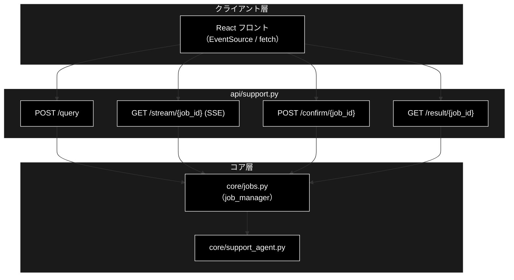
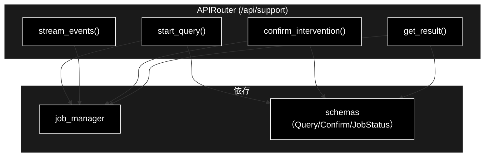
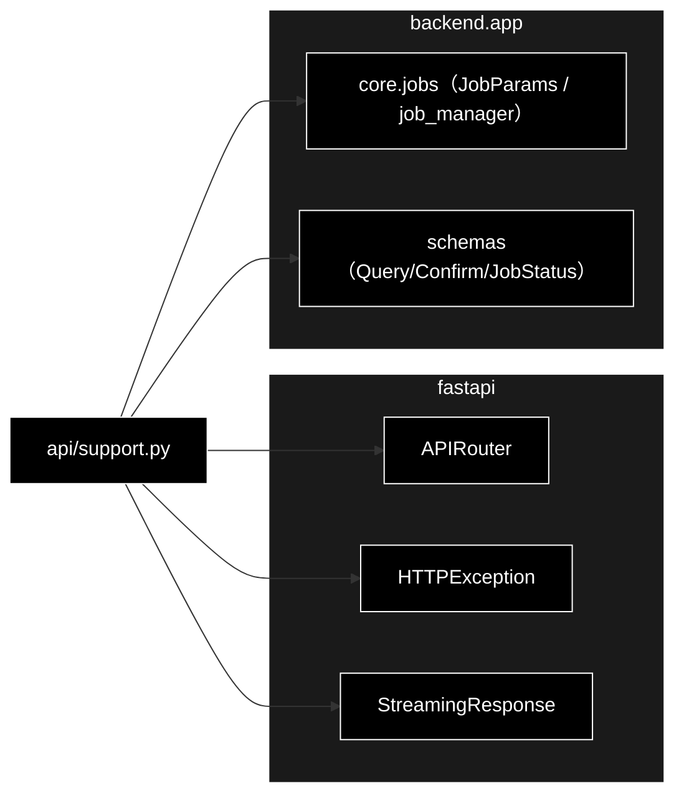

# api/support.py - サポート問い合わせ API ドキュメント

**Version 1.6** | 最終更新: 2026-10-12

> **本書の位置づけ**: `backend/app/api/support.py`（Support のジョブ起動 / SSE / HITL / 結果取得）の **IPO リファレンス**。
> 引くための文書であり、**設計の「なぜ」と処理の流れは上位の文書が正本**である。
>
> | 知りたいこと | 参照先 |
> |---|---|
> | エンドポイントと SSE の契約 | [`README_api.md` §4.0](README_api.md) |
> | ジョブ・SSE・HITL の機構 | [`core_process_flow.md` §3](../../core/docs/core_process_flow.md) |
> | パイプラインの中身（0-(A)〜⑥） | [`core_process_flow.md` §1](../../core/docs/core_process_flow.md) |
> | 文書全体の地図 | [`README_app.md`](../../docs/README_app.md) |

---

## 目次

1. [概要](#概要)
2. [アーキテクチャ構成図](#1-アーキテクチャ構成図)
3. [モジュール構成図](#2-モジュール構成図)
4. [クラス・関数一覧表](#3-クラス関数一覧表)
5. [クラス・関数 IPO詳細](#4-クラス関数-ipo詳細)
6. [エクスポート](#5-エクスポート)
7. [変更履歴](#6-変更履歴)
8. [付録: 依存関係図](#付録-依存関係図)

---

## 概要

`backend/app/api/support.py` は、GRACE-Support の**サポート問い合わせ API**（`/api/support/*`）を
提供する FastAPI ルーターモジュール。ジョブ起動（POST）・進捗配信（SSE）・HITL 応答（POST）・
結果取得（GET）の 4 エンドポイントを定義し、実処理は `core/jobs.py` の `job_manager` に委譲する。

進捗は **SSE（Server-Sent Events）** で配信し、イベントは常に先頭からリプレイされるため
再接続でも取りこぼさない。CONFIRM（人間承認）が必要な副作用アクションは、SSE の
`intervention` イベント → フロントのモーダル → `POST /confirm` の応答で解決する。

### 主な責務

- 問い合わせジョブの起動（`POST /api/support/query`）
- ステップ進捗の SSE 配信（`GET /api/support/stream/{job_id}`）
- HITL CONFIRM 応答の注入（`POST /api/support/confirm/{job_id}`）
- ジョブ状態・最終結果の取得（`GET /api/support/result/{job_id}`）
- 存在しないジョブへの 404 応答

### 各責務対応のモジュール

| # | 責務 | 対応モジュール | 説明 |
|---|------|--------------|------|
| 1 | ジョブ起動 | `api/support.py` → `core/jobs.py` | `job_manager.start(JobParams)` |
| 2 | SSE 進捗配信 | `api/support.py` → `core/jobs.py` | `job.stream_events()` を SSE 整形 |
| 3 | HITL 応答注入 | `api/support.py` → `core/jobs.py` | `job_manager.confirm(...)` |
| 4 | 結果取得 | `api/support.py` → `core/jobs.py` | `job_manager.get(job_id)` |
| 5 | 入出力スキーマ | `backend/app/schemas.py` | Query/Confirm/JobStatus 各モデル |

### 主要機能一覧

| 機能 | 説明 |
|------|------|
| `router` | `APIRouter(prefix="/api/support")` |
| `start_query()` | POST /query（ジョブ起動、202 Accepted） |
| `stream_events()` | GET /stream/{job_id}（SSE 進捗配信） |
| `confirm_intervention()` | POST /confirm/{job_id}（HITL 応答） |
| `get_result()` | GET /result/{job_id}（結果取得） |

---

## 1. アーキテクチャ構成図

### 1.1 システム全体構成



### 1.2 データフロー

1. `POST /query` → `job_manager.start()` がワーカースレッドを起動し `QueryAccepted` を返す
2. `GET /stream/{job_id}` → `job.stream_events()` を `data: {JSON}\n\n` で逐次配信、末尾に `done`
3. CONFIRM 到達時 → SSE に `intervention` → `POST /confirm/{job_id}` で承認/拒否を注入
4. `GET /result/{job_id}` → ジョブ状態と `SupportResult`（ポーリング用フォールバック）

---

## 2. モジュール構成図

### 2.1 内部モジュール構成



### 2.2 外部依存関係

| ライブラリ | バージョン | 用途 |
|-----------|-----------|------|
| `fastapi` | >=0.115.6 | `APIRouter` / `HTTPException` |
| `fastapi.responses` | >=0.115.6 | `StreamingResponse`（SSE） |
| `json` | 標準 | イベントの JSON シリアライズ |

### 2.3 内部依存モジュール

| モジュール | 用途 |
|-----------|------|
| `backend.app.core.jobs` | `JobParams` / `job_manager`（起動・参照・HITL 注入） |
| `backend.app.schemas` | `QueryRequest` / `QueryAccepted` / `ConfirmRequest` / `ConfirmResponse` / `JobStatusResponse` |

---

## 3. クラス・関数一覧表

### 3.1 クラス一覧

本モジュールにクラス定義はない（`router` はモジュールレベルの `APIRouter` インスタンス）。

### 3.2 関数一覧（エンドポイント）

| 関数名 | メソッド/パス | 概要 |
|-------|--------------|------|
| `start_query(request)` | POST /query | 問い合わせジョブを起動 |
| `stream_events(job_id)` | GET /stream/{job_id} | 進捗を SSE で配信 |
| `confirm_intervention(job_id, request)` | POST /confirm/{job_id} | HITL 応答を注入 |
| `get_result(job_id)` | GET /result/{job_id} | ジョブ状態と結果を取得 |

---

## 4. クラス・関数 IPO詳細

### 4.1 使用例

| # | パターン | いつ使うか | 例 |
|---|---------|-----------|----|
| 1 | **基本**: 起動 → SSE 購読 → 承認 → 結果（画面と同じ順） | 1 回の問い合わせの往復を確かめる | 4.1.1 |
| 2 | エラー応答（422 / 404） | 入力の誤り・消えたジョブの扱いを確かめる | 4.1.2 |

> 📝 **確かめ方（2026-10-11）**: 4.1.1・4.1.2 はどちらも `PYTHONPATH=. python3 <例>.py` で実行した。4.1.1 は、Ollama・Gemini Embedding・Qdrant が要る本物の runner を
> **同じ契約 `(params, emit, confirm) -> dict` の偽物**に差し替え（`register_runner()`。[`core/docs/jobs.md`](../../core/docs/jobs.md)）、
> ルーター・ジョブ基盤・SSE・HITL の橋渡しは本物のまま通した。

#### 4.1.1 基本的なワークフロー（起動 → SSE 購読 → 承認）

> ⚠️ **SSE を逐次読むには本物のサーバが要る。** `fastapi.testclient.TestClient` は応答を最後まで溜めてから返すので、
> 承認待ちで止まるジョブの SSE を `TestClient` で読むと、承認を送れないままタイムアウト（安全側の CANCEL）まで待つことになる
> （2026-10-11 に実測）。下の例は同じプロセスで uvicorn を起動し、`httpx` で読む。画面（`EventSource`）と同じ読み方である。

```python
import json, threading, time

import httpx
import uvicorn

from backend.app.core.jobs import JobParams, register_runner
from backend.app.core.support_agent import SupportEvent
from backend.app.main import app
from grace.intervention import InterventionLevel, InterventionRequest


# 本物の runner（run_support_agent_core）は Ollama・Embedding・Qdrant が要るので、
# 同じ契約 (params, emit, confirm) -> dict の偽物へ差し替える
def fake_runner(params, emit, confirm):
    emit(SupportEvent(type="step", step="action", status="started", title="⑥ Action"))
    resp = confirm(InterventionRequest(level=InterventionLevel.CONFIRM,
                                       message="証明書の発行を申請しますか？", reason="action"))
    emit(SupportEvent(type="step", step="action", status="finished", title="⑥ Action"))
    return {"answer": f"承認: {resp.should_continue}", "decision": "answer"}

register_runner(JobParams, fake_runner, "support")

# SSE は本物のサーバでないと逐次届かない（TestClient は応答を最後まで溜めてから返す）
server = uvicorn.Server(uvicorn.Config(app, port=8766, log_level="warning"))
threading.Thread(target=server.run, daemon=True).start()
while not server.started:
    time.sleep(0.05)

base = "http://127.0.0.1:8766"
with httpx.Client(base_url=base, trust_env=False) as c:
    # 1. ジョブを起動する（202 + job_id / stream_url。結果は返らない）
    r = c.post("/api/support/query", json={"query": "住民票の写しの取り方は？", "vertical": "gov"})
    print(r.status_code, r.json()["stream_url"].rsplit("/", 1)[0])
    job_id = r.json()["job_id"]

    # 2. SSE を購読し、3. intervention が来たら承認を注入する
    with c.stream("GET", f"/api/support/stream/{job_id}") as s:
        for line in s.iter_lines():
            if not line.startswith("data: "):
                continue
            ev = json.loads(line[6:])
            print(ev.get("seq"), ev["type"], ev.get("step"), ev.get("status"))
            if ev["type"] == "intervention" and ev["status"] == "waiting":
                iid = ev["data"]["intervention_id"]
                print("  confirm ->", c.post(f"/api/support/confirm/{job_id}",
                                             json={"intervention_id": iid, "approve": True}).json())

    # 4. 最終結果を取る
    res = c.get(f"/api/support/result/{job_id}").json()
    print(res["status"], res["result"]["decision"], res["result"]["answer"])
server.should_exit = True

# 実行結果:
# 202 /api/support/stream
# 0 step action started
# 1 intervention action waiting
#   confirm -> {'status': 'resolved'}
# 2 intervention action resolved
# 3 step action finished
# None done None completed
# completed answer 承認: True
```

> 📌 `data:` 行は `SupportEventModel` の JSON で、`seq` は 0 からの通し番号（再接続すると先頭からリプレイされる）。終端は `type: "done"`（`seq` なし）。
> 承認待ち（`intervention` / `waiting`）の `data.intervention_id` を `POST /confirm` に渡す。本物のパイプラインでは ⑥ Action と 0-(A) の主質問選択で出る。
> 結果の `result` は `SupportResultModel` で検証されるので、runner が返した dict のうち知らないキーは落ち、足りないキーは既定値で埋まる。

#### 4.1.2 エラー応答の確かめ方

```python
from fastapi.testclient import TestClient
from backend.app.main import app

c = TestClient(app)

print(c.post("/api/support/query", json={}).status_code)          # query 必須
print(c.get("/api/support/stream/unknown-id").status_code)          # 未知のジョブ
print(c.get("/api/support/result/unknown").status_code)
print(c.post("/api/support/confirm/unknown",
             json={"intervention_id": "x", "approve": True}).status_code)

# 出力例:
# 422
# 404
# 404
# 404
```

> ⚠️ **404 は「ジョブが消えた」ことも意味する。** `JobManager` はインメモリで、
> 完了したジョブを GC する。フロントは再購読の前に `result` で存在を確かめる
> （[`core/docs/jobs.md` §4.1.2](../../core/docs/jobs.md#41-使用例)）。


### 4.2 エンドポイント関数

#### `start_query`

**概要**: 問い合わせジョブを起動する。進捗は返却された `stream_url` の SSE で配信される。

```python
@router.post("/query", response_model=QueryAccepted, status_code=202)
def start_query(request: QueryRequest) -> QueryAccepted
```

| パラメータ | 型 | デフォルト | 説明 |
|------------|------|-----------|------|
| `request` | QueryRequest | - | query / vertical / dry_run / use_web / do_action / verbose / identity |

| 項目 | 内容 |
|------|------|
| **Input** | `request: QueryRequest` |
| **Process** | 1. `JobParams` を組み立て<br>2. `job_manager.start()` でワーカースレッド起動<br>3. `QueryAccepted`（job_id / stream_url）を返す（202） |
| **Output** | `QueryAccepted`: `{job_id, stream_url}` |

**戻り値例**:
```python
{"job_id": "a1b2c3d4e5f6", "stream_url": "/api/support/stream/a1b2c3d4e5f6"}
```

```python
# 使用例（クライアント）
POST /api/support/query  {"query": "返品したい", "vertical": "ec"}
# 202 → {"job_id": "...", "stream_url": "/api/support/stream/..."}
```

#### `stream_events`

**概要**: ステップ進捗（①〜⑥）を SSE で逐次配信する。イベントは先頭からリプレイされるため
再接続でも取りこぼさない。各メッセージは `data: {SupportEventModel の JSON}`。

```python
@router.get("/stream/{job_id}")
def stream_events(job_id: str) -> StreamingResponse
```

| パラメータ | 型 | デフォルト | 説明 |
|------------|------|-----------|------|
| `job_id` | str | - | 対象ジョブ ID |

| 項目 | 内容 |
|------|------|
| **Input** | `job_id: str` |
| **Process** | 1. `job_manager.get(job_id)`、無ければ 404<br>2. `job.stream_events()` を反復<br>3. None は keepalive（`SSE_KEEPALIVE` = `event: keepalive` の名前付きイベント）、イベントは `data: {JSON}`<br>4. 終端で `data: {"type": "done", "status": ...}` を送出 |
| **Output** | `StreamingResponse`（media_type=`text/event-stream`、`Cache-Control: no-cache` / `X-Accel-Buffering: no`） |

**戻り値例**:
```
data: {"seq": 0, "ts": 1752543210.1, "type": "log", "step": "plan", "message": "❓ 問い合わせ: 返品したい"}

event: keepalive
data: {}

data: {"type": "done", "status": "completed"}
```

```python
# 使用例（フロント）
const es = new EventSource("/api/support/stream/a1b2c3d4e5f6");
es.onmessage = (e) => handle(JSON.parse(e.data));
```

#### `confirm_intervention`

**概要**: HITL CONFIRM への応答（承認 / 拒否）を注入する。`approve=True` で PROCEED、
False で CANCEL。対象なし・タイムアウト済みは not_found / not_waiting を返す。

```python
@router.post("/confirm/{job_id}", response_model=ConfirmResponse)
def confirm_intervention(job_id: str, request: ConfirmRequest) -> ConfirmResponse
```

| パラメータ | 型 | デフォルト | 説明 |
|------------|------|-----------|------|
| `job_id` | str | - | 対象ジョブ ID |
| `request` | ConfirmRequest | - | intervention_id / approve |

| 項目 | 内容 |
|------|------|
| **Input** | `job_id: str`, `request: ConfirmRequest` |
| **Process** | 1. `job_manager.confirm(job_id, intervention_id, approve)`<br>2. `not_found` は 404<br>3. それ以外は `ConfirmResponse(status=...)` |
| **Output** | `ConfirmResponse`: `{status}`（resolved / not_waiting）／ not_found は 404 |

**戻り値例**:
```python
{"status": "resolved"}
```

```python
# 使用例
POST /api/support/confirm/a1b2c3d4e5f6  {"intervention_id": "9f8e...", "approve": true}
# → {"status": "resolved"}
```

#### `get_result`

**概要**: ジョブの状態と最終結果（`SupportResult`）を返す（SSE を使わないポーリング用フォールバック）。

```python
@router.get("/result/{job_id}", response_model=JobStatusResponse)
def get_result(job_id: str) -> JobStatusResponse
```

| パラメータ | 型 | デフォルト | 説明 |
|------------|------|-----------|------|
| `job_id` | str | - | 対象ジョブ ID |

| 項目 | 内容 |
|------|------|
| **Input** | `job_id: str` |
| **Process** | 1. `job_manager.get(job_id)`、無ければ 404<br>2. `JobStatusResponse`（job_id / status / result）を返す |
| **Output** | `JobStatusResponse`: `{job_id, status, result}` |

**戻り値例**:
```python
{"job_id": "a1b2c3d4e5f6", "status": "completed",
 "result": {"answer": "…", "decision": "answer", "vertical": "ec"}}
```

```python
# 使用例
GET /api/support/result/a1b2c3d4e5f6
# → {"job_id": "...", "status": "completed", "result": { ... }}
```


---

## 5. エクスポート

`__all__` 定義はない。`main.py` が `support.router` を `include_router()` する。

```python
router  # APIRouter(prefix="/api/support", tags=["support"])
```

---

## 6. 変更履歴

| バージョン | 日付 | 変更内容 |
|---|---|---|
| 1.0 | — | 初版作成（4 エンドポイント: query / stream(SSE) / confirm / result の IPO ドキュメント） |
| 1.1 | 2026-08-01 | `start_query` の受け取るフィールドに `identity`（`--identity` 相当）を追加 |
| 1.2 | 2026-09-16 | 3 階建て再編に伴い、冒頭へ**位置づけと上位文書への導線**を追加した |
| 1.3 | 2026-09-24 | 使用例を IPO 詳細の冒頭（`### 4.1 使用例`）へ移し、末尾の「## 5. 使用例」章を削除（基本フォーマット `a_class_method_md_format.md` v1.6〜 §6.1 に準拠。2026-09-24）。IPO の小節を 4.2 以降へ繰り下げ、後続の章番号を 1 つ繰り上げた。文書内の `§4.x` 参照も追随 |
| 1.4 | 2026-10-08 | SSE の keepalive をコメント行から名前付きイベント（`event: keepalive`）へ変更したのに追随 |
| 1.5 | 2026-10-11 | `backend/docs/reference/api_support.md` から移した（`a_cross_doc_md_format.md` §1.1.2。リンクを付け替えた）。§4.1 を、実行できなかった断片・出力の無い例から、本リポジトリで実行して確かめた例に作り直した（本物の runner を同じ契約の偽物へ差し替え、uvicorn＋httpx で SSE → 承認 → 結果を通した）。`TestClient` では承認待ちの SSE を読めないことを注記した |
| 1.6 | 2026-10-12 | backend/docs/ の廃止（2026-10-12）に追随し、参照先を backend/app/docs/README_app.md・backend/app/api/docs/README_api.md・backend/app/core/docs/core_process_flow.md などへ付け替えた（テストの地図は docs/testing.md、実行例の txt は docs/examples/） |

---

## 付録: 依存関係図


