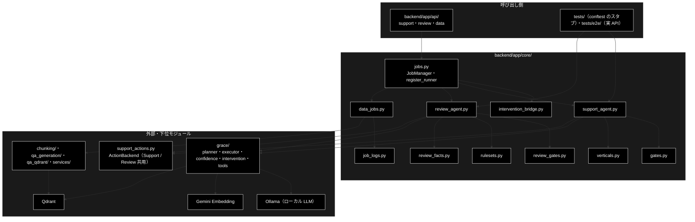

# README_core.md - backend/app/core/ ディレクトリ概要

**Version 1.1** | 最終更新: 2026-10-12

`backend/app/core/` の入口となる文書。2 つのエージェント（GRACE-Support / GRACE-Review）のパイプライン本体と、
データ準備を含む 3 系統が共有するジョブ基盤を置く。各モジュールの引数・戻り値は各モジュールの文書（IPO）に置き、ここには書かない。
HTTP の受け口は [`../../api/docs/README_api.md`](../../api/docs/README_api.md)、アプリの組み立ては [`../../docs/README_app.md`](../../docs/README_app.md)。

> ⚠️ **本リポジトリは Ollama 版。** LLM はすべてローカルの Ollama（既定は `config.py::get_default_ollama_model()`）、Embedding だけ Gemini。
> 姉妹リポジトリ `grace_v2`（Anthropic 版）の同名ファイルとは中身が違うので、文書をコピーで持ち込まない（CLAUDE.md §5）。

---

## 目次

- [概要](#概要)
  - [主な責務](#主な責務)
  - [各責務対応のモジュール](#各責務対応のモジュール)
  - [アーキテクチャ構成図](#アーキテクチャ構成図)
- [1. モジュール一覧（索引）](#1-モジュール一覧索引)
- [2. 使い方（代表的なワークフロー）](#2-使い方代表的なワークフロー)
- [3. 公開 API（__init__.py）](#3-公開-api__init__py)
- [4. 処理フロー・データフロー](#4-処理フローデータフロー)
- [5. 既知の制約・残課題](#5-既知の制約残課題)
- [6. 変更履歴](#6-変更履歴)

---

## 概要

`backend/app/core/` は、`grace/`（planner / executor / confidence / intervention）・`agent_tools.py`・`support_actions.py`・
データ準備のパッケージといった**外側の部品を業務手順として組み立てる**層である。Support は 0-(A)〜⑥、Review は S1・①〜⑦ の 1 周を
1 関数で回し、進捗を `emit`、承認を `confirm` のコールバックで外へ出す。ジョブ基盤（`jobs.py`）は 3 系統の runner をパラメータ型で
引き分け、別スレッドで走らせてイベントを蓄積する。

### 主な責務

- GRACE-Support の 1 周（入力・質問分析 → 業界プロファイル → Plan → Execute → Confidence → 回答ゲート → Web → 情報なし検知 → Action）
- Support の判定（回答ゲート・強制エスカレ・救済・複数質問・担当範囲・情報なし・出典の整形）
- 業界プロファイル（gov / saas / ec）の定義と、プロンプトへ注入する文字列
- GRACE-Review の 1 周（RuleSet → 分割 → 検索 → 検出 → 根拠検証 → 誤検知抑止 → Web → 重大度 → Action）
- Review の判定（二段判定・指摘ゲート・救済・重大度の調整）
- Review のルールセット（EC 広告 23 ルール）の定義
- 文字列だけで決まる事実（購入時の送料・返品条件）で Review の LLM 判定を補う
- ジョブの管理（runner の登録と解決・別スレッド実行・イベントの蓄積とリプレイ・SSE の keepalive と終端）
- HITL の承認待ち（ワーカーの同期待ち ⇔ API からの注入・タイムアウトは安全側）
- 既存パッケージの `logging` をジョブの進捗イベントへ転送する
- データ準備の 4 種の runner（チャンク化 / Q/A 生成 / 登録 / 削除）とステップ定義・承認の要否

### 各責務対応のモジュール

| # | 責務 | 対応モジュール | 説明 |
|---|------|--------------|------|
| 1 | Support の 1 周 | `support_agent.py` | `run_support_agent_core()`（唯一の入口）・`STEP_IDS`・`SupportEvent` / `SupportResult` |
| 2 | Support の判定 | `gates.py` | `_answer_gate` / `_should_force_escalate` / `_detect_no_info_answer` / `analyze_questions` / `drop_uncited_web_citations` ほか。二段判定の第 1 段は LLM を呼ばない |
| 3 | 業界プロファイル | `verticals.py` | `PROFILES`（gov / saas / ec）・`get_profile()`・`build_prompt_addendum()`・`INTENT_MODEL`（`config.py::get_default_ollama_model()` を引く） |
| 4 | Review の 1 周 | `review_agent.py` | `run_review_agent_core()`・`split_segments()`・`REVIEW_STEP_IDS`。② は並列 4、③・④ は Ollama の同時処理数（既定 1）。`GRACE_REVIEW_WORKERS` で上書き |
| 5 | Review の判定 | `review_gates.py` | `select_candidate_rules()`（キーワード）/ `select_document_rules()`（表記漏れ・文書全体）/ `review_gate()` / `should_rescue_finding()` ほか |
| 6 | ルールセット | `rulesets.py` | `RULESETS`・`get_ruleset()`・`RuleSet` / `RuleItem`（`public_description()` / `retrieval_query()` / `citation()`） |
| 7 | 文字列の事実 | `review_facts.py` | `purchase_shipping_shown()`（tokusho-01）/ `return_terms_not_worse()`（policy-01）。読めなければ何も言わない |
| 8 | ジョブの管理 | `jobs.py` | `JobManager`・`register_runner()`・`JobParams`・`SSE_KEEPALIVE`・`done_event()`・`MAX_FINISHED_JOBS` |
| 9 | HITL の承認待ち | `intervention_bridge.py` | `InterventionBridge.resolver()`（ワーカー側でブロック）/ `resolve()`（API 側）。タイムアウトは CANCEL |
| 10 | ログの転送 | `job_logs.py` | `capture_logs()`（with の間だけ・作ったスレッドのログだけ）・`JobLogHandler.set_step()` |
| 11 | データ準備の runner | `data_jobs.py` | `ChunkingParams` / `QaGenerationParams` / `RegisterParams` / `DeleteParams` と各 runner。削除は常に、登録は `recreate=True` のときだけ承認待ち |

### アーキテクチャ構成図



**データフロー（要点）**: `api/` の `JobManager.start(params)` → パラメータ型から runner を引く → 別スレッドで
`run_support_agent_core` / `run_review_agent_core` / データ準備の runner を呼ぶ → `emit` のイベントを `Job` に蓄積（SSE がリプレイ）→
承認が要れば `InterventionBridge.resolver` で待つ → 結果の dict を `Job.result` に入れる。詳細は §4。

---

## 1. モジュール一覧（索引）

| モジュール | 文書 | 種別 | 行数 | Ver | 概要 |
|---|---|---|---:|---|---|
| `support_agent.py`（1,019 行） | [`support_agent.md`](support_agent.md) | E | 730 | 1.8 | GRACE-Support の 1 周（`run_support_agent_core`） |
| `gates.py`（1,586 行） | [`gates.md`](gates.md) | E | 1590 | 2.10 | Support の判定（回答ゲート・救済・複数質問・担当範囲・情報なし・出典） |
| `verticals.py`（283 行） | [`verticals.md`](verticals.md) | E | 570 | 1.7 | 業界プロファイル（gov / saas / ec） |
| `review_agent.py`（1,416 行） | [`review_agent.md`](review_agent.md) | E | 921 | 1.6 | GRACE-Review の 1 周（`run_review_agent_core`） |
| `review_gates.py`（553 行） | [`review_gates.md`](review_gates.md) | E | 885 | 1.6 | Review の判定（二段判定・指摘ゲート・救済・重大度） |
| `rulesets.py`（712 行） | [`rulesets.md`](rulesets.md) | E | 772 | 1.5 | ルールセット（EC 広告 23 ルール） |
| `review_facts.py`（150 行） | [`review_facts.md`](review_facts.md) | E | 421 | 1.0 | 文字列だけで決まる事実（送料・返品条件） |
| `jobs.py`（318 行） | [`jobs.md`](jobs.md) | E | 755 | 1.7 | ジョブの管理・runner の登録・SSE の keepalive と終端 |
| `intervention_bridge.py`（139 行） | [`intervention_bridge.md`](intervention_bridge.md) | E | 485 | 1.4 | HITL の承認待ち（同期 ⇔ 非同期） |
| `job_logs.py`（193 行） | [`job_logs.md`](job_logs.md) | E | 279 | 1.3 | `logging` → 進捗イベント |
| `data_jobs.py`（875 行） | [`data_jobs.md`](data_jobs.md) | E | 423 | 1.8 | データ準備の 4 種の runner |
| —（ディレクトリ全体） | [`core_process_flow.md`](core_process_flow.md) | A | 467 | 1.1 | Support / Review の 1 周・設計判断とジョブ基盤の流れ（2026-10-12 新設。旧 `backend/docs/support_flow.md` / `review_flow.md` / `job_runtime.md`） |

> 行数は文書の行数（実測）。`__init__.py` は空（§3）。1 周の処理フローは [`core_process_flow.md`](core_process_flow.md)（本書 §4 に案内）。

---

## 2. 使い方（代表的なワークフロー）

> 📝 **確かめ方（2026-10-11）**: §2.1 は `PYTHONPATH=. python3 <例>.py` で実行した。本物の Ollama・Gemini Embedding（`GOOGLE_API_KEY`）・Qdrant の代わりに
> `tests/conftest.py` のスタブを使っている（ジョブ基盤・HITL の橋渡し・ゲートの判定は本物）。実データで流すときは E2E
> （`GRACE_E2E=1`。Mac 専用。[`docs/testing.md`](../../../../docs/testing.md) §4.2）を使う。

| やりたいこと | 入口 | 使用例 |
|---|---|---|
| Support を 1 周流す（API を通さずに） | `run_support_agent_core()` | [`support_agent.md`](support_agent.md) §4.1.1〜4.1.2 |
| Review を 1 周流す | `run_review_agent_core()` | [`review_agent.md`](review_agent.md) §4.1.1 |
| ジョブとして流し、承認を注入する（API と同じ組み立て） | `JobManager.start()` → `confirm()` | §2.1・[`jobs.md`](jobs.md) §4.1 |
| 新しいジョブ種別を足す | `register_runner()` | [`jobs.md`](jobs.md) §4.1.1 |
| 判定だけを確かめる（LLM を呼ばない第 1 段） | `gates.py` / `review_gates.py` / `review_facts.py` | [`gates.md`](gates.md) §4.1.2・[`review_gates.md`](review_gates.md) §4.1・[`review_facts.md`](review_facts.md) §4.1 |
| 業界プロファイル・ルールセットを引く | `get_profile()` / `get_ruleset()` | [`verticals.md`](verticals.md) §4.1・[`rulesets.md`](rulesets.md) §4.1 |

### 2.1 ジョブとして流し、承認を注入する

`api/support.py` と同じ組み立て（`JobManager.start(JobParams(...))`）で Support を 1 周流し、⑥ Action の承認待ちに `confirm()` で答える。
本リポジトリは `dry_run=True`（既定）だと副作用が無いので承認を省く。承認待ちを見るため `dry_run=False` にしている（`SUPPORT_ACTION_WEBHOOK_URL` を設定しなければ
実行は疑似＝ログだけ。`support_actions.py`）。

```python
import pytest

from backend.app.core.jobs import JobManager, JobParams
from tests.conftest import PipelineStub, install_pipeline_stub

# 本物の planner / executor / 根拠検証 / ツールは Ollama・Embedding・Qdrant が要るので、テストと同じスタブへ差し替える
mp = pytest.MonkeyPatch()
install_pipeline_stub(mp, PipelineStub())

mgr = JobManager()
job = mgr.start(JobParams(query="エラーが出てログインできません", vertical="saas", dry_run=False))
# ↑ api/support.py と同じ呼び方。dry_run=False でも、Webhook を設定しなければ実行は疑似（ログのみ）
for ev in job.stream_events():                              # GET /api/support/stream と同じ列
    if ev is None:
        continue
    if ev["type"] == "intervention" and ev["status"] == "waiting":
        print("承認待ち:", ev["message"].splitlines()[0])
        print("confirm:", mgr.confirm(job.job_id, ev["data"]["intervention_id"], approve=True))
    elif ev["type"] == "step" and ev["status"] != "started":
        print(ev["step"], ev["status"], end=" / ")
print()
print(job.status, job.result["decision"], job.result["action"]["action_type"], job.result["action_result"][:20])
mp.undo()

# 実行結果:
# analyze skipped / profile finished / plan finished / execute finished / confidence finished / gate finished / web skipped / no_info finished / 承認待ち: 信頼度が低いため確認が必要です。
# confirm: resolved
# action finished /
# completed answer create_ticket 'create_ticket' を擬似実
```

> 📌 `stream_events()` は承認待ちの間 `None`（keepalive）を流し続けるので、同じスレッドで `confirm()` を呼べる（API では別のリクエスト）。
> 承認しない・`timeout_seconds` を過ぎると CANCEL（実行しない）で進む（[`intervention_bridge.md`](intervention_bridge.md) §4.1.2）。

---

## 3. 公開 API（__init__.py）

公開 API なし（`backend/app/core/__init__.py` は空）。`from backend.app.core.support_agent import run_support_agent_core` のように直接 import する。

> ⚠️ `review_agent.py` / `data_jobs.py` の import には副作用がある（`register_runner()` で runner を登録する）。`jobs.py` は Support の runner を
> 自分で登録し、Review・データ準備のモジュールを知らない（循環 import を避けるため）。

---

## 4. 処理フロー・データフロー

1 周の流れと設計判断は [`core_process_flow.md`](core_process_flow.md) にある（2026-10-12 に `backend/docs/` の
`support_flow.md` / `review_flow.md` / `job_runtime.md` の要点をまとめた）。

| 知りたいこと | 文書 |
|---|---|
| GRACE-Support の処理フロー（0-(A)〜⑥）・設計判断・複数質問クエリ・KPI | [`core_process_flow.md`](core_process_flow.md) §1 |
| GRACE-Review の処理フロー（S1・①〜⑦）・設計方針・データモデル・未決事項 | [`core_process_flow.md`](core_process_flow.md) §2 |
| ジョブ・SSE・HITL・runner 注入・失敗の扱い・制約（3 系統の共有基盤） | [`core_process_flow.md`](core_process_flow.md) §3 |
| データ準備（チャンク化 → Q/A 生成 → Qdrant 登録 → 削除） | [`data_jobs.md`](data_jobs.md)・[`api/docs/data.md`](../../api/docs/data.md) |
| 業界プロファイル・ルールセットの一覧と増やし方・規程コレクションの準備 | [`verticals.md`](verticals.md)・[`rulesets.md`](rulesets.md) |
| モデル名の解決（`judge_model()` / `detect_model()` / `_resolve_model()`）・Ollama の前提チェック | [`README_app.md`](../../docs/README_app.md) §4.3 |

| データ | 形式 | 作る側 | 使う側 |
|---|---|---|---|
| 進捗イベント | `SupportEvent`（dataclass。`type` / `step` / `status` / `title` / `message` / `data`） | 各 runner の `emit` | `Job.emit()` が `seq` / `ts` を足して蓄積 → SSE |
| 承認の要求と応答 | `InterventionRequest` → `InterventionResponse`（`grace/intervention.py`） | パイプライン（⑥・⑦・0-(A)・削除） | `InterventionBridge` ⇔ `JobManager.confirm()` |
| Support の結果 | `SupportResult`（`result_to_dict()` で dict） | `run_support_agent_core` | `Job.result` → `schemas.SupportResultModel` |
| Review の結果 | `ReviewResult`（`review_result_to_dict()`） | `run_review_agent_core` | `Job.result` → `schemas.ReviewResultModel` |

---

## 5. 既知の制約・残課題

| # | 内容 | 詳細 |
|---|------|------|
| 1 | ジョブはインメモリ・シングルプロセス前提（永続化しない）。完了ジョブは `MAX_FINISHED_JOBS`（50）を超えると古いものから消える | [`jobs.md`](jobs.md)・[`core_process_flow.md`](core_process_flow.md) §3.3 |
| 2 | **`run_support_agent_core` は `GOOGLE_API_KEY` が無いと例外（`ValueError`）になる**（入口でキーを確かめない。`create_source_agreement_calculator()` の `genai.Client()`）。Web API からはジョブが `error` イベント → `failed` になる。一方 `run_review_agent_core` は Ollama・Embedding に届かなくても例外を出さず、全ルールを「自動判定に失敗したため要確認」で返す（2026-10-11 に VM で実測）。どちらも LLM の失敗は安全側の結果になるので、E2E は `api_errors` を見る（CLAUDE.md §2） | [`support_agent.md`](support_agent.md) §4.1.1・[`review_agent.md`](review_agent.md) §4.1.1 |
| 3 | `GRACE_REVIEW_WORKERS` は ② Retrieve（既定 4）と ③・④（既定は Ollama の同時処理数＝`OLLAMA_NUM_PARALLEL`、未設定なら 1）の**両方**に効く。③・④ だけを上げる手段は無い | [`review_agent.md`](review_agent.md) §5.5 |
| 4 | `capture_logs()` を同時に走らせたジョブが違う `level` を要求すると、先に入った方が勝つ（全ジョブが既定の INFO を使う限り問題にならない） | [`job_logs.md`](job_logs.md) |
| 5 | `review_facts` は「返品」を含む文だけを返品条件として読む（別の文の「返送料はお客様負担」は数えない）。読めないときは判定しないので、誤検知の抑止が働かないだけで誤った抑止はしない | [`review_facts.md`](review_facts.md) §4.1.3 |
| 6 | 文書の点検は §4.1 の使用例の実行とシンボルの網羅（未記載 0）までで、本文の記述を 1 行ずつ実装と突き合わせてはいない。2026-10-11 の点検で見つかった記述の誤り（`review_gates.md` の `select_candidate_rules`・`rulesets.md` の `description` 全文・`data_jobs.md` の kind）は直した | 各文書の変更履歴 |

### 5.1 テスト件数

2026-10-11 に `pytest` で実行した値（Ollama・Qdrant 不要。外部依存は `tests/conftest.py` のスタブ。`OLLAMA_DEFAULT_MODEL` を外して実行）:

| テストファイル | 件数 | 対象 |
|---|---:|---|
| `tests/test_support_agent_core.py` | 16 | `support_agent.py`（代表シナリオ・ステップイベント・HITL） |
| `tests/test_multi_question.py` / `test_multi_question_pipeline.py` | 95 / 30 | `gates.py` の 0-(A) 複数質問と、その 1 周 |
| `tests/test_scope_and_models.py` / `test_no_info_judge.py` | 29 / 18 | 担当範囲・適合性チェックのモデル選択・④' 情報なし判定 |
| `tests/test_jobs_generic.py` / `test_done_event_timing.py` | 18 / 4 | `jobs.py`（runner の登録・終端イベントの時刻） |
| `tests/test_intervention_bridge.py` | 5 | `intervention_bridge.py` |
| `tests/test_job_logs.py` | 10 | `job_logs.py` |
| `tests/test_review_*.py`（26 本） | 413 | Review 系（`review_agent.py` 65・`review_facts.py` 15・`api/review.py` 21 ほか） |

```bash
PYTHONPATH=. .venv/bin/python -m pytest tests/test_support_agent_core.py tests/test_multi_question.py \
  tests/test_multi_question_pipeline.py tests/test_scope_and_models.py tests/test_no_info_judge.py \
  tests/test_jobs_generic.py tests/test_intervention_bridge.py tests/test_job_logs.py \
  tests/test_done_event_timing.py tests/test_review_*.py -q
# 2026-10-11 実測: 638 passed
```

> データ準備の runner（`data_jobs.py`）は `tests/test_data_jobs.py`（57 件・[`README_api.md`](../../api/docs/README_api.md) §5.1）が通す。


### 5.2 触るときの注意（落とし穴とチェックリスト）

> 📝 旧 `backend/docs/pitfalls.md` と `job_runtime.md` §8 をここへ移した（2026-10-12）。

| 注意 | 理由 |
|---|---|
| **Support と Review は部品を共用している**（`GroundednessVerifier` / `InterventionBridge` / `support_actions.py` / `jobs.py` / `gates.py::_match_keyword` / `judge_model`） | Support のつもりで入れた変更が Review を壊す。共用部品を触ったら `tests/test_review_*.py` も流す |
| `review_agent.py` / `data_jobs.py` は **import 時に** `register_runner()` を実行する | 「使われていない import」に見えても消すと `_resolve_runner` が `TypeError: 未登録の params 型です` を出す。逆に `jobs.py` から Review / データ準備を import すると循環 import になる |
| `capture_logs()` は**プロセス全体のロガー**に付くので、スレッド ID で絞り（別ジョブのログが混ざらない）、ロガー level を参照カウントで戻している（`job_logs.py`） | どちらの守りも消すと実測で壊れる。必ず `with` で使う（外し忘れるとハンドラが積み上がり 1 行が N 回転送される） |
| HITL のタイムアウトは `CANCEL`（**実行しない**）で、ジョブは失敗させずに続行する | 「返事が無い＝承認」にすると破壊的操作が無人で走る。`AUTO_PROCEED`（自動承認）を Web 経路へ持ち込まない |
| モデル名は `judge_model(config)` / `detect_model(config)` / `_resolve_model(explicit)` を通す。params の `model` は `Optional[str] = None` のまま持ち回る（dataclass の既定で `get_default_ollama_model()` を評価しない） | 定数を直接使うと、判定系だけ別モデルで空応答になる・「ヘッダーは A・実行は B」になる、という事故が実際に起きた（[`README_app.md`](../../docs/README_app.md) §4.3.1） |
| Ollama 固有の罠（`max_tokens` だけが効く・構造化出力は `json_schema`・JSON 配列は `{"key": [...]}` で包む・数値は `parse_score()`・thinking は無い・tool calling 非対応モデルは無応答） | CLAUDE.md §3 の表が正。未 pull のモデルは実行時 404 で、**モデル名の誤りではない**（`model_not_pulled_message()` で LLM ループ前に弾く） |
| 並列数を上げても速くならない（1 プロセスの推論資源を共有する） | `get_default_chunking_workers()` の実測コメント。③・④ の既定が 1 なのも同じ理由（`review_agent._judge_workers`） |
| **Embedding を Ollama にしない**（`RegisterParams.provider = "gemini"` は意図的） | 3072 → 768 次元に変わり、全コレクションの再作成と全件再登録が要る |
| ステップ番号（①〜⑦）は実行順と一致しない | Support は `web`（⑤）の後に `no_info`（④'）、Review は `web`（⑥）の後に `severity`（⑤）。表示順は `STEP_IDS` / `REVIEW_STEP_IDS` の定義順 |
| 直してはいけない「見かけ上おかしいもの」 | `/api/qdrant/health` が停止中でも 200・`not_waiting` が 200・`api/review.py` と `api/support.py` がほぼ同じ・`model` に既定を入れていない・手元に pull 済みのモデル名（「新しそうな名前」へ変えない） |

ジョブ種別を足す・ジョブ基盤を触るときのチェックリスト:

- [ ] `register_runner()` を**そのモジュールの import 時**に呼んでいるか
- [ ] runner は `(params, emit, confirm) -> Optional[dict]` のシグネチャか。失敗時に `None` を返すなら、**その前に `error` イベントを emit** しているか
- [ ] `model` の既定値を dataclass のデフォルトで評価していないか
- [ ] 破壊的操作なら CONFIRM を出しているか（タイムアウト＝実行しない、で正しいか）
- [ ] 外部パッケージの進捗を出したいなら `capture_logs()` を `with` で使ったか
- [ ] `done_event` の `ts` / `started_at` を落としていないか（画面の所要時間が消える）
- [ ] 3 系統すべてに効く変更なら、`tests/test_jobs_generic.py` と Review 系のテストを流したか

---

## 6. 変更履歴

| バージョン | 日付 | 変更内容 |
|---|---|---|
| 1.0 | 2026-10-11 | 新規作成（`a_cross_doc_md_format.md` §1.1.2・§1.2）。`backend/docs/reference/core_*.md` の 10 本を本ディレクトリへ移し（接頭辞を外した）、文書の無かった `review_facts.py` の文書を足した。§2.1 はテストと同じスタブで実行して確かめた |
| 1.1 | 2026-10-12 | backend/docs/ の廃止にあわせ、§4 の参照先を新設の core_process_flow.md などへ付け替え、§5.2（旧 pitfalls.md の落とし穴と job_runtime.md §8 のチェックリスト。Ollama 固有の罠を含む）を追加した |
