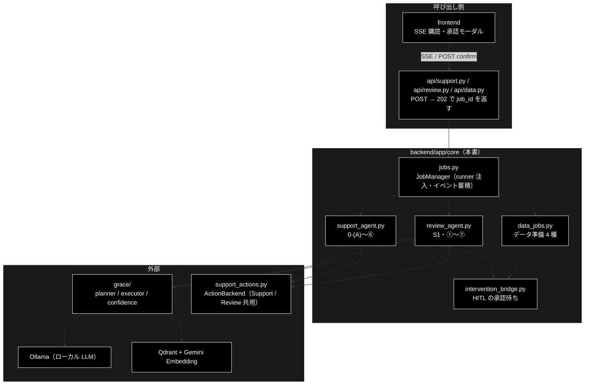
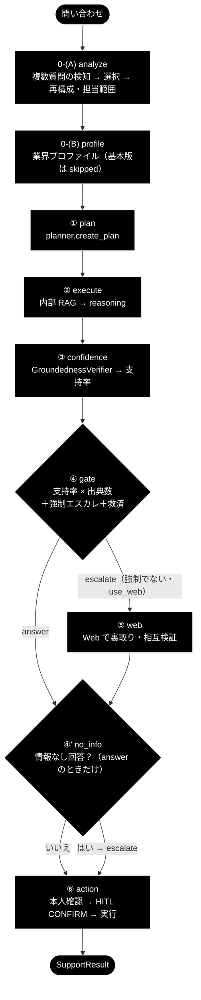
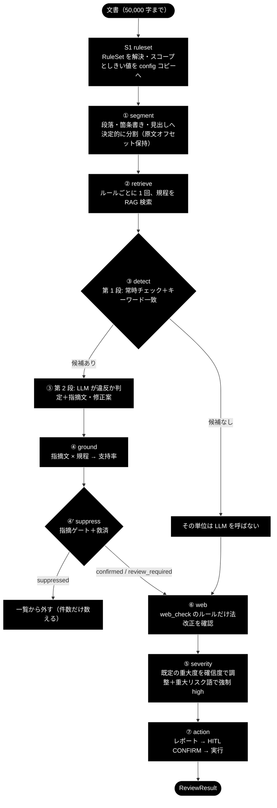
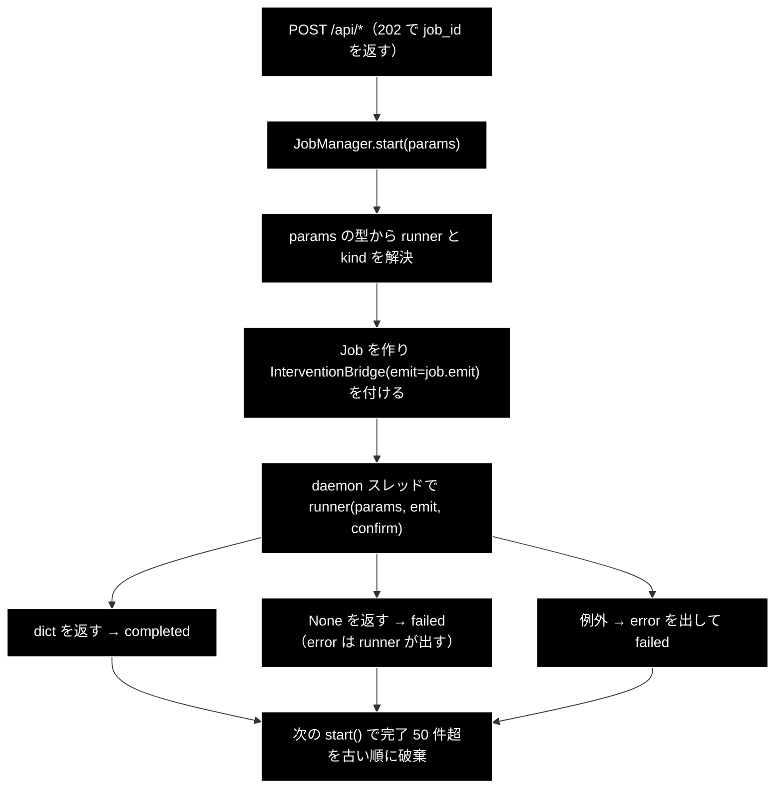
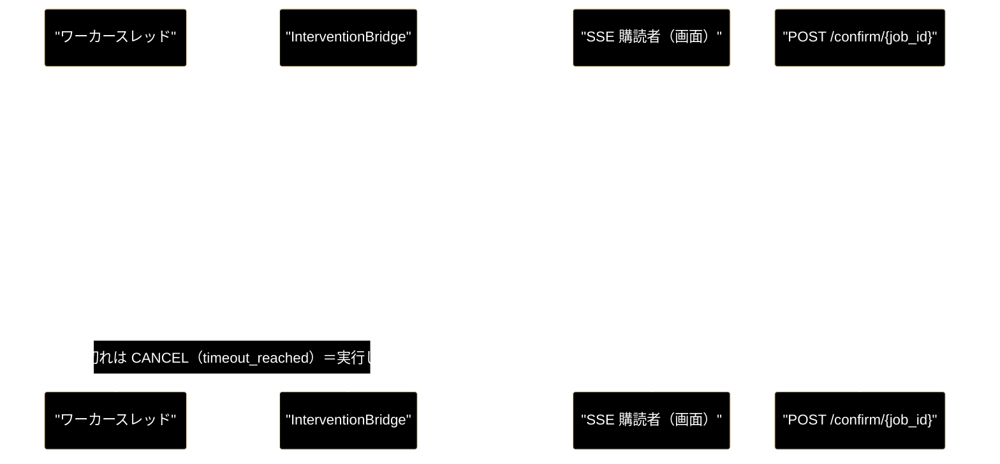

# core_process_flow.md - GRACE-Support / GRACE-Review とジョブ基盤の処理フロー

**Version 1.1** | 最終更新: 2026-10-13

> ⚠️ **本リポジトリは Ollama 版。** LLM はすべてローカルの Ollama（既定は `config.py::get_default_ollama_model()`）、Embedding だけ Gemini。
> 姉妹リポジトリ `grace_v2`（Anthropic 版）の同名ファイルとは中身が違うので、文書をコピーで持ち込まない（CLAUDE.md §5）。
>
> 📝 2026-10-12 に `backend/docs/` を廃止したとき、`support_flow.md`（1,843 行）・`review_flow.md`（1,202 行）・
> `job_runtime.md`（345 行）の**流れと設計判断**だけをここへまとめた。関数のシグネチャ・引数・戻り値は書かない
> （各モジュール文書が正本。§4）。消した文書の全文は git 履歴に残る。

---

## 目次

- [概要](#概要)
- [1. GRACE-Support（問い合わせ → 回答）](#1-grace-support問い合わせ--回答)
- [2. GRACE-Review（文書 → 指摘）](#2-grace-review文書--指摘)
- [3. ジョブ基盤（3 系統の共有）](#3-ジョブ基盤3-系統の共有)
- [4. 関連ドキュメント](#4-関連ドキュメント)
- [5. 変更履歴](#5-変更履歴)

---

## 概要

`backend/app/core/` には 2 本のパイプラインと、それらとデータ準備を載せるジョブ基盤がある。
本書は `a_cross_doc_md_format.md` §1.3 の処理フローの章立て（全体フロー → ステップ詳細 → 分岐・例外）を、
**パイプラインごとに 1 章ずつ**繰り返す形にしている（1 ディレクトリに流れが 3 つあるため）。

| 項目 | 内容 |
|---|---|
| 種別 | A（横断・設計） |
| 対象 | `support_agent.py` / `gates.py` / `verticals.py`（Support）、`review_agent.py` / `review_gates.py` / `rulesets.py` / `review_facts.py`（Review）、`jobs.py` / `intervention_bridge.py` / `job_logs.py`（基盤） |
| 入口 | Web API だけ（CLI は無い。CLAUDE.md §1）。`POST /api/support/query` / `POST /api/review/submit` → `JobManager.start()` |

### 主な責務

- GRACE-Support の 1 周（0-(A)〜⑥）の順序・分岐と、なぜその判定にしたかを示す
- GRACE-Review の 1 周（S1・①〜⑦）の順序・分岐と、Support の機構をどう再利用したかを示す
- 3 系統（Support / Review / データ準備）が共有するジョブ・SSE・HITL の流れと、失敗時の扱いを示す
- 各ステップの実装の所在（モジュール文書）へ案内する

### 各責務対応のモジュール

| # | 責務 | 対応モジュール | 説明 |
|---|---|---|---|
| 1 | Support の流れ | `support_agent.py::run_support_agent_core` / `gates.py` / `verticals.py` | §1 |
| 2 | Review の流れ | `review_agent.py::run_review_agent_core` / `review_gates.py` / `rulesets.py` | §2 |
| 3 | ジョブ基盤 | `jobs.py::JobManager` / `intervention_bridge.py::InterventionBridge` / `job_logs.py::capture_logs` | §3 |
| 4 | 案内 | 各モジュール文書（`support_agent.md` ほか） | §4 |

### アーキテクチャ構成図

---

## 1. GRACE-Support（問い合わせ → 回答）

### 1.1 全体フロー

`STEP_IDS`（`support_agent.py`）の並びが実行順で、画面のタイムラインと 1 対 1 に対応する。
番号は呼称で、**④' は ⑤ の後**に走る。

### 1.2 ステップ詳細

| # | `STEP_IDS` | 実装 | 入力 → 出力 | 失敗・判定不能時の既定 |
|---|---|---|---|---|
| 0-(A) | `analyze` | `gates.py::looks_like_multi_question` → `create_question_analyzer` → `reconstruct_query` / `split_by_scope` | 原文 → 1 本の質問文・保留質問・範囲外質問 | **単一質問とみなす**（現行どおり 1 周） |
| 0-(B) | `profile` | `PROFILES.get(vertical)`（`verticals.py`） | `vertical` → 検索スコープ・しきい値・業務方針 | 基本版（`vertical=None`）は skipped |
| ① | `plan` | `grace.planner.create_plan` | 質問 → `ExecutionPlan` | — |
| ② | `execute` | `grace.executor.execute` ＋ `gates.py::_collect_citations` | 計画 → 回答・出典（`[社内] …` / `[Web] …`） | RAG スコアが `reasoning_min_rag_score`（0.64）未満の結果は根拠に採らない |
| ③ | `confidence` | `GroundednessVerifier.verify` | 回答 × 出典本文 → 支持率（supported / contradicted / neutral） | 全 neutral は `decided=0`（母数から除外） |
| ④ | `gate` | `gates.py::_answer_gate` ＋ `_should_force_escalate` ＋ `_should_rescue_unaffirmed` | 支持率・出典数 → `answer` / `escalate`・`warning` | 未検証・出典 0 は escalate |
| ⑤ | `web` | `support_agent.py` 内 ＋ `_web_citations` / `_merge_citations` / `_pick_groundedness` | escalate の回答 → Web 回答と統合出典 | 結果なしは `used_web=True` だけ記録 |
| ④' | `no_info` | `gates.py::_detect_no_info_answer` ＋ `create_no_info_judge` | answer の回答 → 情報なしなら escalate | 判定できないなら escalate（答えない方が安全） |
| ⑥ | `action` | `gates.py::_decide_action` → `_perform_action`（本人確認 → `InterventionBridge` → `ActionBackend`） | 判定・質問 → アクションの結果文 | 本人確認なし・承認タイムアウトは**実行せず有人へ** |

`support_rate = supported / (supported + contradicted)`。neutral を分母から除くのは、
Q&A 形式の出典では答えていない内容が neutral になり、母数に入れると減点されるため。

### 1.3 回答ゲート（④）と救済・強制エスカレ

| 状態 | 条件 | `decision` / `warning` | 振る舞い |
|---|---|---|---|
| 高信頼 | 支持率 ≥ `notify_th` かつ出典 ≥ 1 | `answer` / `False` | 出典つきで回答 |
| 中信頼 | `confirm_th` ≤ 支持率 < `notify_th` | `answer` / `True` | 回答＋「未確認」の注意書き（黙って精度を落とさない） |
| 低信頼 | それ未満・未検証・出典 0 | `escalate` | ⑤ Web へ。なお不足なら有人対応 |

- しきい値は `config/grace_config.yml` の `confidence.thresholds`（notify 0.7 / confirm 0.4）。プロファイルが上書きでき、
  `gov` は 0.8 / 0.5（正確性優先）。
- **強制エスカレ**（二段判定）: 第 1 段でプロファイルの `escalate_keywords` に部分一致 → 第 2 段で意図分類
  （`create_intent_classifier`）。`question`（FAQ）なら誤検知として発動しない。`request` / `incident` / 分類失敗は安全側で発動する。
- **④-救済**: escalate でも、強制でなく・矛盾なし・出典あり・実質的な回答なら `answer`（`warning=True`）に戻す。
  放置すると ⑤ の作り直しで「情報なし」回答に化け、④' で誤エスカレしていた（ec の返金ポリシーで実測）。
- `decision` は `answer` / `escalate` の **2 値**。中信頼は「答えない」ではなく `warning` で表す（判定軸を 1 本に保つ）。

### 1.4 Web フォールバック（⑤）と情報なし検知（④'）

- ⑤ は **escalate かつ強制エスカレでなく `use_web=True`** のときだけ走る。② で executor が同じクエリの Web 検索を使っていれば、
  回答を作り直さず**内部回答の再検証だけ**行う（`web_reused`。重複推論の省略）。
- `use_web=False` は「**内部 RAG のみ**」。⑤ だけでなく executor の Web 検索（5 経路）も `Executor._web_search_allowed` で止める
  （`tests/test_web_search_toggle.py`）。
- ④' は ⑤ の後、`decision == "answer"` のときだけ。第 1 段は `NO_INFO_MARKERS`（「見当たりません」等）の照合、
  第 2 段は軽量モデルの実質回答判定。**出典が Web だけのとき**は候補句が無くても第 2 段を必ず通す（範囲外の質問 × 動的 Web 検索の対策）。

### 1.5 Action（⑥）

| 判定 | アクション | 承認 |
|---|---|---|
| escalate | `escalate_to_human` | **不要**（引き継ぎ自体が安全側。承認待ちで宙に浮かせない） |
| answer ＋ `action_map` の語に一致 ＋ 意図が `request` / `incident` | `create_ticket` / `send_reply` | **必要**（HITL CONFIRM） |
| answer ＋ 意図が `question` | なし | — |

- `require_identity=True` のプロファイル（`ec`）は、実行前に `IdentityVerifier` で識別子を照合する。未確認なら実行せず有人へ。
- 既定は **dry-run**（`DryRunActionBackend`。記録だけ）。実 API 連携（`WebhookActionBackend`）は `dry_run=False` で `SUPPORT_ACTION_WEBHOOK_URL` を置いたときだけで、
  URL が無ければ疑似実行（`PseudoActionBackend`。ログだけ）。
- **本リポジトリは副作用の無いバックエンド（dry-run）では承認を省く**（`has_side_effects` が偽なら CONFIRM を出さない。`_perform_action`）。
  承認待ちを見たいときは `dry_run=False` にする（Webhook を置かなければ実行は疑似のまま）。
- 副作用は ⑥ がバックエンドを**直接呼ぶ**。`grace/tools.py` のツールにしない（executor が計画の都合で任意の位置に差し込めてしまうため）。

### 1.6 複数質問と担当範囲外（0-(A)）

**前処理であってゲートではない。** 再構成した文を `query` として渡すだけで、planner 以降の判定は変えない。

| 入力 | 第 2 段（LLM） | 選択 | 結果 |
|---|---|---|---|
| 単一質問 | 呼ばない | 出さない | 現行どおり（`analyze` は skipped） |
| 主質問 1 ＋ 関連質問 N | 呼ぶ | 出さない | 再構成して 1 周（指示語を解決） |
| 範囲内 1 ＋ 範囲外 N-1 | 呼ぶ | 出さない | 範囲内に回答＋範囲外は断りと窓口案内 |
| 範囲内が複数 | 呼ぶ | 出す（`ask_user`） | 選んだ 1 つを再構成して 1 周＋**保留質問を必ず返す** |
| 選択がタイムアウト / 拒否 | 呼ぶ | 出す | 原文のまま 1 周（escalate にしない） |
| 解析器の失敗・空応答 | 呼ぶ | 出さない | 単一とみなす |

- 🔴 **保留質問は必ず利用者へ出す。** 出さないと「片方の質問が黙って落ちたのに、支持率が高いので高信頼として提示される」。
  複数質問対応で最も危険とした事故がこれで、`deferred_main_questions` の戻り値と `AnswerCard` の表示が防いでいる。
- **保留**（`deferred_questions`：範囲内だが今回は答えていない）と**範囲外**（`out_of_scope_questions`：この窓口では答えられない）を混ぜない。利用者が次にすることが違う。
- 範囲外の判定は `create_scope_classifier` が全主質問を 1 回で行う。**判定できなければ範囲内**（全件 OUT も分類器の故障とみなして範囲内へ倒す）。
- 範囲外の質問は**検索クエリから外し、生成側には渡す**（`VerticalProfile.build_closing_instruction()` を回答の構成ルールの**後ろ**に置く。前に置くと構成ルールに負けて断りが落ちた）。
  ローカル LLM は指示に従わず断りを落とした実測がある（2026-08-29）ので、モデルが断らなかったときは `gates.ensure_out_of_scope_notice()` が**ゲートの後で**追記し、案内先の URL（`out_of_scope_links`。実在する公的機関だけ）が欠けていれば URL だけを補う。

以下は旧 `docs/multi_question_handling.md` §0 から移した要点（2026-10-13。同書の検討経緯〔§1〜§9〕は git 履歴に残る）。

- **二段判定。** 第 1 段 `gates.looks_like_multi_question`（接続表現か疑問符 2 個以上。LLM を呼ばない）で候補を絞り、
  第 2 段 `gates.create_question_analyzer` が主質問・関連質問の構造化と IN/OUT 判定を 1 回の LLM 呼び出しで行う。
- ⚠️ **第 2 段は解析結果ではなく「了解しました。…」という返事を返すことがある**（実測 2026-08-29）。対策は 3 つ:
  プロンプトの末尾を命令文にする／形式違反なら 1 回だけ厳格に再要求する（`SINGLE` は正常な判定なので再要求しない）／
  元の問い合わせに由来しない行があれば出力ごと捨てる（`_derives_from_query`・文字 2-gram の一致率 `MIN_QUERY_OVERLAP = 0.5` 以上。部分採用はしない）。
  散文が「主質問」として採用され、聞かれていない質問に答えるのを防ぐ。
- **安全側の向きが後段のゲートと逆。** ④' などは判定できなければ escalate だが、複数質問検知は**単一とみなす**（誤って分解する方が害が大きい）。
- **設定は `judges.multi_question`（既定 `true`）で、`judges.enabled`（既定 `false`）とは独立。** 他の補助判定にはキーワード判定という代替があるが、
  構造解析には無い。切ると保留質問が黙って落ちる。出力枠は `verticals.MULTI_QUESTION_MAX_OUTPUT_TOKENS`（1024）で、
  判定用の `JUDGE_MAX_OUTPUT_TOKENS`（512）を流用すると思考で枠を使い切って空応答になり、機能が黙って効かなくなる。
- **URL を記憶から書かせない。** 案内先は `VerticalProfile.out_of_scope_links` からこちらが literal で渡す（回答の構成ルール 4 の捏造禁止）。
  後付けの断り文は claim として neutral になるが、`grace.confidence.is_unsupportable_policy_claim` が支持率の母数から外すので、正しく断っても信頼度は下がらない。
- `SupportResult` に足したフィールド: `is_multi_question` / `question_clusters` / `adopted_cluster_index` / `reconstructed_query`（原文と同じなら null）/
  `deferred_questions` / `out_of_scope_questions` / `out_of_scope_guidance`。フロントは `state/interventionKind.ts`（承認待ちの種類）・
  `QuestionSelectModal.tsx`（選択 UI）・`AnswerCard.tsx`（保留・範囲外の表示）。
- テスト: `tests/test_multi_question.py`（純ロジック・`judges.multi_question` の独立性）/ `tests/test_multi_question_pipeline.py`（パイプライン組み込み）/
  `frontend/src/state/interventionKind.test.ts`。

### 1.7 基本版（`vertical=None`）

画面の「基本版」は別実装ではなく、同じ `run_support_agent_core` を `vertical=None` で呼ぶ。
プロファイル由来の機構（検索スコープ・しきい値・業務方針・断りの指示・担当範囲・強制エスカレ・本人確認・Web 優先ドメイン）は
すべて「無し」に倒れ、0-(B) は skipped になる。**パイプラインの実力をプロファイル抜きで見る基準線**として残している。
ガードレールが薄い（範囲外の質問にも答えようとする）ので、業務では GRACE-Support を選ぶ。3 モードの対照は
[`docs/pipelines.md`](../../../../docs/pipelines.md) §3・§4。

### 1.8 評価指標

| 指標 | 定義 | 目標 |
|---|---|---|
| 自己解決率 | 有人に回さず解決した割合 | 高いほど良い |
| 出典付与率 | 回答に出典が付いた割合 | ほぼ 100% |
| 根拠なし回答率 | 出典・根拠なしで断定した割合 | 0 に近いほど良い |
| エスカレーション適合率 | escalate が妥当だった割合 | 高いほど良い |
| 平均応答時間 | 問い合わせ → 回答 | 低いほど良い |

LLM はローカル実行なので課金されるのは Embedding（Gemini）だけで、効いてくるのは**時間**である。ローカルでは往復 1 回の差が体感に直結するため、
0-(A) の分解と担当範囲の判定は 1 回の LLM 呼び出しに畳んである（以前は 2 回で、実測 16.3 秒＋2.2 秒かかっていた。2026-08-30）。

---

## 2. GRACE-Review（文書 → 指摘）

### 2.1 設計方針

GRACE-Review は文書（EC の LP・商品説明文）を規程（景表法・特商法・薬機法・社内方針）に照らし、**根拠条文つきの指摘**を返す。
入出力の型は Support と違うが、中核の機構は再利用している。

| GRACE-Support | GRACE-Review | 再利用する実装 |
|---|---|---|
| ③ 回答の裏付け | ④ Ground（**指摘の根拠**が規程にあるか） | `GroundednessVerifier`（無改造） |
| ④ 回答ゲート | ④' 指摘ゲート（confirmed / review_required / suppressed） | `_answer_gate` と同型の `decide_finding_status` |
| ④-救済 | ④-救済（矛盾なしの指摘は棄却せず保留へ） | `_should_rescue_unaffirmed` と同型 |
| エスカレ語 → 強制エスカレ | **重大リスク語** → 強制 high | `_should_force_escalate` と同型（二段判定） |
| ⑤ Web フォールバック | ⑥ Web 裏取り（**信頼度を下げる方向にだけ**使う） | `tool_registry.execute("web_search")` |
| ⑥ Action | ⑦ Action（レポート → HITL → 起票 / 引き継ぎ） | `_perform_action` / `ActionBackend`（無改造） |
| `VerticalProfile` | `RuleSet`（1 プロファイル = N ルール） | 構造を踏襲（型は分ける） |

3 原則: (1) **既存機構を無改造で使う**（変更が要るなら設計を疑う）、(2) **過検知を抑えることを最優先**
（指摘が多すぎると読まれない）、(3) **Support を壊さない**（共用部品を触ったら `tests/test_review_*.py` も流す）。
新規に作ったのは Segment / Detect / Severity の 3 つだけである。

### 2.2 全体フロー

`REVIEW_STEP_IDS` の並びが実行順。**⑥ Web は ⑤ Severity より先**に走る（番号は Support との対応を示す呼称）。

### 2.3 ステップ詳細

| # | `REVIEW_STEP_IDS` | 実装 | 入力 → 出力 | 失敗・判定不能時の既定 |
|---|---|---|---|---|
| （0） | — | `run_review_agent_core` の冒頭 | 設定を**ディープコピー**（LLM はローカルで API キーが無いので事前チェックはしない） | Ollama・Embedding に届かなくても例外にせず、全ルールを「自動判定に失敗したため要確認」で返す |
| S1 | `ruleset` | `rulesets.py::get_ruleset` | ID → スコープ・しきい値（既定 0.85 / 0.60）・重大リスク語 | 未知の ID は skipped |
| ① | `segment` | `review_agent.py` の分割関数 | 文書 → `Segment`（`start` / `end` は原文基準） | 400 字超は文末で再分割。200 個で打ち切り（`truncated`） |
| ② | `retrieve` | `_retrieve_evidence`（`rag_search`・5 件） | ルールの `retrieval_query()` → 規程の出典と本文 | 例外・空は根拠なしで続行（要旨 `public_description()` が根拠の代わり） |
| ③ | `detect` | `review_gates.py::select_candidate_rules` → `create_violation_detector` | 判定単位 × 候補ルール → 違反の判定・指摘文・修正案 | LLM 呼び出しが 300 回で打ち切り（`truncated`） |
| ④ | `ground` | `GroundednessVerifier`（Support と同じ）＋ `damp_support_rate` | 指摘文 × 規程 → 支持率 | 判定できない主張が多いほど減衰 |
| ④' | `suppress` | `decide_finding_status` ＋ `should_rescue_finding` ＋ `detect_vacuous_finding` | 支持率・出典数 → 3 状態 | 未検証・根拠ゼロは **`review_required`**（指摘を消さない） |
| ⑥ | `web` | ルール単位で 1 回（`"{law} {article} 改正 ガイドライン"`） | `web_check` のルール → `web_checked` | 既定 OFF。例外・待ちの打ち切りは握りつぶして続行 |
| ⑤ | `severity` | `adjust_severity` ＋ `should_force_high` ＋ `apply_forced_high` | 既定の重大度・確信度・重大リスク語 → 最終の重大度 | 言及種別の分類に失敗したら安全側（強制する） |
| ⑦ | `action` | `_decide_review_action` → `_perform_action`（Support と同じ関数） | 指摘 → レポート（Markdown）→ 実行 | 本人確認は不要（`identity_verifier=None`） |

### 2.4 分岐の要点

- **判定単位**: 常時チェックのルール（`always_check=True`。表記漏れを見る 7 件）は**文書全体**を 1 単位として判定する。
  それ以外はセグメントごとに、キーワード（除外語 `keyword_excludes` を引いて）が当たったルールだけを第 2 段へ送る。
- **② はルール自身の文で引く。** 広告の文をクエリにするとスコアが下限 0.70 を割り、登録した条文が根拠に届かなかった（2026-10-01 に是正）。
  クエリがルールだけで決まるので、同じルールが複数の単位に出ても検索は 1 回。採用は `evidence_min_score`（0.70）以上かつ
  最上位 × `evidence_top_ratio`（0.92）以上（他ルールの条文が混ざって指摘文が越境するのを防ぐ）。`policy-01` は
  `evidence_query` / `evidence_collections` で自社規程のコレクションだけを引く（詳細と登録手順は [`rulesets.md`](rulesets.md) §6.4）。
- **② は並列 4、③④ は Ollama の同時処理数**（`OLLAMA_NUM_PARALLEL`、未設定なら 1＝直列）。ローカルの Ollama は既定で 1 本ずつしか処理しないので、
  多く投げてもキューで待つだけで速くならず、待ち時間が各呼び出しのタイムアウトを食う。`GRACE_REVIEW_WORKERS` は両方を上書きする（0 以下は直列、数値でなければ既定）。
- **④' 指摘ゲート**: 支持率 ≥ `notify_th` → `confirmed`、≥ `confirm_th` → `review_required`、それ未満 → `suppressed`。
  `suppressed` でも矛盾なし・根拠あり・実質的なら `review_required` に救済する。`confirm_needs_human=True` のルール
  （広告文だけでは決まらないもの。現在 keihyo-07）は `confirmed` にしない。
- **文字列で決まる事実**（送料の表示・返品条件の比較）は `review_facts.py` が LLM の判定を補う。
- **⑥ Web は新しい指摘を作らない。** 信頼度を下げる方向にだけ使う。
- **⑤ 強制 high**: `critical_keywords` に一致 → 言及種別を分類（打消し・引用などの誤検知を除く）→ high と `review_required` へ引き上げる。
- **⑦**: high が 1 件でもあれば `escalate_to_human`（承認不要）、それ以外は `create_ticket`（要承認）、指摘ゼロならアクションなし。

### 2.5 ガード上限

| 定数 | 値 | 到達時 |
|---|---:|---|
| `schemas.MAX_DOCUMENT_CHARS` | 50,000 | 入力段で 422 |
| `MAX_SEGMENTS` | 200 | 以降を捨てて `truncated=True` |
| `MAX_SEGMENT_CHARS` | 400 | 文末で再分割（打ち切りではない） |
| `MAX_LLM_CALLS` | 300 | ③ を打ち切って `truncated=True` |
| `RETRIEVE_LIMIT` | 5 | ② の取得件数 |

> ⚠️ **上限は外さない。** 200 セグメント × 23 ルールを無条件に第 2 段へ送ると 4,600 回の LLM 呼び出しになる。

### 2.6 データモデル

| 型 | 主な項目 |
|---|---|
| `Segment` | `segment_id` / `text` / `start` / `end` / `kind`（`paragraph` / `list_item` / `heading` / `document`） |
| `ReviewFinding` | 原文の位置（`segment_id` / `excerpt` / `start` / `end`）、ルール（`rule_id` / `law` / `article`）、`message` / `suggestion`、`severity` / `confidence` / `citations`、`status` / `forced` / `web_checked` |
| `FindingSummary` | 重大度別・状態別の件数（`suppressed` は件数だけで、`findings` には入らない） |
| `ReviewResult` | 上記に加えて `used_web` / `action` / `action_result` と計測値（`rules_evaluated` / `detected_raw` / `rescued` / `forced_high` / `truncated`） |

項目の正本は [`review_agent.md`](review_agent.md)、API の形は [`../../docs/schemas.md`](../../docs/schemas.md)。

### 2.7 前提と未決事項

| 論点 | 現在の扱い |
|---|---|
| 規程データ | `ec_ad_rules_anthropic` は grace_v2 と**共用の Qdrant** にあり、条文の雛形（`qa_output/ec_ad_rules_statutes_template.csv`）は grace_v2 にだけ置く（CLAUDE.md §5・[`docs/port_from_grace_v2_todo.md`](../../../../docs/port_from_grace_v2_todo.md) §12） |
| 入力方式 | テキストの貼り付けだけ（ファイルの取り込みは無い） |
| Web 裏取りの既定 | OFF（条文が一次情報で、速度とコストに見合わない） |
| 本人確認 | 不要（`identity_verifier=None` 固定） |
| 法務監修 | **本ルールセットは技術検証用のサンプル**。実運用には監修が要る |

---

## 3. ジョブ基盤（3 系統の共有）

### 3.1 ジョブのライフサイクルとリプレイ

- `emit()` はイベントに `seq`（連番）と `ts` を付けて `Job.events` に**捨てずに**積む。SSE は先頭から流すので、
  POST と購読のあいだのイベントも、再接続でも取りこぼさない。
- 15 秒イベントが無ければ keepalive（`SSE_KEEPALIVE` = **名前付きイベント**）を送る。フロントは keepalive も含めて 60 秒無音なら
  張り直し、リプレイ分を `seq` で読み飛ばす（`frontend/src/state/streamWatch.ts`）。keepalive をコメント行に戻さないこと。
- イベントは `step` / `log` / `intervention` / `result` / `error` の 5 種。SSE の終端 `done` は別物で、`ts` と `started_at` を必ず載せる
  （画面の所要時間がこれを使う）。ワイヤ形式は [`../../api/docs/README_api.md`](../../api/docs/README_api.md) §4.1。

### 3.2 runner 注入と HITL の橋渡し

| params の型 | kind | 登録する場所 |
|---|---|---|
| `JobParams` | `support` | `jobs.py` の末尾 |
| `ReviewParams` | `review` | `review_agent.py` の import 時 |
| `ChunkingParams` / `QaGenerationParams` / `RegisterParams` / `DeleteParams` | `chunking` / `qa` / `register` / `delete` | `data_jobs.py` の import 時 |

- `register_runner()` は import の副作用だが漏れない（params を作るにはそのモジュールを import する必要がある）。
  これで `jobs.py` は Review もデータ準備も知らずに済み、循環 import も起きない。未登録の型は `TypeError`。
- `InterventionBridge` は、同期コールバック（`InterventionHandler.on_confirm`）と別の HTTP リクエストで届く承認を `threading.Event` でつなぐ。

- 待ち時間は Bridge 生成時の指定 → `request.timeout_seconds` → `DEFAULT_CONFIRM_TIMEOUT`（300 秒）の順。
  **「返事が無い＝承認」には絶対にしない。** Web 経路に自動承認は持ち込まない。
- 同時に待てるのは 1 ジョブ 1 件。`intervention_id` が違えば `not_waiting`（404 ではない）。`selected_option` は 0-(A) の主質問の選択にだけ使う。
- データ準備のパッケージ（`chunking/` ほか）は進捗を `logger` にしか出さないので、`job_logs.capture_logs` が実行中だけハンドラを付けてイベントへ流す
  （スレッド ID で絞る・level を参照カウントで戻す。どちらも削ると壊れる。[`job_logs.md`](job_logs.md)）。

### 3.3 失敗の扱いと制約

| 失敗 | 見え方 |
|---|---|
| runner が例外 | `error`（型・内容と Qdrant / API キーの手がかり）→ `failed` |
| runner が `None` | runner が出した `error` だけ → `failed` |
| HITL のタイムアウト | `intervention`（`timeout`）。**ジョブは失敗しない**。アクションを実行せず有人へ倒して続行 |
| ジョブ ID が無い | 404（`job not found`） |
| データ準備で Ollama が起動していない・モデルが pull されていない | LLM ループの前に `error`（起動方法・pull 済みの一覧を添える）→ `failed` |

SSE は失敗しても必ず `done`（`status=failed`）で閉じる。

| 制約 | 影響 |
|---|---|
| メモリ上に保持・永続化なし | 再起動で全ジョブが消え、`job_id` は 404 |
| シングルプロセス前提 | `--workers 2` 以上だと別プロセスのジョブが見えない |
| 完了ジョブは 50 件まで（`MAX_FINISHED_JOBS`） | 古い完了ジョブから消え、結果の取得が 404 |
| 認証なし | CORS は `localhost:5173` / `127.0.0.1:5173` だけ |
| キャンセル API なし | 走り出したジョブは外から止められない |

ジョブ種別を足すときの手順は [`README_core.md`](README_core.md) §5.2。

---

## 4. 関連ドキュメント

| 知りたいこと | 文書 |
|---|---|
| Support の関数・`SupportResult` の項目 | [`support_agent.md`](support_agent.md)・[`gates.md`](gates.md)・[`verticals.md`](verticals.md) |
| Review の関数・データクラスの項目 | [`review_agent.md`](review_agent.md)・[`review_gates.md`](review_gates.md)・[`rulesets.md`](rulesets.md)・[`review_facts.md`](review_facts.md) |
| ジョブ・HITL・ログ取り込みの実装 | [`jobs.md`](jobs.md)・[`intervention_bridge.md`](intervention_bridge.md)・[`job_logs.md`](job_logs.md)・[`data_jobs.md`](data_jobs.md) |
| エンドポイント・SSE のワイヤ形式・HTTP ステータス | [`../../api/docs/README_api.md`](../../api/docs/README_api.md) §4 |
| backend 全体の構成・モデル名の解決・API キー | [`../../docs/README_app.md`](../../docs/README_app.md) §4 |
| 3 モードの対照・ガードレール | [`docs/pipelines.md`](../../../../docs/pipelines.md)・[`docs/guardrails.md`](../../../../docs/guardrails.md) |
| 画面側 | [`frontend/docs/SupportPanel.md`](../../../../frontend/docs/SupportPanel.md)・[`frontend/docs/ReviewPanel.md`](../../../../frontend/docs/ReviewPanel.md) |

---

## 5. 変更履歴

| バージョン | 日付 | 変更内容 |
|---|---|---|
| 1.0 | 2026-10-12 | 新規作成。`backend/docs/` の廃止にあわせ、`support_flow.md` / `review_flow.md` / `job_runtime.md` の流れと設計判断をまとめた（grace_v2 の同名文書と章立てをそろえ、Ollama 版の違い〔dry-run で承認を省く・③④ の並列数・事前チェックの有無・課金〕を実装で確かめて書いた）。④' 指摘ゲートで根拠ゼロは `review_required`、② Retrieve はルールごとに 1 回（いずれも実装で確認） |
| 1.1 | 2026-10-13 | §1.6 に旧 docs/multi_question_handling.md §0 の要点（二段判定・了解の返事への対策・安全側の向き・judges.multi_question・URL の扱い・返すもの・テスト）を統合 |
