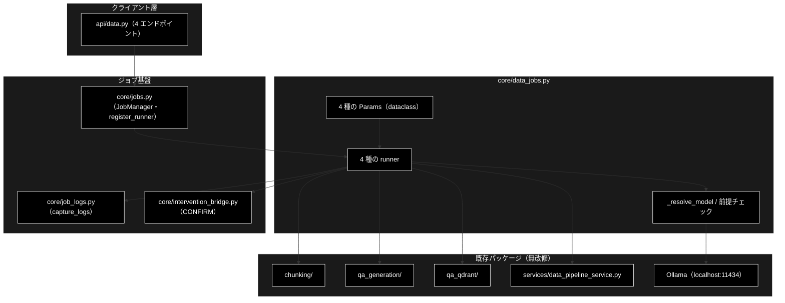
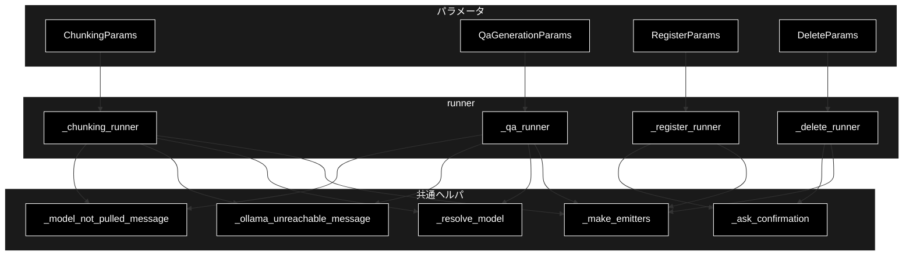

# core/data_jobs.py - データ準備ジョブの runner ドキュメント

**Version 1.8** | 最終更新: 2026-10-12

> **本書の位置づけ**: `backend/app/core/data_jobs.py`（データ準備 4 ジョブの runner）の **IPO リファレンス**。
> 引くための文書であり、**設計の「なぜ」と処理の流れは上位の文書が正本**である。
>
> | 知りたいこと | 参照先 |
> |---|---|
> | ジョブ基盤・runner 注入・SSE・HITL | [`core_process_flow.md` §3.2](core_process_flow.md) |
> | エンドポイントと CONFIRM の要否 | [`README_api.md` §4.0](../../api/docs/README_api.md) |
> | 使うモデルの決まり方・Ollama の前提チェック | [`README_app.md` §4.3](../../docs/README_app.md) |
> | 文書全体の地図 | [`README_app.md`](../../docs/README_app.md) |

---

## 目次

1. [概要](#概要)
2. [アーキテクチャ構成図](#1-アーキテクチャ構成図)
3. [モジュール構成図](#2-モジュール構成図)
4. [クラス・関数一覧表](#3-クラス関数一覧表)
5. [クラス・関数 IPO詳細](#4-クラス関数-ipo詳細)
6. [設定・定数](#5-設定定数)
7. [落とし穴](#6-落とし穴)
8. [エクスポート](#7-エクスポート)
9. [変更履歴](#8-変更履歴)

---

## 概要

`backend/app/core/data_jobs.py` は、データ準備の 4 ジョブ
（**チャンク化 / Q/A 生成 / Qdrant 登録 / コレクション削除**）を
**GRACE-Support・GRACE-Review と同じジョブ基盤**（`core/jobs.py`）へ載せる runner 群である。

`register_runner(params_type, runner, kind)` が params の型から runner を解決するため、
`jobs.py` に手を入れずに 4 種類を追加できる。

### 主な責務

- 4 種類の params（`ChunkingParams` / `QaGenerationParams` / `RegisterParams` / `DeleteParams`）を受け、対応するパッケージを呼ぶ
- 進捗を `step` / `log` イベントとして SSE へ流す（既存パッケージは**無改修**。`core/job_logs.py` の `capture_logs()` で `logging` を横取りする）
- **破壊的操作に HITL CONFIRM を通す**（削除は常に / 登録は `recreate=True` のときだけ）
- **ローカル LLM の前提をループ前に確かめる**（Ollama への到達性・モデルが pull 済みか）
- 使用モデルを **1 箇所（`_resolve_model()`）で解決**する

### 各責務対応のモジュール

| # | 責務 | 対応モジュール | 説明 |
|---|------|--------------|------|
| 1 | 4 種類の params を受け、対応するパッケージを呼ぶ | `backend/app/core/data_jobs.py::_chunking_runner` / `_qa_runner` / `_register_runner` / `_delete_runner` | 呼び先は チャンク化 `chunking/csv_text_to_chunks_text_csv.py`・Q/A 生成 `qa_generation/pipeline.py::QAPipeline`・登録 `qa_qdrant/register_to_qdrant.py`・削除 `services/data_pipeline_service.py::delete_collection`。モジュール末尾の `backend/app/core/jobs.py::register_runner` で params の型から runner を引けるようにする |
| 2 | 進捗を `step` / `log` イベントとして SSE へ流す | `backend/app/core/job_logs.py::capture_logs` | 既存パッケージは無改修。ステップごとに `with capture_logs(emit, step=...)` で `logging` を横取りする。イベントの型は `backend/app/core/support_agent.py::SupportEvent` |
| 3 | 破壊的操作に HITL CONFIRM を通す | `backend/app/core/data_jobs.py::_ask_confirmation` → `grace/intervention.py::InterventionRequest` | 削除は常に、登録は `recreate=True` かつ既存コレクションがあるときだけ。承認の橋渡しは `backend/app/core/intervention_bridge.py`（`jobs.py` 経由） |
| 4 | ローカル LLM の前提をループ前に確かめる | `backend/app/core/data_jobs.py::_ollama_unreachable_message` / `_model_not_pulled_message` | 判定の実体は `services/data_pipeline_service.py::ollama_unreachable_message` / `model_not_pulled_message`（CLI のチャンク化と共用）。チャンク化と Q/A 生成で使う |
| 5 | 使用モデルを 1 箇所で解決する | `backend/app/core/data_jobs.py::_resolve_model` | 未指定なら `get_config().llm.model`（画面ヘッダーと同じ解決）、それも無ければ `config.py::get_default_ollama_model()` |

### 主要機能一覧

| 機能 | 説明 |
|---|---|
| `_chunking_runner()` | CSV / テキスト → セマンティックチャンク CSV（`load` → `chunk` → `save`） |
| `_qa_runner()` | チャンク → Q/A ペア（`load` → `generate` → `coverage` → `save`） |
| `_register_runner()` | Q/A CSV → Qdrant 登録（`prepare` → `confirm` → `embed` → `upsert`） |
| `_delete_runner()` | コレクション削除（`inspect` → `confirm` → `delete`） |
| `_resolve_model()` | 使用モデルの解決（フォーム指定 → `get_config().llm.model` → 既定） |
| `_ollama_unreachable_message()` / `_model_not_pulled_message()` | ローカル LLM の前提チェック |

---

## 1. アーキテクチャ構成図

### 1.1 システム全体構成



### 1.2 データフロー

1. `api/data.py` が params を作り `job_manager.start(params)` を呼ぶ
2. `jobs.py` が型から runner を解決し、ワーカースレッドで実行する
3. runner は `_make_emitters(emit)` で step/log ヘルパを作り、進捗を SSE へ流す
4. 破壊的操作の手前で `_ask_confirmation()` が CONFIRM を要求する
5. 既存パッケージを呼ぶ区間は `capture_logs()` でログを横取りして転送する
6. 戻り dict が `Job.result` になる（`None` は失敗）

---

## 2. モジュール構成図



### 2.2 外部依存関係

| 依存 | 用途 |
|---|---|
| `chunking.csv_text_to_chunks_text_csv` / `chunking.async_api_client` | チャンク化本体・中断例外 |
| `qa_qdrant.register_to_qdrant` | Qdrant 登録本体 |
| `services.data_pipeline_service` | 入力ファイル解決・コレクション操作・Ollama 到達性 / pull 済み判定 |
| `services.qdrant_service` | コレクション一覧 |
| `qdrant_client_wrapper` | Qdrant クライアント |
| `config` | `get_default_ollama_model` / `get_default_chunking_workers` |
| `grace.intervention` | `InterventionRequest` / `InterventionLevel` |

---

## 3. クラス・関数一覧表

### 3.1 パラメータ（dataclass）

| クラス | 主なフィールド | CONFIRM |
|---|---|---|
| `ChunkingParams` | `input_file` / `output_dir="output_chunked"` / `model=None` / `workers`（既定は `get_default_chunking_workers()`）/ `block_size=1000` / `text_column` / `max_rows` / `combine_rows` / `resume` | なし |
| `QaGenerationParams` | `input_file` / `output_dir="qa_output"`（直下。入れ子だと ③ の選択肢に出ない） / `model=None` / `max_docs` / `use_celery=False` / `concurrency=8`（表示用。実際の並列数はワーカーの `-c`） / `analyze_coverage=True` | なし |
| `RegisterParams` | `input_file` / `collection` / `recreate=False` / `batch_size=100` / `embed_workers=2` / `text_col` / `domain` / `max_docs` / **`provider="gemini"`** / `normalize_filename=True` / `create_ui_csv=True` | `recreate=True` のときだけ |
| `DeleteParams` | `collections: List[str]` | **常に** |

### 3.2 関数一覧

| 関数 | 概要 |
|---|---|
| `_resolve_model(explicit)` | 使用モデルの解決（未指定は `get_config().llm.model` → `get_default_ollama_model()`） |
| `_ollama_unreachable_message()` | Ollama へ確実に繋がらないときだけメッセージを返す |
| `_model_not_pulled_message(model)` | モデルが未 pull ならメッセージ（**pull 済み一覧つき**）を返す |
| `_make_emitters(emit)` | `log` / `step_started` / `step_finished` / `step_skipped` / `error` を作る |
| `_ask_confirmation(confirm, message, reason)` | CONFIRM を要求し `(承認されたか, タイムアウトしたか)` を返す |
| `_chunking_runner` / `_qa_runner` / `_register_runner` / `_delete_runner` | 4 種の実行関数 |

---

## 4. クラス・関数 IPO詳細

### 4.1 使用例

| # | パターン | いつ使うか | 例 |
|---|---------|-----------|----|
| 1 | **基本**: パラメータとステップ定義を見る | 画面のステップ表示・承認の要否を確かめる | 4.1.1 |
| 2 | ジョブとして起動する（`JobManager.start`） | runner の解決と失敗の返り方を確かめる | 4.1.2 |

> 📝 **確かめ方（2026-10-11）**: 4.1.1・4.1.2 はすべて `PYTHONPATH=. python3 <例>.py` で実行し、出力が記載どおりであることを確かめた（LLM・Qdrant は使わない）。

#### 4.1.1 基本的なワークフロー（パラメータとステップ定義）

4 種の runner は `params` の**型**で解決される（`register_runner()` 済み）。
呼び出し側が作るのはパラメータだけで、runner を直接呼ぶ必要はない。

```python
from backend.app.core.data_jobs import (
    ChunkingParams, DeleteParams, CHUNKING_STEP_IDS, DELETE_STEP_IDS,
)

# 1. チャンク化（非破壊なので CONFIRM なし）
p = ChunkingParams(input_file="OUTPUT/cc_news_1per.csv")
print(f"{type(p).__name__}: {p.input_file} -> {p.output_dir}")
print(f"steps: {CHUNKING_STEP_IDS}")

# 2. 削除（破壊的なので confirm ステップを持つ）
d = DeleteParams(collections=["demo_anthropic"])
print(f"{type(d).__name__}: {d.collections} / steps={DELETE_STEP_IDS}")

# 出力例:
# ChunkingParams: OUTPUT/cc_news_1per.csv -> output_chunked
# steps: ('load', 'chunk', 'save')
# DeleteParams: ['demo_anthropic'] / steps=('inspect', 'confirm', 'delete')
```

> ⚠️ **`confirm` ステップの有無が、そのジョブが破壊的かどうかを表す。**
> 削除は常に、登録は `recreate=True` のときだけ HITL CONFIRM を通る（§7）。

#### 4.1.2 ジョブとして起動する

```python
from backend.app.core.data_jobs import ChunkingParams
from backend.app.core.jobs import JobManager

mgr = JobManager()
job = mgr.start(ChunkingParams(input_file="OUTPUT/no_such.csv"))
# → params の型から _chunking_runner が解決される（kind="chunking"）
for ev in job.stream_events():          # GET /api/data/stream/{job_id} と同じ列
    if ev is not None:
        print(ev["type"], ev.get("step"), ev.get("status"), (ev.get("message") or "")[:50])
print(job.kind, job.status, job.result)

# 実行結果（入力ファイルの検証で止まる）:
# step load started
# error None None ❌ 入力ファイルを開けません: ファイルが見つかりません: OUTPUT/no_such.csv
# chunking failed None
```

> 📌 失敗は例外ではなく `error` イベント → `status: failed`（`result` は `None`）で返る。API はこれをそのまま SSE と `GET /api/data/result` に出す
> （[`api/docs/data.md` §4.1.1](../../api/docs/data.md#41-使用例)）。実際にチャンク化まで進めると Ollama を呼ぶ（`ollama serve` が要る）ので、ここでは手前で止まる入力にした。
> 画面から実行する手順は 本書 §5.3。


### 4.2 `_resolve_model(explicit: Optional[str]) -> str`

| 項目 | 内容 |
|---|---|
| **Input** | `explicit`: フォームで選ばれたモデル名（未指定は `None` / 空文字） |
| **Process** | 1. 指定があればトリムして返す<br>2. 無ければ `grace.config.get_config().llm.model`（`grace_config.yml` と `GRACE_LLM_MODEL` 適用後。yml にモデル名は書かないので通常は `get_default_ollama_model()` と同じ）<br>3. 解決できなければ `config.get_default_ollama_model()` |
| **Output** | 実際に使うモデル名 |

> ⚠️ **既定は `GET /api/model`（画面ヘッダーの「利用モデル名」）と同じ解決を使う。**
> `get_default_ollama_model()` を直接使うと、`llm.model` が上書きされている（yml に明示・`GRACE_LLM_MODEL`）
> ときに「**ヘッダーは A・実行は B**」になる（2026-10-07 までは yml がモデル名を明示していたため実際に起きた）。

### 4.3 `_chunking_runner(params, emit, confirm)`

| 項目 | 内容 |
|---|---|
| **Input** | `ChunkingParams`、`emit`、`confirm`（未使用＝非破壊） |
| **Process** | 1. `_resolve_model()` でモデルを決める<br>2. **Ollama 到達性 → モデル pull 済み**を確認（NG なら `error` を出して `None`）<br>3. `load`: 入力 CSV を解決して読む<br>4. `chunk`: `capture_logs(["chunking"])` の中でチャンク化（中断は `ChunkingAbortedError`。再開 ID のジョブが別の入力・設定〔ファイル名・本文・`block_size`・`model`〕で作られていれば `ResumeMismatchError`。どちらも LLM の続きを呼ばずにメッセージをそのまま `error` にする。回帰は `tests/test_data_jobs.py::test_chunking_resume_with_other_input_is_error`）<br>5. `save`: 出力 CSV を書く（命名は `generate_output_filename()`） |
| **Output** | `{"output_file": ..., "chunks": ..., "model": ...}` 形式の dict。失敗時 `None` |

### 4.4 `_qa_runner(params, emit, confirm)`

| 項目 | 内容 |
|---|---|
| **Input** | `QaGenerationParams`、`emit`、`confirm`（未使用＝非破壊） |
| **Process** | 1. モデル解決と前提チェック（4.3 と同じ）<br>2. `load` → `generate`（`QAPipeline`。`use_celery=True` なら Celery 並列）<br>3. `coverage`: `analyze_coverage=True` のときセマンティックカバレッジを計測<br>4. `save`: Q/A CSV を書く（**新規ファイル**。既存を壊さない） |
| **Output** | 生成件数・出力パス・使用モデルを含む dict。失敗時 `None` |

> 📌 **一部のチャンクだけ失敗したら、成功のままログに出す**（2026-10-11〜）。`result["failed_chunks"]` が空でなければ、
> `⚠️ N チャンクで Q/A 生成に失敗しました（ID…）。同じ設定でもう一度実行すると、失敗したチャンクだけを作り直します` を
> generate ステップのログに出す（`tests/test_data_jobs.py::test_qa_partial_failure_is_reported`）。全チャンクの失敗は `QAPipeline.run()` が
> `RuntimeError` を出すので、generate ステップの失敗になる。

### 4.5 `_register_runner(params, emit, confirm)`

| 項目 | 内容 |
|---|---|
| **Input** | `RegisterParams`、`emit`、`confirm` |
| **Process** | 1. `prepare`: 入力ファイルとコレクションの存在を確認<br>2. `confirm`: **`recreate=True` のときだけ** `_ask_confirmation()`（拒否・タイムアウトなら実行しない）<br>3. `embed`: `provider`（既定 `gemini`）で Embedding<br>4. `upsert`: `register_to_qdrant()` で登録 |
| **Output** | 登録件数・コレクション名を含む dict。失敗・非承認時 `None` |

> ⚠️ **Embedding は Gemini のまま。** `provider` を `"ollama"` にしてはいけない
> （次元が 3072 → 768 に変わり、既存コレクションの再作成と全件再登録が必要になる）。

### 4.6 `_delete_runner(params, emit, confirm)`

| 項目 | 内容 |
|---|---|
| **Input** | `DeleteParams`、`emit`、`confirm` |
| **Process** | 1. `inspect`: 対象コレクションの件数を数える<br>2. `confirm`: **必ず** `_ask_confirmation()`<br>3. `delete`: 承認されたものだけ削除 |
| **Output** | 削除したコレクション名の一覧を含む dict。非承認時は削除しない |

---

## 5. 設定・定数

### 5.1 ステップ ID

```python
CHUNKING_STEP_IDS = ("load", "chunk", "save")
QA_STEP_IDS       = ("load", "generate", "coverage", "save")
REGISTER_STEP_IDS = ("prepare", "confirm", "embed", "upsert")
DELETE_STEP_IDS   = ("inspect", "confirm", "delete")
```

各 ID には日本語ラベル（`*_STEP_LABELS`）が対応し、UI のタイムラインに出る。

### 5.2 既定値

| 値 | 既定 | 出どころ |
|---|---|---|
| チャンク化の並列数 | `get_default_chunking_workers()` | **ローカル LLM では上げても速くならない**（実測コメント参照） |
| 使用モデル | `None`（＝ `_resolve_model()` が解決） | `get_config().llm.model`（既定は `config.py::get_default_ollama_model()`） |
| Embedding プロバイダ | `"gemini"` | `CLAUDE.md` §3 |

### 5.3 画面・API から流す手順

> 📝 旧 `backend/docs/data_pipeline.md` §5 をここへ移した（2026-10-12）。

画面からは `./run_dev.sh` → 「データ管理」タブの ① チャンキング → ② Q/A 作成 → ③ Qdrant 登録 → ④ コレクション管理。API を直接叩くときは次のとおり。

```bash
curl -s localhost:8000/api/qdrant/collections | jq                 # コレクション一覧
curl -s 'localhost:8000/api/files?dir=OUTPUT' | jq '.files[].path'  # 入力ファイルの候補

JOB=$(curl -s -X POST localhost:8000/api/chunking/run \
  -H 'Content-Type: application/json' \
  -d '{"input_file":"OUTPUT/cc_news_1per.csv"}' | jq -r .job_id)
curl -N localhost:8000/api/data/stream/$JOB                         # 進捗（先頭からリプレイされる）

JOB=$(curl -s -X POST localhost:8000/api/qa/generate \
  -H 'Content-Type: application/json' \
  -d '{"input_file":"output_chunked/cc_news_1per_chunks.csv"}' | jq -r .job_id)

# 削除は承認が要る。SSE の intervention から intervention_id を取って承認する
JOB=$(curl -s -X POST localhost:8000/api/qdrant/delete \
  -H 'Content-Type: application/json' -d '{"collections":["old_collection"]}' | jq -r .job_id)
curl -s -X POST localhost:8000/api/data/confirm/$JOB \
  -H 'Content-Type: application/json' -d '{"intervention_id":"<SSE で受け取った ID>","approve":true}'
```

- `model` を省略（空文字も）すると `_resolve_model()` が既定（`GET /api/model` と同じ値）へ倒す。並列数（`workers`）は上げても速くならない（§5.2）。
- 画面はタブ切替で SSE の購読が切れるが、`job_id` があれば購読し直せる（イベントは先頭からリプレイされ、承認待ちも戻る）。
  **先に `GET /api/data/result/{job_id}` で存在を確かめる**。完了ジョブは 50 件で消え、消えた ID に SSE でつなぐと「切断されました」という誤ったエラーになる。
- 承認を経ずに消す API は無い（HTTP の `DELETE` メソッドを使っていないのはこのため）。
- 大規模バッチや `--resume` は従来どおり CLI の方が向く（`python -m chunking.csv_text_to_chunks_text_csv` / `qa_qdrant/make_qa_register_qdrant.py` /
  `qa_qdrant/register_to_qdrant.py` / `qdrant_delete_collection.py`）。

---

## 6. 落とし穴

| 罠 | 対処 |
|---|---|
| **`model` の既定を dataclass のデフォルトで評価する** | import 時に 1 度だけ確定し、`.env` と yml の食い違いに気づけない。`None` のまま持ち回り `_resolve_model()` で解決する |
| **未 pull のモデルで走らせる** | チャンク化は 404 を 3 回リトライしてフォールバック分割へ落ちるため、**止まらずにゴミを作り続ける**（実測: 1,229 ブロックで 404 が 3,687 回）。`_model_not_pulled_message()` で LLM ループ前に弾く |
| **Ollama 未起動を「判定不能」と混ぜる** | 接続拒否は曖昧ではないので確実に弾く。一覧が取れないだけのケースとは区別する |
| **CONFIRM のタイムアウトを承認扱いにする** | `_ask_confirmation()` は `(False, True)` を返し、呼び出し側は**実行しない** |
| **`capture_logs()` を `with` 以外で使う** | ハンドラが積み上がり、1 行のログが N 回転送される |

---

## 7. エクスポート

`__all__` は定義していない。外部（`api/data.py`）が使うのは 4 つの params 型のみで、
runner とヘルパは**モジュール内部**（`_` 始まり）である。
import されると `register_runner()` が 4 件走る（[`core_process_flow.md` §3.2](core_process_flow.md)）。

---

## 8. 変更履歴

| バージョン | 日付 | 変更内容 |
|---|---|---|
| 1.0 | 2026-09-16 | 新規作成（文書再編 Phase 3）。実装（857 行）から IPO を書き起こした |
| 1.1 | 2026-10-08 | 既定モデル名を `config.py` の 1 箇所へ一元化（`grace_config.yml` からモデル名を削除）したのに追随。§4.2 と既定値の表を更新 |
| 1.2 | 2026-10-09 | `QaGenerationParams.batch_chunks` を削除（`QAPipeline` が一度も使っていなかった）。`concurrency` は表示用である旨を注記 |
| 1.3 | 2026-10-09 | `QaGenerationParams.output_dir` の既定を `qa_output/pipeline` → `qa_output` 直下へ変更したのに追随 |
| 1.4 | 2026-10-10 | 概要の「各責務対応のモジュール」を「主な責務」（5 項目）と 1:1 に揃え、列を共通骨格の `# \| 責務 \| 対応モジュール \| 説明` にした（パッケージ単位の 6 行を責務ごとに組み直し、欠けていた Ollama 事前確認とモデル解決の行を足した）。変更履歴を 3 列へ移した |
| 1.5 | 2026-10-11 | `_chunking_runner` の Process に、`ResumeMismatchError`（再開 ID のジョブが別の入力・設定で作られている）を分けて捕まえることを追記した |
| 1.6 | 2026-10-11 | Q/A 生成の失敗の扱いを変えたのに追随（全チャンクの失敗は `QAPipeline.run()` が `RuntimeError`、一部の失敗は `failed_chunks` をジョブのログに出す。grace_v2 と同じ修正） |
| 1.7 | 2026-10-11 | `backend/docs/reference/core_data_jobs.md` から移した（`a_cross_doc_md_format.md` §1.1.2。リンクを付け替えた）。§4.1 を、実行できなかった断片・出力の無い例から、本リポジトリで実行して確かめた例に作り直した（パラメータとステップ定義・ジョブとして起動して失敗の返り方を見る） |
| 1.8 | 2026-10-12 | §5.3 画面・API から流す手順を追加（旧 backend/docs/data_pipeline.md §5 を移した）。backend/docs/ の廃止に追随して参照先を付け替えた |
