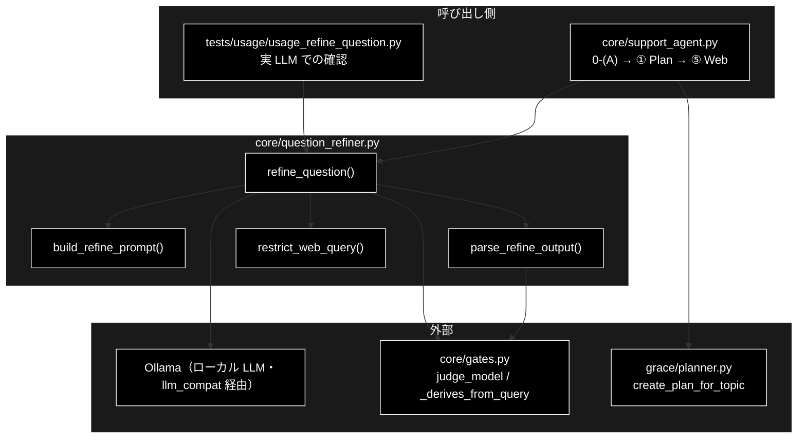
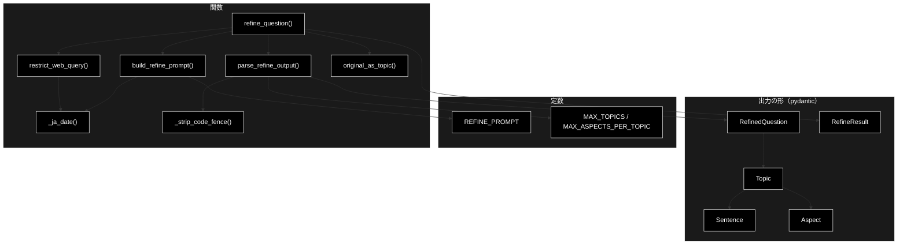
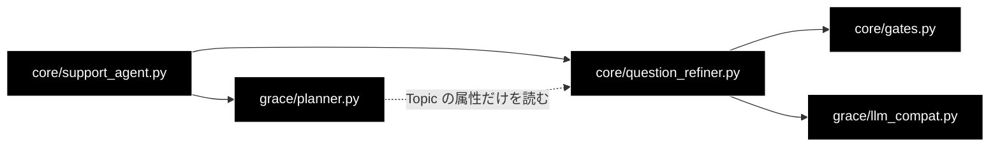

# core/question_refiner.py - 0-(A) 質問の整理（LLM） ドキュメント

**Version 1.0** | 最終更新: 2026-10-30

> GRACE-Support の 0-(A)。問い合わせを**毎回 1 回の LLM 呼び出しで**「話題 → 観点」に整理し、回答用の質問文・社内検索の文・
> Web 検索の語を作る。呼び出し元は `support_agent.run_support_agent_core`、整理した話題から計画を作るのは
> `grace/planner.py::Planner.create_plan_for_topic`（[`../../../../grace/docs/planner.md`](../../../../grace/docs/planner.md)）。

---

## 目次

1. [概要](#概要)
2. [1. アーキテクチャ構成図](#1-アーキテクチャ構成図)
3. [2. モジュール構成図](#2-モジュール構成図)
4. [3. クラス・関数一覧表](#3-クラス関数一覧表)
5. [4. クラス・関数 IPO詳細](#4-クラス関数-ipo詳細)
6. [5. 設定・定数](#5-設定定数)
7. [6. エクスポート](#6-エクスポート)
8. [7. 変更履歴](#7-変更履歴)
9. [付録: 依存関係図](#付録-依存関係図)

---

## 概要

`backend/app/core/question_refiner.py` は、GRACE-Support の 0-(A) で**利用者の問い合わせを LLM で整理する**モジュール。
ローカル LLM（`gates.judge_model(config)`。既定 `gemma4:26b-a4b-it-qat`。`config.py::get_default_ollama_model()`）を**毎回 1 回**呼び、問い合わせを次の単位に整理する。

| 単位 | 意味 | 例（「Jed York CEO が…経緯は？ / その件の経緯を詳しく / 最新ニュースを検索して、49ers の新 GM とヘッドコーチの人事を」） |
|---|---|---|
| 話題 `Topic` | 対象（人・物・出来事）が同じ文のまとまり。**話題ごとに回答 1 つ** | 49ers の GM・ヘッドコーチの交代（1 つ） |
| 観点 `Aspect` | 話題の中の、知りたい側面。**観点ごとに社内検索・Web 検索** | 経緯 / 人事（2 つ） |
| 文 `Sentence` | 問い合わせの各文と、前の文との関係（`relation`） | 文 1 = 主 / 文 2 = 同一 / 文 3 = 別観点 |

`relation` は `前置き`（質問ではない文。観点を持たない）/ `主`（その話題で最初に質問している文）/ `同一`（前の文と同じ観点）/ `別観点` の 4 値。

> ⚠️ **なぜ文字列一致をやめて LLM にしたか（実測 2026-10-22）。** 以前の 0-(A) は、接続語 10 個の部分一致か「？」2 個以上のときだけ
> LLM で分解し、それ以外は問い合わせの文をそのまま社内検索・Web 検索・回答生成に渡していた。上の 3 行は接続語も「？」2 個も無いので
> 分解されず、2 行目の「その件」が 1 行目を指すことも解決されなかった。

> ⚠️ **LLM の出力をそのまま信用しない。** 書き写した文が元の問い合わせに由来するか（`gates._derives_from_query`）・形が正しいかを
> 検査し（`parse_refine_output`）、`web_query` からは問い合わせに無い語を外す（`restrict_web_query`）。
> **失敗したら元の文のまま進める**（`RefineResult.failed`）。前処理であってゲートではないので、回答は止めない。

### 主な責務

- 問い合わせを話題・観点・文に整理するプロンプトを組み立てる（今日・明日の日付・担当範囲を埋め込む）
- 軽量 LLM を毎回 1 回呼び、構造化出力（`RefinedQuestion`）を受け取る
- LLM の出力を検査し、形式違反・作り出した文を退ける
- Web 検索の語から、問い合わせに無い語を外す
- 失敗したら元の文を 1 話題・1 観点にして返す

### 各責務対応のモジュール

| # | 責務 | 対応モジュール | 説明 |
|---|------|--------------|------|
| 1 | プロンプトの組み立て | `question_refiner.py` | `build_refine_prompt()`（`REFINE_PROMPT` の `<<TODAY>>` / `<<TOMORROW>>` / `<<SCOPE_BLOCK>>` / `<<QUERY>>` を埋める） |
| 2 | 軽量 LLM の呼び出し | `question_refiner.py` / `grace.llm_compat` / `gates` | `refine_question()` が `create_chat_client(config)` と `judge_model(config)` で 1 回呼ぶ |
| 3 | 出力の検査 | `question_refiner.py` / `gates` | `parse_refine_output()`（`_derives_from_query` で書き写しを確かめる） |
| 4 | Web 検索の語の制限 | `question_refiner.py` | `restrict_web_query()` |
| 5 | 失敗時の元の文 | `question_refiner.py` | `original_as_topic()` |

### 主要機能一覧

| 機能 | 説明 |
|------|------|
| `refine_question()` | 問い合わせを整理する入口。毎回 LLM を 1 回呼ぶ。失敗しても例外を出さず元の文で返す |
| `build_refine_prompt()` | プロンプトを組み立てる（LLM は呼ばない） |
| `parse_refine_output()` | LLM の出力を検査して `RefinedQuestion` にする。不合格なら `ValueError` |
| `restrict_web_query()` | `web_query` から問い合わせに無い語を外す |
| `original_as_topic()` | 失敗時に使う「元の文のまま」の 1 話題・1 観点 |
| `Sentence` / `Aspect` / `Topic` / `RefinedQuestion` | LLM に返させる JSON の形（pydantic） |
| `RefineResult` | `refine_question()` の戻り値（`topics` / `failed` / `reason` / `elapsed_sec`） |

---

## 1. アーキテクチャ構成図

### 1.1 システム全体構成



### 1.2 データフロー

1. `support_agent` が `refine_question(query, config, profile)` を呼ぶ
2. `build_refine_prompt()` が今日・明日の日付、担当範囲（プロファイルがあるとき）、問い合わせを埋め込む
3. LLM を 1 回呼ぶ（`response_schema=RefinedQuestion`・`temperature=0`・`max_output_tokens=3000`）
4. `parse_refine_output()` が出力を検査する。不合格なら `ValueError` → 元の文（`original_as_topic`）・`failed=True`
5. 合格したら、全観点の `web_query` を `restrict_web_query()` に通す
6. `support_agent` は話題が複数なら利用者に選ばせ、採用した話題を `Planner.create_plan_for_topic()` に渡す。
   ⑤ Web フォールバックは観点ごとの `web_query` で検索する

---

## 2. モジュール構成図

### 2.1 内部モジュール構成



### 2.2 外部依存関係

| ライブラリ | 用途 |
|-----------|------|
| `pydantic` | `Sentence` / `Aspect` / `Topic` / `RefinedQuestion`（LLM の構造化出力の型と検査） |

### 2.3 内部依存モジュール

| モジュール | 用途 |
|-----------|------|
| `backend.app.core.gates` | `judge_model`（軽量モデル名の解決）/ `_derives_from_query`（書き写しの検査） |
| `grace.llm_compat` | `create_chat_client`（`refine_question` の中で遅延 import。`client` を渡せば使わない） |

---

## 3. クラス・関数一覧表

### 3.1 クラス一覧

| クラス | 種類 | 項目 |
|-------|------|------|
| `Sentence` | pydantic | `text`（元の文の書き写し）/ `aspect`（観点の name。前置きは空文字）/ `relation`（`前置き` / `主` / `同一` / `別観点`） |
| `Aspect` | pydantic | `name` / `search_query`（社内検索の 1 文）/ `web_query`（Web 検索の語。8 語まで）/ `wants_latest_web` |
| `Topic` | pydantic | `answer_question`（回答用の質問文）/ `sentences` / `aspects` / `in_scope`（担当範囲。範囲が示されていなければ null） |
| `RefinedQuestion` | pydantic | `topics`（LLM に返させる JSON 全体） |
| `RefineResult` | NamedTuple | `topics` / `failed` / `reason` / `elapsed_sec` |

### 3.2 関数一覧

| 関数名 | 概要 |
|-------|------|
| `refine_question(query, config, profile=None, *, today=None, client=None)` | 問い合わせを整理する。毎回 LLM を 1 回呼ぶ |
| `build_refine_prompt(query, *, today, profile=None)` | プロンプトを組み立てる |
| `parse_refine_output(text, query)` | 出力を検査して `RefinedQuestion` にする |
| `restrict_web_query(web_query, query, *, today)` | 問い合わせに無い語を外す |
| `original_as_topic(query)` | 元の文のままの 1 話題・1 観点 |
| `_ja_date(d)` | `YYYY年M月D日` |
| `_strip_code_fence(text)` | ```` ```json ... ``` ```` の中身だけを返す |

---

## 4. クラス・関数 IPO詳細

### 4.1 使用例

呼び方は**3 通り**ある。

| 処理パターン | 呼び方 | 向いている場面 | 例 |
|---|---|---|---|
| 整理する（本番と同じ） | `refine_question(query, config, profile)` | 0-(A)。`client` を省略すると `create_chat_client(config)` | 4.1.1 |
| 失敗したとき | 同上（LLM の失敗・形式違反） | 例外を出さず元の文で返ることを確かめる | 4.1.2 |
| 部品だけを使う | `build_refine_prompt` / `parse_refine_output` / `restrict_web_query` | プロンプトや検査を確かめる・別の LLM 出力を検査する | 4.1.3 |

> 📝 3 本とも、LLM の代わりに決めた JSON を返すクライアントを渡して**そのまま実行し**、出力を確かめてある（2026-10-30）。
> 実際の LLM での出力は `tests/usage/usage_refine_question.py --repeat 3` で確かめる（Mac・2026-10-29：両リポジトリとも 5 ケース × 3 回合格）。

#### 4.1.1 基本的なワークフロー（整理する）

```python
import json
from datetime import date
from types import SimpleNamespace

from backend.app.core.question_refiner import refine_question

# LLM の代わりに、決めた JSON を返すクライアント（本番では省略 → create_chat_client(config)）
class FixedClient:
    def __init__(self, text):
        self.text = text
        self.models = self
    def generate_content(self, **kwargs):
        return SimpleNamespace(text=self.text)

query = "住民票の写しを取りたい。その件の手数料はいくらですか？"
llm_output = json.dumps({"topics": [{
    "answer_question": "住民票の写しを取る場合の手数料はいくらですか？",
    "sentences": [
        {"text": "住民票の写しを取りたい。", "aspect": "", "relation": "前置き"},
        {"text": "その件の手数料はいくらですか？", "aspect": "手数料", "relation": "主"}],
    "aspects": [{"name": "手数料", "search_query": "住民票の写しの手数料",
                 "web_query": "住民票 写し 手数料 交付", "wants_latest_web": False}],
    "in_scope": None}]}, ensure_ascii=False)

config = SimpleNamespace(llm=SimpleNamespace(light_model="gemma4:26b-a4b-it-qat"))
result = refine_question(query, config, today=date(2026, 10, 30), client=FixedClient(llm_output))
print(result.failed, len(result.topics))
topic = result.topics[0]
print(topic.answer_question)
for s in topic.sentences:
    print(f"  {s.relation}: {s.text}（観点: {s.aspect or '-'}）")
for a in topic.aspects:
    print(f"  観点「{a.name}」 社内検索: {a.search_query} ／ Web: {a.web_query} ／ 最新情報: {a.wants_latest_web}")
```

```
# 出力:
# False 1
# 住民票の写しを取る場合の手数料はいくらですか？
#   前置き: 住民票の写しを取りたい。（観点: -）
#   主: その件の手数料はいくらですか？（観点: 手数料）
#   観点「手数料」 社内検索: 住民票の写しの手数料 ／ Web: 住民票 写し 手数料 ／ 最新情報: False
```

> 📝 LLM が `web_query` に入れた「交付」は問い合わせに無いので外れている（`restrict_web_query`）。
> 「住民票の写しを取りたい。」は質問ではないので `前置き`・観点なし（2026-10-29 に追加。以前は「主」にして観点を付けるしかなく、
> 軽量モデルが「取得方法」と「手数料」の 2 観点に分けていた）。

#### 4.1.2 失敗したとき（元の文のまま）

```python
result = refine_question(query, config, client=FixedClient("了解しました。整理します。"))
print(result.failed, result.reason)
print(result.topics[0].answer_question == query, result.topics[0].aspects[0].web_query == query)
```

```
# 出力:
# True ValueError: JSON の形式が違う: JSONDecodeError
# True True
```

> ⚠️ **例外は出さない。** LLM の例外（API エラー・タイムアウト）・JSON でない応答・検査の不合格のどれも、元の文を 1 話題・1 観点にして
> `failed=True` で返す。`support_agent` はそのまま元の文で ① 以降を進め、ログに理由を出す。

#### 4.1.3 部品だけを使う

```python
from datetime import date

from backend.app.core.question_refiner import build_refine_prompt, parse_refine_output, restrict_web_query

prompt = build_refine_prompt(query, today=date(2026, 10, 30))
print("2026年10月30日" in prompt, query in prompt, "<<" in prompt)   # 日付・問い合わせが入り、埋め残しが無い

parsed = parse_refine_output(llm_output, query)
print(parsed.topics[0].aspects[0].name)
try:
    parse_refine_output(llm_output.replace('"relation": "主"', '"relation": "同一"'), query)
except ValueError as e:
    print("ValueError:", e)

print(restrict_web_query("Jed York 49ers GM ヘッドコーチ 解任 経緯",
                         "Jed York CEOが新しいGMとコーチを探す背景は？ 49ersのヘッドコーチの経緯は？",
                         today=date(2026, 10, 30)))
```

```
# 出力:
# True True False
# 手数料
# ValueError: 話題 1 の前置きを除いた最初の文の relation が「主」でない
# Jed York 49ers GM ヘッドコーチ 経緯
```

---

### 4.2 `refine_question`

**概要**: 問い合わせを LLM で整理する。**毎回 1 回** LLM を呼ぶ（文字列一致で呼ぶかどうかを決めない）。

```python
def refine_question(query: str, config, profile=None, *, today: Optional[date] = None,
                    client=None) -> RefineResult
```

| パラメータ | 型 | デフォルト | 説明 |
|------------|------|-----------|------|
| `query` | str | - | 利用者の問い合わせ（原文） |
| `config` | GraceConfig | - | `judge_model(config)` のモデルを使う |
| `profile` | VerticalProfile | None | 業界プロファイル。あれば担当範囲（`scope_description`）も判定させる |
| `today` | date | None | 今日の日付（テスト用。省略時は `date.today()`） |
| `client` | - | None | LLM クライアント（テスト用。省略時は `create_chat_client(config)`） |

| 項目 | 内容 |
|------|------|
| **Input** | `query`, `config`, `profile`, `today`, `client` |
| **Process** | 1. `build_refine_prompt(query, today=today, profile=profile)`<br>2. `client.models.generate_content(model=judge_model(config), contents=prompt, config={response_mime_type: application/json, response_schema: RefinedQuestion, temperature: 0.0, max_output_tokens: 3000})`<br>3. `parse_refine_output(response.text, query)`<br>4. 全観点の `web_query` を `restrict_web_query()` に通す<br>5. どこかで例外 → `original_as_topic(query)`・`failed=True`・`reason` に例外の型と文 |
| **Output** | `RefineResult(topics, failed, reason, elapsed_sec)` |

> ⚠️ ローカル LLM でも、同じ問い合わせで出力が毎回同じとは限らない。プロンプトを変えたら、確認用スクリプトを `--repeat 3` で流して毎回合格するかを見る
> （`response_schema` は `llm_compat` が JSON Schema の制約付きデコードとして Ollama へ渡す）。

### 4.3 `build_refine_prompt`

```python
def build_refine_prompt(query: str, *, today: date, profile=None) -> str
```

| 項目 | 内容 |
|------|------|
| **Input** | `query`, `today`, `profile` |
| **Process** | `REFINE_PROMPT` の `<<TODAY>>` → `_ja_date(today)`、`<<TOMORROW>>` → `_ja_date(today + 1 日)`、`<<SCOPE_BLOCK>>` → プロファイルの `【担当範囲（name）】scope_description`（無ければ空）、`<<QUERY>>` → `query` |
| **Output** | プロンプト文字列（LLM は呼ばない） |

### 4.4 `parse_refine_output`

```python
def parse_refine_output(text: str, query: str) -> RefinedQuestion
```

| 項目 | 内容 |
|------|------|
| **Input** | `text`（LLM の出力）、`query`（元の問い合わせ） |
| **Process** | 1. コードフェンスを外し、JSON として読み `RefinedQuestion` で検査（relation は 4 値）<br>2. 話題が 1〜`MAX_TOPICS`、各話題の観点が 1〜`MAX_ASPECTS_PER_TOPIC`、文が 1 つ以上<br>3. `answer_question` / 観点の `name` / `search_query` / `web_query` が空でない<br>4. 前置きを除いた最初の文が `主`（質問の文が無い話題は不合格）<br>5. すべての文が元の問い合わせの書き写し（`_derives_from_query`）<br>6. 前置きでない文の `aspect` が観点の一覧にあり、各観点に前置きでない文が 1 つ以上ある（前置きの文だけから作った観点は不合格） |
| **Output** | `RefinedQuestion`。不合格なら `ValueError`（理由つき） |

### 4.5 `restrict_web_query`

```python
def restrict_web_query(web_query: str, query: str, *, today: date) -> str
```

| 項目 | 内容 |
|------|------|
| **Input** | `web_query`（LLM が作った語）、`query`（元の問い合わせ）、`today` |
| **Process** | 1. 空白（全角を含む）で区切った語ごとに、`query` に部分文字列として含まれるかを見る<br>2. 例外として、今日・明日の `YYYY年M月D日` は残す（「明日」から書き換えたもの）<br>3. 外した語があればログに出す<br>4. 1 語も残らなければ `query` をそのまま返す |
| **Output** | 語を空白でつないだ文字列 |

> ⚠️ **LLM の出力を照らすだけで、問い合わせを文字列で解釈はしない。** 実測（2026-10-29）で、軽量モデルが経緯の `web_query` に
> 問い合わせに無い「解任」を 3 回に 1 回入れた（プロンプトで禁止しても）。言い換え（「取りたい」→「取得」、「できますか」→「可否」）も
> 外れるが、検索語としては困らない。

### 4.6 `original_as_topic`

```python
def original_as_topic(query: str) -> Topic
```

`answer_question` = `query`、文 1 つ（`主`・観点「原文」）、観点 1 つ（`search_query` = `web_query` = `query`・`wants_latest_web=False`）の `Topic`。
整理に失敗したとき・`support_agent` で話題の選択が得られなかったときに使う。

---

## 5. 設定・定数

| 定数 | 値 | 説明 |
|------|-----|------|
| `MAX_TOPICS` | `4` | 1 つの問い合わせから取り出す話題の上限。超えたら不合格（元の文で進める） |
| `MAX_ASPECTS_PER_TOPIC` | `3` | 1 つの話題の観点の上限（観点ごとに社内検索するので増やしすぎない） |
| `Relation` | `Literal["前置き", "主", "同一", "別観点"]` | 文どうしの関係 |
| `REFINE_PROMPT` | - | プロンプト本文。【用語】【やること】【禁止】と例 5 つ（3 行で観点 2 つ／前置き＋指示語／独立した 2 話題／指示語が何を指すか分からない／可否だけを聞く） |

> ⚠️ **プロンプトの例に、実際に試す問い合わせ（49ers の 3 行・住民票・領収書など）と同じ文を入れない。** 入れると LLM が例の出力を
> 写すだけになり、整理できるかの確認にならない（`tests/test_question_refiner.py::test_inputs_we_try_are_not_in_the_examples`）。
> 例の `web_query` も問い合わせにある語だけにする（`test_example_web_queries_use_only_words_of_the_example_query`）。
>
> ⚠️ **実際の LLM で見つかった書き足しを防ぐ規則を消さない**（`test_rules_found_on_the_real_llm_stay_in_the_prompt`）:
> 対象の補足（「サンフランシスコ・49ers」）・出来事の推測（「解任」）・聞かれていないこと（「方法も」）・前置きの文から観点を作らない・
> `web_query` は問い合わせにある語だけ。

---

## 6. エクスポート

`__all__` は定義していない。`support_agent` は `refine_question` / `original_as_topic` を、`tests/conftest.py` は `RefineResult` /
`original_as_topic` を import する。

---

## 7. 変更履歴

| バージョン | 日付 | 変更内容 |
|---|---|---|
| 1.0 | 2026-10-30 | 初版（grace_v2 の同名文書から移植。コードは同一で、LLM の記述をローカル LLM に直した）。2026-10-22〜29 に作った `question_refiner.py`（話題 → 観点の整理・`前置き`・`restrict_web_query`）と、`support_agent` の 0-(A) へのつなぎ込みを文書化。§4.1 の 3 本は LLM をスタブにして実行し出力を確かめた |

---

## 付録: 依存関係図


