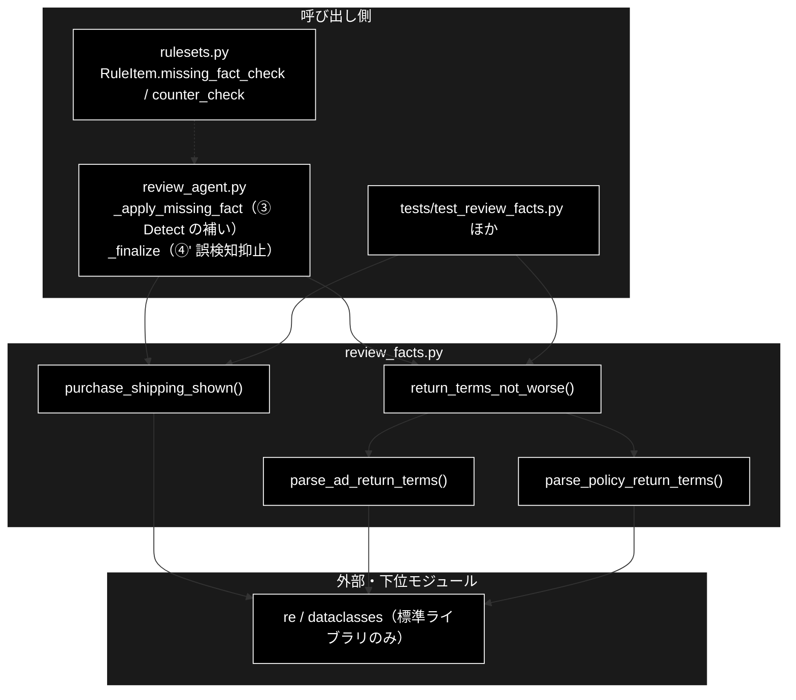
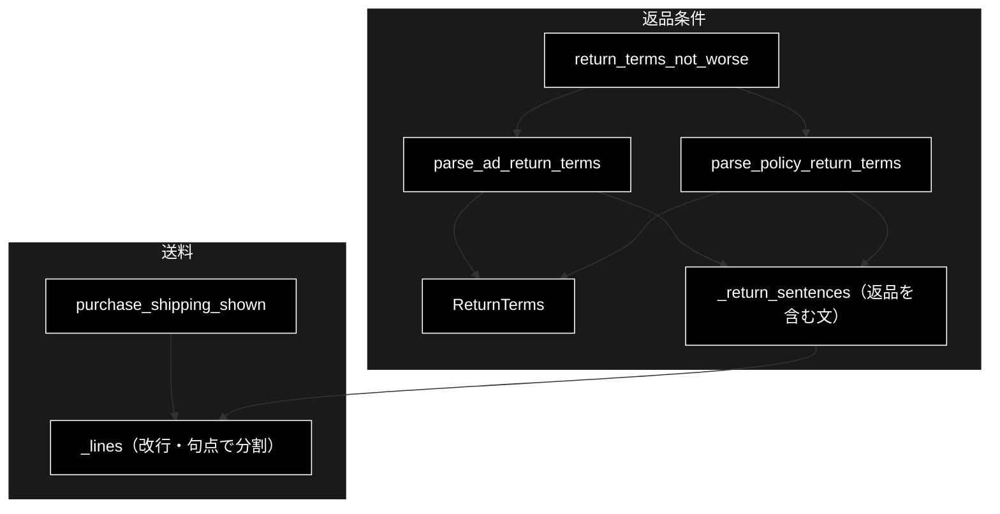
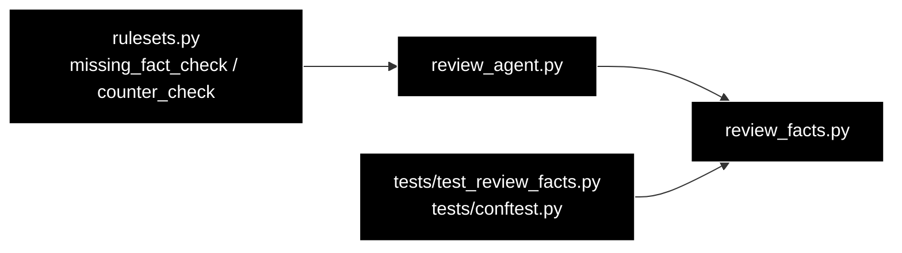

# review_facts.py - GRACE-Review の「文字列だけで決まる事実」 ドキュメント

**Version 1.0** | 最終更新: 2026-10-11

---

## 目次

1. [概要](#概要)
2. [アーキテクチャ構成図](#1-アーキテクチャ構成図)
3. [モジュール構成図](#2-モジュール構成図)
4. [クラス・関数一覧表](#3-クラス関数一覧表)
5. [クラス・関数 IPO詳細](#4-クラス関数-ipo詳細)
6. [設定・定数](#5-設定定数)
7. [エクスポート](#6-エクスポート)
8. [変更履歴](#7-変更履歴)
9. [付録: 依存関係図](#付録-依存関係図)

---

## 概要

`backend/app/core/review_facts.py` は、GRACE-Review の判定のうち **広告文と規程の文字列を見れば機械的に決まる事実**を取り出す純関数群です。
LLM は判定基準に例まで書いてあっても読み落とすことがあるため（実測 2026-10-03・本リポジトリのローカル LLM（Ollama）・各 2 回）、
次の 2 つは LLM に頼らずここで決め、③ Detect の取りこぼしと ④' の誤検知を止めます。

| ルール | LLM の誤り（実測） | ここで決めること | 呼び出し元 |
|---|---|---|---|
| tokusho-01（販売価格・送料の明示） | 送料の無い広告を 2 回とも「違反なし」 | 購入時の送料が広告文に書かれているか | `review_agent._apply_missing_fact`（`RuleItem.missing_fact_check == "purchase_shipping"`） |
| policy-01（社内規程との不一致） | 条件が 1 つ少ない＝顧客に**有利**な広告を「不利」 | 返品条件が規程より顧客に不利でないと言い切れるか | `review_agent._finalize`（`RuleItem.counter_check == "return_terms"`） |

> ⚠️ **読み取れないときは何も言わない（`None` / `False` を返し、判定しない）。** LLM の判断を上書きする安全網なので、
> 確信が持てる形に当てはまったときだけ働く。LLM・Embedding・Qdrant は使わない。

### 主な責務

- 購入時の送料の表示が広告文にあるかを調べる（返品の行に出てくる「送料」は数えない）
- 広告文・規程から返品条件（期限・条件・返送料の負担）を読み取る
- 返品条件について、広告が規程より顧客に不利でないと言い切れるなら理由文を返す

### 各責務対応のモジュール

| # | 責務 | 対応モジュール | 説明 |
|---|------|--------------|------|
| 1 | 送料の表示の有無 | `review_facts.py` | `purchase_shipping_shown(document)`。`False` なら `review_agent` が tokusho-01 を違反として補う |
| 2 | 返品条件の読み取り | `review_facts.py` | `parse_ad_return_terms()`（広告は顧客に厳しい側へ見積もる）/ `parse_policy_return_terms()`（規程は曖昧なら読まない）→ `ReturnTerms` |
| 3 | 不利でないことの判定 | `review_facts.py` | `return_terms_not_worse(finding_message, document, policy_texts)`。理由文を返すと `review_agent` が policy-01 の指摘を `suppressed` にする |

### 主要機能一覧

| 機能 | 説明 |
|------|------|
| `purchase_shipping_shown()` | 「送料無料」「全国一律600円」などが返品以外の行にあれば `True` |
| `parse_ad_return_terms()` | 広告の返品条件。期限は最も短いもの、条件と送料負担はすべての和 |
| `parse_policy_return_terms()` | 規程の返品条件。期限が 2 種類以上なら `None` |
| `return_terms_not_worse()` | 期限・条件・返送料の 3 点で広告が規程以下なら理由文、それ以外は `None` |

---

## 1. アーキテクチャ構成図

### 1.1 システム全体構成



### 1.2 データフロー

1. **tokusho-01**: ③ Detect の LLM が「違反なし」と判定したルールのうち `missing_fact_check == "purchase_shipping"` のものについて、
   `review_agent._apply_missing_fact` が `purchase_shipping_shown(document)` を呼ぶ。`False` なら違反の判定（`_MISSING_SHIPPING`）に置き換える。
   LLM が違反ありとした・判定に失敗した（`verdict is None`）ときは呼ばない。
2. **policy-01**: ④ Ground の後、`counter_check == "return_terms"` の指摘について `review_agent._finalize` が
   `return_terms_not_worse(finding.message, document, source_texts)` を呼ぶ。`source_texts` は ② Retrieve で引いた規程の本文。
   理由文が返れば指摘を `suppressed` にし、`suppress_reason` に理由文を入れる。

---

## 2. モジュール構成図

### 2.1 内部モジュール構成



### 2.2 外部依存関係

| ライブラリ | 用途 |
|-----------|------|
| `re`（標準） | 文の分割（`[\n。]`）・期限（`到着後 N 日` / `到着から N 日`）・顧客負担の検出 |
| `dataclasses`（標準） | `ReturnTerms`（frozen） |

### 2.3 内部依存モジュール

なし（他のモジュールを import しない）。

---

## 3. クラス・関数一覧表

### 3.1 クラス一覧

| クラス名 | 概要 |
|---------|------|
| `ReturnTerms` | 広告または規程から読み取った返品条件（`days` / `conditions` / `customer_pays_shipping`） |

### 3.2 関数一覧

| 関数名 | 概要 |
|-------|------|
| `purchase_shipping_shown(document)` | 購入時の送料が書かれているか |
| `parse_ad_return_terms(document)` | 広告の返品条件。期限が読めなければ `None` |
| `parse_policy_return_terms(policy_texts)` | 規程の返品条件。期限が読めない・食い違うなら `None` |
| `return_terms_not_worse(finding_message, document, policy_texts)` | 不利でないと言い切れるなら理由文、それ以外は `None` |
| `_lines(text)` | 改行と「。」で分け、空でない行を返す（内部） |
| `_return_sentences(texts)` | 「返品」を含む行だけを返す（内部） |

---

## 4. クラス・関数 IPO詳細

### 4.1 使用例

| # | パターン | いつ使うか | 例 |
|---|---------|-----------|----|
| 1 | **基本**: 送料の表示の有無（tokusho-01） | ③ Detect の「違反なし」を補うか決める | 4.1.1 |
| 2 | 返品条件を読み取り、不利でないと判定する（policy-01） | ④' で LLM の誤検知を止める | 4.1.2 |
| 3 | 判定しない（`None`）になる場合 | 抑止が働かない理由を調べる | 4.1.3 |

> 📝 **確かめ方（2026-10-11）**: 4.1.1〜4.1.3 はすべて `PYTHONPATH=. python3 <例>.py` で実行し、出力をそのまま載せた（LLM・Qdrant は使わない）。
> `conditions` は `frozenset` で、表示の順が実行ごとに変わり得るので、例では `sorted()` して出している。

#### 4.1.1 基本: 購入時の送料が書かれているか

```python
from backend.app.core.review_facts import purchase_shipping_shown

ng = "販売価格: 4,980円（税込）\n返品・交換は商品到着後7日以内。返品時の送料はお客様負担となります。"
ok = "販売価格: 4,980円（税込）\n送料: 全国一律600円"
print(purchase_shipping_shown(ng))   # 返品の行の「送料」は数えない
print(purchase_shipping_shown(ok))
print(purchase_shipping_shown(""))

# 実行結果:
# False
# True
# False
```

> 📌 `False` は「書かれていない」の意味で、`review_agent._apply_missing_fact` はこのとき tokusho-01 を違反として補う。
> 「返品」「返送」「返却」「交換」を含む行は、「送料」があっても数えない（実測 2026-10-03: 表記漏れ LP 案はこの 1 か所だけに「送料」があった）。

#### 4.1.2 返品条件を読み取り、不利でないと判定する

```python
from backend.app.core.review_facts import (
    parse_ad_return_terms, parse_policy_return_terms, return_terms_not_worse,
)

ad = "返品は商品到着後14日以内、未開封に限り受け付けます（返送料はお客様負担）。"
policy = ["返品は商品到着後14日以内で、未使用・未開封のものに限ります。",
          "お客様都合の返品は返送料をお客様にご負担いただきます。"]
a, p = parse_ad_return_terms(ad), parse_policy_return_terms(policy)
print(a.days, sorted(a.conditions), a.customer_pays_shipping)
print(p.days, sorted(p.conditions), p.customer_pays_shipping)
print(return_terms_not_worse("返品条件が規程より顧客に不利", ad, policy))

# 実行結果:
# 14 ['未開封'] True
# 14 ['未使用', '未開封'] True
# 規程と照合した結果、返品条件は顧客に不利ではない（期限: 広告 14 日 ≥ 規程 14 日／条件: 広告「未開封」は規程「未使用・未開封」以下）
```

> 📌 広告は条件が 1 つ少ない（＝顧客に有利）ので、LLM が「不利」と指摘しても `review_agent._finalize` がこの理由文で `suppressed` にする。
> 規程の返送料は「お客様都合の返品は…」のように場合分けで書かれることが多いが、**どこかで顧客負担と書いてあれば顧客負担**と読む（不良品の扱いまでは比べない）。

#### 4.1.3 判定しない（`None`）になる場合

```python
from backend.app.core.review_facts import parse_ad_return_terms, return_terms_not_worse

policy = ["返品は商品到着後14日以内で、未使用・未開封のものに限ります。"]
msg = "返品条件が規程より顧客に不利"
print(return_terms_not_worse(msg, "返品は商品到着後7日以内。", policy))                    # 期限が規程より短い
print(return_terms_not_worse(msg, "返品は到着後14日以内、未使用・タグ付きに限る。", policy))  # 規程に無い条件
print(return_terms_not_worse("返品と交換の条件が不利", "返品は到着後14日以内。", policy))     # 返品以外の話題
print(return_terms_not_worse(msg, "返品は到着後14日以内。",
                             ["返品は到着後14日以内。", "返品は到着後30日以内。"]))          # 規程の期限が食い違う
print(parse_ad_return_terms("返品はお気軽にどうぞ。"))                                    # 期限が読めない
# ⚠️ 「返品」を含まない文は返品条件として読まない
t = parse_ad_return_terms("返品は到着後14日以内。返送料はお客様負担です。")
print(t.customer_pays_shipping)

# 実行結果:
# None
# None
# None
# None
# None
# False
```

> ⚠️ **文は改行と「。」で分け、「返品」を含む文だけを読む。** 最後の例の「返送料はお客様負担です。」は別の文なので、返送料の負担として数えない
> （規程も同じ規則で読む）。

### 4.2 `ReturnTerms`

#### 概要

広告または規程から読み取った返品条件。`frozen=True` の dataclass。

#### IPO

| 区分 | 内容 |
|---|---|
| **Input** | `days: Optional[int]`（商品到着後 N 日以内）/ `conditions: FrozenSet[str]`（`RETURN_CONDITION_WORDS` のうち出てきたもの）/ `customer_pays_shipping: bool` |
| **Process** | なし（値の入れ物） |
| **Output** | 不変のインスタンス |

> 📌 `days` は型の上では `Optional` だが、`parse_*_return_terms()` は期限が読めないとき `ReturnTerms` ではなく `None` を返すので、返ってきた `ReturnTerms` の `days` は常に整数である。

### 4.3 `purchase_shipping_shown(document)`

#### シグネチャ

```python
def purchase_shipping_shown(document: str) -> bool
```

#### パラメータ

| 名前 | 型 | 説明 |
|---|---|---|
| `document` | `str` | 広告文の全体（`None` は `""` として扱う） |

#### IPO

| 区分 | 内容 |
|---|---|
| **Input** | 広告文 |
| **Process** | 1. 改行と「。」で行に分ける 2. 「返品」「返送」「返却」「交換」を含む行を飛ばす 3. 「送料」「配送料」「配送手数料」「配達料」のどれかを含む行があれば `True` |
| **Output** | `bool` |

#### 戻り値例・使用例

§4.1.1。

### 4.4 `parse_ad_return_terms(document)`

#### シグネチャ

```python
def parse_ad_return_terms(document: str) -> Optional[ReturnTerms]
```

#### IPO

| 区分 | 内容 |
|---|---|
| **Input** | 広告文 |
| **Process** | 1. 「返品」を含む文を集める 2. 各文から期限（`到着後 N 日` / `到着から N 日`）・条件語・顧客負担（`お客様/購入者/お客さま …負担`）を拾う 3. 期限が 1 つも無ければ `None` |
| **Output** | `ReturnTerms(min(期限), 条件の和, 負担の論理和)` または `None` |

> 📌 **広告は顧客に厳しい側へ見積もる**（期限は最も短いもの、条件・負担はすべて足す）。「不利でない」と言い切るための読み方である。

使用例は §4.1.2・§4.1.3。

### 4.5 `parse_policy_return_terms(policy_texts)`

#### シグネチャ

```python
def parse_policy_return_terms(policy_texts: Iterable[str]) -> Optional[ReturnTerms]
```

#### IPO

| 区分 | 内容 |
|---|---|
| **Input** | 規程の本文の並び（② Retrieve で引いた根拠の本文） |
| **Process** | 1. 「返品」を含む文を集める 2. 期限が書かれた文から期限と条件語を拾う（条件は期限と同じ文のものだけ） 3. 顧客負担はどの文からでも拾う 4. 期限の種類が 1 つでなければ `None` |
| **Output** | `ReturnTerms` または `None` |

> 📌 **規程は曖昧なら読まない**（期限が 2 種類以上なら判定をあきらめる）。広告とは逆の読み方である。

使用例は §4.1.2・§4.1.3。

### 4.6 `return_terms_not_worse(finding_message, document, policy_texts)`

#### シグネチャ

```python
def return_terms_not_worse(
    finding_message: str, document: str, policy_texts: Iterable[str],
) -> Optional[str]
```

#### パラメータ

| 名前 | 型 | 説明 |
|---|---|---|
| `finding_message` | `str` | ③ Detect の指摘文。「返品」を含み、返品以外の話題（`交換` / `キャンセル` / `解約` / `返金` / `価格` / `料金` / `定期`）を含まないときだけ判定する |
| `document` | `str` | 広告文の全体 |
| `policy_texts` | `Iterable[str]` | 規程の本文 |

#### IPO

| 区分 | 内容 |
|---|---|
| **Input** | 指摘文・広告文・規程 |
| **Process** | 1. 指摘文が返品だけの話か確かめる 2. 広告・規程の `ReturnTerms` を読む（どちらかが `None` なら `None`） 3. 期限 `広告 ≥ 規程`・条件 `広告 ⊆ 規程`・返送料（広告が顧客負担なら規程も顧客負担）の 3 つがすべて成り立つか |
| **Output** | 成り立てば理由文（`規程と照合した結果、返品条件は顧客に不利ではない（期限: …／条件: …）`）、それ以外は `None` |

#### 戻り値例・使用例

§4.1.2（理由文）・§4.1.3（`None`）。

---

## 5. 設定・定数

| 定数 | 値 | 用途 |
|---|---|---|
| `RETURN_CONDITION_WORDS` | `("未使用", "未開封", "未着用", "未洗濯", "タグ付き", "箱付き")` | 返品を受け付ける条件（多いほど顧客に厳しい） |
| `_RETURN_WORDS` | `("返品", "返送", "返却", "交換")` | 送料の判定で飛ばす行 |
| `_SHIPPING_WORDS` | `("送料", "配送料", "配送手数料", "配達料")` | 購入時の送料の表示とみなす語 |
| `_OTHER_TOPICS` | `("交換", "キャンセル", "解約", "返金", "価格", "料金", "定期")` | 指摘文がこれに触れていたら返品条件の判定をしない |
| `_DAYS` | `到着(?:後\|から)\s*(\d+)\s*日` | 返品の期限 |
| `_CUSTOMER_PAYS` | `(お客様\|購入者\|お客さま)(?:に\|の)?(?:ご)?負担` | 返送料の顧客負担 |

どのルールに使うかは `rulesets.py` の `RuleItem.missing_fact_check`（`"purchase_shipping"`）/ `counter_check`（`"return_terms"`）で決まる（[`rulesets.md`](rulesets.md)）。

---

## 6. エクスポート

`__all__` は定義していない。`review_agent.py` が `purchase_shipping_shown` と `return_terms_not_worse` を import する。
テストのスタブ（`tests/conftest.py`）は `purchase_shipping_shown` を差し替えられるようにしてある（既定 `True`・`None` で実物）。

テスト: `tests/test_review_facts.py`（15 件。2026-10-11 実測）。

---

## 7. 変更履歴

| バージョン | 日付 | 変更内容 |
|---|---|---|
| 1.0 | 2026-10-11 | 新規作成。`review_facts.py`（2026-10-03 追加）には文書が無かった（`backend/app/core/` の構成整理で見つけた）。§4.1 の例はすべて実行して確かめた |

---

## 付録: 依存関係図


