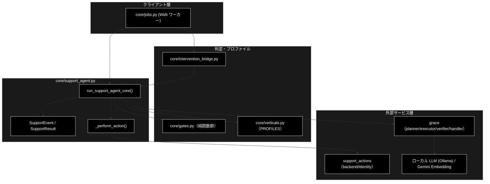
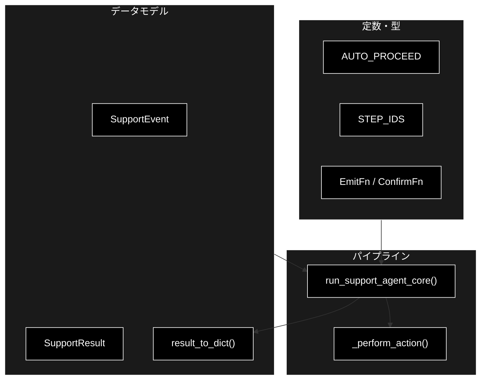
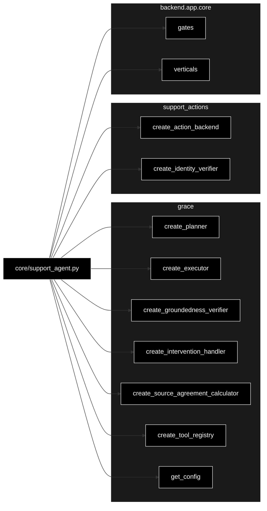

# core/support_agent.py - GRACE-Support コアサービス ドキュメント

**Version 1.10** | 最終更新: 2026-10-14

> **本書の位置づけ**: `backend/app/core/support_agent.py`（GRACE-Support のコアパイプライン（`run_support_agent_core`））の **IPO リファレンス**。
> 引くための文書であり、**設計の「なぜ」と処理の流れは上位の文書が正本**である。
>
> | 知りたいこと | 参照先 |
> |---|---|
> | 各段の IPO と設計判断 | [`core_process_flow.md` §1](core_process_flow.md) |
> | ジョブ・SSE・HITL の機構 | [`core_process_flow.md` §3](core_process_flow.md) |
> | 判定ロジックの詳細 | [`core/docs/gates.md`](./gates.md) |
> | 文書全体の地図 | [`README_backend_app.md`](../../docs/README_backend_app.md) |

---

## 目次

1. [概要](#概要)
2. [アーキテクチャ構成図](#1-アーキテクチャ構成図)
3. [モジュール構成図](#2-モジュール構成図)
4. [クラス・関数一覧表](#3-クラス関数一覧表)
5. [クラス・関数 IPO詳細](#4-クラス関数-ipo詳細)
6. [設定・定数](#5-設定定数)
7. [エクスポート](#6-エクスポート)
8. [変更履歴](#7-変更履歴)
9. [付録: 依存関係図](#付録-依存関係図)

---

## 概要

`backend/app/core/support_agent.py` は、GRACE-Support（業界特化・自律型サポートエージェント）の
**UI 非依存・イベント発行型コアサービス**である。かつての CLI
（`agent_support_example.py::run_support_agent()`・2026-09-20 削除）から標準出力
（print / `_banner`）への密結合を分離した版で、処理パイプライン
（①Plan〜⑥Action、④'・④救済・二段判定）は当時と完全に同一。
変えたのは「入出力の経路」だけで、途中経過は `emit(SupportEvent)` コールバック、
HITL CONFIRM は `confirm` コールバックで解決する。

Web は `jobs.py`／`InterventionBridge` を介して SSE ストリームと HTTP 承認へ配線する。
LLM は **ローカル LLM（Ollama）** で **API キー不要**、Embedding のみ Gemini（検索）。
挙動は `tests/test_support_agent_core.py` で固定している。

### 主な責務

- パイプライン進捗を `SupportEvent` として発行（step/log/intervention/result/error）
- ①Plan → ②Execute（内部RAG）→ ③Groundedness → ④回答ゲート → ⑤Web裏取り → ④'情報なし検知 → ⑥Action の統括
- 業界プロファイル（`--vertical`）によるしきい値・検索スコープ・方針・Web優先ドメインの切り替え
- **リクエスト単位の設定分離**（`copy.deepcopy(get_config())`・並行実行時の相互汚染防止／P-08）
- HITL CONFIRM の解決（Web=InterventionBridge 承認待ち。`AUTO_PROCEED` はテスト用）
- 副作用アクションの本人確認 → CONFIRM → バックエンド実行の統括
- KPI 計測用メタデータ（強制エスカレ・本人確認・情報なし検知・Web再利用）の付与

### 各責務対応のモジュール

| # | 責務 | 対応モジュール | 説明 |
|---|------|--------------|------|
| 1 | 進捗イベント発行 | `support_agent.py` | `SupportEvent` を `emit` で通知 |
| 2 | パイプライン統括 | `support_agent.py` | `run_support_agent_core()` が①〜⑥を実行 |
| 3 | 業界プロファイル適用 | `core/verticals.py` | `PROFILES` からしきい値・スコープ・`build_prompt_addendum()` を取得 |
| 4 | 回答ゲート等の判定 | `core/gates.py` | 純関数群（`_answer_gate` 他）へ委譲 |
| 7 | 検証用の出典本文集約 | `core/gates.py` | `_collect_source_texts` / `_web_source_texts`（P-01） |
| 5 | HITL 承認の解決 | `core/intervention_bridge.py` | Web の `resolver` を `confirm` に渡す |
| 6 | Plan/Execute/検証/アクション | `grace` / `support_actions.py` | planner/executor/verifier/backend |

### 主要機能一覧

| 機能 | 説明 |
|------|------|
| `SupportEvent` | パイプライン進捗イベント（dataclass） |
| `SupportResult` | サポート回答の結果（dataclass） |
| `result_to_dict()` | `SupportResult` を JSON 化可能な dict へ変換 |
| `run_support_agent_core()` | コアパイプライン本体（イベント発行型） |
| `_perform_action()` | 本人確認 → HITL CONFIRM → バックエンド実行 |
| `AUTO_PROCEED` | 無条件承認レスポンス（テスト用。Web では使用禁止） |
| `STEP_IDS` | パイプラインのステップ ID 一覧（UI タイムライン対応） |

---

## 1. アーキテクチャ構成図

### 1.1 システム全体構成



### 1.2 データフロー

1. 呼び出し側（Web ワーカー）が `run_support_agent_core(query, emit=..., confirm=...)` を実行
2. ①Plan で `planner.create_plan(query)`、②Execute で `executor.execute(plan)`（内部RAG＋動的Web）
3. ③Groundedness で内部回答を検証、④回答ゲートで answer/escalate を判定（＋強制エスカレ＋救済）
4. escalate かつ Web 有効時は⑤で裏取り（重複時は再検証のみ）、④'で「情報なし回答」を検知
5. ⑥で本人確認 → HITL CONFIRM → アクション実行、最後に `result` イベントと `SupportResult` を返す

---

## 2. モジュール構成図

### 2.1 内部モジュール構成



### 2.2 外部依存関係

| ライブラリ | バージョン | 用途 |
|-----------|-----------|------|
| `dataclasses` | 標準 | `SupportEvent` / `SupportResult` の定義・`asdict` |

### 2.3 内部依存モジュール

| モジュール | 用途 |
|-----------|------|
| `backend.app.core.gates` | 回答ゲート・強制エスカレ・情報なし検知・救済・出典整形の純関数群 |
| `backend.app.core.verticals` | `PROFILES` / `ActionRequest` / `Decision` / `Intent` / `DEFAULT_QUERY` / `INTENT_MODEL` |
| `grace` | planner/executor/verifier/intervention handler/tool registry/config |
| `grace.confidence` | `create_groundedness_verifier` |
| `support_actions` | `create_action_backend` / `create_identity_verifier` |

---

## 3. クラス・関数一覧表

### 3.1 クラス一覧

#### SupportEvent

| メソッド | 概要 |
|---------|------|
| （dataclass） | `type` / `step` / `status` / `title` / `message` / `data` を保持する進捗イベント |

#### SupportResult

| メソッド | 概要 |
|---------|------|
| （dataclass） | 回答・出典・groundedness・decision・アクション結果・KPI メタ等を保持する結果 |

### 3.2 関数一覧（カテゴリ別）

#### 変換

| 関数名 | 概要 |
|-------|------|
| `result_to_dict(result)` | `SupportResult` を JSON 化可能な dict にする |

#### アクション

| 関数名 | 概要 |
|-------|------|
| `_perform_action(action, handler, backend, identity_verifier, identity, emit_log)` | 本人確認 → HITL CONFIRM → バックエンド実行 |

#### パイプライン

| 関数名 | 概要 |
|-------|------|
| `run_support_agent_core(query, verbose, use_web, do_action, dry_run, vertical, identity, emit, confirm)` | コアパイプライン本体 |

---

## 4. クラス・関数 IPO詳細

### 4.1 使用例

| # | パターン | いつ使うか | 例 |
|---|---------|-----------|----|
| 1 | **基本**: 本物の呼び出し（`run_support_agent_core`） | Web API の runner と同じ呼び方 | 4.1.1 |
| 2 | テストと同じスタブで 1 周流す（イベントと承認） | Ollama・Embedding・Qdrant なしで流れを確かめる | 4.1.2 |
| 3 | ステップ ID と実行順 | 画面のタイムラインとの対応を見る | 4.1.3 |
| 4 | 結果の JSON 化 | API レスポンス・`result` イベントの形を見る | 4.1.4 |

> 📝 **確かめ方（2026-10-11）**: 4.1.2〜4.1.4 は `PYTHONPATH=. python3 <例>.py` で実行した。4.1.1 は Ollama（`ollama serve`・モデル pull 済み）・`GOOGLE_API_KEY`（Embedding）・Qdrant（実データ）が要るので
> **この VM では出力を確かめていない**（`GOOGLE_API_KEY` が無いと例外 `ValueError` になることだけ確かめた）。
> 実データで流すときは E2E（`GRACE_E2E=1`。Mac 専用。[`docs/testing.md`](../../../../docs/testing.md) §4.2）を使う。

#### 4.1.1 基本的なワークフロー（パイプラインの実行）

`run_support_agent_core()` は **Web API から呼ばれる唯一の入口**。
`emit` / `confirm` を渡さなければ通知なし・自動承認で動く（既定 `dry_run=True` なので安全）。

```python
from backend.app.core.support_agent import run_support_agent_core

# 1. 最小の呼び出し（emit / confirm 省略 = 通知なし・自動承認）
result = run_support_agent_core("住民票の写しの取り方は？", vertical="gov")

# 2. 結果は SupportResult 1 個に集約される
print(result.decision, result.groundedness, result.vertical)
print(result.citations)

# 出力例（実行には稼働中の Ollama・GOOGLE_API_KEY・Qdrant の実データが要る）:
# answer 0.83 gov
# ['[社内] gov_faq_anthropic: 住民票の交付']
```

> ⚠️ **上のコードだけは実行して出力を確認していない**（Ollama・Embedding・Qdrant を要するため）。出力例は形を示すためのもの。
> ⚠️ **`GOOGLE_API_KEY` が無いと、`None` ではなく例外になる**（`create_source_agreement_calculator()` の `genai.Client()` が `ValueError`。2026-10-11 実測）。
> grace_v2（Anthropic 版）は入口でキーを確かめて `None` を返すが、本リポジトリには入口の確認が無い。Web API から呼ぶと `JobManager` が例外を捕まえ、
> `error` イベント（「❌ 実行に失敗しました: ValueError: No API key was provided…」）を流してジョブを `failed` にする（[`README_backend_core.md`](README_backend_core.md) §5）。

#### 4.1.2 テストと同じスタブで 1 周流す

`tests/conftest.py` の `install_pipeline_stub()` は、planner / executor / 根拠検証 / ツール / 判定器を固定応答に差し替える
（テストの `pipeline_stub` フィクスチャの中身）。`pytest.MonkeyPatch()` を使えば、テストの外でも同じスタブで流せる。

```python
import pytest

from backend.app.core.support_agent import AUTO_PROCEED, run_support_agent_core
from tests.conftest import PipelineStub, install_pipeline_stub

# テストと同じスタブ（planner / executor / 根拠検証 / ツール / 判定器）を差し込む
mp = pytest.MonkeyPatch()
install_pipeline_stub(mp, PipelineStub())

events = []
result = run_support_agent_core("パスワードを忘れました", emit=events.append,
                                confirm=lambda _req: AUTO_PROCEED)
print(result.decision, result.citations, result.action.action_type, result.action_result[:10])
print([f"{e.step}:{e.status}" for e in events if e.type == "step" and e.status != "started"])
mp.undo()

# 実行結果:
# answer ['[社内] faq.md'] send_reply [DRY-RUN]
# ['analyze:skipped', 'profile:skipped', 'plan:finished', 'execute:finished', 'confidence:finished', 'gate:finished', 'web:skipped', 'no_info:finished', 'action:finished']
```

> 📌 `confirm` に `AUTO_PROCEED` を返す関数を渡すと、⑥ Action の承認を自動で通す（`dry_run=True` が既定なので実行は `[DRY-RUN]`）。
> 単一の質問なので 0-(A) は第 1 段（LLM を呼ばない判定）で終わり `skipped`、`vertical` を省いたので 0-(B) も `skipped`、`use_web=False`（既定）なので ⑤ も `skipped` になる。
> Web API から呼ぶときの `confirm` は `InterventionBridge.resolver`（[`intervention_bridge.md`](intervention_bridge.md)）。

#### 4.1.3 ステップ ID と実行順

```python
from backend.app.core.support_agent import STEP_IDS

print(STEP_IDS)

# 出力例:
# ('analyze', 'profile', 'plan', 'execute', 'confidence', 'gate', 'web', 'no_info', 'action')
```

> ⚠️ **このタプルが実行順である。** 呼称（0-(A) / ①〜⑥ / ④'）とは並びが違い、
> **④' `no_info` は ⑤ `web` の後**に来る（[`core_process_flow.md` §1.2](core_process_flow.md) の対応表）。

#### 4.1.4 結果の JSON 化（API レスポンス・`result` イベント）

```python
from backend.app.core.support_agent import SupportResult, result_to_dict

r = SupportResult(
    answer="住民票の写しは窓口かコンビニ交付で取得できます。",
    citations=["[社内] gov_faq_anthropic: 住民票の交付"],
    groundedness=0.83, groundedness_decided=6,
    decision="answer", vertical="gov",
)
d = result_to_dict(r)

print(f"decision={d['decision']} groundedness={d['groundedness']} vertical={d['vertical']}")
print(f"multi-question 既定: is_multi_question={d['is_multi_question']} "
      f"deferred={d['deferred_questions']}")

# 出力例:
# decision=answer groundedness=0.83 vertical=gov
# multi-question 既定: is_multi_question=False deferred=[]
```

> 0-(A) 由来の 7 フィールドは**すべて optional**で、単一質問では既定値のまま返る。
> 既存のフロント・API クライアントの挙動は変わらない（`SupportResult` の項目は本書 §4.3、API での形は [`schemas.md`](../../docs/schemas.md)）。


### 4.2 SupportEvent クラス

パイプラインの進捗イベント。`emit` 経由で呼び出し側（Web=SSE）へ渡る。

#### コンストラクタ: `__init__`

**概要**: 進捗イベントを構築する dataclass。

```python
SupportEvent(
    type: str,
    step: Optional[str] = None,
    status: Optional[str] = None,
    title: str = "",
    message: str = "",
    data: Dict[str, Any] = {},
)
```

| パラメータ | 型 | デフォルト | 説明 |
|------------|------|-----------|------|
| `type` | str | - | `step` / `log` / `intervention` / `result` / `error` |
| `step` | Optional[str] | None | ステップ ID（`STEP_IDS` のいずれか） |
| `status` | Optional[str] | None | `started` / `finished` / `skipped`（type=step 時） |
| `title` | str | "" | ステップ開始時の見出し |
| `message` | str | "" | ログメッセージ |
| `data` | Dict[str, Any] | `{}` | 付随データ（result 時は SupportResult の dict） |

| 項目 | 内容 |
|------|------|
| **Input** | `type: str`, `step`, `status`, `title`, `message`, `data` |
| **Process** | フィールドを保持する（振る舞いなし） |
| **Output** | `SupportEvent` インスタンス |

**戻り値例**:
```python
SupportEvent(type="step", step="plan", status="started", title="① Plan（planner）")
```

```python
# 使用例
emit(SupportEvent(type="log", step="gate", message="[gate] answer（未確認注記）"))
```

### 4.3 SupportResult クラス

サポート回答の結果。API レスポンス（`SupportResultModel`）へ JSON 化される。

#### コンストラクタ: `__init__`

**概要**: 回答本文・出典・groundedness・decision・アクション結果・KPI メタを保持する dataclass。

```python
SupportResult(
    answer: Optional[str],
    citations: List[str] = [],
    groundedness: float = 0.0,
    groundedness_decided: int = 0,
    decision: Decision = "escalate",
    warning: bool = False,
    used_web: bool = False,
    source_agreement: Optional[float] = None,
    contradiction: bool = False,
    action: Optional[ActionRequest] = None,
    action_result: Optional[str] = None,
    vertical: Optional[str] = None,
    overall_confidence: float = 0.0,
    intent: Optional[Intent] = None,
    forced_escalate: bool = False,
    identity_checked: bool = False,
    no_info_detected: bool = False,
    no_info_unconfirmed: bool = False,
    web_reused: bool = False,
)
```

| パラメータ | 型 | デフォルト | 説明 |
|------------|------|-----------|------|
| `answer` | Optional[str] | - | 回答本文（escalate 時も内部回答が入りうる） |
| `citations` | List[str] | `[]` | 出典表示（`[社内]` / `[Web]` プレフィックス付き） |
| `groundedness` | float | 0.0 | 支持率（採用した検証結果の support_rate） |
| `groundedness_decided` | int | 0 | 判定できた主張数（supported+contradicted。0=判定不能） |
| `decision` | Decision | "escalate" | `answer` / `escalate` |
| `warning` | bool | False | 中信頼（未確認）の注意書きを付けるか |
| `used_web` | bool | False | Web を使ったか（動的 or ⑤ フォールバック） |
| `source_agreement` | Optional[float] | None | 内部×Web の意味的一致度 |
| `contradiction` | bool | False | 矛盾の可能性 |
| `action` | Optional[ActionRequest] | None | 実施（予定）のアクション |
| `action_result` | Optional[str] | None | アクション結果メッセージ |
| `vertical` | Optional[str] | None | 適用した業界プロファイル |
| `overall_confidence` | float | 0.0 | executor の総合信頼度 |
| `intent` | Optional[Intent] | None | 意図分類の結果 |
| `forced_escalate` | bool | False | エスカレ語による強制エスカレか（KPI） |
| `identity_checked` | bool | False | 本人確認ステップが起動したか（KPI） |
| `no_info_detected` | bool | False | 情報なし検知で escalate に倒したか |
| `no_info_unconfirmed` | bool | False | 情報なしの候補句はあるが、判定器が無効のため実質回答か未確認のまま回答を維持したか（UI が注記を出す） |
| `web_reused` | bool | False | ⑤で executor の Web 結果を再利用したか |

| 項目 | 内容 |
|------|------|
| **Input** | 上記フィールド（`answer` は必須） |
| **Process** | フィールドを保持する（振る舞いなし） |
| **Output** | `SupportResult` インスタンス |

**戻り値例**:
```python
SupportResult(
    answer="30日以内であれば返品可能です。…",
    citations=["[社内] ec_policy_anthropic/return.md"],
    groundedness=0.83, groundedness_decided=3,
    decision="answer", warning=False, vertical="ec",
)
```

```python
# 使用例
result = run_support_agent_core("返品したい", vertical="ec")
print(result.decision, result.groundedness)
# answer 0.83
```

### 4.4 パイプライン関数

#### `run_support_agent_core`

**概要**: GRACE-Support パイプラインを実行する。進捗は
`emit`、HITL は `confirm` で解決する。

```python
def run_support_agent_core(
    query: str = DEFAULT_QUERY,
    verbose: bool = False,
    use_web: bool = True,
    do_action: bool = True,
    dry_run: bool = True,
    vertical: Optional[str] = None,
    identity: Optional[Dict[str, str]] = None,
    emit: Optional[EmitFn] = None,
    confirm: Optional[ConfirmFn] = None,
) -> Optional[SupportResult]
```

| パラメータ | 型 | デフォルト | 説明 |
|------------|------|-----------|------|
| `query` | str | `DEFAULT_QUERY` | 問い合わせ内容 |
| `verbose` | bool | False | 詳細ログ（groundedness 内訳等） |
| `use_web` | bool | True | ⑤ Web フォールバックの有効化 |
| `do_action` | bool | True | ⑥ アクション実行の有効化 |
| `dry_run` | bool | True | アクションをドライラン（安全） |
| `vertical` | Optional[str] | None | 業界プロファイル（gov/saas/ec） |
| `identity` | Optional[Dict[str, str]] | None | 本人確認用の識別子 |
| `emit` | Optional[EmitFn] | None | 進捗イベントのコールバック（None=通知なし） |
| `confirm` | Optional[ConfirmFn] | None | HITL 解決コールバック（None=無条件承認。テスト・スクリプト用） |

| 項目 | 内容 |
|------|------|
| **Input** | `query`, `verbose`, `use_web`, `do_action`, `dry_run`, `vertical`, `identity`, `emit`, `confirm` |
| **Process** | 1. LLM の事前キーチェックは無し（ローカル LLM のため）<br>2. **`config = copy.deepcopy(get_config())`（P-08・リクエスト単位の設定分離）**、planner/executor/verifier/handler を生成、意図分類・情報なし判定をメモ化配線<br>3. 0-(A) 入力・質問分析（複数質問の検知→選択→再構成。単一質問では LLM を呼ばない）→ 0-(B) 業界プロファイル適用（検索スコープ・方針・Web優先ドメインを config へ注入。§4.4.1）<br>4. ①Plan → ②Execute（内部RAG＋動的Web検知）<br>5. ③Groundedness（**出典本文を渡す**・P-01） → ④回答ゲート＋強制エスカレ＋④救済<br>6. ⑤Web フォールバック（escalate かつ非強制時。重複時は再検証のみ）<br>7. ④'情報なし回答検知（Webのみ出典は強制判定）<br>8. ⑥本人確認→HITL CONFIRM→アクション実行<br>9. KPI メタ付与→`result` イベント発行 |
| **Output** | `Optional[SupportResult]`: 成功時は結果、APIキー未設定時は `None` |

**戻り値例**:
```python
SupportResult(
    answer="…", citations=["[社内] …", "[Web] …（https://…）"],
    groundedness=0.75, decision="answer", warning=True,
    used_web=True, web_reused=True, vertical="ec",
)
```

```python
# 使用例（Web ワーカーからの配線）
events = []
result = run_support_agent_core(
    "返品したい", vertical="ec",
    emit=events.append,             # SSE ストリームへ配線
    confirm=bridge.resolver,        # InterventionBridge の承認待ち
)
```

#### 4.4.1 リクエスト単位の設定分離とプロファイル配線（S1 の内部）

`run_support_agent_core` が**冒頭で必ず行う**設定の扱い。ここを誤ると並行実行時に
リクエスト同士が干渉するため、パイプライン本体より先に押さえる必要がある。

```python
# P-08: シングルトン config をそのまま書き換えない
config = copy.deepcopy(get_config())
...
# S1: 業界プロファイルを config へ配線（tools は config 参照を保持＝実行時に効く）
config.qdrant.allowed_collections   = list(profile.collections) if profile else []
config.llm.prompt_addendum          = profile.build_prompt_addendum() if profile else ""
config.web_search.preferred_domains = list(profile.preferred_domains) if profile else []
```

| 配線先 | 値 | 効果範囲 | 対応 |
|---|---|---|---|
| `config.qdrant.allowed_collections` | `profile.collections` | **内部 RAG 検索のみ** | S1 |
| `config.llm.prompt_addendum` | `profile.build_prompt_addendum()`（業界方針＋`SCOPE_POLICY`） | reasoning（生成側） | W-2 |
| `config.web_search.preferred_domains` | `profile.preferred_domains` | Web 検索の**並べ替え（加点）** | W-1 |

> ⚠️ **P-08（設定分離）**: 業界プロファイルに合わせて config を書き換えるため、
> シングルトンをそのまま使うと `jobs.py` がジョブごとに立てるワーカースレッド同士で
> 値を奪い合う（**gov のリクエストが ec の検索スコープで走る**等）。リクエスト単位の
> ディープコピーを作り、以降の生成物（planner / executor / tools / verifier …）は
> すべてこのコピーを参照させる。

> 📝 **なぜ生成側でスコープを担保するか（W-2）**: 検索スコープが効くのは内部 RAG だけで、
> ⑤ Web フォールバックと executor の動的 `web_search` にはドメイン制限が無い。
> よって「担当範囲外の話題を回答しない」ことは `SCOPE_POLICY` の注入で担保する。
> 詳細は [`core/docs/verticals.md`](./verticals.md) §5.2。

> 📝 **W-1 は絞り込みではない**: `preferred_domains` は一致した結果を加点して上位へ
> 並べ替えるだけで、非一致も残す。絞り込むと 0 件化 → 情報なし回答 → ④' の誤エスカレへ連鎖する。

**③ Groundedness へ渡す出典（P-01）**: 識別子ではなく**本文**を渡す。本文が取れない
経路では出典ラベルへフォールバックする。

```python
internal_source_texts = _collect_source_texts(result.step_results)
verify_sources = internal_source_texts or [_citation_text(c) for c in internal_citations]
```

識別子（ファイル名）だけを渡すとどの主張も裏付けられず全 neutral になり、
`support_rate = supported / (supported + contradicted)` の**分母が 0** になる
（詳細は [`core/docs/gates.md`](./gates.md) §4.8 `_collect_source_texts`）。

### 4.5 アクション関数

#### `_perform_action`

**概要**: 本人確認 → HITL（CONFIRM 承認）→ バックエンド実行 の順でアクションを行う。未確認・
タイムアウト時は安全側（実行せず有人対応）に倒す。

```python
def _perform_action(
    action: ActionRequest,
    handler,
    backend,
    identity_verifier=None,
    identity: Optional[Dict[str, str]] = None,
    emit_log: Optional[Callable[[str], None]] = None,
) -> str
```

| パラメータ | 型 | デフォルト | 説明 |
|------------|------|-----------|------|
| `action` | ActionRequest | - | 実行するアクション（action_type / args） |
| `handler` | InterventionHandler | - | HITL 承認ハンドラ |
| `backend` | ActionBackend | - | 実行先（dry-run/webhook/pseudo） |
| `identity_verifier` | 任意 | None | 本人確認器（None なら本人確認スキップ） |
| `identity` | Optional[Dict[str, str]] | None | 提示された識別子 |
| `emit_log` | Optional[Callable[[str], None]] | None | ログ出力先（None なら print） |

| 項目 | 内容 |
|------|------|
| **Input** | `action`, `handler`, `backend`, `identity_verifier`, `identity`, `emit_log` |
| **Process** | 1. 本人確認（未確認なら有人へ引き継ぎメッセージを返す）<br>2. `ActionDecision(CONFIRM)` を `handler.handle()`<br>3. 非承認: timeout→エスカレ / それ以外→キャンセル<br>4. 承認: `backend.execute(action_type, args)` |
| **Output** | `str`: 実行結果／引き継ぎ／タイムアウト／キャンセルのメッセージ |

**戻り値例**:
```python
"[dry-run] create_ticket を受け付けました（チケットID: TCK-0001）"
```

```python
# 使用例
msg = _perform_action(action, handler, backend,
                      identity_verifier=verifier, identity={"order_id": "A1"})
print(msg)
```

---

## 5. 設定・定数

### 5.1 STEP_IDS

パイプラインのステップ ID（UI タイムライン表示と対応）。

```python
STEP_IDS = (
    "analyze", "profile", "plan", "execute", "confidence",
    "gate", "web", "no_info", "action",
)
```

| 値 | 説明 |
|----|------|
| `analyze` | 0-(A) 入力・質問分析（複数質問の検知 → 選択 → 再構成） |
| `profile` | 0-(B) 業界プロファイル適用（`--vertical` 指定時のみ） |
| `plan` | ① Plan |
| `execute` | ② Execute（内部RAG → reasoning） |
| `confidence` | ③ Groundedness |
| `gate` | ④ 回答ゲート＋強制エスカレ＋④救済 |
| `web` | ⑤ Web フォールバック |
| `no_info` | ④' 情報なし回答検知 |
| `action` | ⑥ Action（本人確認 → HITL CONFIRM → 実行） |

### 5.2 AUTO_PROCEED

```python
AUTO_PROCEED = InterventionResponse(action=InterventionAction.PROCEED)
```

| 定数名 | 用途 | 注意 |
|-------|------|------|
| `AUTO_PROCEED` | 非対話用の無条件承認（実行はドライランで安全） | ⚠️ Web（`backend.app.api`）では使用禁止。承認は必ず `InterventionBridge` を経由する（受け入れ条件 §5-2） |


---

## 6. エクスポート

本モジュールに `__all__` 定義はない。他モジュール（`jobs.py` / `intervention_bridge.py`）
から参照される主なシンボル:

```python
# 公開シンボル（明示的 __all__ はなし）
SupportEvent
SupportResult
result_to_dict
run_support_agent_core
AUTO_PROCEED
STEP_IDS
EmitFn        # type alias: Callable[[SupportEvent], None]
ConfirmFn     # type alias: Callable[[InterventionRequest], InterventionResponse]
```

---

## 7. 変更履歴

| バージョン | 日付 | 変更内容 |
|---|---|---|
| 1.0 | — | 初版作成（イベント発行型コアパイプライン・SupportEvent/SupportResult・_perform_action の IPO ドキュメント） |
| 1.1 | — | 実コード再読による最新化: §4.3.1「リクエスト単位の設定分離とプロファイル配線」を新設し、P-08（`copy.deepcopy(get_config())` による並行実行時の相互汚染防止）・W-2（`build_prompt_addendum()` で `SCOPE_POLICY` を reasoning へ注入）・W-1（`preferred_domains` は除外ではなく加点）・P-01（groundedness へ出典**本文**を渡す／識別子のみだと全 neutral 化して支持率の分母が 0 になる）を追記。`run_support_agent_core` の Process 欄と責務表・主な責務に反映 |
| 1.2 | — | 0-(A) 入力・質問分析を追加。`STEP_IDS` に `analyze` を先頭追加（`profile` は 0-(B) へ改称）、`QuestionCluster` と `SupportResult` の複数質問 5 フィールド（`is_multi_question` / `question_clusters` / `adopted_cluster_index` / `reconstructed_query` / `deferred_questions`）を追加。前処理であり planner/executor/gates の判定は無改変 |
| 1.2 | 2026-09-16 | 3 階建て再編に伴い、冒頭へ**位置づけと上位文書への導線**を追加した |
| 1.3 | — | 0-(A) にスコープ判定を組み込み。業界プロファイルの**解決**を 0-(B) の手前へ移した（`scope_description` / `out_of_scope_guidance` を 0-(A) が読むため。config への注入＝適用は 0-(B) のまま）。`SupportResult` に `out_of_scope_questions` / `out_of_scope_guidance` を追加 |
| 1.4 | — | `SupportResult.no_info_unconfirmed` を追加（④'）。判定器が無効（`judges.enabled=false`・既定）なら、候補句だけでは escalate せず注記付きで回答を維持する（`no_info_unconfirmed`）。判定器が有効で失敗した場合は従来どおり escalate。あわせて冒頭の版表記（1.2 のまま）を最新版に揃えた |
| 1.5 | 2026-09-24 | 使用例を IPO 詳細の冒頭（`### 4.1 使用例`）へ移し、末尾の「## 6. 使用例」章を削除（基本フォーマット `a_class_method_md_format.md` v1.6〜 §6.1 に準拠。2026-09-24）。IPO の小節を 4.2 以降へ繰り下げ、後続の章番号を 1 つ繰り上げた。文書内の `§4.x` 参照も追随 |
| 1.6 | 2026-10-10 | テストの所在を `backend/tests/` からリポジトリ直下の `tests/` へ移したのに追随（パス・コマンド・import の表記） |
| 1.7 | 2026-10-11 | `backend/docs/reference/core_support_agent.md` から移した（`a_cross_doc_md_format.md` §1.1.2。リンクを付け替えた）。§4.1 を、実行できなかった断片・出力の無い例から、本リポジトリで実行して確かめた例に作り直した（テストと同じスタブで 1 周流す・ステップ ID・結果の JSON 化）。本物の呼び出し（4.1.1）は `GOOGLE_API_KEY` が無いと例外になることを確かめて注記した |
| 1.8 | 2026-10-12 | backend/docs/ の廃止（2026-10-12）に追随し、参照先を backend/app/docs/README_app.md・backend/app/api/docs/README_api.md・backend/app/core/docs/core_process_flow.md などへ付け替えた（テストの地図は docs/testing.md、実行例の txt は docs/examples/） |
| 1.9 | 2026-10-14 | 索引の改名（frontend/docs/README.md → README_frontend.md、README_api.md → README_backend_api.md、README_core.md → README_backend_core.md）に合わせて参照を付け替えた |
| 1.10 | 2026-10-14 | 索引の改名（backend/app/docs/README_app.md → README_backend_app.md）に合わせて参照を付け替えた |

---

## 付録: 依存関係図


