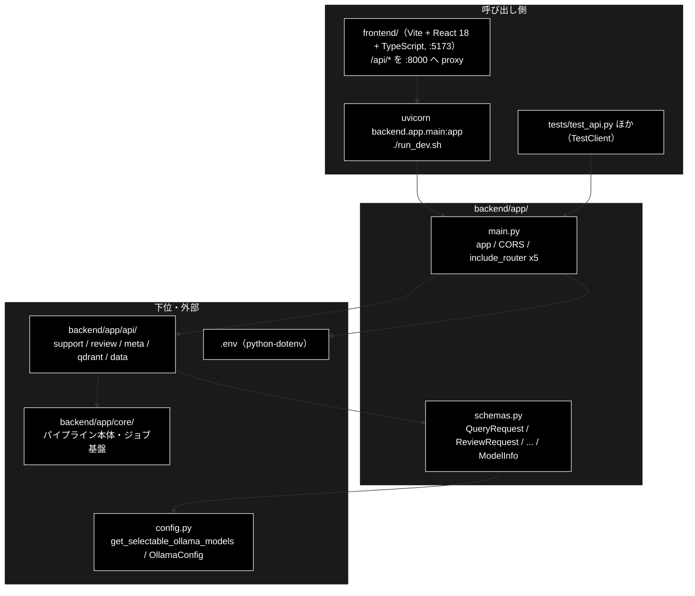
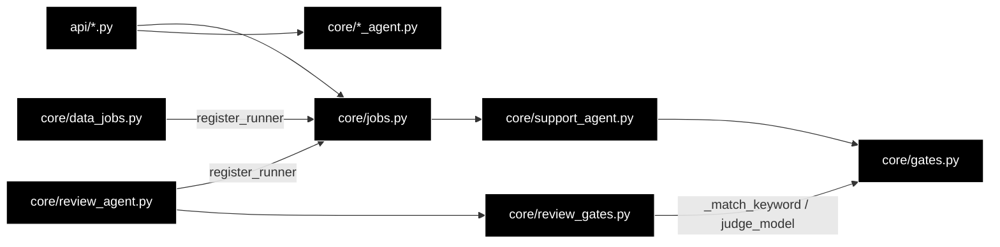

# README_app.md - backend/app/ ディレクトリ概要

**Version 1.2** | 最終更新: 2026-10-14

`backend/app/` の入口となる文書。FastAPI の起動口（`main.py`）と、API の入出力の型（`schemas.py`）を置く。
ルーター（`api/`）とパイプライン本体・ジョブ基盤（`core/`）は**別のディレクトリ**で、それぞれの `docs/` に README がある。
各モジュールの引数・戻り値は各モジュールの文書（IPO）に置き、ここには書かない。

> ⚠️ **本リポジトリは Ollama 版。** LLM はローカルの Ollama（API キー不要）、Embedding だけ Gemini（`GOOGLE_API_KEY`）。
> 姉妹リポジトリ `grace_v2`（Anthropic 版）の同名ファイルとは中身が違うので、文書をコピーで持ち込まない（CLAUDE.md §5）。

---

## 目次

- [概要](#概要)
  - [主な責務](#主な責務)
  - [各責務対応のモジュール](#各責務対応のモジュール)
  - [アーキテクチャ構成図](#アーキテクチャ構成図)
- [1. モジュール一覧（索引）](#1-モジュール一覧索引)
- [2. 使い方（代表的なワークフロー）](#2-使い方代表的なワークフロー)
- [3. 公開 API（__init__.py）](#3-公開-api__init__py)
- [4. 処理フロー・データフロー](#4-処理フローデータフロー)
- [5. 既知の制約・残課題](#5-既知の制約残課題)
- [6. 変更履歴](#6-変更履歴)

---

## 概要

`backend/app/` は GRACE の Web API（FastAPI・`:8000`）の**最上位**である。`main.py` が 5 つのルーター（`api/`）を 1 つの `app` にまとめ、
`schemas.py` がリクエストの検証とレスポンスの形を決める。エージェントを動かす入口はこの Web API だけである（CLI は無い。CLAUDE.md §1）。

### 主な責務

- FastAPI アプリを組み立てる（`.env` の読み込み・CORS・5 つのルーターの登録）
- API の入出力の型を定め、リクエストを検証する（`frontend/src/types.ts` と 1:1）

### 各責務対応のモジュール

| # | 責務 | 対応モジュール | 説明 |
|---|------|--------------|------|
| 1 | アプリの組み立て | `main.py` | `app = FastAPI(...)`。CORS は Vite の dev サーバ（`:5173`）だけを許可。認証は無い（ローカル開発専用） |
| 2 | 入出力の型と検証 | `schemas.py` | Pydantic モデル。`model` は `config.py::get_selectable_ollama_models()` の選択肢だけを受け付ける。不正な入力は 422 |

### アーキテクチャ構成図



**データフロー（要点）**: ブラウザの JSON → `schemas.py` のリクエストモデルで検証（不正なら 422）→ `api/` がジョブを起動 →
`core/` の runner が結果の dict を返す → `schemas.py` の応答モデルで検証して返す（知らないキーは落ち、足りないキーは既定値）。詳細は §4。

---

## 1. モジュール一覧（索引）

| モジュール | 文書 | 種別 | 行数 | Ver | 概要 |
|---|---|---|---:|---|---|
| `main.py`（68 行） | [`main.md`](main.md) | E | 502 | 1.7 | FastAPI アプリ。`.env`・CORS・5 ルーター（25 エンドポイント） |
| `schemas.py`（559 行） | [`schemas.md`](schemas.md) | E | 1009 | 1.13 | API の入出力の型（Pydantic）。`frontend/src/types.ts` と対で保つ |

> 行数は文書の行数（実測）。`__init__.py` は空（§3）。Support / Review の 1 周の流れは `core/docs/core_process_flow.md`、backend 全体の構造は本書 §4 にある。

**関連する README**: [`api/docs/README_backend_api.md`](../api/docs/README_backend_api.md)（ルーター）/ [`core/docs/README_backend_core.md`](../core/docs/README_backend_core.md)（パイプライン・ジョブ基盤）/
本書 §4（backend 全体の地図・目的別の早見表）。

---

## 2. 使い方（代表的なワークフロー）

> 📝 **確かめ方（2026-10-11）**: §2.1 は VM で uvicorn を起動して `curl` した（`GOOGLE_API_KEY` を入れていない環境。Ollama は無い）。

| やりたいこと | 入口 | 使用例 |
|---|---|---|
| 開発サーバを起動する（backend + frontend） | `./run_dev.sh` | 直下 [`README.md`](../../../README.md) §7 |
| API だけを起動して確かめる | `uvicorn backend.app.main:app` | §2.1・[`main.md`](main.md) §4.1 |
| サーバを立てずに API を叩く（テスト） | `fastapi.testclient.TestClient(app)` | [`main.md`](main.md) §4.1.2 |
| リクエストの形・422 になる入力を確かめる | `schemas.QueryRequest` ほか | [`schemas.md`](schemas.md) §4.1 |

### 2.1 API だけを起動して確かめる

```bash
docker compose -f docker-compose/docker-compose.yml up -d     # Qdrant（/api/health には不要）
uvicorn backend.app.main:app --reload --port 8000              # 別ターミナル
curl -s localhost:8000/api/health
curl -s localhost:8000/openapi.json | python3 -c "import json,sys; print(len(json.load(sys.stdin)['paths']))"

# 出力例:
# {"status":"ok","google_api_key":false}
# 25
```

> 📌 `google_api_key` は環境変数にキーがあるかだけを示す（値は返さない）。LLM は Ollama なので LLM のキーは無く、Ollama に届くかもここでは見ない。
> `false` でも起動はでき、メタ情報（`/api/verticals` 等）は返る。エージェントの実行（`POST /api/support/query` 等）はジョブとして受け付けられ、
> Embedding や Ollama に届かないと `error` イベントで失敗するか、判定に失敗した項目を「要確認」として返す（[`../core/docs/README_backend_core.md`](../core/docs/README_backend_core.md) §5）。

---

## 3. 公開 API（__init__.py）

公開 API なし（`backend/app/__init__.py` は空）。`from backend.app.main import app` / `from backend.app.schemas import QueryRequest` のようにモジュールを直接 import する。

---

## 4. 処理フロー・データフロー

backend の文書は `backend/app/docs/`（本書）・`backend/app/api/docs/`・`backend/app/core/docs/` の 3 か所だけにある
（2026-10-12 に `backend/docs/` を廃止した）。

| 知りたいこと | 文書 |
|---|---|
| backend の層構造・依存の向き・backend が持たないもの | 本書 §4.1・§4.2 |
| モデル名の解決（既定・UI からの上書き・Ollama の前提チェック）・環境変数 | 本書 §4.3 |
| 全エンドポイント・SSE のワイヤ形式・HITL の往復・HTTP ステータス・`types.ts` との対応 | [`api/docs/README_backend_api.md`](../api/docs/README_backend_api.md) §4 |
| GRACE-Support / GRACE-Review の 1 周・設計判断・ジョブ基盤の流れ | [`core/docs/core_process_flow.md`](../core/docs/core_process_flow.md) |
| 各モジュールの引数・戻り値 | 各ディレクトリの README の索引（§1・`README_backend_api.md` §1・`README_backend_core.md` §1） |

**目的別の早見表**

| やりたいこと | 読む文書 |
|---|---|
| 新しいエンドポイントを足す | `README_backend_api.md` §4 → `core_process_flow.md` §3（runner 注入） |
| 新しいジョブ種別を足す | `core_process_flow.md` §3 → `README_backend_core.md` §5.2（チェックリスト）→ `core/docs/data_jobs.md` |
| 回答が escalate に倒れる理由を追う | `core_process_flow.md` §1 → `core/docs/gates.md` |
| 指摘が出ない・誤検知する理由を追う | `core_process_flow.md` §2 → `core/docs/review_gates.md` |
| 業界プロファイル / ルールを増やす | `core/docs/verticals.md` / `core/docs/rulesets.md`（どちらも「増やすときの手順」） |
| 規程コレクション（`ec_ad_rules_anthropic`）を作り直す | `core/docs/rulesets.md`（規程コレクションの準備。雛形は grace_v2 側） |
| 既定モデルを変える | 本書 §4.3.5・CLAUDE.md §3 |
| 触る前に落とし穴を確認する | `README_backend_core.md` §5.2・CLAUDE.md |

| データ | 形式 | 作る側 | 使う側 |
|---|---|---|---|
| リクエスト | `QueryRequest` / `ReviewRequest` / `ChunkingRequest` / `QaGenerationRequest` / `RegisterRequest` / `DeleteCollectionsRequest` / `ConfirmRequest` | 画面（`frontend/src/api/client.ts`） | `api/` のルーター |
| 受付 | `QueryAccepted`（`job_id` / `stream_url`） | `api/` | 画面（SSE を購読する） |
| 結果 | `JobStatusResponse` / `ReviewJobStatusResponse` / `DataJobStatusResponse` | `api/`（runner の dict を検証） | 画面 |
| メタ情報 | `ModelChoice` / `ModelInfo` / `VerticalInfo` / `RuleSetInfo` | `api/meta.py` | 画面のセレクタ・ヘッダー |


### 4.1 依存の向き

守られている規律は 3 つ。**ここを崩すと循環 import になる。**

1. **`core/` は `api/` を知らない。** 逆向きの import は存在しない。
2. **`jobs.py` は Review・データ準備を知らない。** Support の runner だけを自分で登録し、Review / データ準備の runner は
   `review_agent.py` / `data_jobs.py` が**自分の import 時に** `register_runner()` で登録する（[`core_process_flow.md`](../core/docs/core_process_flow.md) §3）。
3. **判定ロジックは `*_gates.py` に集める。** `review_gates.py` は `gates.py` から `_match_keyword` / `judge_model` を再利用する（Review → Support の一方向）。



### 4.2 backend が持たないもの（外部境界）

`backend/app/` が import している**リポジトリ内の外部モジュール**は次がすべてである（標準ライブラリ・FastAPI・Pydantic を除く）。
**この表の裏返しが「backend を読むだけでは分からないこと」**で、RAG 検索・planner のプロンプト・Ollama クライアントの互換処理などは
`grace/docs/`・`services/docs/`・`chunking/docs/` 側の文書にある。

| 外部モジュール | 使う側 | 何を委ねているか |
|---|---|---|
| `grace`（`create_intervention_handler` / `create_tool_registry` / `get_config`） | `support_agent.py` / `review_agent.py` | エージェント基盤の生成・設定解決 |
| `grace.confidence.create_groundedness_verifier` | `support_agent.py` / `review_agent.py` | ③④ 根拠検証（**Support / Review 共用**） |
| `grace.intervention`（`InterventionRequest` / `InterventionResponse` / `InterventionAction`） | `intervention_bridge.py` | HITL の型とアクション |
| `grace.llm_compat.create_chat_client` | `gates.py` / `review_gates.py` / `data_jobs.py` | **ローカル LLM（Ollama）の呼び出し** |
| `grace.config.get_config` | `api/meta.py` / 各コア | 解決済みのモデル名・しきい値 |
| `support_actions`（`create_action_backend` / `create_identity_verifier`） | `support_agent.py` / `review_agent.py` | ⑥⑦ アクション実行・本人確認（**共用**） |
| `services.qdrant_service` | `api/qdrant.py` / `data_jobs.py` | Qdrant の参照 |
| `services.data_pipeline_service` | `api/qdrant.py` / `data_jobs.py` | 入力ファイル解決・コレクション操作・**Ollama 到達性 / pull 済み判定** |
| `chunking.csv_text_to_chunks_text_csv` / `chunking.async_api_client` | `data_jobs.py` | チャンク化本体 |
| `qa_qdrant.register_to_qdrant` | `data_jobs.py` | Qdrant 登録本体 |
| `qdrant_client_wrapper.get_qdrant_client` | `api/qdrant.py` / `data_jobs.py` | Qdrant クライアント生成 |
| `config`（`get_default_ollama_model` / `get_selectable_ollama_models` / `get_default_chunking_workers` / `OllamaConfig`） | `api/meta.py` / `schemas.py` / `data_jobs.py` / `verticals.py` | ローカル LLM の既定・選択できるモデル・並列数 |

> ⚠️ **共用部品は Support と Review の両方に効く。** `GroundednessVerifier` / `InterventionBridge` / `support_actions.py` を
> 触った変更は、Support のつもりでも Review を壊す。共用部品を触ったら `tests/test_review_*.py` も流す。

### 4.3 モデル名の解決と環境変数

プロバイダの方針（LLM はすべて Ollama・Embedding だけ Gemini）は CLAUDE.md §3 が正。ここには backend 側の仕組みを書く。

> ⚠️ **Embedding を Ollama にしない。** `RegisterParams.provider` の既定 `"gemini"` は**正しい**。`nomic-embed-text`（768 次元）へ変えると
> 既存の Qdrant コレクション（3072 次元）の**再作成と全件再登録**が要る。
>
> ⚠️ **`ANTHROPIC_API_KEY` は不要。** Anthropic の LLM 経路は 2026-10-08 に削除した。`create_llm_client("anthropic")` /
> `config.llm.provider="anthropic"` はどちらも `ValueError` になる（`tests/test_no_anthropic_path.py`）。

#### 4.3.1 既定モデルは 1 か所・判定系とデータ準備は解決関数を通す

**既定モデル名の実体は `config.py::get_default_ollama_model()` の 1 か所だけ**（2026-10-08〜）。環境変数 `OLLAMA_DEFAULT_MODEL` があればそれ、
無ければ固定文字列（現在 `gemma4:26b-a4b-it-qat`）を返す。`grace/config.py` の `llm.model` / `llm.light_model`（`default_factory`）・
`ModelConfig.DEFAULT_MODEL`・`OllamaConfig.DEFAULT_MODEL`・`verticals.INTENT_MODEL` はすべてここを引く。
**`config/grace_config.yml` にモデル名を書かない**（書くと yml がクラス既定より優先され、画面と CLI でモデルが割れる。
2026-10-08 まで実際に割れていた。`tests/test_model_info_api.py::TestDefaultModelHasOneSource`）。

```python
# backend/app/core/gates.py — 軽量モデル（意図分類・情報なし判定・言及分類・空疎判定）
def judge_model(config) -> str:          # config.llm.light_model → 無ければ verticals.INTENT_MODEL

# backend/app/core/review_gates.py — 本モデル（③ Detect の第2段）
def detect_model(config) -> str:         # config.llm.model → 無ければ既定

# backend/app/core/data_jobs.py — データ準備ジョブの既定
def _resolve_model(explicit) -> str:     # フォーム指定 → get_config().llm.model → get_default_ollama_model()
```

**定数を直接参照しない。** 実際の事故: 判定系だけ派生元のモデル（`num_ctx` 4096）を表示し、回答本文を丸ごと含むプロンプトで枠を使い切って空応答に
なりうる状態だった（2026-08-17）。`_resolve_model()` が無かった頃は、`.env` の `OLLAMA_DEFAULT_MODEL` と yml の `llm.model` が食い違うと
「ヘッダーは A・実行は B」になり、チャンク化が 404 を 3 回リトライしてフォールバック分割へ落ち、**止まらずにゴミを作り続けた**（1,229 ブロックで 404 が 3,687 回）。

| 使う場所 | 解決 | 既定 |
|---|---|---|
| planner / executor / reasoning / groundedness（`grace/`） | `llm.model` | `get_default_ollama_model()` |
| 意図分類・情報なし判定・言及分類・空疎判定 | `judge_model()` | `llm.light_model`（既定は本モデルと同じ） |
| ③ Detect 第2段 | `detect_model()` | `llm.model` |
| チャンク化・Q/A 生成（`data_jobs.py`） | `_resolve_model()` | フォーム指定 → `llm.model` → `get_default_ollama_model()` |
| Qdrant 登録の Embedding（`RegisterParams.provider`） | リクエスト既定 | `gemini`（**変えない**） |
| 画面ヘッダー（`GET /api/model`） | `get_config().llm` | 同上 |

1 回だけ別モデルで動かすときは `GRACE_LLM_MODEL` / `GRACE_LLM_LIGHT_MODEL` を使う。

#### 4.3.2 UI から選ぶ（ジョブ単位の上書き）

セレクタは画面ヘッダーにあり、エージェントの 3 タブでは 1 つ、データ管理タブでは工程（チャンキング / Q/A 作成）ごとに 2 つ並ぶ
（`frontend/src/state/headerModel.ts`）。

| 層 | 役割 |
|---|---|
| `config.py::get_selectable_ollama_models()` | **選択肢の正本**。`ModelConfig.AVAILABLE_MODELS`（すべて Ollama のモデル）から **tool calling 非対応**を除く |
| `GET /api/models` | 選択肢（`id` / `supports_tool_calls` / `notes`） |
| `schemas.py::_validate_model_choice` | 受付時の検証（一覧に無ければ **422**） |
| `JobParams.model` / `ReviewParams.model` / データ準備の各 params | ジョブ単位で持ち回る（既定は `None`。dataclass の既定で評価しない） |
| `_resolve_model()`（データ準備）/ 各コア | 未指定なら既定へ倒す |

> ⚠️ **tool calling 非対応のモデルを選ばせない。** ReAct（`rag_search` / `web_search` / `reasoning`）は `tool_calls` 形式の応答を前提にしており、
> 非対応モデルではツールが一切発火しない、または無応答になる。判定は `OllamaConfig.supports_tool_calls()`。

#### 4.3.3 LLM の前提は「キー」ではなく「サーバとモデル」

クラウド API の「キーが無い」に相当するのが、ローカルでは次の 2 つである。**データ準備のジョブ**（チャンク化・Q/A 生成）は、どちらも LLM ループへ入る前に
確かめて `error` イベントで返す（`data_jobs.py`）。**Support / Review は事前に確かめない**。LLM 呼び出しの失敗は安全側の結果
（escalate・「自動判定に失敗したため要確認」）になるので、実データで確かめるときは E2E の `api_errors` を見る（CLAUDE.md §2）。

| 前提 | 判定 | 失敗時 |
|---|---|---|
| Ollama が起動しているか | `services.data_pipeline_service.ollama_unreachable_message()` | 起動方法を含むメッセージを出してジョブを `failed` に |
| モデルが pull 済みか | `services.data_pipeline_service.model_not_pulled_message()` | **pull 済みの一覧を添えて**返す（`gemma4:e4b` と `gemma4:e4b-mlx` のような 1 語違いが実際の事故） |

Ollama 固有の落とし穴（`max_tokens` だけが効く・構造化出力は `json_schema`・数値は `parse_score()`・thinking は無い）は CLAUDE.md §3 の表が正。

#### 4.3.4 環境変数

`.env`（リポジトリルート）を `main.py` が `load_dotenv()` で読む（未導入でも起動は続行）。

| 変数 | 必須 | 用途 |
|---|:--:|---|
| `GOOGLE_API_KEY` | ✅ | Embedding（検索・登録） |
| `OLLAMA_BASE_URL` | — | 既定 `http://localhost:11434/v1` |
| `OLLAMA_DEFAULT_MODEL` | — | `get_default_ollama_model()` を上書き。**アプリ全体の既定が変わる**ので通常は書かない（CLAUDE.md §3） |
| `SERPAPI_KEY` | — | ⑤ Web フォールバック |
| `QDRANT_URL` | — | 既定 `http://localhost:6333` |

`GET /api/health` が返すのは `google_api_key` の有無だけである（LLM 用のキーは存在しない）。
設定は `config/grace_config.yml` → 環境変数（接頭辞 `GRACE_`）→ `GraceConfig`（pydantic で検証）の順に読む。
**セクション名は先頭 1 語のみ**なので、`GRACE_WEB_SEARCH_*` は `web.search_*` と解釈されて効かない（yml で直す）。`GOOGLE_API_KEY` は yml に書かない。

#### 4.3.5 既定モデルを変えるときの手順

1. **`ollama pull <モデル名>` を先に済ませる**（未取得のまま起動すると実行時 404。モデル名が間違っているわけではない）
2. `config.py::get_default_ollama_model()` の**フォールバック文字列 1 か所**を書き換える（画面・エージェント・データジョブ・CLI すべてに効く）
3. `config/grace_config.yml` には**モデル名を書かない**
4. そのモデルが `ModelConfig.AVAILABLE_MODELS` にあり、`OllamaConfig.MODEL_CONSTRAINTS` に **tool calling 対応**が登録されているか確認する（無いとセレクタに出ない）
5. `GET /api/model` と `GET /api/models` を叩き、**画面の表示と実際の挙動が一致する**ことを確かめる
6. `judge_model()` / `detect_model()` / `_resolve_model()` を通さない直接参照を足していないか grep する

---

## 5. 既知の制約・残課題

| # | 内容 | 詳細 |
|---|------|------|
| 1 | **認証が無い**（ローカル開発専用）。CORS は `http://localhost:5173` / `http://127.0.0.1:5173` だけを許可 | [`main.md`](main.md) §5 |
| 2 | 応答モデルに無いキーは黙って落ちる。runner の戻り値に項目を足したら `schemas.py` と `frontend/src/types.ts` の両方に足す | [`schemas.md`](schemas.md) §4.1.2 |
| 3 | `schemas.py` の `ChunkingRequest.input_file` のコメントは「許可ディレクトリ外は 400」だが、実際は 202 で受け付けてジョブが `error` で失敗する（検証は runner 側。`api/data.py::run_chunking` の docstring が正しい）。コード側のコメントの直しは未対応 | [`api/docs/data.md`](../api/docs/data.md) §3.1.1 |

### 5.1 テスト件数

2026-10-11 に `pytest` で実行した値（Ollama・Qdrant 不要）:

| テストファイル | 件数 | 対象 |
|---|---:|---|
| `tests/test_api.py` | 11 | `main.py` 経由の API（`TestClient`） |
| `tests/test_model_selection.py` | 17 | `schemas.py` の `model` の検証・既定値の一致 |
| `tests/test_model_info_api.py` | 15 | `/api/models`・`/api/model`（既定モデル名が 1 か所で決まること） |

```bash
PYTHONPATH=. .venv/bin/python -m pytest tests/test_api.py tests/test_model_selection.py tests/test_model_info_api.py -q
# 2026-10-11 実測: 43 passed（OLLAMA_DEFAULT_MODEL を外して実行）
```

---

## 6. 変更履歴

| バージョン | 日付 | 変更内容 |
|---|---|---|
| 1.0 | 2026-10-11 | 新規作成（`a_cross_doc_md_format.md` §1.1.2・§1.2）。`backend/docs/reference/main.md` / `schemas.md` を本ディレクトリへ移し、索引・使い方・既知の制約をまとめた。§2.1 は uvicorn を起動して確かめた |
| 1.1 | 2026-10-12 | backend/docs/ の廃止にあわせ §4 を書き直した（目的別の早見表・§4.1 依存の向き・§4.2 backend が持たないもの・§4.3 モデル名の解決と環境変数〔既定は 1 か所・解決関数・UI の上書き・Ollama の前提チェック・既定を変える手順〕。旧 architecture.md / config_and_providers.md から移した） |
| 1.2 | 2026-10-14 | 索引の改名（frontend/docs/README.md → README_frontend.md、README_api.md → README_backend_api.md、README_core.md → README_backend_core.md）に合わせて参照を付け替えた |
