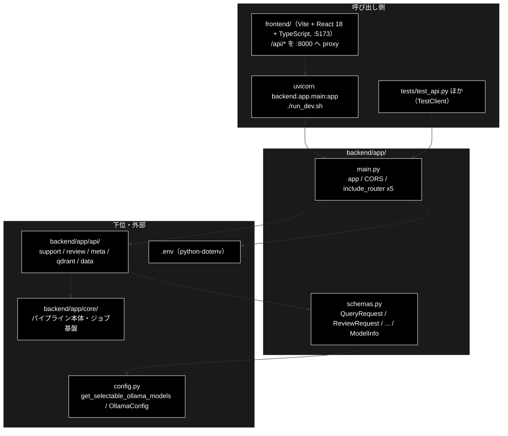

# README_app.md - backend/app/ ディレクトリ概要

**Version 1.0** | 最終更新: 2026-10-11

`backend/app/` の入口となる文書。FastAPI の起動口（`main.py`）と、API の入出力の型（`schemas.py`）を置く。
ルーター（`api/`）とパイプライン本体・ジョブ基盤（`core/`）は**別のディレクトリ**で、それぞれの `docs/` に README がある。
各モジュールの引数・戻り値は各モジュールの文書（IPO）に置き、ここには書かない。

> ⚠️ **本リポジトリは Ollama 版。** LLM はローカルの Ollama（API キー不要）、Embedding だけ Gemini（`GOOGLE_API_KEY`）。
> 姉妹リポジトリ `grace_v2`（Anthropic 版）の同名ファイルとは中身が違うので、文書をコピーで持ち込まない（CLAUDE.md §5）。

---

## 目次

- [概要](#概要)
  - [主な責務](#主な責務)
  - [各責務対応のモジュール](#各責務対応のモジュール)
  - [アーキテクチャ構成図](#アーキテクチャ構成図)
- [1. モジュール一覧（索引）](#1-モジュール一覧索引)
- [2. 使い方（代表的なワークフロー）](#2-使い方代表的なワークフロー)
- [3. 公開 API（__init__.py）](#3-公開-api__init__py)
- [4. 処理フロー・データフロー](#4-処理フローデータフロー)
- [5. 既知の制約・残課題](#5-既知の制約残課題)
- [6. 変更履歴](#6-変更履歴)

---

## 概要

`backend/app/` は GRACE の Web API（FastAPI・`:8000`）の**最上位**である。`main.py` が 5 つのルーター（`api/`）を 1 つの `app` にまとめ、
`schemas.py` がリクエストの検証とレスポンスの形を決める。エージェントを動かす入口はこの Web API だけである（CLI は無い。CLAUDE.md §1）。

### 主な責務

- FastAPI アプリを組み立てる（`.env` の読み込み・CORS・5 つのルーターの登録）
- API の入出力の型を定め、リクエストを検証する（`frontend/src/types.ts` と 1:1）

### 各責務対応のモジュール

| # | 責務 | 対応モジュール | 説明 |
|---|------|--------------|------|
| 1 | アプリの組み立て | `main.py` | `app = FastAPI(...)`。CORS は Vite の dev サーバ（`:5173`）だけを許可。認証は無い（ローカル開発専用） |
| 2 | 入出力の型と検証 | `schemas.py` | Pydantic モデル。`model` は `config.py::get_selectable_ollama_models()` の選択肢だけを受け付ける。不正な入力は 422 |

### アーキテクチャ構成図



**データフロー（要点）**: ブラウザの JSON → `schemas.py` のリクエストモデルで検証（不正なら 422）→ `api/` がジョブを起動 →
`core/` の runner が結果の dict を返す → `schemas.py` の応答モデルで検証して返す（知らないキーは落ち、足りないキーは既定値）。詳細は §4。

---

## 1. モジュール一覧（索引）

| モジュール | 文書 | 種別 | 行数 | Ver | 概要 |
|---|---|---|---:|---|---|
| `main.py`（68 行） | [`main.md`](main.md) | E | 501 | 1.6 | FastAPI アプリ。`.env`・CORS・5 ルーター（25 エンドポイント） |
| `schemas.py`（559 行） | [`schemas.md`](schemas.md) | E | 1008 | 1.12 | API の入出力の型（Pydantic）。`frontend/src/types.ts` と対で保つ |

> 行数は文書の行数（実測）。`__init__.py` は空（§3）。処理フロー・データフローは backend 全体にまたがるので `backend/docs/` に置く（§4）。

**関連する README**: [`api/docs/README_api.md`](../api/docs/README_api.md)（ルーター）/ [`core/docs/README_core.md`](../core/docs/README_core.md)（パイプライン・ジョブ基盤）/
[`backend/docs/README.md`](../../docs/README.md)（backend 全体の地図）。

---

## 2. 使い方（代表的なワークフロー）

> 📝 **確かめ方（2026-10-11）**: §2.1 は VM で uvicorn を起動して `curl` した（`GOOGLE_API_KEY` を入れていない環境。Ollama は無い）。

| やりたいこと | 入口 | 使用例 |
|---|---|---|
| 開発サーバを起動する（backend + frontend） | `./run_dev.sh` | [`backend/docs/install_and_setup.md` §6](../../docs/install_and_setup.md#6-起動手順) |
| API だけを起動して確かめる | `uvicorn backend.app.main:app` | §2.1・[`main.md`](main.md) §4.1 |
| サーバを立てずに API を叩く（テスト） | `fastapi.testclient.TestClient(app)` | [`main.md`](main.md) §4.1.2 |
| リクエストの形・422 になる入力を確かめる | `schemas.QueryRequest` ほか | [`schemas.md`](schemas.md) §4.1 |

### 2.1 API だけを起動して確かめる

```bash
docker compose -f docker-compose/docker-compose.yml up -d     # Qdrant（/api/health には不要）
uvicorn backend.app.main:app --reload --port 8000              # 別ターミナル
curl -s localhost:8000/api/health
curl -s localhost:8000/openapi.json | python3 -c "import json,sys; print(len(json.load(sys.stdin)['paths']))"

# 出力例:
# {"status":"ok","google_api_key":false}
# 25
```

> 📌 `google_api_key` は環境変数にキーがあるかだけを示す（値は返さない）。LLM は Ollama なので LLM のキーは無く、Ollama に届くかもここでは見ない。
> `false` でも起動はでき、メタ情報（`/api/verticals` 等）は返る。エージェントの実行（`POST /api/support/query` 等）はジョブとして受け付けられ、
> Embedding や Ollama に届かないと `error` イベントで失敗するか、判定に失敗した項目を「要確認」として返す（[`../core/docs/README_core.md`](../core/docs/README_core.md) §5）。

---

## 3. 公開 API（__init__.py）

公開 API なし（`backend/app/__init__.py` は空）。`from backend.app.main import app` / `from backend.app.schemas import QueryRequest` のようにモジュールを直接 import する。

---

## 4. 処理フロー・データフロー

このディレクトリだけで閉じる流れは無い。1 回のリクエストの流れは backend 全体の文書にある。

| 知りたいこと | 文書 |
|---|---|
| 層構造・モジュールの責務・依存の向き | [`backend/docs/architecture.md`](../../docs/architecture.md) |
| 全エンドポイント・SSE のワイヤ形式・HTTP ステータス・`types.ts` との対応 | [`backend/docs/api_contract.md`](../../docs/api_contract.md) |
| ブラウザ → FastAPI → コア → 描画の end-to-end | [`backend/docs/webapp_flow.md`](../../docs/webapp_flow.md) |
| モデル名の解決経路（リクエスト単位の上書き = `schemas` の `model`） | [`backend/docs/config_and_providers.md`](../../docs/config_and_providers.md) |

| データ | 形式 | 作る側 | 使う側 |
|---|---|---|---|
| リクエスト | `QueryRequest` / `ReviewRequest` / `ChunkingRequest` / `QaGenerationRequest` / `RegisterRequest` / `DeleteCollectionsRequest` / `ConfirmRequest` | 画面（`frontend/src/api/client.ts`） | `api/` のルーター |
| 受付 | `QueryAccepted`（`job_id` / `stream_url`） | `api/` | 画面（SSE を購読する） |
| 結果 | `JobStatusResponse` / `ReviewJobStatusResponse` / `DataJobStatusResponse` | `api/`（runner の dict を検証） | 画面 |
| メタ情報 | `ModelChoice` / `ModelInfo` / `VerticalInfo` / `RuleSetInfo` | `api/meta.py` | 画面のセレクタ・ヘッダー |

---

## 5. 既知の制約・残課題

| # | 内容 | 詳細 |
|---|------|------|
| 1 | **認証が無い**（ローカル開発専用）。CORS は `http://localhost:5173` / `http://127.0.0.1:5173` だけを許可 | [`main.md`](main.md) §5 |
| 2 | 応答モデルに無いキーは黙って落ちる。runner の戻り値に項目を足したら `schemas.py` と `frontend/src/types.ts` の両方に足す | [`schemas.md`](schemas.md) §4.1.2 |
| 3 | `schemas.py` の `ChunkingRequest.input_file` のコメントは「許可ディレクトリ外は 400」だが、実際は 202 で受け付けてジョブが `error` で失敗する（検証は runner 側。`api/data.py::run_chunking` の docstring が正しい）。コード側のコメントの直しは未対応 | [`api/docs/data.md`](../api/docs/data.md) §3.1.1 |

### 5.1 テスト件数

2026-10-11 に `pytest` で実行した値（Ollama・Qdrant 不要）:

| テストファイル | 件数 | 対象 |
|---|---:|---|
| `tests/test_api.py` | 11 | `main.py` 経由の API（`TestClient`） |
| `tests/test_model_selection.py` | 17 | `schemas.py` の `model` の検証・既定値の一致 |
| `tests/test_model_info_api.py` | 15 | `/api/models`・`/api/model`（既定モデル名が 1 か所で決まること） |

```bash
PYTHONPATH=. .venv/bin/python -m pytest tests/test_api.py tests/test_model_selection.py tests/test_model_info_api.py -q
# 2026-10-11 実測: 43 passed（OLLAMA_DEFAULT_MODEL を外して実行）
```

---

## 6. 変更履歴

| バージョン | 日付 | 変更内容 |
|---|---|---|
| 1.0 | 2026-10-11 | 新規作成（`a_cross_doc_md_format.md` §1.1.2・§1.2）。`backend/docs/reference/main.md` / `schemas.md` を本ディレクトリへ移し、索引・使い方・既知の制約をまとめた。§2.1 は uvicorn を起動して確かめた |
