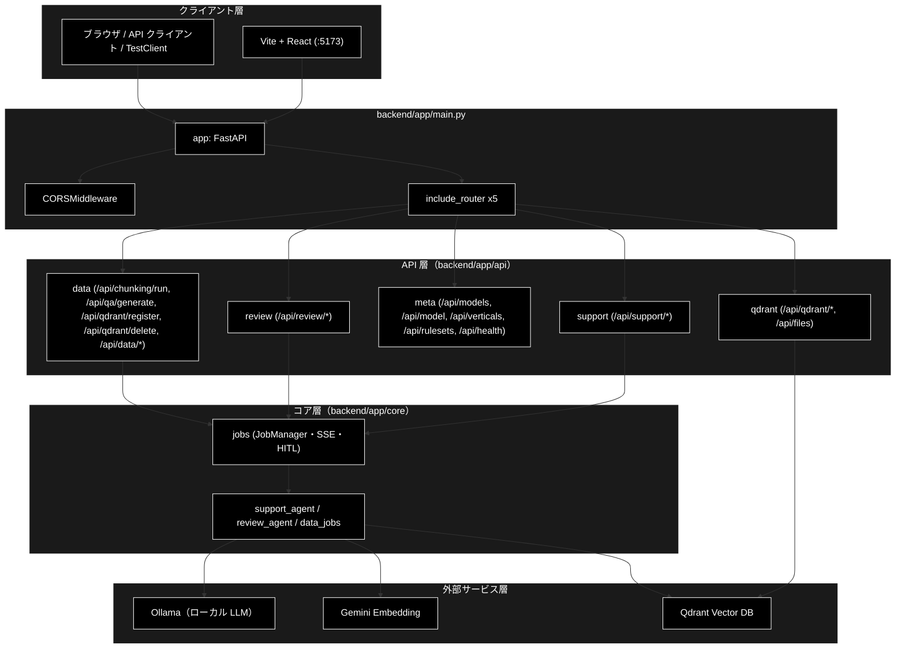
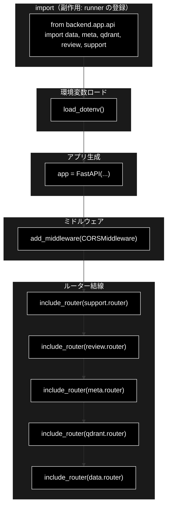
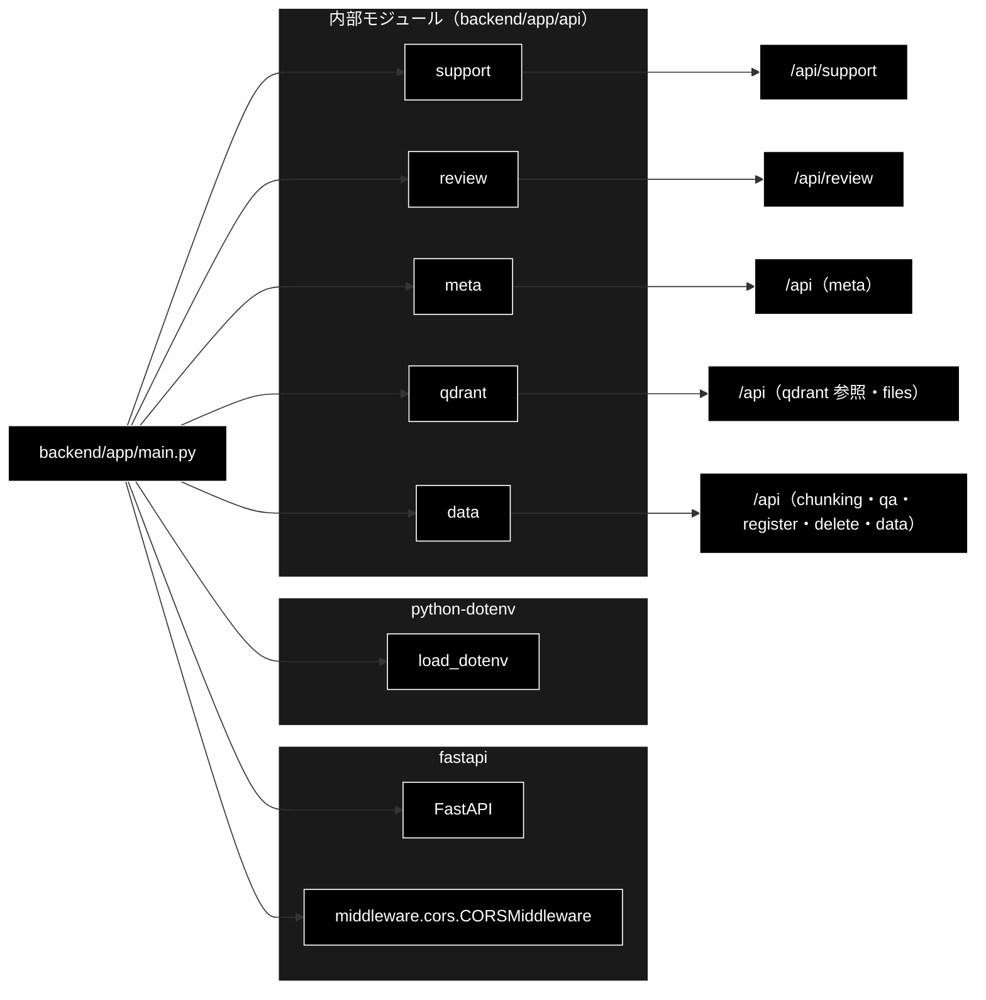

# main.py - GRACE Web API 起動モジュール ドキュメント

**Version 1.6** | 最終更新: 2026-10-11

> **本書の位置づけ**: `backend/app/main.py`（FastAPI アプリの組み立て（CORS・ルーター結線））の **IPO リファレンス**。
> 引くための文書であり、**設計の「なぜ」と処理の流れは上位の文書が正本**である。ディレクトリの索引は [`README_app.md`](README_app.md)。
>
> | 知りたいこと | 参照先 |
> |---|---|
> | 層構造・外部境界・依存の向き | [`architecture.md`](../../docs/architecture.md) |
> | エンドポイントと SSE の契約 | [`api_contract.md`](../../docs/api_contract.md) |
> | 起動手順・前提 | [`install_and_setup.md`](../../docs/install_and_setup.md) |
> | 文書全体の地図 | [`backend/docs/README.md`](../../docs/README.md) |

---

## 目次

1. [概要](#概要)
2. [アーキテクチャ構成図](#1-アーキテクチャ構成図)
3. [モジュール構成図](#2-モジュール構成図)
4. [クラス・関数一覧表](#3-クラス関数一覧表)
5. [クラス・関数 IPO詳細](#4-クラス関数-ipo詳細)
6. [設定・定数](#5-設定定数)
7. [エクスポート](#6-エクスポート)
8. [変更履歴](#7-変更履歴)
9. [付録: 依存関係図](#付録-依存関係図)

---

## 概要

`backend/app/main.py` は、GRACE（GRACE-Support / GRACE-Review とデータ準備）の **Web API（FastAPI アプリケーション）のエントリポイント**である。
コア（`backend/app/core/`）を HTTP/SSE 経由で公開するための「起動と結線」だけを担い、業務ロジックは持たない。

本モジュール自体にクラス・関数は定義されておらず、**モジュールレベルで ASGI アプリ（`app`）を生成し、CORS ミドルウェアと
5 つの API ルーター（`support` / `review` / `meta` / `qdrant` / `data`）を結線する**構成である。LLM はローカルの Ollama（API キー不要）、
Embedding は Gemini（`gemini-embedding-001`）を用いる（鍵は `.env` の `GOOGLE_API_KEY`）。
ローカル開発専用で認証は持たず、CORS は Vite dev サーバ（`http://localhost:5173`）のみ許可する。

### 主な責務

- FastAPI アプリケーション（ASGI `app`）の生成とメタ情報（title/description/version）の設定
- `.env` からの環境変数（Embedding 用の `GOOGLE_API_KEY` 等）の読み込み
- ローカル開発向け CORS 許可オリジン（Vite dev サーバ）の設定
- エージェントのルーター（`/api/support/*` / `/api/review/*`）の登録
- メタ情報・データ準備のルーター（`/api/models` ほか / `/api/qdrant/*`・`/api/files` / `/api/chunking/run` ほか）の登録

### 各責務対応のモジュール

| # | 責務 | 対応モジュール | 説明 |
|---|------|--------------|------|
| 1 | FastAPI アプリの生成とメタ情報設定 | `backend/app/main.py` | `FastAPI(title="GRACE API", version="1.1.0", ...)` を生成し `app` として公開 |
| 2 | 環境変数の読み込み | `python-dotenv` | `load_dotenv()` で `.env` を読み込み（未導入でも続行） |
| 3 | CORS 許可オリジンの設定 | `fastapi.middleware.cors` | `CORSMiddleware` で Vite dev サーバのみ許可 |
| 4 | エージェントのルーターの登録 | `backend/app/api/support.py` / `review.py` | 各 4 本（submit/query・stream・confirm・result） |
| 5 | メタ情報・データ準備のルーターの登録 | `backend/app/api/meta.py` / `qdrant.py` / `data.py` | 5 本 / 5 本 / 7 本（合計 25 エンドポイント） |

### 主要機能一覧

| 機能 | 説明 |
|------|------|
| `app` | FastAPI アプリケーションインスタンス（ASGI エントリポイント） |
| `load_dotenv()` | `.env` から環境変数を読み込む（`python-dotenv`。ImportError 時はスキップ） |
| `app.add_middleware(CORSMiddleware, ...)` | Vite dev サーバ向け CORS 許可設定 |
| `app.include_router(...)` × 5 | `support` → `review` → `meta` → `qdrant` → `data` の順に結線 |

---

## 1. アーキテクチャ構成図

### 1.1 システム全体構成



### 1.2 データフロー

1. `uvicorn backend.app.main:app` により本モジュールが読み込まれる（`from backend.app.api import data, meta, qdrant, review, support` が先に走る。
   `review` / `data` の import で `review_agent` / `data_jobs` が読まれ、各 runner が `register_runner()` で登録される）
2. `load_dotenv()` が `.env` を読み込み、`GOOGLE_API_KEY` 等を環境変数化（LLM は Ollama なのでキーは無い）
3. `FastAPI(...)` で `app` を生成し、`CORSMiddleware` を追加（Vite dev サーバのみ許可）
4. `include_router()` で 5 つのルーターを `app` に結線（各ルーターが自分の `prefix` を持つ）
5. 起動後、クライアント（Vite/ブラウザ）からのリクエストを各ルーターへ委譲

---

## 2. モジュール構成図

### 2.1 内部モジュール構成



### 2.2 外部依存関係

| ライブラリ | バージョン（pyproject.toml） | 用途 |
|-----------|-----------|------|
| `fastapi` | >=0.116.0 | ASGI アプリ（`FastAPI`）・CORS ミドルウェア |
| `python-dotenv` | ==1.1.1 | `.env` からの環境変数読み込み（`load_dotenv`。コード側は ImportError 保護があり未導入でも起動は継続） |
| `uvicorn` | ==0.34.0 | ASGI サーバ（`app` を起動する実行環境。本モジュールは import しない） |

### 2.3 内部依存モジュール

| モジュール | 用途 |
|-----------|------|
| `backend.app.api.support` | GRACE-Support（`/api/support/*`）。[`api/docs/support.md`](../api/docs/support.md) |
| `backend.app.api.review` | GRACE-Review（`/api/review/*`）。[`api/docs/review.md`](../api/docs/review.md) |
| `backend.app.api.meta` | メタ情報（`/api/models` / `/api/model` / `/api/verticals` / `/api/rulesets` / `/api/health`）。[`api/docs/meta.md`](../api/docs/meta.md) |
| `backend.app.api.qdrant` | Qdrant の参照（`/api/qdrant/health` / `collections` …・`/api/files`）。[`api/docs/qdrant.md`](../api/docs/qdrant.md) |
| `backend.app.api.data` | データ準備のジョブ（チャンク化 / Q/A 生成 / 登録 / 削除・`/api/data/*`）。[`api/docs/data.md`](../api/docs/data.md) |

---

## 3. クラス・関数一覧表

本モジュールはクラス・関数を定義せず、**モジュールレベルの構成要素**のみで成り立つ。
以下は import した関数・生成したオブジェクトのクイックリファレンス。

### 3.1 モジュールレベル構成要素

| 要素 | 種別 | 概要 |
|------|------|------|
| `app` | オブジェクト（`FastAPI`） | ASGI エントリポイント。`uvicorn backend.app.main:app` で参照される |
| `load_dotenv()` | 呼び出し（`python-dotenv`） | `.env` から環境変数を読み込む（ImportError 時はスキップ） |
| `app.add_middleware(CORSMiddleware, ...)` | 呼び出し | Vite dev サーバ向け CORS 許可設定 |
| `app.include_router(<router>)` × 5 | 呼び出し | `support` / `review` / `meta` / `qdrant` / `data` を結線 |

---

## 4. クラス・関数 IPO詳細

本モジュールには関数・クラス定義がないため、**モジュール実行時（import 時）に評価される
構成要素**を IPO 形式で記述する。

### 4.1 使用例

| # | パターン | いつ使うか | 例 |
|---|---------|-----------|----|
| 1 | **基本**: uvicorn で起動して叩く | 開発中に API を手で確かめる | 4.1.1 |
| 2 | `TestClient` でプロセス内から叩く | テスト・サーバを立てずに確かめる | 4.1.2 |

> 📝 **確かめ方（2026-10-11）**: 4.1.1 は VM で uvicorn を `--port 8765` で起動して `curl` し、4.1.2 は `PYTHONPATH=. python3 <例>.py` で実行した。
> どちらも `GOOGLE_API_KEY` を入れていない環境なので `google_api_key` は `false`（入れると `true`）。LLM は Ollama なので LLM のキーは返さない。

#### 4.1.1 基本: uvicorn で起動して叩く

> 📎 **起動手順の正本は [`install_and_setup.md` §6](../../docs/install_and_setup.md#6-起動手順)**（Qdrant の起動・`./run_dev.sh` で backend と frontend を一括起動）。
> ここでは `main.py` の `app` を単体で起動する形だけを示す。

```bash
uvicorn backend.app.main:app --reload --port 8000     # 別ターミナル
curl -s localhost:8000/api/health
curl -s localhost:8000/api/verticals | head -c 80

# 出力例:
# INFO:     Uvicorn running on http://127.0.0.1:8000 (Press CTRL+C to quit)
# {"status":"ok","google_api_key":false}
# [{"id":"gov","name":"自治体","collections":["gov_faq_anthropic","gov_laws_anthropic"],…
```

> 📌 `/api/health` は Qdrant にも LLM にもつながない（キーが環境変数にあるかだけを見る）ので、Qdrant が止まっていても `ok` を返す。
> Qdrant の生死は `/api/qdrant/health`（[`api/docs/qdrant.md`](../api/docs/qdrant.md)）。

#### 4.1.2 `TestClient` でプロセス内から叩く

```python
from fastapi.testclient import TestClient
from backend.app.main import app

client = TestClient(app)
print(client.get("/api/health").json())
print([v["id"] for v in client.get("/api/verticals").json()])
paths = sorted(client.get("/openapi.json").json()["paths"])
print(len(paths), paths[:3])
# CORS: Vite の dev サーバ（:5173）からのプリフライトを許可している
r = client.options("/api/health", headers={"Origin": "http://localhost:5173",
                                           "Access-Control-Request-Method": "GET"})
print(r.status_code, r.headers.get("access-control-allow-origin"))

# 実行結果:
# {'status': 'ok', 'google_api_key': False}
# ['gov', 'saas', 'ec']
# 25 ['/api/chunking/run', '/api/data/confirm/{job_id}', '/api/data/result/{job_id}']
# 200 http://localhost:5173
```

> 📌 5 つのルーター（`support` / `review` / `meta` / `qdrant` / `data`）を合わせて **25 エンドポイント**（パスも 25。1 つのパスに 1 メソッド）。
> 一覧と契約は [`backend/docs/api_contract.md`](../../docs/api_contract.md)。

### 4.2 `app`（FastAPI アプリケーションインスタンス）

**概要**: GRACE Web API の ASGI エントリポイント。

```python
app = FastAPI(
    title="GRACE API",
    description=(
        "業界特化・自律型エージェント（内部RAG＋Web裏取り＋HITL アクション）。"
        "Support（問い合わせ→回答）と Review（文書→指摘）を提供する。"
    ),
    version="1.1.0",
)
```

| パラメータ | 型 | 値 | 説明 |
|------------|------|-----------|------|
| `title` | str | "GRACE API" | OpenAPI ドキュメントのタイトル |
| `description` | str | （上記説明文） | OpenAPI ドキュメントの説明 |
| `version` | str | "1.1.0" | API バージョン |

| 項目 | 内容 |
|------|------|
| **Input** | `title: str`, `description: str`, `version: str`（キーワード指定） |
| **Process** | 1. `FastAPI(...)` で ASGI アプリを生成<br>2. `CORSMiddleware` を追加<br>3. 5 つのルーターを結線 |
| **Output** | `FastAPI`: ルーター・ミドルウェア登録済みの ASGI アプリケーション |

```python
from backend.app.main import app

print(app.title, app.version)

# 実行結果（2026-10-11）:
# GRACE API 1.1.0
```

### 4.3 `load_dotenv()`（環境変数の読み込み）

**概要**: `.env` から `GOOGLE_API_KEY`（Embedding）等を読み込む。LLM はローカル（Ollama）なので API キーは不要。`python-dotenv`
未導入でもアプリ起動を止めないよう `try/except ImportError` で保護している。

```python
try:
    from dotenv import load_dotenv

    load_dotenv()
except ImportError:
    pass
```

| 項目 | 内容 |
|------|------|
| **Input** | なし（カレント基準の `.env` を暗黙に参照） |
| **Process** | 1. `python-dotenv` を import 試行<br>2. 成功時 `load_dotenv()` で `.env` を環境変数へ反映（**既にある環境変数は上書きしない**）<br>3. ImportError 時は `pass`（既存の環境変数のみで続行） |
| **Output** | `None`（副作用として `os.environ` を更新） |

> 📌 キーの有無は `GET /api/health` の `google_api_key` で分かる（§4.1）。Ollama の接続先は `OLLAMA_BASE_URL`（既定 `http://localhost:11434/v1`）。

### 4.4 `app.add_middleware(CORSMiddleware, ...)`（CORS 設定）

**概要**: ローカル開発で Vite dev サーバ（既定 5173）からのクロスオリジンアクセスを許可する。

```python
app.add_middleware(
    CORSMiddleware,
    allow_origins=["http://localhost:5173", "http://127.0.0.1:5173"],
    allow_credentials=True,
    allow_methods=["*"],
    allow_headers=["*"],
)
```

| パラメータ | 型 | 値 | 説明 |
|------------|------|-----------|------|
| `allow_origins` | list[str] | `["http://localhost:5173", "http://127.0.0.1:5173"]` | 許可するオリジン（Vite dev サーバのみ） |
| `allow_credentials` | bool | True | クッキー等の資格情報の送信を許可 |
| `allow_methods` | list[str] | `["*"]` | 許可する HTTP メソッド（全許可） |
| `allow_headers` | list[str] | `["*"]` | 許可するリクエストヘッダ（全許可） |

| 項目 | 内容 |
|------|------|
| **Input** | `CORSMiddleware`, `allow_origins`, `allow_credentials`, `allow_methods`, `allow_headers` |
| **Process** | 1. `CORSMiddleware` を `app` のミドルウェアスタックに追加<br>2. 指定オリジンからのプリフライト/実リクエストに CORS ヘッダを付与 |
| **Output** | `None`（`app` にミドルウェアが登録される副作用） |

> 📌 画面は通常 Vite の proxy（`frontend/vite.config.ts`）経由で同一オリジンとして `/api/*` を叩くので、CORS が効くのは
> `:5173` から `:8000` を直接叩いたときである。プリフライトの確かめ方は §4.1.2。

### 4.5 `app.include_router(...)`（ルーター結線）

**概要**: 5 つのルーターを `app` に登録する。各ルーターは自身に `prefix` を持つため、本モジュールでは追加の prefix を与えない。

```python
app.include_router(support.router)
app.include_router(review.router)
app.include_router(meta.router)
app.include_router(qdrant.router)
app.include_router(data.router)
```

| ルーター | prefix | エンドポイント数 | 文書 |
|---|---|---:|---|
| `support.router` | `/api/support` | 4 | [`api/docs/support.md`](../api/docs/support.md) |
| `review.router` | `/api/review` | 4 | [`api/docs/review.md`](../api/docs/review.md) |
| `meta.router` | `/api` | 5 | [`api/docs/meta.md`](../api/docs/meta.md) |
| `qdrant.router` | `/api` | 5 | [`api/docs/qdrant.md`](../api/docs/qdrant.md) |
| `data.router` | `/api` | 7 | [`api/docs/data.md`](../api/docs/data.md) |

| 項目 | 内容 |
|------|------|
| **Input** | 5 つの `APIRouter` |
| **Process** | 1. 各ルーターの経路を `app` に結線<br>2. 各経路を `app` の OpenAPI（`/openapi.json`・`/docs`）に反映 |
| **Output** | `None`（`app` に 25 の経路が登録される副作用） |

> ⚠️ `qdrant.router` と `data.router` はどちらも `/api/qdrant/...` の経路を持つ（参照系 `GET /api/qdrant/collections` 等は `qdrant`、
> 副作用のある `POST /api/qdrant/register` / `delete` は `data`）。パスとメソッドが重ならないので順番には依存しない。
> 全経路の一覧は [`backend/docs/api_contract.md`](../../docs/api_contract.md)、数え方は §4.1.2。

---

## 5. 設定・定数

### 5.1 FastAPI アプリメタ情報

`app` 生成時に指定するメタ情報。OpenAPI ドキュメント（`/docs`・`/openapi.json`）に反映される。

| キー | 値 | 説明 |
|-----|-------------|------|
| `title` | "GRACE API" | API 名称 |
| `description` | §4.2 の説明文 | API 概要 |
| `version` | "1.1.0" | API バージョン |

### 5.2 CORS 許可オリジン

| キー | 値 | 説明 |
|-----|-------------|------|
| `allow_origins` | `http://localhost:5173` / `http://127.0.0.1:5173` | Vite dev サーバのみ許可（本番配信オリジンは含めない） |
| `allow_credentials` | True | 資格情報付きリクエストを許可 |
| `allow_methods` | `["*"]` | 全メソッド許可 |
| `allow_headers` | `["*"]` | 全ヘッダ許可 |

> 📝 **注意**: 認証なし・ローカル開発専用の設定。公開環境で使う場合は `allow_origins` を
> 実オリジンへ限定し、`allow_methods` / `allow_headers` の全許可も見直すこと。

---

## 6. エクスポート

本モジュールに `__all__` 定義はない。外部（`uvicorn` / テスト）から参照される
実質的なエクスポートは ASGI アプリケーション `app` のみ。

```python
from backend.app.main import app   # uvicorn backend.app.main:app で参照されるもの
```

---

## 7. 変更履歴

| バージョン | 日付 | 変更内容 |
|---|---|---|
| 1.0 | — | 初版作成（FastAPI 起動・CORS・ルーター結線のモジュールドキュメント） |
| 1.1 | — | 実コードとの再突合による改善: 誤字修正（Gemili→Gemini）、アーキテクチャ構成図にコア層（core.jobs / core.support_agent / core.verticals）を追加、外部依存バージョンを pyproject.toml に整合（fastapi >=0.116.0 / python-dotenv ==1.1.1 / uvicorn ==0.34.0）、起動ワークフローに `./run_dev.sh`（1 コマンド起動）を追記、`/api/verticals` の戻り値例を実 PROFILES（gov / saas / ec）に修正 |
| 1.2 | — | GRACE-Review の追加に追随（PR #41）: `review.router` の結線、`title` を "GRACE API"・`version` を 1.1.0 へ、2 エージェント構成の説明を追記 |
| 1.3 | 2026-09-16 | 3 階建て再編に伴い、冒頭へ**位置づけと上位文書への導線**を追加した |
| 1.4 | 2026-09-24 | 使用例を IPO 詳細の冒頭（`### 4.1 使用例`）へ移し、末尾の「## 6. 使用例」章を削除（基本フォーマット `a_class_method_md_format.md` v1.6〜 §6.1 に準拠。2026-09-24）。IPO の小節を 4.2 以降へ繰り下げ、後続の章番号を 1 つ繰り上げた。文書内の `§4.x` 参照も追随 |
| 1.5 | 2026-10-08 | Anthropic 予備経路の削除に追随（2026-10-08）。`/api/health` の出力例に残っていた `anthropic_api_key` を外し、現行の応答（`google_api_key` のみ）に合わせた |
| 1.6 | 2026-10-11 | `backend/docs/reference/main.md` から移した（`a_cross_doc_md_format.md` §1.1.2。リンクを付け替えた）。**ルーターが 3 つ（`support` / `review` / `meta`）のまま 2 つ（`qdrant` / `data`）抜けていた**のを実装どおり 5 つに是正し（概要・構成図・§4.5・付録）、`version` の記載の食い違い（"1.0.0" と "1.1.0"）と `description` を実装に合わせた。§4.1 を 2 パターン（uvicorn で起動して叩く / `TestClient`）に組み直し、どちらも実行して確かめた（エンドポイント数 25・CORS のプリフライトを追加） |

---

## 付録: 依存関係図


