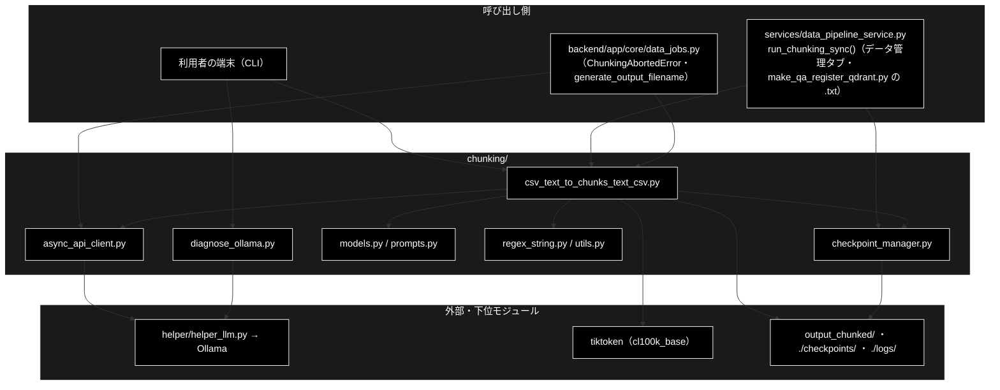

# README_chunking.md - chunking/ ディレクトリ概要

**Version 2.1** | 最終更新: 2026-10-11

`chunking/` の入口となる文書。ディレクトリの役割・モジュール索引・コマンドの早見表・運用の流れ・既知の制約をまとめる。
文書を新しく書く／直す前に、まずここを見る。

> 📌 **データ準備 3 工程のうち ① チャンク化を担う。**
> ② Q/A 生成は [`qa_generation/`](../../qa_generation/docs/README.md)、③ Qdrant 登録は [`qa_qdrant/`](../../qa_qdrant/docs/README_qa_qdrant.md)。
>
> ⚠️ **本リポジトリは Ollama 版。** チャンク化の LLM はローカル LLM（Ollama。既定 `gemma4:26b-a4b-it-qat` = `config.py::get_default_ollama_model()`）で、
> API キーは要らない。姉妹リポジトリ `grace_v2` は Anthropic 版で、`async_api_client.py` などの中身が違い、`diagnose_ollama.py` は無い。
> 文書をコピーで持ち込まないこと（CLAUDE.md §5）。

---

## 目次

- [概要](#概要)
  - [主な責務](#主な責務)
  - [各責務対応のモジュール](#各責務対応のモジュール)
  - [アーキテクチャ構成図](#アーキテクチャ構成図)
- [1. モジュール一覧（索引）](#1-モジュール一覧索引)
- [2. 使い方（代表的なワークフロー）](#2-使い方代表的なワークフロー)
- [3. 公開 API（__init__.py）](#3-公開-api__init__py)
- [4. 処理フロー・データフロー](#4-処理フローデータフロー)
- [5. 既知の制約・残課題](#5-既知の制約残課題)
- [6. 変更履歴](#6-変更履歴)

---

## 概要

`chunking/` は、テキスト（`.txt`・CSV）を **ローカル LLM で意味のまとまり（チャンク）に分け、チャンク CSV を書く**パッケージである。
分け方は 3 段階（Step1 段落分割 → Step2 意味的分割 → Step3 連続性チェック）で、最後に 1 チャンク 512 トークン（cl100k_base）の上限を掛ける。
出力の `<入力名>_chunks.csv` が ② Q/A 生成の入力になる。ローカル LLM は 1 呼び出しに数十秒かかるので（20 行で約 2 時間半の実測）、
**小さく試して所要時間を測ってから**全件へ進む（§2.2）。

### 主な責務

- 入力（`.txt` / CSV）の読み込みと、3 段階の LLM チャンク化・チャンク CSV の保存
- LLM 呼び出しの並列化・リトライ・連続失敗での中断
- 各段の途中結果の保存と、続きからの再開
- LLM に返させる JSON の形（スキーマ）の定義
- 各段で LLM に渡す指示文（プロンプト）の定義
- 正規表現による文分割（Step1 の前処理・後処理）
- ログ設定・表示の整形・呼び出し回数の見積もり
- 遅い・止まらないときの Ollama の診断

### 各責務対応のモジュール

| # | 責務 | 対応モジュール | 説明 |
|---|------|--------------|------|
| 1 | 読み込み・3 段階・保存 | `csv_text_to_chunks_text_csv.py` | CLI の入口（Ollama の事前確認・所要時間の表つき）。`chunks_all_async()` / `load_text_from_csv()` / `save_chunks_as_csv()` |
| 2 | 並列・リトライ・中断 | `async_api_client.py` | `AsyncAPIClient` / `ChunkingAbortedError`（スキーマのオウム返しは 1 回で中断） |
| 3 | 途中結果と再開 | `checkpoint_manager.py` | `CheckpointManager`（`./checkpoints/<JOB_ID>/step1〜3.json`） |
| 4 | 応答のスキーマ | `models.py` | `StructuralResult` / `ParagraphUnit` / `SentenceUnit` / `ContinuityResult` |
| 5 | 指示文 | `prompts.py` | `PARAGRAPH_SEPARATION_PROMPT` / `SEMANTIC_CHUNKING_PROMPT` / `CONTINUITY_CHECK_PROMPT` |
| 6 | 文分割 | `regex_string.py` | `chunk_text()` |
| 7 | 補助 | `utils.py` | `setup_logging()` / `format_size()` ほか |
| 8 | Ollama の診断 | `diagnose_ollama.py` | `python -m chunking.diagnose_ollama`（本番の Step1 リクエストを 1 回流して判定） |

### アーキテクチャ構成図



**データフロー**: 入力ファイル → 1 本のテキスト（CSV は行を空行でつなぐ）→ ブロック（1000 文字）→ 段落（Step1）→ チャンク（Step2）→ 結合（Step3）→
512 トークンの上限 → `<出力先>/<入力名>_chunks.csv`（8 列）と `_chunks_simple.csv`（`Text` 列）。詳細は §4。

---

## 1. モジュール一覧（索引）

| モジュール | 文書 | 種別 | 行数 | Ver | 概要 |
|---|---|---|---:|---|---|
| `csv_text_to_chunks_text_csv.py`（1194 行） | [`csv_text_to_chunks_text_csv.md`](csv_text_to_chunks_text_csv.md) | E | 1414 | 1.9 | CLI と 3 段階パイプライン・入出力・Ollama の事前確認・所要時間の表 |
| `async_api_client.py`（282 行） | [`async_api_client.md`](async_api_client.md) | E | 615 | 2.1 | 構造化出力つき非同期 LLM クライアント（Semaphore・リトライ・連続失敗とオウム返しで中断） |
| `checkpoint_manager.py`（325 行） | [`checkpoint_manager.md`](checkpoint_manager.md) | E | 453 | 1.1 | 段ごとの途中結果の保存と再開・再開時の入力と設定の照合・ジョブの一覧と掃除 |
| `models.py`（50 行） | [`models.md`](models.md) | E | 243 | 1.0 | 応答のスキーマ（Pydantic） |
| `prompts.py`（100 行） | [`prompts.md`](prompts.md) | E | 197 | 1.0 | 3 段階の指示文 |
| `regex_string.py`（182 行） | [`regex_string.md`](regex_string.md) | E | 280 | 1.0 | 正規表現による文分割（日本語・英語） |
| `utils.py`（187 行） | [`utils.md`](utils.md) | E | 289 | 1.0 | ログ設定・表示の整形・呼び出し回数の見積もり |
| `diagnose_ollama.py`（289 行） | [`diagnose_ollama.md`](diagnose_ollama.md) | E | 513 | 1.0 | Ollama の診断 CLI。§3 に所要時間の測り方と症状別の切り分け（旧 `timing.md`） |
| （処理フロー） | [`chunking_process_flow.md`](chunking_process_flow.md) | A | 232 | 1.1 | 3 つの入口から Ollama の確認・3 段階・上限・保存まで。各段の失敗時の既定・中断・再開 |

> 行数は文書の行数（2026-10-11 実測）。`__init__.py`（101 行・再エクスポートだけ）は文書を作らない（§3）。
> データフロー（チャンク CSV の列・置き場所）は別文書にせず、§4 と [`qa_qdrant/docs/qa_qdrant_data_flow.md`](../../qa_qdrant/docs/qa_qdrant_data_flow.md) §2.1 に書く。
>
> **移した文書（2026-10-11）**: 旧 `README.md`（棚卸し索引）→ 本書。手順書 `usage.md`（運用の入口）→ 本書 §2 に取り込み、原本は [`archive/usage.md`](archive/usage.md)。
> 手順書 `timing.md`（測り方と切り分け）→ [`diagnose_ollama.md`](diagnose_ollama.md) §3 に取り込み、原本は [`archive/timing.md`](archive/timing.md)。

---

## 2. 使い方（代表的なワークフロー）

| # | ワークフロー | いつ使うか | 例 |
|---|------------|-----------|----|
| 1 | CLI の早見表（よく使うオプション） | コマンドをすぐ打ちたい | 2.1 |
| 2 | 小さく試す → 入力を分けて刻んで回す → 出力を確かめる | 大きなデータを全件チャンク化する | 2.2 |
| 3 | チャンク化 → Q/A 生成 → Qdrant 登録 | 文書をアプリで検索できるようにする | 2.3 |
| 4 | 本番の入口と同じ組み立て方（Python） | データ管理タブと同じ関数で動かす | 2.4 |

> 📝 **確かめ方（2026-10-11）**: 2.1〜2.4 は実行した。Ollama の代わりに偽サーバ（OpenAI 互換の `/v1/models`・`/v1/chat/completions`。
> 段落分割は「。」で文に割るだけ・連続性は常に「つながらない」）を立て、Embedding（Gemini）はスタブ（文字列から決まる 3072 次元）、Qdrant は `docker compose` の実物。
> 入力は 4 文の `data/document.txt` と、`Combined_Text` 列を持つ 3 行の `OUTPUT/gov_faq.csv`。
> **所要時間はどれも実物の Ollama と桁が違う**（実測の目安は [`diagnose_ollama.md`](diagnose_ollama.md) §3.2）。各モジュールの使い方は、それぞれの文書の §4.1。

### 2.1 CLI の早見表

```bash
# 前提: ollama serve が動き、モデルが pull 済み（ollama list）。API キーは要らない
# 正本は --help と csv_text_to_chunks_text_csv.md
# 基本（出力は <--output>/<入力名>_chunks.csv と _chunks_simple.csv）
python -m chunking.csv_text_to_chunks_text_csv --input-file data/document.txt --output output_chunked

# CSV を入力にする（本文の列を指定・先頭 2 行だけで試す）
python -m chunking.csv_text_to_chunks_text_csv --input-file OUTPUT/gov_faq.csv --output output_chunked --text-column Combined_Text --max-rows 2

# 並列数・モデル・ブロックの大きさを変える（既定: OLLAMA_NUM_PARALLEL か 1 / gemma4:26b-a4b-it-qat / 1000 文字）
python -m chunking.csv_text_to_chunks_text_csv --input-file data/document.txt --output output_chunked --workers 2 --model gemma4:26b-a4b-it-qat --block-size 800

# 詳細ログ（コンソールも DEBUG。プロンプト全文が流れる。ログファイルは常に ./logs/chunking_<日時>.log）
python -m chunking.csv_text_to_chunks_text_csv --input-file data/document.txt --output output_chunked --verbose 2>/dev/null

# 中断したジョブを再開する（JOB_ID は ./checkpoints/ 配下のディレクトリ名。入力・--block-size・--model が違えば終了コード 1）
JOB_ID=$(ls -t checkpoints | head -1)
python -m chunking.csv_text_to_chunks_text_csv --input-file data/document.txt --output output_chunked --resume "$JOB_ID"

# 遅い・止まらないとき（本番の Step1 リクエストを 1 回流して判定する）
python -m chunking.diagnose_ollama --skip-step1 > /dev/null

ls output_chunked

# 出力例（最後の 1 つ）:
# document_chunks.csv
# document_chunks_simple.csv
# gov_faq_chunks.csv
# gov_faq_chunks_simple.csv
```

> ⚠️ **`--output` は省略しない。** 既定は `chunks_output` だが、プロジェクトの規約（CLAUDE.md §8.2）と後続の Q/A 生成が見るのは `output_chunked`。
>
> 📌 並列は asyncio ＋ Semaphore（`--workers` 本まで）。**Ollama は既定で 1 本ずつしか処理しないので、`--workers` だけ上げても速くならない**
> （`OLLAMA_NUM_PARALLEL` を上げて `ollama serve` し直したときだけ意味がある。[`diagnose_ollama.md`](diagnose_ollama.md) §3.5）。
> リトライは最大 3 回（429・rate・quota は 30 秒・60 秒、それ以外は 1 秒・2 秒）。LLM 呼び出しが連続 3 回失敗すると `ChunkingAbortedError` で止まる
> （`CHUNKING_ABORT_AFTER_FAILURES`。0 で無効）。単発の失敗では止まらず、そのブロック・段落を原文のまま残して件数を所要時間の表の直後に出す。
> 実行前に Ollama へ繋がらない・モデルが無い・入力ファイルが無いと終了コード 1。`--combine-rows` は効かない（§5 の 4）ので載せていない。

### 2.2 小さく試す → 入力を分けて刻んで回す → 出力を確かめる

全件は長い（`gemma4:12b-mlx` の実測で 20 行 2 時間 26 分、500 行で約 61 時間の見積もり）。**先頭数行で所要時間と品質を確かめてから**本番へ進む。
`--max-rows N` は常に**先頭** N 行で（オフセットが無い）、`--resume` は段単位の再開でしかないので、全件を刻むには入力 CSV を先に分ける。

```bash
# ① 先頭 2 行で試す。最後に「所要時間（実測）」の表が出る（読み方は diagnose_ollama.md §3.3）
python -m chunking.csv_text_to_chunks_text_csv --input-file OUTPUT/gov_faq.csv --output output_chunked \
  --text-column Combined_Text --max-rows 2 2>&1 | grep -A3 "所要時間（実測）" | tail -1

# ② 入力 CSV を 2 行ずつに分ける（実データでは 100 行ずつなど）
python -c "
import pandas as pd
df = pd.read_csv('OUTPUT/gov_faq.csv')
for i in range(0, len(df), 2):
    df.iloc[i:i+2].to_csv(f'OUTPUT/gov_faq_part{i//2}.csv', index=False)
    print(f'part{i//2}: {len(df.iloc[i:i+2])} 行')"

# ③ 1 本ずつ回す（1 本が落ちても、その 1 本だけやり直せる）
for p in 0 1; do
  python -m chunking.csv_text_to_chunks_text_csv --input-file OUTPUT/gov_faq_part${p}.csv --output output_chunked --text-column Combined_Text 2>/dev/null
done

# ④ 出力を 1 本にまとめ、文字落ちが無いかを入力と突き合わせる
python -c "
import glob, pandas as pd
files = sorted(glob.glob('output_chunked/gov_faq_part*_chunks.csv'))
out = pd.concat([pd.read_csv(f) for f in files], ignore_index=True)
out.to_csv('output_chunked/gov_faq_chunks.csv', index=False)
src = pd.read_csv('OUTPUT/gov_faq.csv')['Combined_Text'].astype(str).str.len().sum()
print(f'{len(files)} ファイル → {len(out)} チャンク / 文字数 {out[\"text\"].astype(str).str.len().sum()} / 入力 {src} / chunk_id 重複 {out[\"chunk_id\"].duplicated().sum()}')"

# 出力例:
#   Step1 段落分割                  0.0 秒  /      1 件  =     0.04 秒/件
# part0: 2 行
# part1: 1 行
# 2 ファイル → 5 チャンク / 文字数 83 / 入力 83 / chunk_id 重複 0
```

> ⚠️ **文字数を必ず突き合わせる。** このパイプラインは入力を逐語で書き写す工程を含み、指示追従の弱いモデルは文を落とすことがある。
> スキーマとして正しい JSON が返るので**エラーにならない**。また、3 回失敗したブロックは黙って出力から消える（§5 の 1）。
> 少し下回る程度は、改行・連続する空白を 1 つの空白にまとめ、前後の空白を削る分（`_normalize_whitespace()`）。大きく下回ったら、そのモデル・その実行は使えない
> （`gemma4:12b-mlx` の実測は 54,767 / 54,800 字 = 99.94%）。
>
> 📌 `chunk_id` は `<入力名>_chunk_<n>` なので、分けたファイルを結合しても重複しない（`dataset_type` 列も分けたファイル名になる）。
> 全件を一気に回すなら `nohup python -m chunking.csv_text_to_chunks_text_csv ... > logs/chunking_full.log 2>&1 &`。

### 2.3 チャンク化 → Q/A 生成 → Qdrant 登録

```bash
# 1. チャンク化（Ollama）
python -m chunking.csv_text_to_chunks_text_csv --input-file data/document.txt --output output_chunked 2>/dev/null

# 2. Q/A 生成 → Qdrant 登録（Ollama・GOOGLE_API_KEY・Qdrant）
python qa_qdrant/make_qa_register_qdrant.py \
  --input-file output_chunked/document_chunks.csv \
  --collection document_qa --recreate 2>&1 | grep "データ件数"

# 出力例（偽サーバではチャンク 1 つにつき Q/A 1 件）:
# INFO:__main__:   データ件数  : 4 件
```

> 📌 **チャンク化は Celery を使わない**（asyncio で直接 Ollama を呼ぶ）。`./start_celery.sh` が要るのは 2 で `--use-celery` を付けるときだけで、
> Q/A 生成も同じ 1 台の Ollama を使うので、ここでも効くのは `OLLAMA_NUM_PARALLEL` の方（[`qa_qdrant/docs/make_qa_register_qdrant.md`](../../qa_qdrant/docs/make_qa_register_qdrant.md)）。
> `make_qa_register_qdrant.py` に `.txt` を渡すと 1 と 2 を 1 本でやる（ワーカー数はデータ管理タブと同じ既定・ブロック 1000 文字で、`--resume` は無い）。

### 2.4 本番の入口と同じ組み立て方（Python）

```python
from pathlib import Path
from chunking.csv_text_to_chunks_text_csv import generate_output_filename
from config import get_default_chunking_workers, get_default_ollama_model
from services.data_pipeline_service import run_chunking_sync

# データ管理タブの「① チャンキング」と make_qa_register_qdrant.py の .txt 入力が使う同期版
text = Path("data/document.txt").read_text(encoding="utf-8")
out = generate_output_filename("data/document.txt", "output_chunked")   # output_chunked/document_chunks.csv（ディレクトリも作る）
chunks = run_chunking_sync(
    text,
    model=get_default_ollama_model(),
    max_workers=get_default_chunking_workers(),
    block_size=1000,
    output_file=out,
    dataset_type="document",
    source_file="document.txt",
)
print(len(chunks), out)

# 実行結果（偽サーバ）:
# 4 output_chunked/document_chunks.csv
```

> ⚠️ `run_chunking_sync()` は Ollama の確認をしない（データ管理タブ・`make_qa_register_qdrant.py` は呼ぶ前に確かめる）。
> チャンク化の中で LLM 呼び出しが連続して失敗すると `ChunkingAbortedError` が上がり、データ管理タブのジョブはこれを捕まえてエラーイベントにする
> （[`async_api_client.md`](async_api_client.md) §4.1）。引数は [`services/docs/data_pipeline_service.md`](../../services/docs/data_pipeline_service.md)。

---

## 3. 公開 API（__init__.py）

`chunking/__init__.py`（101 行）の `__all__` は 19 個（再エクスポート 18 個と `__version__`）。`__version__ = "1.2.0"`（パッケージの更新では上げていない）。

| 名前 | 定義元 | 用途 |
|---|---|---|
| `SentenceUnit` / `ParagraphUnit` / `StructuralResult` / `ContinuityResult` | `models.py` | 応答のスキーマ |
| `PARAGRAPH_SEPARATION_PROMPT` / `SEMANTIC_CHUNKING_PROMPT` / `CONTINUITY_CHECK_PROMPT` | `prompts.py` | 指示文 |
| `AsyncAPIClient` | `async_api_client.py` | LLM クライアント（`ChunkingAbortedError` は再エクスポートしない） |
| `CheckpointManager` | `checkpoint_manager.py` | 途中結果と再開 |
| `chunks_all_async` / `load_text_from_csv` / `save_chunks_as_csv` / `save_chunks_as_text` | `csv_text_to_chunks_text_csv.py` | 本体（`save_chunks_as_simple_csv` / `generate_output_filename` は再エクスポートしない） |
| `show_paragraphs` / `setup_logging` / `format_time` / `format_size` / `estimate_api_calls` | `utils.py` | 補助 |
| `__version__` | `__init__.py` | `"1.2.0"` |

> ⚠️ **`import chunking` だけで本体（`csv_text_to_chunks_text_csv.py`）と `pandas`・`tiktoken`・`tqdm`・`openai`・`helper.helper_llm` が読み込まれる**
> （2026-10-11 に `sys.modules` で確認）。`diagnose_ollama.py` は再エクスポートしない。
> 本番のコードはどれも `from chunking.<module> import ...` と個別に import していて、この再エクスポートを使っていない（2026-10-11 grep）。
> 副作用として、`python -m chunking.csv_text_to_chunks_text_csv` を実行すると最初に
> `RuntimeWarning: 'chunking.csv_text_to_chunks_text_csv' found in sys.modules after import of package 'chunking' ...` が出る（動作には影響しない）。

---

## 4. 処理フロー・データフロー

- **処理フロー** — [`chunking_process_flow.md`](chunking_process_flow.md)。3 つの入口（CLI・データ管理タブ・`.txt` 入力の Q/A 登録）から
  Ollama の確認・`chunks_all_async()` の Step1〜3・上限・所要時間の表・保存までと、各段で LLM が失敗したときの既定（Step1・Step2 は**そのブロックを捨てる**、Step3 は「つながらない」扱い）、中断と再開。
- **データの形** — 入力 CSV は本文の列（指定が無ければ `text` → `content` → `Combined_Text` → `body` → `document` → `answer` の順に探し、大文字小文字の変種も見る。
  無ければ最初の列）の非空セルを `"\n\n"` でつなぐ。出力は 8 列（`chunk_id` = `<入力名>_chunk_<n>` / `text`（改行は空白へ）/ `tokens` / `chunk_idx` /
  `dataset_type` = 入力名 / `type` = `llm_chunk` / `sentence_count` / `source_file`）と、`Text` 1 列の簡易版（**`text` と `Text` の大文字小文字を取り違えると `KeyError`**）。
  後続での読まれ方は [`qa_qdrant/docs/qa_qdrant_data_flow.md`](../../qa_qdrant/docs/qa_qdrant_data_flow.md) §2.1。

| 出力 | 置き場所 | 上書き |
|------|---------|:-----:|
| チャンク CSV・簡易版 | `<--output>/<入力名>_chunks.csv` / `_chunks_simple.csv`（`--output` の既定 `chunks_output`） | する（CLAUDE.md §8.2） |
| チェックポイント | `./checkpoints/<JOB_ID>/step1〜3.json`（カレント基準） | しない（実行ごとに増え、自動では消えない） |
| ログ | `./logs/chunking_<日時>.log`（CLI だけ） | しない（実行ごとに増える） |

**環境変数**（詳細は [`diagnose_ollama.md`](diagnose_ollama.md) §6）:

| 変数 | 既定 | 効果 |
|---|---|---|
| `OLLAMA_BASE_URL` | `http://localhost:11434/v1` | 接続先 |
| `OLLAMA_DEFAULT_MODEL` | 未設定（`gemma4:26b-a4b-it-qat`） | `--model` の既定。**アプリ全体の既定も変わる**ので通常は書かない（親ディレクトリの `.env` やシェルのプロファイルからも来る） |
| `OLLAMA_NUM_PARALLEL` | Ollama 側の既定 | サーバの同時処理数（`ollama serve` に渡す）。`--workers` の既定もこれに従う |
| `CHUNKING_LLM_TIMEOUT` | 未設定（`helper_llm` の既定 180 秒） | 1 リクエストの期限（秒） |
| `CHUNKING_ABORT_AFTER_FAILURES` | `3` | 連続失敗で中断する回数。`0` で無効 |

---

## 5. 既知の制約・残課題

2026-10-11 に実装を読み、Ollama の代わりに偽サーバを立てて CLI を動かして確かめた。**1〜3 は同日に直した**（下の表の取り消し線。修正前のコードで fail するテストを先に書いた）。

| # | 内容 | 影響 | 詳細 |
|---|------|------|------|
| 1 | ~~1 ブロックの LLM 呼び出しが失敗すると、その本文が黙って消える~~ → **解決**（失敗したブロック・段落は原文のまま残し、件数を警告ログと所要時間の表の直後に出す） | — | [`csv_text_to_chunks_text_csv.md`](csv_text_to_chunks_text_csv.md) §4.1.5・§5.3 の 1 |
| 2 | ~~`--resume` がジョブと入力ファイルの対応を確かめない~~ → **解決**（`job.json` で照合し、違えば終了コード 1。データ管理タブの再開 ID も同じ） | — | 同 §4.1.3・§5.3 の 2、[`checkpoint_manager.md`](checkpoint_manager.md) §4.1.4 |
| 3 | ~~入力ファイルが無くても CLI の終了コードが 0~~ → **解決**（終了コード 1） | — | 同 §4.1.5・§5.3 の 3 |
| — | ~~同じ秒に始めた新規ジョブがチェックポイントのディレクトリを共有する~~ → **解決**（2 の照合で見つかった。2 つ目以降の ID に `_1`, `_2` … を付ける） | 修正前は、あとの実行が前の実行の途中結果（別の入力のチャンク）を読み戻していた | [`checkpoint_manager.md`](checkpoint_manager.md) §4.2 |
| 4 | `--combine-rows` が効かない | オプションが何もしない | 同 §5.3 の 4 |
| 5 | Step1 のブロックが文や語の途中で切れる | 境目の文が 2 チャンクに割れることがある | 同 §5.3 の 5 |
| 6 | `chunking/requirements.txt` が古い（`google-genai` を挙げ、実際に要る `openai`・`tiktoken`・`pandas` が無い） | 書かれたとおりに入れても動かない。依存の正本はリポジトリ直下の `pyproject.toml` | — |
| 7 | `import chunking` で本体まで読み込み、`python -m` で `RuntimeWarning` が出る | 見た目と import の重さ | §3 |
| 8 | 移植前の記述が残る（`models.py` / `prompts.py` の docstring の「Gemini API」、`AsyncAPIClient.get_stats()` の `truncated_responses` は常に 0、`utils.show_paragraphs()` は何もしない、`utils.estimate_api_calls()` の時間は 1 呼び出し 2 秒の仮定） | 読む人が誤解する | 各モジュールの文書 |
| 9 | `diagnose_ollama.py` は Ollama に接続できなくても終了コード 0 | スクリプトから診断の失敗を検知できない | [`diagnose_ollama.md`](diagnose_ollama.md) §5.1.3 |

> 1〜3 は出力の中身や成否が静かに食い違う問題だったので、`tests/test_chunking_fallback_and_resume.py` と
> `tests/test_data_jobs.py::test_chunking_resume_with_other_input_is_error` を先に書き、修正前のコードで fail することを確かめてから直した。

### 5.1 文書を保守するときの約束とテスト件数

| 置き場所 | 書くもの | 書かないもの |
|---|---|---|
| `<module>.md` | IPO（入出力・副作用・使用例） | 運用判断・ほかのモジュールの仕様 |
| 本書 §2 | コマンドの早見表と、モジュールを組み合わせる運用の流れ | 1 モジュールの IPO |
| [`diagnose_ollama.md`](diagnose_ollama.md) §3 | 所要時間の測り方・実測の基準値・症状別の切り分け | 実行手順（本書 §2 へリンク） |
| モジュール docstring | 最小の実行例と本書へのリンク | 詳細な手順 |

- 運用手順は 1 か所（本書 §2）にだけ書く。同じ手順が 2 か所にあると片方だけ直したときに食い違う（`--max-rows` で刻む誤った手順を 3 回案内した）
- CLI のオプションを変えたら、同じコミットで本書 §2.1 と [`csv_text_to_chunks_text_csv.md`](csv_text_to_chunks_text_csv.md) §4.5 を直す
- 使用例は**動かして確かめてから**載せる（`a_class_method_md_format.md` §9.5）。Ollama は偽サーバでよいが、所要時間の数値は実測を書く

テスト件数（2026-10-11 に `pytest --collect-only` で数えた値）:

| テストファイル | 件数 | 対象 |
|---|---:|---|
| `tests/chunking/test_max_chunk_tokens.py` | 5 | `_enforce_max_chunk_tokens()`（512 トークンの上限） |
| `tests/test_chunking_abort.py` | 5 | `AsyncAPIClient` の連続失敗での中断・カウントの戻し・0 で無効・環境変数の既定 |
| `tests/test_chunking_cli_preflight.py` | 5 | CLI のモデルの事前確認（pull 済み一覧つきのメッセージ・一覧が取れないときと import に失敗したときは止めない） |
| `tests/test_chunking_fallback_and_resume.py` | 20 | LLM が失敗したブロック・段落の原文を残すこと（所要時間の表の直後の 1 行を含む）・`--resume` の照合（入力・モデル・ブロック長・ファイル名）・CLI の終了コード・同じ秒の新規ジョブが別のディレクトリになること（`chunks_all_async()` / `main()` を `AsyncAPIClient` のスタブで動かす） |
| `tests/test_chunking_fail_fast.py` | 7 | 連続失敗で止まる・成功で数え直す・0 で無効・出力上限・タイムアウトの環境変数 |
| `tests/test_chunking_model_passthrough.py` | 7 | 指定したモデル名がそのまま Ollama へ渡ること |
| `tests/test_chunking_timing_summary.py` | 4 | 所要時間の表 |
| `tests/test_chunking_workers_default.py` | 9 | `--workers` の既定（`OLLAMA_NUM_PARALLEL` か 1） |
| `tests/test_schema_echo.py` | 13 | スキーマのオウム返しの検知と即中断 |
| `tests/test_ollama_unreachable.py` | 10 | Ollama 停止の判定（確実に繋がらないときだけ止め、曖昧なら素通り）と CLI・データ管理タブの入口（**間接**） |
| `tests/test_data_jobs.py` | 56 | データ管理タブのジョブ全体（チャンク化ジョブの runner・入力検証・再開 ID の照合を含む・**間接**） |

```bash
env -u OLLAMA_DEFAULT_MODEL PYTHONPATH=. .venv/bin/python -m pytest tests/chunking tests/test_chunking_*.py tests/test_schema_echo.py -q
# 2026-10-11 実測: 75 passed
```

> ⚠️ 3 段階パイプライン（`chunks_all_async()`）は `test_chunking_fallback_and_resume.py` が LLM のスタブで通しているが、分割の中身（プロンプト・Step3 の結合）は見ていない。
> `CheckpointManager` の保存・掃除そのもの・`regex_string`・`utils`・`diagnose_ollama` を**直接**検証するテストは無い。

---

## 6. 変更履歴

| バージョン | 日付 | 変更内容 |
|---|---|---|
| 1.0 | 2026-09-11 | 新規作成（旧名 `chunking/docs/README.md`・棚卸し索引）。`usage.md` 新設にあわせて整備 |
| 1.1〜1.3 | 2026-09-24〜2026-10-10 | 文書種別の明記、`check_async.md` / `memo.txt` の削除、`grace/docs/` の構成整理への追随（各版の内容は git 履歴） |
| 2.0 | 2026-10-11 | `a_cross_doc_md_format.md` §1.1〜§1.4 に合わせて `README_chunking.md` へ改名し、共通骨格（主な責務・各責務対応のモジュール・3 層構成図）を持つ構成に書き直した。専用の文書が無かった 6 モジュール（`checkpoint_manager` / `models` / `prompts` / `regex_string` / `utils` / `diagnose_ollama`）の文書と `chunking_process_flow.md` を新設し、手順書 `usage.md` を §2 に、`timing.md` を `diagnose_ollama.md` §3 に取り込んで原本を `archive/` へ移した。§2 のワークフロー 4 本を実行して確かめ、実測で見つけた制約 9 件を §5 に、テスト件数を数え直して §5.1 に記録した |
| 2.1 | 2026-10-11 | §5 の 1〜3（LLM が失敗したブロックの本文が消える・`--resume` が入力を照合しない・入力ファイルが無くても終了コード 0）を直したので解決済みにし、照合で見つかった「同じ秒の新規ジョブがディレクトリを共有する」も解決済みとして足した。§5.1 のテスト件数を数え直し（`test_chunking_fallback_and_resume.py` 20 件・`test_data_jobs.py` 56 件・75 passed）、§2.1 を実行し直した |
