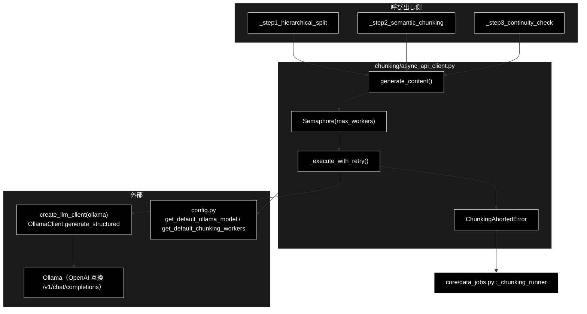
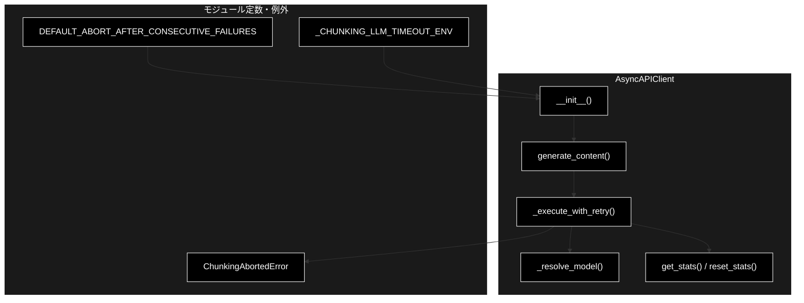
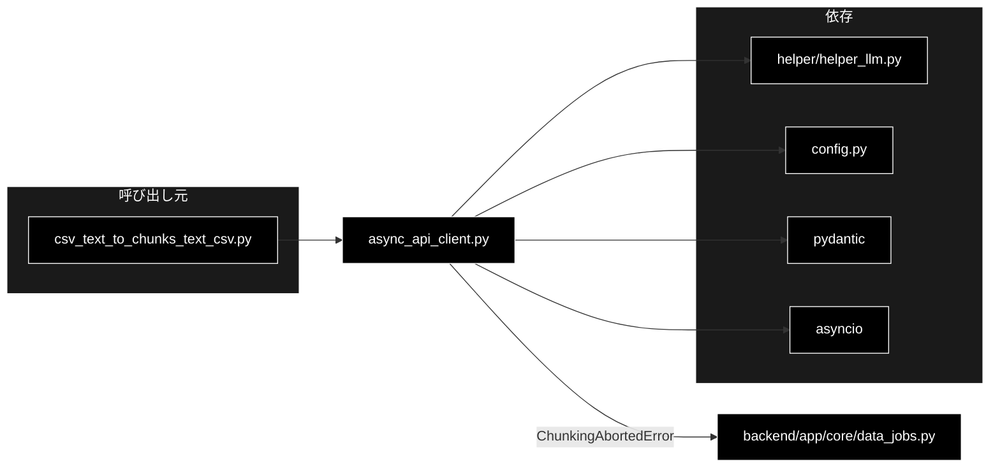

# async_api_client.py - チャンク化用 非同期APIクライアント ドキュメント

**Version 2.0** | 最終更新: 2026-10-11

---

## 目次

1. [概要](#概要)
2. [アーキテクチャ構成図](#1-アーキテクチャ構成図)
3. [モジュール構成図](#2-モジュール構成図)
4. [クラス・関数一覧表](#3-クラス関数一覧表)
5. [クラス・関数 IPO詳細](#4-クラス関数-ipo詳細)
6. [設定・定数](#5-設定定数)
7. [エクスポート](#6-エクスポート)
8. [変更履歴](#7-変更履歴)
9. [付録: 依存関係図](#付録-依存関係図)

---

## 概要

`chunking/async_api_client.py` は、チャンク化の 3 段階（段落分割 → 意味的分割 → 連続性チェック）から呼ばれる
**構造化出力つき非同期 LLM クライアント**である。

LLM は**ローカル LLM（Ollama）**（既定 `gemma4:26b-a4b-it-qat` = `config.py::get_default_ollama_model()`。API キーは要らない）。
同期の `create_llm_client("ollama").generate_structured()` を `asyncio.to_thread()` でラップし、`asyncio.Semaphore` で並列数を絞る。
並列数の既定は `config.py::get_default_chunking_workers()`（`OLLAMA_NUM_PARALLEL`、無ければ **1**）。

> ⚠️ **v1.x の本書は Gemini 時代の記述のままだった**（`genai.Client`・`GOOGLE_API_KEY`・`gemini-2.0-flash`、
> 現在は存在しない `_is_valid_json()` / `_is_truncated_response()`、`max_workers` の既定 8 など）。
> v2.0 で実装（282 行）と突き合わせて全面的に書き直した。

### 主な責務

- 構造化出力（Pydantic スキーマ準拠）の生成を**非同期で**行う
- `Semaphore` で並列実行数を絞る
- 指数バックオフでリトライする（レート制限は待ち時間を延ばす）
- **連続失敗が続いたら・スキーマ定義が返ってきたらチャンク化を中断する**（`ChunkingAbortedError`）
- 呼び出し側が渡したモデル名をそのまま使う（未指定のときだけ既定へ）
- 呼び出し統計を収集する

### 各責務対応のモジュール

| # | 責務 | 対応モジュール | 説明 |
|---|------|--------------|------|
| 1 | 構造化出力を非同期で生成する | 本モジュール（`generate_content()`）＋ `helper/helper_llm.py` | `create_llm_client("ollama")` の `generate_structured()` を `asyncio.to_thread()` で包む |
| 2 | 並列実行数を絞る | 本モジュール（`__init__()` / `generate_content()`） | `asyncio.Semaphore(max_workers)`。既定は `config.py::get_default_chunking_workers()` |
| 3 | 指数バックオフでリトライする | 本モジュール（`_execute_with_retry()`） | 通常 `2^attempt` 秒、レート制限は `30×(attempt+1)` 秒待つ |
| 4 | 中断する | 本モジュール（`ChunkingAbortedError`）→ `backend/app/core/data_jobs.py` | 連続失敗数がしきい値に達したとき・`SchemaEchoError` のとき。ジョブ側が error イベントへ変換する |
| 5 | モデル名を決める | 本モジュール（`_resolve_model()`） | 指定があればそのまま、空なら `default_model` |
| 6 | 呼び出し統計を収集する | 本モジュール（`get_stats()` / `reset_stats()`） | 総数・失敗数などを集計 |

### 主要機能一覧

| 機能 | 説明 |
|------|------|
| `DEFAULT_ABORT_AFTER_CONSECUTIVE_FAILURES` | 連続失敗の既定許容回数（環境変数 `CHUNKING_ABORT_AFTER_FAILURES`。import 時に読む） |
| `ChunkingAbortedError` | 中断。**握りつぶしてはいけない** |
| `AsyncAPIClient` | 非同期クライアント本体 |
| `AsyncAPIClient.generate_content()` | セマフォ制御つきの構造化出力生成 |
| `AsyncAPIClient._execute_with_retry()` | リトライと中断判断（プライベート） |
| `AsyncAPIClient._resolve_model()` | 指定されたモデル名を使う・空なら既定（静的メソッド） |
| `AsyncAPIClient.get_stats()` / `reset_stats()` | 統計の取得・リセット |

---

## 1. アーキテクチャ構成図

### 1.1 システム全体構成



### 1.2 データフロー

1. 3 段階のいずれかが `generate_content(model, contents, response_schema, task_id)` を呼ぶ
2. `Semaphore` が空くまで待つ（同時実行は `max_workers` 件まで）
3. `_execute_with_retry()` が `_resolve_model()` でモデルを決め、`asyncio.to_thread()` で同期の `generate_structured()` を呼ぶ
4. 成功 → Pydantic インスタンスを `model_dump_json()` した**文字列**を返し、連続失敗カウントを 0 に戻す
5. `SchemaEchoError`（データではなくスキーマ定義が返った）→ リトライせず、その場で `ChunkingAbortedError`
6. それ以外の失敗 → 指数バックオフで `max_retries` 回まで再試行
7. 使い切ったら連続失敗カウントを 1 増やし、**しきい値に達していれば `ChunkingAbortedError`**。達していなければ `None` を返す
   （呼び出し側の Step1・Step2 はそのブロックの本文を捨てて次へ進む。代わりの処理は無い・§4.1.3）

---

## 2. モジュール構成図

### 2.1 内部モジュール構成



### 2.2 外部依存関係

| ライブラリ | 用途 |
|-----------|------|
| `pydantic` | `BaseModel`（レスポンススキーマの型） |
| `asyncio` / `logging` / `os`（標準） | `to_thread` / `Semaphore` / `sleep`、ログ、環境変数 |

### 2.3 内部依存モジュール

| モジュール | 用途 |
|-----------|------|
| `helper.helper_llm.create_llm_client` | LLM クライアント生成（`provider="ollama"`。接続先は `OLLAMA_BASE_URL`） |
| `helper.helper_llm.SchemaEchoError` | スキーマのオウム返しの検知（`generate_structured()` が送出） |
| `config.get_default_ollama_model` / `get_default_chunking_workers` | 既定モデル・既定の並列数 |

---

## 3. クラス・関数一覧表

### 3.1 クラス一覧

#### ChunkingAbortedError

`RuntimeError` のサブクラス。LLM 呼び出しが連続で失敗した、またはモデルがスキーマ定義を返したためチャンク化を中断したことを表す。

> ⚠️ **握りつぶして続行してはいけない。** 続行しても、LLM が 1 度も使えていないのに「成功」した CSV ができるだけである。
> 捕捉は `backend/app/core/data_jobs.py::_chunking_runner` が行い、error イベントへ変換する。CLI は捕まえずにトレースバックで終了コード 1。

#### AsyncAPIClient

| メソッド | 概要 |
|---------|------|
| `__init__(api_key, max_workers, max_retries, max_output_tokens, default_model, abort_after_consecutive_failures)` | コンストラクタ |
| `_resolve_model(model, default_model)` | 指定があればそのまま、空なら既定（`@staticmethod`） |
| `generate_content(model, contents, response_schema, task_id)` | セマフォ制御つきの生成（`async`） |
| `_execute_with_retry(model, contents, response_schema, task_id)` | リトライと中断判断（`async`） |
| `get_stats()` | 統計情報を取得 |
| `reset_stats()` | 統計情報をリセット |

### 3.2 関数一覧

モジュールレベル関数はない。

---

## 4. クラス・関数 IPO詳細

### 4.1 使用例

| # | パターン | いつ使うか | 例 |
|---|---------|-----------|----|
| 1 | **基本**: 1 件を構造化出力で呼び、検証して読む | チャンク化の各段と同じ使い方 | 4.1.1 |
| 2 | 並列に投げて統計を見る | 多数のブロックを `max_workers` 本ずつ処理する | 4.1.2 |
| 3 | 失敗したとき（1 件だけ失敗・連続失敗で中断・中断を無効にする） | Ollama が落ちている・遅すぎてタイムアウトする | 4.1.3 |
| 4 | スキーマのオウム返しで即中断 | 指示追従の弱いモデル・structured outputs 未対応の Ollama | 4.1.4 |
| 5 | モデル名の扱い（指定どおり使う・空なら既定） | 呼び出し側でモデルを選ぶ | 4.1.5 |

> 📝 **確かめ方（2026-10-11）**: 4.1.1〜4.1.5 はすべて実行した。Ollama の代わりに偽サーバ（OpenAI 互換の `/v1/models`・`/v1/chat/completions`。
> 段落分割の依頼には入力を「。」で文に割って返し、連続性の依頼には常に「つながらない」と答える）を立てた。
> 4.1.3 は誰も待ち受けていないポートへ向けて実際に接続を失敗させ、4.1.4 は `generate_structured` を差し替えてスキーマのオウム返しを模擬した。
> リトライの待ち（1 回目の失敗後 1 秒・2 回目の後 2 秒）は実際に待つので、4.1.3 は十数秒かかる。最後の試行のあとは待たないが、
> ログには `Retrying in 4s (attempt 3/3)` と出る（文言だけ。`max_retries=1` でも `Retrying in 1s` と出る）。

#### 4.1.1 基本: 1 件を構造化出力で呼び、検証して読む

```python
import asyncio
from chunking.async_api_client import AsyncAPIClient
from chunking.models import StructuralResult
from chunking.prompts import PARAGRAPH_SEPARATION_PROMPT

client = AsyncAPIClient(max_output_tokens=8192)   # 既定モデル・並列数は config.py から（chunks_all_async() と同じ 8192）
print(client.default_model, client.max_workers)

json_text = asyncio.run(client.generate_content(
    model="gemma4:26b-a4b-it-qat",
    contents=f"{PARAGRAPH_SEPARATION_PROMPT}\n\n【入力テキスト】\n住民票は区役所で取れます。手数料は300円です。",
    response_schema=StructuralResult,
    task_id="step1_block_0",
))
result = StructuralResult.model_validate_json(json_text)   # 戻り値は検証済みの JSON 文字列
print([p.full_text for p in result.paragraphs])

# 実行結果（偽サーバ）:
# gemma4:26b-a4b-it-qat 1
# ['住民票は区役所で取れます。', '手数料は300円です。']
```

> 📌 `OLLAMA_NUM_PARALLEL=4` が環境にあれば `max_workers` の既定は 4、`CHUNKING_LLM_TIMEOUT=600` があれば 1 リクエストの期限は 600 秒
> （どちらもクライアントを作った時点の値。期限の既定は `helper_llm` の 180 秒）。

#### 4.1.2 並列に投げて統計を見る

```python
import asyncio
from chunking.async_api_client import AsyncAPIClient
from chunking.models import ContinuityResult
from chunking.prompts import CONTINUITY_CHECK_PROMPT

client = AsyncAPIClient(max_workers=2)        # 同時に走る呼び出しは 2 本まで（Semaphore）
pairs = [("住民票は区役所で取れます。", "手数料は300円です。")] * 5

async def run():
    tasks = [
        client.generate_content(
            model="gemma4:26b-a4b-it-qat",
            contents=f"{CONTINUITY_CHECK_PROMPT}\n\n【前のテキスト】\n{a}\n\n【次のテキスト】\n{b}",
            response_schema=ContinuityResult,
            task_id=f"step3_pair_{i}",
        )
        for i, (a, b) in enumerate(pairs)
    ]
    return await asyncio.gather(*tasks)

results = asyncio.run(run())
print(len(results), ContinuityResult.model_validate_json(results[0]).is_connected)
print(client.get_stats())

# 実行結果（偽サーバ）:
# 5 False
# {'total_requests': 5, 'failed_requests': 0, 'truncated_responses': 0, 'success_rate': 100.0, 'concurrency': 2}
```

> ⚠️ **Ollama は既定で 1 本ずつしか処理しない。** `max_workers` だけ上げても順番待ちになり、待ち時間が各リクエストのタイムアウトを食う
> （`OLLAMA_NUM_PARALLEL` を上げて `ollama serve` し直したときだけ意味がある。[`diagnose_ollama.md`](diagnose_ollama.md) §3.5）。
> `truncated_responses` は数える処理が無く、常に 0（Gemini 時代の名残）。

#### 4.1.3 失敗したとき

```python
import asyncio, os
os.environ["OLLAMA_BASE_URL"] = "http://localhost:11499/v1"   # 誰も待ち受けていないポート（Ollama が落ちているのと同じ）

from chunking.async_api_client import AsyncAPIClient, ChunkingAbortedError
from chunking.models import StructuralResult

def call(client, i):
    return client.generate_content("gemma4:26b-a4b-it-qat", "【入力テキスト】\n住民票は区役所で取れます。", StructuralResult, task_id=f"block_{i}")

# (a) 1 件だけ失敗 → リトライ 3 回のあと None（例外にはならない）
client = AsyncAPIClient(max_retries=3, abort_after_consecutive_failures=3)
print(asyncio.run(call(client, 0)))
print(client.get_stats()["failed_requests"])

# (b) 続けて失敗 → (a) と合わせて連続 3 件目で ChunkingAbortedError（呼び出し側はこれで処理全体を止める）
async def many(client):
    for i in range(1, 4):
        await call(client, i)
try:
    asyncio.run(many(client))
except ChunkingAbortedError as e:
    print(type(e).__name__, str(e).splitlines()[0])

# (c) abort_after_consecutive_failures=0 なら何回失敗しても止めない（環境変数 CHUNKING_ABORT_AFTER_FAILURES=0 と同じ）
client0 = AsyncAPIClient(max_retries=1, abort_after_consecutive_failures=0)
print([asyncio.run(call(client0, i)) for i in range(4)])

# 実行結果:
# None
# 1
# ChunkingAbortedError LLM 呼び出しが 3 回連続で失敗したためチャンク化を中断しました。最後のエラー: Connection error.
# [None, None, None, None]
```

> ⚠️ **`None` を受け取った側に代わりの処理（フォールバック）は無い。** ログは `Failed after 3 retries. Using fallback.` と出すが、
> チャンク化の Step1・Step2 はそのブロック（段落）の本文を**捨てて先へ進む**（[`csv_text_to_chunks_text_csv.md`](csv_text_to_chunks_text_csv.md) §5.3 の 1）。
> 中断のメッセージには確認すること（`ollama serve` が動いているか・モデルが pull 済みか・タイムアウトを延ばすなら `CHUNKING_LLM_TIMEOUT=600`・並列数を下げる）が続く。
>
> 📌 CLI・データ管理タブは、Ollama が落ちていればチャンク化の**前に**止める（ここまで来ない）。ここで中断するのは、途中で落ちた・遅すぎてタイムアウトし続けるとき。
> データ管理タブのジョブ（`backend/app/core/data_jobs.py::_chunking_runner`）は `ChunkingAbortedError` を捕まえ、メッセージをそのままエラーイベントにする。

#### 4.1.4 スキーマのオウム返しで即中断

```python
import asyncio
from chunking.async_api_client import AsyncAPIClient, ChunkingAbortedError
from chunking.models import StructuralResult
from helper.helper_llm import SchemaEchoError

client = AsyncAPIClient(max_retries=3)

calls = []
def echo(*args, **kwargs):   # モデルが「データではなくスキーマ定義」を返した状況を模擬する
    calls.append(1)
    raise SchemaEchoError("StructuralResult のスキーマ定義が返りました")
client.llm.generate_structured = echo

try:
    asyncio.run(client.generate_content("llama3.2:latest", "【入力テキスト】\n住民票は区役所で取れます。", StructuralResult, task_id="block_0"))
except ChunkingAbortedError as e:
    print(len(calls), str(e).splitlines()[0])

# 実行結果:
# 1 llama3.2:latest がデータではなく JSON スキーマ定義を返しました（block_0）。リトライしても同じ結果になるため中断します。
```

> 📌 **リトライしない・連続回数も数えない。** 同じプロンプトとスキーマを送り直しても同じ出力が返るため（2026-09-11 に `llama3.2:latest` で 3 回とも同一だった）。
> 実際の検知は `helper_llm.OllamaClient.generate_structured()` が行う（`json_schema` に対応しない Ollama で `json_object` へ落ちたとき起きやすい）。
> 対処は [`diagnose_ollama.md`](diagnose_ollama.md) §3.4。回帰は `tests/test_schema_echo.py`。

#### 4.1.5 モデル名の扱い

```python
from chunking.async_api_client import AsyncAPIClient

# 指定されたモデルはそのまま使う。None・空・空白だけのときに既定へ
print(AsyncAPIClient._resolve_model("gemma4:12b-mlx", "gemma4:26b-a4b-it-qat"))
print(AsyncAPIClient._resolve_model(None, "gemma4:26b-a4b-it-qat"))
print(AsyncAPIClient._resolve_model("  ", "gemma4:26b-a4b-it-qat"))
print(AsyncAPIClient(default_model="").default_model)   # 空の default_model は config.py の既定へ

# 実行結果:
# gemma4:12b-mlx
# gemma4:26b-a4b-it-qat
# gemma4:26b-a4b-it-qat
# gemma4:26b-a4b-it-qat
```

> ⚠️ **pull されていないモデル名でも、そのまま Ollama へ送る**（404 で失敗し、リトライ・中断の扱いになる）。名前の確認は呼び出し側
> （CLI・データ管理タブの事前確認）の仕事。かつての「`claude` で始まらない名前を捨てる」分岐の経緯は §5.2。

### 4.2 `AsyncAPIClient.__init__`

**概要**: LLM クライアント・Semaphore・中断しきい値・統計カウンタを用意する。

```python
AsyncAPIClient(
    api_key: Optional[str] = None,
    max_workers: Optional[int] = None,
    max_retries: int = 3,
    max_output_tokens: int = 8192,
    default_model: Optional[str] = None,
    abort_after_consecutive_failures: Optional[int] = None,
)
```

| パラメータ | 型 | デフォルト | 説明 |
|------------|------|-----------|------|
| `api_key` | Optional[str] | None | **未使用**（後方互換のため残置。ローカル実行でキーは要らない） |
| `max_workers` | Optional[int] | None | 並列実行数。`None` なら `get_default_chunking_workers()`（`OLLAMA_NUM_PARALLEL`、無ければ 1）。0 以下は 1 |
| `max_retries` | int | 3 | 1 呼び出しあたりの最大試行回数 |
| `max_output_tokens` | int | 8192 | 出力トークン上限（Ollama では `max_tokens` として送られ、そのまま 1 リクエストの最悪時間を決める） |
| `default_model` | Optional[str] | None | モデル未指定の呼び出しで使う既定。`None`・空なら `get_default_ollama_model()`（**クライアントを作った時点で解決**。シグネチャに焼き付けない） |
| `abort_after_consecutive_failures` | Optional[int] | None | 連続失敗の許容回数。`None` なら `DEFAULT_ABORT_AFTER_CONSECUTIVE_FAILURES`。**0 で中断を無効** |

| 項目 | 内容 |
|------|------|
| **Input** | 上記パラメータ・環境変数 `CHUNKING_LLM_TIMEOUT` |
| **Process** | ① `default_model` を決める<br>② `create_llm_client("ollama", default_model=..., [timeout=CHUNKING_LLM_TIMEOUT])`（数値でなければ警告して無視）<br>③ 中断しきい値の決定<br>④ `max_workers` を決めて `asyncio.Semaphore(max_workers)`<br>⑤ 統計カウンタの初期化 |
| **Output** | `AsyncAPIClient` インスタンス |

**インスタンス属性**:

| 属性 | 型 | 説明 |
|------|-----|------|
| `llm` | `OllamaClient` | `create_llm_client("ollama", ...)` の戻り（接続先は `OLLAMA_BASE_URL`） |
| `default_model` | `str` | 既定モデル |
| `max_workers` / `semaphore` | `int` / `asyncio.Semaphore` | 並列制御 |
| `max_retries` / `max_output_tokens` | `int` | 試行回数・出力上限 |
| `abort_after_consecutive_failures` | `int` | 中断しきい値（0 で無効） |
| `_consecutive_failures` | `int` | **連続**失敗回数。成功で 0 に戻る |
| `_total_requests` / `_failed_requests` / `_truncated_responses` | `int` | 統計 |

使用例は 4.1.1・4.1.5。

### 4.3 `AsyncAPIClient._resolve_model`

```python
@staticmethod
def _resolve_model(model: Optional[str], default_model: str) -> str
```

| 項目 | 内容 |
|------|------|
| **Input** | `model`（呼び出し側の指定）、`default_model` |
| **Process** | `(model or "").strip()` が空でなければそれ、空なら `default_model` |
| **Output** | 実際に使うモデル名 |

使用例は 4.1.5。回帰は `tests/test_chunking_model_passthrough.py`（`generate_content(model=X)` の X が `generate_structured` まで届くことも確かめる）。

### 4.4 `AsyncAPIClient.generate_content`

```python
async def generate_content(
    model: str,
    contents: str,
    response_schema: Type[BaseModel],
    task_id: Optional[str] = None,
) -> Optional[str]
```

| 項目 | 内容 |
|------|------|
| **Input** | モデル名、プロンプト、レスポンススキーマ、タスク識別子（ログ用） |
| **Process** | `async with self.semaphore:` の中で `_execute_with_retry()` を呼ぶ |
| **Output** | 検証済み JSON **文字列**、または `None`（全リトライ失敗）。`ChunkingAbortedError` を送出しうる |

**戻り値例**:

```python
'{"paragraphs":[{"id":0,"sentences":[{"text":"住民票は区役所で取れます。"}]}]}'
```

> 📝 **戻り値は Pydantic インスタンスではなく JSON 文字列。** 呼び出し側が `model_validate_json()` でパースする契約を、Gemini 時代から維持している。

使用例は 4.1.1〜4.1.4。

### 4.5 `AsyncAPIClient._execute_with_retry`

**概要**: リトライと**中断判断**。本モジュールの中核。

| 項目 | 内容 |
|------|------|
| **Input** | モデル名、プロンプト、レスポンススキーマ、`task_id` |
| **Process** | ① `_resolve_model()`<br>② `max_retries` 回ループし `asyncio.to_thread(self.llm.generate_structured, contents, response_schema, model, max_output_tokens=...)`<br>③ 成功したら `_consecutive_failures = 0` にして JSON 文字列を返す<br>④ `SchemaEchoError` → `_failed_requests` を加算し、その場で `ChunkingAbortedError`（リトライしない）<br>⑤ ほかの例外 → 指数バックオフで待つ（レート制限は長め。最後の試行のあとは待たない）<br>⑥ 使い切ったら `_failed_requests` と `_consecutive_failures` を加算<br>⑦ しきい値に達していれば `ChunkingAbortedError`、達していなければ `Failed after N retries. Using fallback.` をログに出して `None` |
| **Output** | JSON 文字列 / `None`。中断時は `ChunkingAbortedError` |

**リトライ待機時間**:

| 状況 | 判定 | 待機時間 |
|------|------|---------|
| レート制限 | エラー文字列（小文字）に `429` / `rate` / `quota` | `30 * (attempt + 1)` 秒（30・60） |
| それ以外 | — | `2 ** attempt` 秒（1・2） |

#### なぜ中断が要るのか

`None` を返して次のブロックへ進む（＝そのブロックを捨てる）のは、**1 ブロックだけ落ちたとき**には許せる。しかし

- Ollama が落ちた・モデルが pull されていない
- 1 リクエストがタイムアウト（既定 180 秒）より長くかかる
- 並列数を上げすぎて順番待ちがタイムアウトを食う

のように**全ブロックで等しく失敗する**原因では、1 ブロックあたり `max_retries` 回ぶんの待ち（タイムアウトなら 180 秒 × 3 ＋ 3 秒 = 543 秒）を払い続けたうえ、
**LLM を 1 度も使えていないのに「成功」した CSV** が出来上がる。実際に 1229 ブロックを 185 時間かけて処理しかけた（2026-09-06）。

**連続**失敗で数えるのが要点で、途中で 1 件でも成功すればカウントは 0 に戻る。単発の失敗が積み上がって止まることはない。
回帰は `tests/test_chunking_abort.py` / `tests/test_chunking_fail_fast.py`。

### 4.6 `AsyncAPIClient.get_stats` / `reset_stats`

| 項目 | 内容 |
|------|------|
| **Input** | なし |
| **Process** | カウンタから成功率を計算（取得）／ カウンタを 0 に戻す（リセット。`_consecutive_failures` は戻さない） |
| **Output** | `{"total_requests", "failed_requests", "truncated_responses", "success_rate", "concurrency"}` / `None` |

> 📝 `total_requests` は**試行**の回数（リトライ 1 回ごとに 1 増える）、`failed_requests` は使い切った呼び出し・`SchemaEchoError` の回数。
> `_truncated_responses` は Gemini 時代の切断検出のカウンタで、現在は**常に 0**。使用例は 4.1.2・4.1.3。

---

## 5. 設定・定数

### 5.1 デフォルト設定値と環境変数

| 設定 | デフォルト値 | 説明 |
|-----|-------------|------|
| `max_workers` | `get_default_chunking_workers()`（`OLLAMA_NUM_PARALLEL`、無ければ 1） | 並列実行数 |
| `max_retries` | 3 | 最大試行回数 |
| `max_output_tokens` | 8192 | 出力トークン上限（`chunks_all_async()` も 8192 を渡す） |
| `default_model` | `get_default_ollama_model()`（`gemma4:26b-a4b-it-qat`） | 既定モデル |

| 環境変数 | 既定 | 読む時点 | 効果 |
|---------|------|---------|------|
| `CHUNKING_ABORT_AFTER_FAILURES` | `3` | **モジュールの import 時** | `DEFAULT_ABORT_AFTER_CONSECUTIVE_FAILURES`。`0` で中断しない、`1` で最初の失敗で中断 |
| `CHUNKING_LLM_TIMEOUT` | 未設定（`helper_llm` の既定 180 秒） | クライアントを作った時 | 1 リクエストの期限（秒）。延ばすと失敗の検知も遅くなるので、遅いモデルだと分かっているときだけ延ばす |
| `OLLAMA_NUM_PARALLEL` | 未設定 | クライアントを作った時 | `max_workers` の既定 |
| `OLLAMA_DEFAULT_MODEL` | 未設定 | クライアントを作った時 | `default_model` の既定（アプリ全体の既定も変わる） |
| `OLLAMA_BASE_URL` | `http://localhost:11434/v1` | クライアントを作った時 | 接続先（`helper_llm.OllamaClient`） |

### 5.2 ⚠️ モデルの決め方（v1.1 で修正）

**呼び出し側が渡したモデルは捨てない。** 未指定（None / 空文字 / 空白）のときだけ `default_model` へ倒す（§4.3）。

v1.0 の実装には Anthropic 移植時代の名残で、こういう分岐が残っていた:

```python
if model and str(model).lower().startswith("claude"):
    return model
return default_model      # ← "claude" で始まらなければ捨てる
```

本リポジトリのモデル名は `gemma4:12b-mlx` のように **`claude` では始まらない**ので、**呼び出し側が渡したモデルは 100% 捨てられていた**。
データ管理タブのモデル欄も、`core/data_jobs.py::_resolve_model()` の解決結果も、この 1 行で無効化されていた:

```
チャンク化処理開始 (3段階)
モデル: gemma4:12b-mlx                          ← 解決結果は正しい
OllamaClient initialized: ... model=gemma4:e4b  ← 実際に使われたのは別物
[step1_block_242] Error: 404 model 'gemma4:e4b' not found
```

⚠️ **「モデル名からプロバイダを推測して差し替える」分岐を書かないこと。**

### 5.3 レート制限の判定キーワード

エラーメッセージ（小文字化）に `429` / `rate` / `quota` のいずれかが含まれるとき、レート制限として待ち時間を延ばす。

---

## 6. エクスポート

`__all__` の定義はない。公開要素は以下のとおり（`chunking/__init__.py` が再エクスポートするのは `AsyncAPIClient` だけ）。

```python
DEFAULT_ABORT_AFTER_CONSECUTIVE_FAILURES   # 連続失敗の既定許容回数
ChunkingAbortedError                       # 中断
AsyncAPIClient                             # 非同期クライアント
```

---

## 7. 変更履歴

| バージョン | 日付 | 変更内容 |
|---|---|---|
| 1.0 | 2025-01-29 | 初版作成（Google Gemini 前提） |
| 1.1 | 2026-09-06 | プロバイダ表記を Ollama へ是正。`_resolve_model()` が **"claude" で始まらないモデル名を捨てていた**バグの修正を記載。`default_model` を実行時解決へ。§4 以降の Gemini 時代の記述は残っていた |
| 1.2 | 2026-09-24 | 使用例を IPO 詳細の冒頭（`### 4.1 使用例`）へ移し、末尾の「## 6. 使用例」章を削除（基本フォーマット `a_class_method_md_format.md` v1.6〜 §6.1 に準拠）。主な責務と 1:1 の「各責務対応のモジュール」を追加し、現行実装に無い `_is_valid_json()` / `_is_truncated_response()` の IPO に注記した |
| 1.3 | 2026-10-10 | テストの所在を `backend/tests/` からリポジトリ直下の `tests/` へ移したのに追随（パス・コマンド・import の表記） |
| 2.0 | 2026-10-11 | **実装（282 行）と突き合わせて全面改訂**（`chunking/docs/` の構成整理）。Gemini 時代のまま残っていた記述（`genai.Client`・`GOOGLE_API_KEY`・`gemini-2.0-flash`・存在しない `_is_valid_json()` / `_is_truncated_response()`・`max_workers` の既定 8）を外し、`ChunkingAbortedError`・`SchemaEchoError` での即中断・`CHUNKING_LLM_TIMEOUT`・並列数の既定（`OLLAMA_NUM_PARALLEL` か 1）を記述した。§4.1 を処理パターン（基本・並列と統計・失敗時・オウム返し・モデル名）ごとの 5 本にし、Ollama の代わりに偽サーバを立てて実行して確かめた。`None` を受けた側に代わりの処理が無いこと、`truncated_responses` が常に 0 であることを記録 |

---

## 付録: 依存関係図


