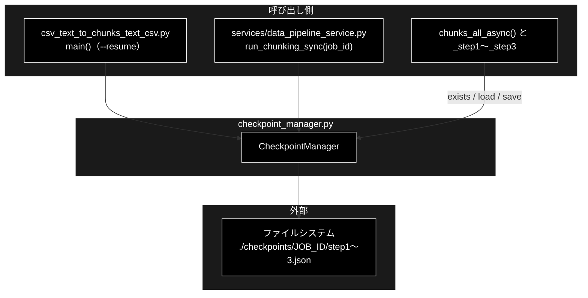
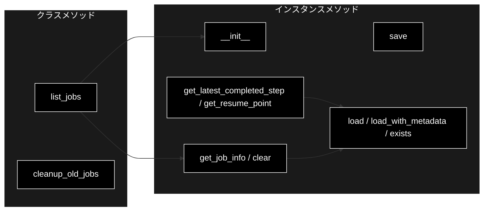
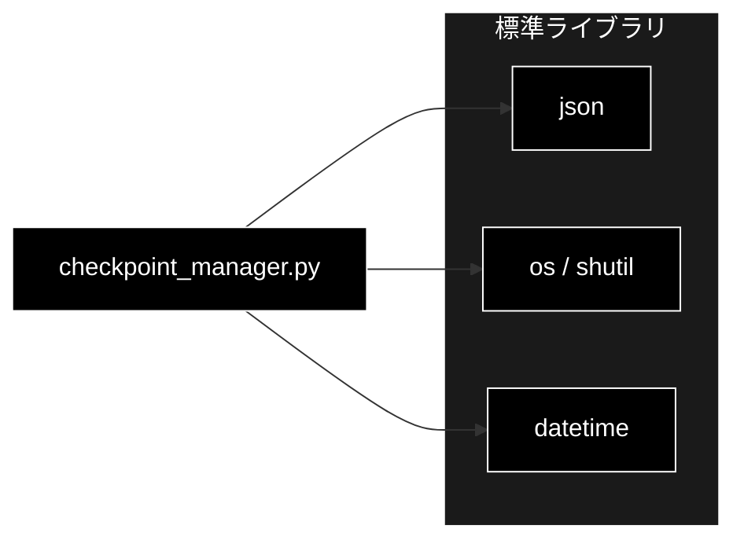

# checkpoint_manager.py - チャンク化の途中結果（チェックポイント）管理 ドキュメント

**Version 1.0** | 最終更新: 2026-10-11

---

## 目次

1. [概要](#概要)
2. [アーキテクチャ構成図](#1-アーキテクチャ構成図)
3. [モジュール構成図](#2-モジュール構成図)
4. [クラス・関数一覧表](#3-クラス関数一覧表)
5. [クラス・関数 IPO詳細](#4-クラス関数-ipo詳細)
6. [設定・定数](#5-設定定数)
7. [エクスポート](#6-エクスポート)
8. [変更履歴](#7-変更履歴)
9. [付録: 依存関係図](#付録-依存関係図)

---

## 概要

`chunking/checkpoint_manager.py` は、チャンク化の 3 段階（Step1 段落分割・Step2 意味的分割・Step3 連続性チェック）の
**各段の結果を JSON に保存し、途中で落ちたときに続きから再開する**ための `CheckpointManager` クラスを持つ。
保存先は `<checkpoint_dir>/<job_id>/step1.json`〜`step3.json`（既定 `./checkpoints/<YYYYMMDD_HHMMSS>/`）。

> 📌 呼び出し元は 2 つ: チャンク化 CLI（`csv_text_to_chunks_text_csv.py::main()` の `--resume <JOB_ID>`）と、
> データ管理タブ・`.txt` 入力の Q/A 登録（`services/data_pipeline_service.py::run_chunking_sync()`。`job_id` を渡せば再開）。
> どちらも **`./checkpoints` はカレントディレクトリ基準**で、実行のたびに新しいジョブのディレクトリが増える（自動では消えない）。

### 主な責務

- ジョブごとのチェックポイントディレクトリの用意
- 段の結果（文字列のリスト）とメタデータの原子的な保存と読み込み
- 最後に終わった段から、再開すべき段とその入力を決める
- 保存済みジョブの一覧・情報の取得と、古いジョブ・このジョブの削除

### 各責務対応のモジュール

| # | 責務 | 対応モジュール | 説明 |
|---|------|--------------|------|
| 1 | ディレクトリの用意 | `checkpoint_manager.py` | `CheckpointManager.__init__()` が `<checkpoint_dir>/<job_id>/` を作る（`job_id` 省略時は現在時刻） |
| 2 | 保存と読み込み | `checkpoint_manager.py` | `save()`（一時ファイル → `os.replace`）/ `load()` / `load_with_metadata()` / `exists()` |
| 3 | 再開点の決定 | `checkpoint_manager.py` | `get_latest_completed_step()` / `get_resume_point()` |
| 4 | 一覧と削除 | `checkpoint_manager.py` | `list_jobs()` / `get_job_info()` / `cleanup_old_jobs()` / `clear()` |

### 主要機能一覧

| 機能 | 説明 |
|------|------|
| `CheckpointManager(checkpoint_dir="./checkpoints", job_id=None)` | ジョブのディレクトリを作る |
| `save(step_name, data, metadata=None)` | `<step_name>.json` に `{"step", "timestamp", "count", "data", "metadata"}` を書く |
| `load(step_name)` | `data` を返す（無い・壊れていれば `None`） |
| `get_resume_point()` | `(再開する段, 前段のデータ)`。全段済みなら `(None, step3 のデータ)` |
| `list_jobs(checkpoint_dir)` / `cleanup_old_jobs(checkpoint_dir, keep_count)` | ジョブの一覧と、古いジョブの削除（クラスメソッド） |

---

## 1. アーキテクチャ構成図

### 1.1 システム全体構成



### 1.2 データフロー

1. 呼び出し側が `CheckpointManager()`（新規）か `CheckpointManager(job_id=...)`（再開）を作る。ディレクトリはこの時点で作られる
2. 各段の関数は、最初に `exists("stepN")` を見て、あれば `load("stepN")` を返して LLM を呼ばない
3. 無ければ LLM で処理し、終わったら `save("stepN", 結果)` する（`*.tmp` に書いてから `os.replace` で置き換える）
4. 3 段とも済んだジョブを同じ `job_id` で流し直すと、LLM を 1 回も呼ばずに `step3.json` の内容が出力になる

---

## 2. モジュール構成図

### 2.1 内部モジュール構成



### 2.2 外部依存関係

| ライブラリ | 用途 |
|-----------|------|
| `json` / `os` / `shutil` / `datetime` / `logging`（標準） | JSON の読み書き・原子的な置き換え・ディレクトリ削除・ジョブ ID の生成 |

---

## 3. クラス・関数一覧表

### 3.1 クラス一覧

| クラス | 概要 |
|--------|------|
| `CheckpointManager` | 1 ジョブのチェックポイントを扱う。クラスメソッドで全ジョブの一覧・掃除もする |

### 3.2 メソッド一覧

| メソッド | 種別 | 概要 |
|---------|------|------|
| `__init__(checkpoint_dir="./checkpoints", job_id=None)` | インスタンス | `<checkpoint_dir>/<job_id>/` を作る |
| `save(step_name, data, metadata=None)` | インスタンス | 段の結果を原子的に保存し、パスを返す |
| `load(step_name)` | インスタンス | `data` を返す。無い・壊れていれば `None` |
| `load_with_metadata(step_name)` | インスタンス | JSON 全体を返す。無い・壊れていれば `None` |
| `exists(step_name)` | インスタンス | `<step_name>.json` があるか |
| `get_latest_completed_step()` | インスタンス | `step3` → `step2` → `step1` の順に探し、最初に見つかった段 |
| `get_resume_point()` | インスタンス | 再開する段と、その入力（前段のデータ） |
| `clear()` | インスタンス | このジョブのディレクトリを消す |
| `get_job_info()` | インスタンス | `job_id` / `job_dir` / 段ごとの `timestamp`・`count`・`metadata` |
| `list_jobs(checkpoint_dir="./checkpoints")` | クラス | 全ジョブの `get_job_info()`（ディレクトリ名の降順） |
| `cleanup_old_jobs(checkpoint_dir="./checkpoints", keep_count=10)` | クラス | ディレクトリ名の降順で `keep_count` 個を残し、ほかを消す |

---

## 4. クラス・関数 IPO詳細

### 4.1 使用例

| # | パターン | いつ使うか | 例 |
|---|---------|-----------|----|
| 1 | **基本**: 段を保存し、再開点を求める | 3 段階パイプラインと同じ使い方を確かめる | 4.1.1 |
| 2 | CLI で中断したジョブを再開する（`--resume`） | 長いチャンク化が途中で落ちた | 4.1.2 |
| 3 | ジョブの一覧と掃除 | `./checkpoints/` が溜まった | 4.1.3 |

> 📝 **確かめ方（2026-10-11）**: 4.1.1・4.1.3 は空の一時ディレクトリで実行した。4.1.2 は Ollama の代わりに偽サーバ
> （段落分割は「。」で文に割るだけ・連続性はつながらない）を立てて CLI を 2 回実行した。

#### 4.1.1 基本: 段を保存し、再開点を求める

```python
from chunking.checkpoint_manager import CheckpointManager

m = CheckpointManager(checkpoint_dir="ckpt", job_id="demo_job")   # ckpt/demo_job/ ができる
print(m.get_resume_point())                       # まだ何も無い

m.save("step1", ["段落1", "段落2"], metadata={"block_size": 1000})
print(m.get_resume_point())                       # Step2 から、Step1 の結果を入力に

m.save("step2", ["チャンク1", "チャンク2", "チャンク3"])
print(m.get_latest_completed_step(), m.load("step2"))
print(m.load_with_metadata("step1")["metadata"])

# 実行結果:
# ('step1', None)
# ('step2', ['段落1', '段落2'])
# step2 ['チャンク1', 'チャンク2', 'チャンク3']
# {'block_size': 1000}
```

> 📌 3 段階パイプライン（`_step1_hierarchical_split` ほか）は `get_resume_point()` を使わず、各段の頭で `exists()` / `load()` を見る。
> どちらでも結果は同じ（済んだ段は LLM を呼ばずに読み戻す）。

#### 4.1.2 CLI で中断したジョブを再開する

```bash
# 1 回目（途中で落ちたとする）。JOB_ID は ./checkpoints/ 配下のディレクトリ名（実行時刻）
python -m chunking.csv_text_to_chunks_text_csv --input-file data/document.txt --output output_chunked
JOB_ID=$(ls -t checkpoints | head -1)

# 2 回目: 同じ入力で --resume を付けると、済んだ段は LLM を呼ばずに読み戻す
python -m chunking.csv_text_to_chunks_text_csv --input-file data/document.txt --output output_chunked --resume "$JOB_ID" 2>&1 | grep "チェックポイントから再開"

# 出力例:
# 2026-10-11 07:45:22 [INFO] __main__: Step1: チェックポイントから再開
# 2026-10-11 07:45:22 [INFO] __main__: Step2: チェックポイントから再開
# 2026-10-11 07:45:22 [INFO] __main__: Step3: チェックポイントから再開
```

> ⚠️ **ジョブと入力ファイルの対応は確かめない。** 別の入力ファイルで `--resume <前のジョブ>` を付けると、前のジョブのチャンクが
> **新しい入力の名前の CSV に書かれる**（2026-10-11 実測・終了コード 0）。`--resume` は同じ入力・同じ `--block-size` / `--model` で使う
> （[`csv_text_to_chunks_text_csv.md`](csv_text_to_chunks_text_csv.md) §5.3 の既知の問題）。

#### 4.1.3 ジョブの一覧と掃除

```python
import os
from chunking.checkpoint_manager import CheckpointManager

for jid in ["20261009_090000", "20261010_090000", "20261011_090000"]:
    CheckpointManager("ckpt2", jid).save("step1", ["x"])

print([j["job_id"] for j in CheckpointManager.list_jobs("ckpt2")])
CheckpointManager.cleanup_old_jobs("ckpt2", keep_count=2)
print(sorted(os.listdir("ckpt2")))

# 実行結果:
# ['20261011_090000', '20261010_090000', '20261009_090000']
# ['20261010_090000', '20261011_090000']
```

> ⚠️ `list_jobs()` / `cleanup_old_jobs()` の「新しい順」は**ディレクトリ名の降順**で、更新日時ではない。
> 既定の `job_id`（`YYYYMMDD_HHMMSS`）なら時刻順になるが、`job_id` に任意の名前を付けると順番が崩れ、新しいジョブが消えることがある。
> 本リポジトリに `cleanup_old_jobs()` を呼ぶコードは無い（2026-10-11 grep）ので、`./checkpoints/` は溜まり続ける。

### 4.2 `CheckpointManager.__init__`

```python
def __init__(self, checkpoint_dir: str = "./checkpoints", job_id: Optional[str] = None)
```

| パラメータ | 型 | デフォルト | 説明 |
|------------|------|-----------|------|
| `checkpoint_dir` | str | `"./checkpoints"` | 保存先の親ディレクトリ（カレントディレクトリ基準） |
| `job_id` | Optional[str] | `None` | ジョブ ID。`None` なら `datetime.now().strftime("%Y%m%d_%H%M%S")` |

| 項目 | 内容 |
|------|------|
| **Input** | `checkpoint_dir`, `job_id` |
| **Process** | `job_dir = <checkpoint_dir>/<job_id>` を `os.makedirs(exist_ok=True)` で作り、INFO ログを出す |
| **Output** | インスタンス（属性 `checkpoint_dir` / `job_id` / `job_dir`）。**作った時点でディレクトリができる** |

### 4.3 `save` / `load` / `load_with_metadata` / `exists`

```python
def save(self, step_name: str, data: List[str], metadata: Optional[dict] = None) -> str
def load(self, step_name: str) -> Optional[List[str]]
def load_with_metadata(self, step_name: str) -> Optional[dict]
def exists(self, step_name: str) -> bool
```

| 項目 | 内容 |
|------|------|
| **Input** | `step_name`（`"step1"` / `"step2"` / `"step3"`。ほかの名前も保存はできる）、`data`（文字列のリスト）、`metadata` |
| **Process** | `save`: `{"step", "timestamp"(ISO 8601), "count", "data", "metadata"}` を `<step>.json.tmp` に書き、`os.replace` で `<step>.json` へ置き換える（書き込み失敗時は `.tmp` を消して例外を上げ直す）。`load`: JSON を読み `data` を返す。`load_with_metadata`: JSON 全体を返す。`exists`: ファイルの有無 |
| **Output** | `save`: 保存したパス。`load` / `load_with_metadata`: 無い・JSON が壊れていれば `None`（エラーログを出す）。`exists`: bool |

```python
# 使用例
from chunking.checkpoint_manager import CheckpointManager

m = CheckpointManager("ckpt3", "job")
path = m.save("step3", ["最終チャンク"], metadata={"model": "gemma4:26b-a4b-it-qat"})
print(path, m.exists("step3"), m.load("step3"), m.load("step9"))
# ckpt3/job/step3.json True ['最終チャンク'] None
```

### 4.4 `get_latest_completed_step` / `get_resume_point`

| 項目 | 内容 |
|------|------|
| **Input** | なし |
| **Process** | `step3` → `step2` → `step1` の順に `exists()` を見る |
| **Output** | `get_latest_completed_step`: 最初に見つかった段名か `None`。`get_resume_point`: `step3` 済み → `(None, step3 のデータ)`、`step2` 済み → `("step3", step2 のデータ)`、`step1` 済み → `("step2", step1 のデータ)`、何も無い → `("step1", None)` |

使用例は 4.1.1。

### 4.5 `clear` / `get_job_info`

| 項目 | 内容 |
|------|------|
| **Input** | なし |
| **Process** | `clear`: `job_dir` を `shutil.rmtree` で消す。`get_job_info`: 3 段それぞれの `load_with_metadata()` から `timestamp` / `count` / `metadata` を集める |
| **Output** | `clear`: `None`。`get_job_info`: `{"job_id", "job_dir", "steps": {"step1": {...}, ...}}`（無い段は含まない） |

```python
# 使用例
from chunking.checkpoint_manager import CheckpointManager

m = CheckpointManager("ckpt4", "job")
m.save("step1", ["a", "b"])
print(m.get_job_info()["steps"]["step1"]["count"])
m.clear()
print(m.load("step1"))
# 2
# None
```

### 4.6 `list_jobs` / `cleanup_old_jobs`（クラスメソッド）

| 項目 | 内容 |
|------|------|
| **Input** | `checkpoint_dir`（既定 `"./checkpoints"`）、`keep_count`（既定 10） |
| **Process** | `list_jobs`: ディレクトリ名の降順に、各ジョブの `CheckpointManager` を作って `get_job_info()` を集める。`cleanup_old_jobs`: ディレクトリ名の降順で `keep_count` 番目以降を `shutil.rmtree` |
| **Output** | `list_jobs`: ジョブ情報のリスト（親ディレクトリが無ければ `[]`）。`cleanup_old_jobs`: `None` |

使用例は 4.1.3。

---

## 5. 設定・定数

| 項目 | 値 |
|------|----|
| 既定の保存先 | `./checkpoints`（カレントディレクトリ基準。CLI・データ管理タブとも既定のまま使う） |
| ジョブ ID の既定 | 現在時刻 `YYYYMMDD_HHMMSS`（同じ秒に 2 つ作ると同じディレクトリを共有する） |
| ファイル名 | `<step_name>.json`（書き込み中は `<step_name>.json.tmp`） |

---

## 6. エクスポート

`__all__` は無い。`chunking/__init__.py` が `CheckpointManager` を再エクスポートする（`from chunking import CheckpointManager`）。

```python
CheckpointManager
```

> 📌 テストは無い（2026-10-11 grep）。3 段階パイプラインの再開は、本書 4.1.2 と [`csv_text_to_chunks_text_csv.md`](csv_text_to_chunks_text_csv.md) §4.1 で実行して確かめている。

---

## 7. 変更履歴

| バージョン | 日付 | 変更内容 |
|---|---|---|
| 1.0 | 2026-10-11 | 新規作成（`chunking/docs/` の構成整理。それまで専用の文書が無かった）。§4.1 の使用例 3 本と §4.3・§4.5 の例を実行して確かめ、`--resume` が入力ファイルとの対応を確かめないこと・掃除の順番がディレクトリ名順であることを記録した |

---

## 付録: 依存関係図


