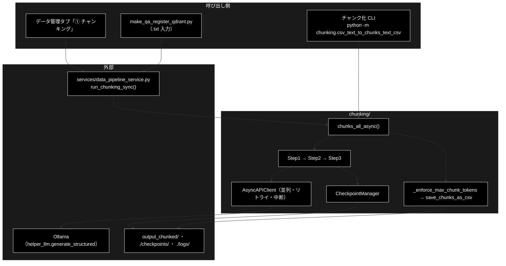
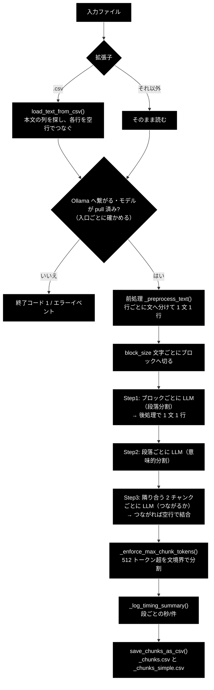
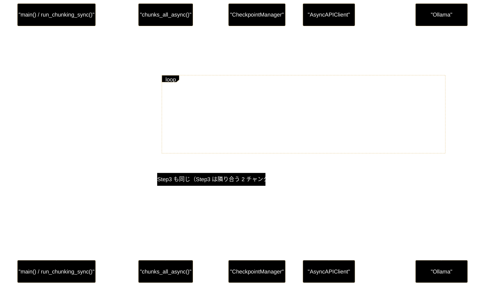

# chunking_process_flow.md - chunking/ 処理フロー

**Version 1.1** | 最終更新: 2026-10-11

テキスト（`.txt`・CSV）を LLM で意味のまとまりに分け、チャンク CSV を書くまでの**処理の流れ**（どの順で・どのモジュールが・どんな条件で分岐するか）をまとめる。
各関数の引数・戻り値は各モジュールの文書（IPO）に置き、ここには書かない。ディレクトリ全体の入口は [`README_chunking.md`](README_chunking.md)。

---

## 目次

- [概要](#概要)
- [1. 全体フロー](#1-全体フロー)
- [2. ステップ詳細](#2-ステップ詳細)
- [3. 分岐・例外・中断](#3-分岐例外中断)
- [4. シーケンス](#4-シーケンス)
- [5. 関連ドキュメント](#5-関連ドキュメント)
- [6. 変更履歴](#6-変更履歴)

---

## 概要

入口は 3 つあり、どれも `chunks_all_async()` に行き着く: チャンク化 CLI（`python -m chunking.csv_text_to_chunks_text_csv`）、
データ管理タブの「① チャンキング」と `make_qa_register_qdrant.py` の `.txt` 入力（どちらも `services/data_pipeline_service.py::run_chunking_sync()` 経由）。
`chunks_all_async()` は **Step1 段落分割 → Step2 意味的分割 → Step3 連続性チェック**の順にローカル LLM（Ollama）を呼び、最後にトークン数の上限を掛けて CSV を書き、各段の所要時間の表をログに出す。
どの入口も、LLM を呼ぶ前に **Ollama へ繋がるか・モデルが pull 済みか**を確かめる（`chunks_all_async()` 自身は確かめない）。

### 主な責務

- 入力（`.txt` / CSV）を 1 本のテキストにする
- テキストをブロックに切り、LLM で段落に分ける（Step1）
- 段落を話題のまとまりに分ける（Step2）
- 隣り合うチャンクがつながるかを判定して結合する（Step3）
- 各段の結果をチェックポイントに残し、再開できるようにする
- 最終チャンクにトークン数の上限を掛け、2 種類の CSV を書く
- 各段の所要時間（秒/件）をログに出す

### 各責務対応のモジュール

| # | 責務 | 対応モジュール | 説明 |
|---|------|--------------|------|
| 1 | 入力を 1 本のテキストにする | `csv_text_to_chunks_text_csv.py` | `main()`（`.txt` はそのまま）・`load_text_from_csv()`（CSV の各行を空行でつなぐ） |
| 2 | Step1 段落分割 | `csv_text_to_chunks_text_csv.py` ＋ `regex_string.py` / `prompts.py` / `models.py` | `_step1_hierarchical_split()`（前処理 `chunk_text` → ブロック → LLM → 後処理） |
| 3 | Step2 意味的分割 | `csv_text_to_chunks_text_csv.py` ＋ `prompts.py` / `models.py` | `_step2_semantic_chunking()` |
| 4 | Step3 連続性チェック | `csv_text_to_chunks_text_csv.py` ＋ `prompts.py` / `models.py` | `_step3_continuity_check()` |
| 5 | チェックポイント | `checkpoint_manager.py` | `CheckpointManager`（各段の頭で `exists` / `load`、終わりで `save`） |
| 6 | 上限と保存 | `csv_text_to_chunks_text_csv.py` | `_enforce_max_chunk_tokens()`（512 トークン）→ `save_chunks_as_csv()`（＋`_simple.csv`） |
| 7 | 所要時間の表 | `csv_text_to_chunks_text_csv.py` | `_log_timing_summary()`（段ごとの秒・件数・秒/件。読み方は [`diagnose_ollama.md`](diagnose_ollama.md) §4） |

### アーキテクチャ構成図

---

## 1. 全体フロー

---

## 2. ステップ詳細

| # | ステップ | 実装（ファイル::シンボル） | 入力 | 出力 | 失敗時の既定 |
|---|---------|--------------------------|------|------|------------|
| 0 | 入力の読み込み | `csv_text_to_chunks_text_csv.py::main` / `load_text_from_csv` | `.txt` / `.csv` | 1 本のテキスト（CSV は本文の列の非空セルを `"\n\n"` でつなぐ） | 入力ファイルが無い → エラーログを出して終了コード 1。指定した列が無い → `ValueError` |
| 0' | Ollama の確認 | CLI: `_ollama_unreachable_message` / `_model_not_pulled_message`。データ管理タブ・`make_qa_register_qdrant.py` は `services/data_pipeline_service.py` の同じ判定 | `--model` | なし | 繋がらない・未 pull → エラーログを出して**終了コード 1**（LLM を呼ぶ前） |
| 1 | Step1 段落分割 | `_step1_hierarchical_split`（`regex_string.chunk_text` / `PARAGRAPH_SEPARATION_PROMPT` / `StructuralResult`） | テキスト | 段落のリスト（1 文 1 行）。`step1.json` に保存 | ブロックの呼び出しが失敗（`None`）・検証失敗・段落が空 → **そのブロックの原文を 1 段落として残す**（警告ログ・`metadata.fallback_count`） |
| 2 | Step2 意味的分割 | `_step2_semantic_chunking`（`SEMANTIC_CHUNKING_PROMPT` / `StructuralResult`） | 段落 | チャンクのリスト。`step2.json` | 失敗した段落は**分けずに 1 チャンクとして残す**（警告ログ・`metadata.fallback_count`） |
| 3 | Step3 連続性チェック | `_step3_continuity_check`（`CONTINUITY_CHECK_PROMPT` / `ContinuityResult`） | チャンク（n 個 → n−1 組） | 結合後のチャンク（`"\n\n"` でつなぐ）。`step3.json` | 失敗・検証失敗 → **つながらない扱い**（本文は残る） |
| 4 | 上限 | `_enforce_max_chunk_tokens(MAX_CHUNK_TOKENS=512)` | 最終チャンク | 512 トークン（cl100k_base）以下に文境界で分けたチャンク | 1 文だけで超えるものは分けずに残し、警告を出す |
| 4' | 所要時間の表 | `_log_timing_summary` | 各段の秒・LLM 呼び出し件数 | ログ（`所要時間（実測）`） | なし |
| 5 | 保存 | `save_chunks_as_csv` / `save_chunks_as_simple_csv`（`.csv` 以外の出力先なら `save_chunks_as_text`） | 最終チャンク | `<出力先>/<入力名>_chunks.csv`（8 列）と `_chunks_simple.csv`（`Text` 列）。改行は空白に置き換える | 例外は上へ |

LLM の呼び出し回数は、ブロック数 ＋ 段落数 ＋（チャンク数 − 1）。どの段も `AsyncAPIClient` が `--workers` 本まで同時に投げる。既定は `config.py::get_default_chunking_workers()`（環境変数 `OLLAMA_NUM_PARALLEL`、無ければ **1**）。
Ollama は既定で 1 本ずつしか処理しないので、ワーカー数だけ上げても速くならず、順番待ちが各リクエストのタイムアウトを食う（同関数の docstring に実測）。

---

## 3. 分岐・例外・中断

### 3.1 中断（連続失敗）

`AsyncAPIClient` はリトライ（最大 3 回。429・rate・quota を含むエラーは 30 秒・60 秒…、それ以外は 1 秒・2 秒）を使い切ると、
**連続失敗の回数**を 1 増やす。`CHUNKING_ABORT_AFTER_FAILURES`（既定 3）に達すると `ChunkingAbortedError` で処理全体を止める（CLI は終了コード 1、
データ管理タブはエラーイベント）。達しなければ `None` を返し、§2 の「失敗時の既定」のとおり各段が扱う。成功すると連続回数は 0 に戻る。

モデルがデータではなく**JSON スキーマ定義そのもの**を返したとき（`helper_llm.SchemaEchoError`）は、リトライも連続回数の集計もせず、**その 1 回で** `ChunkingAbortedError` にする（送り直しても同じ結果になるため）。
1 リクエストのタイムアウトは `helper_llm` の既定（180 秒）で、`CHUNKING_LLM_TIMEOUT` で延ばせる（[`diagnose_ollama.md`](diagnose_ollama.md) §4）。

### 3.2 再開

各段は頭で `checkpoint_manager.exists("stepN")` を見て、あれば LLM を呼ばずに `load()` を返す。CLI の `--resume <JOB_ID>`、
`run_chunking_sync(job_id=...)` が同じジョブのディレクトリを使う。ジョブ ID を渡さない新規実行は、現在時刻の ID で新しいディレクトリを作る
（同じ秒の 2 つ目以降は `_1`, `_2` …。2026-10-11 までは同じ秒の実行がディレクトリを共有していた）。

`chunks_all_async()` は LLM を呼ぶ前に、ジョブの `job.json` と今回の入力・設定（ファイル名・本文の文字数と SHA-256・`block_size`・`model`）を
照合する（`CheckpointManager.verify_or_record_job()`）。食い違えば `ResumeMismatchError` で止め（CLI は終了コード 1・データ管理タブは
エラーイベント）、新規ジョブなら記録する。`job.json` の無い古いジョブは照合できないので、警告を出して今回の値を記録し、そのまま再開する
（2026-10-11〜。それまでは照合が無く、前のジョブのチャンクが新しい入力名の CSV に書かれた・[`csv_text_to_chunks_text_csv.md`](csv_text_to_chunks_text_csv.md) §5.3 の 2）。

### 3.3 Ollama と入力の検査

- API キーは要らない。`chunks_all_async()` は何も確かめない（Ollama が落ちていれば各リクエストの例外になり、§3.1 で中断する）
- CLI は入力を読んだあと、Ollama へ繋がらない・`--model` が pull されていない → 終了コード 1（LLM を呼ぶ前）
- データ管理タブは、チャンク化の前に入力ファイルを開けるか・本文が空でないか・Ollama へ繋がるか・モデルが pull 済みかを確かめ、駄目ならエラーイベントで止める（`backend/app/core/data_jobs.py::_chunking_runner`）
- `make_qa_register_qdrant.py` は `.txt` 入力のとき `require_ollama_ready()`（チャンク化と Q/A 生成の 2 モデル）で確かめ、駄目なら終了コード 1。`.txt` の本文が空なら終了コード 1（チャンク化の前）

---

## 4. シーケンス

---

## 5. 関連ドキュメント

| 文書 | 内容 |
|------|------|
| [`README_chunking.md`](README_chunking.md) | `chunking/` の入口・モジュール索引・コマンドの早見表 |
| [`csv_text_to_chunks_text_csv.md`](csv_text_to_chunks_text_csv.md) | 3 段階と入出力の IPO・既知の問題 |
| [`async_api_client.md`](async_api_client.md) / [`checkpoint_manager.md`](checkpoint_manager.md) | 並列・リトライ・中断 / 再開 |
| [`diagnose_ollama.md`](diagnose_ollama.md) | 遅い・タイムアウトするときの切り分け（所要時間の表の読み方） |
| [`qa_qdrant/docs/qa_qdrant_data_flow.md`](../../qa_qdrant/docs/qa_qdrant_data_flow.md) §2.1 | チャンク CSV の列と、後続（Q/A 生成）での読まれ方 |
| [`services/docs/data_pipeline_service.md`](../../services/docs/data_pipeline_service.md) | `run_chunking_sync()`（データ管理タブ・`.txt` 入力の入口） |

---

## 6. 変更履歴

| バージョン | 日付 | 変更内容 |
|---|---|---|
| 1.0 | 2026-10-11 | 新規作成（`a_cross_doc_md_format.md` §1.3）。3 つの入口から `chunks_all_async()` の 3 段階・上限・保存までと、各段の失敗時の既定（Step1・Step2 は失敗したブロックを捨て、Step3 はつながらない扱い）・中断・再開をまとめた。失敗時の挙動・Ollama の確認での終了コードは、Ollama の代わりに偽サーバを立てて CLI を実行して確かめた |
| 1.1 | 2026-10-11 | §2 の失敗時の既定（Step1・Step2 は原文のまま残す・入力ファイルが無ければ終了コード 1）と §3.2 の再開（`job.json` で入力と設定を照合する・新規ジョブの ID が同じ秒でも重ならない）を、同日のコード修正に合わせて直した |
