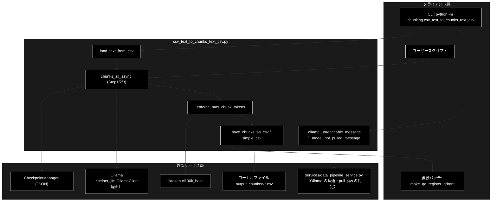
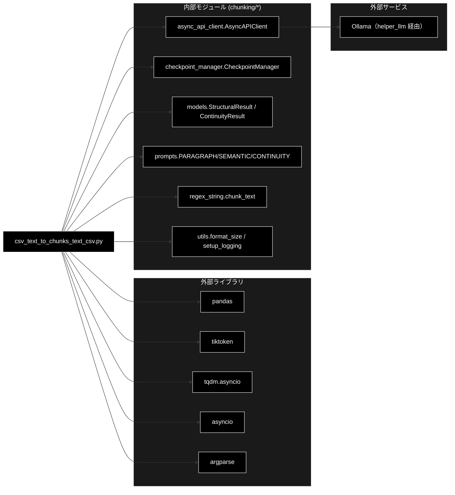

# csv_text_to_chunks_text_csv.py - LLMベースセマンティックチャンキング（統一版） ドキュメント

**Version 1.9** | 最終更新: 2026-10-11

---

## 目次

1. [概要](#概要)
2. [アーキテクチャ構成図](#1-アーキテクチャ構成図)
3. [モジュール構成図](#2-モジュール構成図)
4. [クラス・関数一覧表](#3-クラス関数一覧表)
5. [クラス・関数 IPO詳細](#4-クラス関数-ipo詳細)
6. [設定・定数](#5-設定定数)
7. [エクスポート](#6-エクスポート)
8. [変更履歴](#7-変更履歴)
9. [付録: 依存関係図](#付録-依存関係図)

---

## 概要

`csv_text_to_chunks_text_csv.py` は、テキストまたは CSV ファイルを入力として受け取り、LLM ベースの 3 段階アルゴリズム（階層構造化 → 意味的チャンキング → 文脈連続性チェック）で意味的なチャンクに分割するパイプラインモジュールです。`asyncio` による並列化、`CheckpointManager` による再開機能、最終チャンクの最大トークン数強制（Embedding の無言切り捨て防止）、CSV 出力時の改行正規化、メタデータ付き CSV とシンプル CSV（`Text` カラムのみ）の二系統同時出力を提供します。
LLM はローカル LLM（Ollama。既定 `gemma4:26b-a4b-it-qat`）で、CLI は実行前に **Ollama へ繋がるか・モデルが pull 済みか**を確かめ、最後に**各段の所要時間の表**を出します。

> 📎 `chunking/` 全体の入口は [`README_chunking.md`](README_chunking.md)、3 段階の流れは [`chunking_process_flow.md`](chunking_process_flow.md)。
> 補助モジュールは [`async_api_client.md`](async_api_client.md) / [`checkpoint_manager.md`](checkpoint_manager.md) / [`models.md`](models.md) /
> [`prompts.md`](prompts.md) / [`regex_string.md`](regex_string.md) / [`utils.md`](utils.md)、遅い・止まらないときは [`diagnose_ollama.md`](diagnose_ollama.md)。
>
> ⚠️ **2026-10-11 に CLI を動かして既知の問題を 6 件見つけ、出力が静かに壊れる 1〜3 は同日に直した**（[§5.3](#53-既知の問題2026-10-11-実測)）。
> LLM が失敗したブロック・段落は**原文のまま残し**（以前は本文が消えた）、件数を所要時間の表の直後に出す。`--resume` は**入力と設定を照合**し、
> 違えば終了コード 1 で止める。入力ファイルが無いときも終了コード 1 を返す。残る 4〜6 は未対応。

### 主な責務

- 入力ファイル（`.txt` / `.csv`）の読み込みとテキスト抽出
- 3 段階 LLM 処理（段落分割 / 意味的分割 / 連続性結合）の実行
- `asyncio.gather` による並列 API 呼び出しと進捗表示（tqdm）
- チェックポイントによる中断・再開のサポート（再開時は入力と設定を照合する）
- 最終チャンクの最大トークン数強制（Embedding 入力上限超過防止）
- CSV 形式での保存（メタデータ付き + シンプル版）
- CLI の実行前の Ollama の確認と、各段の所要時間の表

### 各責務対応のモジュール

| # | 責務 | 対応モジュール | 説明 |
|---|------|--------------|------|
| 1 | 入力ファイル読み込み | `csv_text_to_chunks_text_csv.py` | `load_text_from_csv()` / `main()` の直接読み込み |
| 2 | 3 段階チャンク処理 | `csv_text_to_chunks_text_csv.py` | `chunks_all_async()` / `_step1` / `_step2` / `_step3` |
| 3 | 並列 LLM 呼び出し | `chunking/async_api_client.py` | `AsyncAPIClient.generate_content()` |
| 4 | チェックポイント | `chunking/checkpoint_manager.py` | `CheckpointManager.save/load/exists` / `verify_or_record_job()`（`_job_meta()` が作る値で照合） |
| 5 | トークン上限強制 | `csv_text_to_chunks_text_csv.py` | `_enforce_max_chunk_tokens()` |
| 6 | CSV 保存 | `csv_text_to_chunks_text_csv.py` | `save_chunks_as_csv()` / `save_chunks_as_simple_csv()` |
| 7 | Ollama の確認・所要時間 | `csv_text_to_chunks_text_csv.py` ＋ `services/data_pipeline_service.py` | `_ollama_unreachable_message()` / `_model_not_pulled_message()`（判定は `services` へ委譲）・`_log_timing_summary()`・`_log_fallback_summary()` |

### 主要機能一覧

| 機能 | 説明 |
|------|------|
| `MAX_CHUNK_TOKENS` | 最終チャンクの最大トークン数（512、cl100k_base 換算） |
| `EMBEDDING_INPUT_TOKEN_LIMIT` | Embedding（gemini-embedding-001）入力上限（2048） |
| `_count_tokens()` | tiktoken／文字数フォールバックでトークン数を概算 |
| `_normalize_whitespace()` | 改行・タブ・連続空白を半角スペース 1 つに正規化 |
| `_preprocess_text()` | 入力テキストを句読点で分割（Step1 前処理） |
| `_postprocess_paragraph()` | Step1 出力段落を文ごとに改行区切り化 |
| `load_text_from_csv()` | CSV からテキストカラムを自動検出して読み込み |
| `save_chunks_as_simple_csv()` | `Text` カラムのみのシンプル CSV を出力 |
| `save_chunks_as_csv()` | メタデータ付き CSV + シンプル CSV を同時出力 |
| `save_chunks_as_text()` | 後方互換のテキスト形式（`---` 区切り）保存 |
| `generate_output_filename()` | 入力ファイル名から `<stem>_chunks.csv` を生成 |
| `_split_sentences_simple()` | 日本語・英語混在の簡易文分割 |
| `_split_oversized_text()` | `max_tokens` 超のテキストを文境界で分割 |
| `_enforce_max_chunk_tokens()` | 最終チャンク全件に上限を強制 |
| `chunks_all_async()` | 3 段階チャンク化のエントリポイント |
| `_step1_hierarchical_split()` | Step1: 段落分割 |
| `_step2_semantic_chunking()` | Step2: 意味的分割 |
| `_step3_continuity_check()` | Step3: 連続性チェックと結合 |
| `_ollama_unreachable_message()` | Ollama へ確実に繋がらないならエラーメッセージ（CLI の事前確認） |
| `_model_not_pulled_message()` | モデルが pull されていなければエラーメッセージ（CLI の事前確認） |
| `_log_timing_summary()` | 各段の所要時間・件数・秒/件の表をログに出す |
| `create_parser()` | CLI の引数定義（既定値をテストから読めるよう `main()` から分離） |
| `main()` | CLI エントリポイント（argparse） |

---

## 1. アーキテクチャ構成図

### 1.1 システム全体構成



### 1.2 データフロー

1. CLI またはユーザースクリプトから入力ファイル（`.txt` / `.csv`）を受け取る
2. `load_text_from_csv()` がテキストカラムを自動検出し、結合テキストを生成
2'. CLI は Ollama へ繋がるか・`--model` が pull 済みかを確かめ、駄目なら終了コード 1（`chunks_all_async()` 自身は確かめない）
3. `chunks_all_async()` が Step1 → Step2 → Step3 を順次・並列に実行
4. 各 Step は `AsyncAPIClient` 経由で Ollama を並列呼び出し（既定 1 本）、`CheckpointManager` に保存
5. `_enforce_max_chunk_tokens()` で最終チャンク全件に 512 トークン上限を強制
6. `_log_timing_summary()` が各段の所要時間の表をログに出す
7. `save_chunks_as_csv()` がメタデータ付き CSV + シンプル CSV の 2 ファイルを出力

---

## 2. モジュール構成図

### 2.1 内部モジュール構成

```mermaid
flowchart TB
    subgraph CONST["定数・補助"]
        MAXT["MAX_CHUNK_TOKENS=512"]
        EMBT["EMBEDDING_INPUT_TOKEN_LIMIT=2048"]
        TOK["_count_tokens"]
        NORM["_normalize_whitespace"]
        PRE["_preprocess_text"]
        POST["_postprocess_paragraph"]
        SPLIT["_split_sentences_simple"]
        SPLITOV["_split_oversized_text"]
        ENF["_enforce_max_chunk_tokens"]
    end

    subgraph IO["入出力"]
        LOAD["load_text_from_csv"]
        SAVECSV["save_chunks_as_csv"]
        SAVESIM["save_chunks_as_simple_csv"]
        SAVETXT["save_chunks_as_text"]
        GENFN["generate_output_filename"]
    end

    subgraph PIPE["3 段階パイプライン"]
        ENTRY["chunks_all_async"]
        S1["_step1_hierarchical_split"]
        S2["_step2_semantic_chunking"]
        S3["_step3_continuity_check"]
    end

    subgraph CLIB["CLI・事前確認・計測"]
        MAIN["main"]
        PARSER["create_parser"]
        UNR["_ollama_unreachable_message"]
        NPL["_model_not_pulled_message"]
        TIM["_log_timing_summary"]
    end

    MAIN --> PARSER
    MAIN --> UNR
    MAIN --> NPL
    MAIN --> LOAD
    MAIN --> GENFN
    MAIN --> ENTRY
    ENTRY --> S1
    ENTRY --> S2
    ENTRY --> S3
    S1 --> PRE
    S1 --> POST
    ENTRY --> ENF
    ENTRY --> TIM
    ENF --> SPLITOV
    SPLITOV --> SPLIT
    ENF --> TOK
    ENTRY --> SAVECSV
    SAVECSV --> SAVESIM
    SAVECSV --> NORM
    SAVESIM --> NORM
classDef default fill:#000,stroke:#fff,color:#fff
classDef subgraphStyle fill:#1a1a1a,stroke:#fff,color:#fff
class MAXT,EMBT,TOK,NORM,PRE,POST,SPLIT,SPLITOV,ENF,LOAD,SAVECSV,SAVESIM,SAVETXT,GENFN,ENTRY,S1,S2,S3,MAIN,PARSER,UNR,NPL,TIM default
style CONST fill:#1a1a1a,stroke:#fff,color:#fff
style IO fill:#1a1a1a,stroke:#fff,color:#fff
style PIPE fill:#1a1a1a,stroke:#fff,color:#fff
style CLIB fill:#1a1a1a,stroke:#fff,color:#fff
```



### 2.2 外部依存関係

| ライブラリ | 用途 |
|-----------|------|
| `pandas` | CSV 読み書きと DataFrame 操作 |
| `tiktoken` | `cl100k_base` トークナイザでトークン数計測 |
| `tqdm.asyncio` | 非同期処理の進捗表示 |
| `asyncio` | 並列タスク制御 |
| `argparse` | CLI 引数解析 |
| `re` / `pathlib` | テキスト整形・パス操作 |

### 2.3 内部依存モジュール

| モジュール | 用途 |
|-----------|------|
| `chunking.async_api_client.AsyncAPIClient` | Ollama の非同期並列呼び出し（リトライ・連続失敗とスキーマのオウム返しで中断） |
| `config.get_default_ollama_model` / `get_default_chunking_workers` | `--model` / `--workers` と `chunks_all_async()` の既定 |
| `services.data_pipeline_service.ollama_unreachable_message` / `model_not_pulled_message` | CLI の事前確認（遅延 import。データ管理タブと同じ判定） |
| `chunking.checkpoint_manager.CheckpointManager` | Step1/2/3 のチェックポイント保存・再開 |
| `chunking.models.StructuralResult` | Step1/Step2 応答スキーマ |
| `chunking.models.ContinuityResult` | Step3 応答スキーマ |
| `chunking.prompts.PARAGRAPH_SEPARATION_PROMPT` | Step1 用プロンプト |
| `chunking.prompts.SEMANTIC_CHUNKING_PROMPT` | Step2 用プロンプト |
| `chunking.prompts.CONTINUITY_CHECK_PROMPT` | Step3 用プロンプト |
| `chunking.regex_string.chunk_text` | 日本語・英語の文分割 |
| `chunking.utils.format_size` / `setup_logging` | サイズ整形・ログ設定 |

---

## 3. クラス・関数一覧表

本モジュールはクラスを定義しません。すべて関数構成です。

### 3.1 関数一覧（カテゴリ別）

#### トークン・テキスト補助

| 関数名 | 概要 |
|-------|------|
| `_count_tokens(text)` | tiktoken（失敗時は文字数）でトークン数を概算 |
| `_normalize_whitespace(text)` | 改行・タブ・連続空白を半角スペース 1 つに正規化 |
| `_preprocess_text(text)` | 句読点ベースで長い 1 行を分割（Step1 前処理） |
| `_postprocess_paragraph(paragraph)` | 段落を文ごとに改行区切り化（Step1 後処理） |
| `_split_sentences_simple(text)` | 日本語・英語の簡易文分割 |
| `_split_oversized_text(text, max_tokens)` | max_tokens 超のテキストを文境界で分割 |
| `_enforce_max_chunk_tokens(chunks, max_tokens)` | 最終チャンク全件に上限を強制 |
| `_job_meta(text, model, block_size, source_file)` | チェックポイントの照合に使う、ジョブの入力と設定 |
| `_parse_structural(result_json, task_id)` | Step1・Step2 の LLM 応答を段落本文のリストにする（失敗は `None`） |
| `_warn_fallback(step, unit, indexes, total)` | LLM が失敗して原文のまま残した件数を警告する |

#### 入出力

| 関数名 | 概要 |
|-------|------|
| `load_text_from_csv(csv_path, text_column, max_rows, combine_rows)` | CSV からテキストを読み込み結合 |
| `save_chunks_as_simple_csv(chunks, output_file, normalize_whitespace)` | Text カラムのみのシンプル CSV を保存 |
| `save_chunks_as_csv(chunks, output_file, dataset_type, source_file, normalize_whitespace, save_simple_csv)` | メタデータ付き CSV + シンプル CSV を保存 |
| `save_chunks_as_text(chunks, output_file)` | 後方互換のテキスト形式（`---` 区切り）保存 |
| `generate_output_filename(input_file, output_dir, dataset_type)` | `<stem>_chunks.csv` のパスを生成 |

#### パイプライン（3 段階）

| 関数名 | 概要 |
|-------|------|
| `chunks_all_async(text, model, max_workers, block_size, checkpoint_manager, output_file, dataset_type, source_file)` | 3 段階チャンク化のエントリポイント |
| `_step1_hierarchical_split(text, client, model, block_size, checkpoint_manager)` | Step1: 段落分割 |
| `_step2_semantic_chunking(paragraphs, client, model, checkpoint_manager)` | Step2: 意味的チャンキング |
| `_step3_continuity_check(chunks, client, model, checkpoint_manager)` | Step3: 連続性チェックと結合 |

#### CLI・事前確認・計測

| 関数名 | 概要 |
|-------|------|
| `main()` | argparse による CLI エントリポイント。戻り値が終了コードになる（事前確認で弾くと 1） |
| `create_parser()` | CLI の引数定義 |
| `_ollama_unreachable_message()` | Ollama へ確実に繋がらないならメッセージ、それ以外は `None` |
| `_model_not_pulled_message(model)` | モデルが pull 済み一覧に無ければメッセージ、それ以外（判定できない場合を含む）は `None` |
| `_log_timing_summary(timings, max_workers, model)` | 各段の所要時間の表をログに出す |
| `_log_fallback_summary(checkpoint_manager)` | 表の直後に、LLM が失敗して原文のまま残した件数を 1 行で出す（0 件なら出さない） |

---

## 4. クラス・関数 IPO詳細

### 4.1 使用例

| # | パターン | いつ使うか | 例 |
|---|---------|-----------|----|
| 1 | **基本**: テキストファイルをチャンク CSV にする（CLI） | 文書 1 本を Q/A 生成の入力にする | 4.1.1 |
| 2 | CSV を入力にする（列の指定・行数の制限） | ニュース・FAQ など行ごとに本文がある CSV | 4.1.2 |
| 3 | 中断したジョブを再開する（`--resume`） | 長いチャンク化が途中で落ちた | 4.1.3 |
| 4 | Python から呼ぶ（`chunks_all_async()`） | 自作スクリプト・ほかのパイプラインから使う | 4.1.4 |
| 5 | 止まるとき・止まらないとき | Ollama・モデル・入力ファイルの不備、別の入力での再開、LLM の失敗 | 4.1.5 |

> 📝 **確かめ方（2026-10-11）**: 4.1.1〜4.1.5 はすべて実行した（4.1.3・4.1.5 の再開と単発の失敗・入力ファイル無しは v1.9 の修正後に、
> Ollama の代わりに `generate_structured` を返すスタブと、事前確認を素通りさせて実行し直した）。Ollama の代わりに偽サーバ（OpenAI 互換の `/v1/models`・`/v1/chat/completions`）を立てた
> （Step1・Step2 は入力を「。」で文に割って 1 文 1 段落で返し、Step3 は常に「つながらない」と答える）。出力例のチャンク数・本文・所要時間はそのときのもので、
> 実際の LLM では段落・話題のまとまりで切れ（1 チャンクに複数の文が入る）、1 呼び出しに数十秒かかる（[`diagnose_ollama.md`](diagnose_ollama.md) §3.2）。
> 入力は 4 文の `data/document.txt` と、`Combined_Text` 列を持つ 3 行の `OUTPUT/gov_faq.csv`。カレントディレクトリに `checkpoints/` と `logs/` もできる。
> 3 工程を通した手順・大きなデータの刻み方は [`README_chunking.md`](README_chunking.md) §2、次の Q/A 生成・登録は
> [`qa_qdrant/docs/make_qa_register_qdrant.md`](../../qa_qdrant/docs/make_qa_register_qdrant.md) §5.1。

#### 4.1.1 基本: テキストファイルをチャンク CSV にする

```bash
# 前提: ollama serve が動き、モデルが pull 済み。--output を省くと chunks_output/ に書く（CLAUDE.md §8.2 の例は output_chunked/）
python -m chunking.csv_text_to_chunks_text_csv \
  --input-file data/document.txt \
  --output output_chunked 2>&1 | grep -A3 "所要時間（実測）" | tail -2

head -3 output_chunked/document_chunks.csv
head -2 output_chunked/document_chunks_simple.csv

# 出力例:
# 2026-10-11 08:07:28 [INFO] __main__:   モデル: gemma4:26b-a4b-it-qat / 並列ワーカー数: 1
# 2026-10-11 08:07:28 [INFO] __main__:   Step1 段落分割                  0.0 秒  /      1 件  =     0.04 秒/件
# chunk_id,text,tokens,chunk_idx,dataset_type,type,sentence_count,source_file
# document_chunk_0,住民票の写しは市役所の窓口で取得できます。,23,0,document,llm_chunk,1,document.txt
# document_chunk_1,手数料は1通300円です。,10,1,document,llm_chunk,1,document.txt
# Text
# 住民票の写しは市役所の窓口で取得できます。
```

> 📌 最後に**所要時間の表**（段ごとの秒・件数・秒/件）が出る（`_log_timing_summary()`。読み方は [`diagnose_ollama.md`](diagnose_ollama.md) §3.3）。
> 表の Step3 の件数は Step2 のチャンク数で、実際の呼び出し回数（チャンク数 − 1）より 1 多い。
>
> ⚠️ `python -m` で起動すると、最初に `RuntimeWarning: 'chunking.csv_text_to_chunks_text_csv' found in sys.modules ...` が出る。
> `chunking/__init__.py` が本モジュールを import しているためで、動作には影響しない（[`README_chunking.md`](README_chunking.md) §3）。
> 出力ファイル名は常に `<入力名>_chunks.csv`（同じ入力なら**上書き**。`--timestamp` は無い・CLAUDE.md §8.2）。

#### 4.1.2 CSV を入力にする

```bash
# 本文の列を指定し、先頭 2 行だけで試す（列を省くと text → content → Combined_Text → body ... の順に探す）
python -m chunking.csv_text_to_chunks_text_csv \
  --input-file OUTPUT/gov_faq.csv \
  --output output_chunked \
  --text-column Combined_Text \
  --max-rows 2 2>/dev/null

cut -d, -f1,2 output_chunked/gov_faq_chunks.csv

# 出力例:
# chunk_id,text
# gov_faq_chunk_0,東京都の住民票は区役所で取得できます。
# gov_faq_chunk_1,手数料は300円です。
# gov_faq_chunk_2,マイナンバーカードがあればコンビニでも取れます。
```

> ⚠️ CSV の各行は空行（`\n\n`）でつないで **1 本のテキスト**にしてからチャンク化する。行（文書）の境界は保証されず、
> 隣の行と同じチャンクに入ることがある。`--combine-rows` は付けても付けなくても同じ結果になる（§5.3 の 4）。
> `--max-rows N` は常に**先頭** N 行（オフセットは無い）。全件を刻んで回すときは入力 CSV を先に分ける（[`README_chunking.md`](README_chunking.md) §2.2）。

#### 4.1.3 中断したジョブを再開する

```bash
# 1 回目。チェックポイントは ./checkpoints/<JOB_ID>/（JOB_ID は実行時刻）に
# job.json（入力と設定）と step1〜3.json
python -m chunking.csv_text_to_chunks_text_csv --input-file OUTPUT/gov_faq.csv --output output_chunked 2>/dev/null
JOB_ID=$(ls -t checkpoints | head -1)
cat "checkpoints/$JOB_ID/job.json"

# 2 回目: 同じ入力・設定で --resume を付けると、済んだ段は LLM を呼ばずに読み戻す
python -m chunking.csv_text_to_chunks_text_csv --input-file OUTPUT/gov_faq.csv --output output_chunked --resume "$JOB_ID" 2>&1 | grep -c "チェックポイントから再開"

# 出力例:
# {
#   "source_file": "gov_faq.csv",
#   "text_chars": 87,
#   "text_sha256": "330490a89f554bfc8ee132202e99115fb429945926e2185c56d12c56ce9ffee7",
#   "block_size": 1000,
#   "model": "gemma4:26b-a4b-it-qat"
# }
# 3
```

> ⚠️ **別の入力・設定では再開できない。** `job.json` と食い違えば、LLM を呼ぶ前に終了コード 1 で止まり、CSV も書かない（4.1.5）。
> 見るのはファイル名・本文（文字数と SHA-256。`--text-column` / `--max-rows` の違いも本文の違いになる）・`--block-size`・`--model`（`--workers` は見ない）。
> `job.json` が無い古いジョブ（v1.8 以前に作ったもの）は照合できないので、警告を出して今回の値を記録し、そのまま再開する。
> 再開は段単位で、Step2 の途中からは再開できない（Step1 が済んでいれば Step1 の時間だけが助かる）。

#### 4.1.4 Python から呼ぶ

```python
import asyncio
from chunking.checkpoint_manager import CheckpointManager
from chunking.csv_text_to_chunks_text_csv import chunks_all_async, load_text_from_csv

text = load_text_from_csv("OUTPUT/gov_faq.csv", text_column="Combined_Text")
chunks = asyncio.run(chunks_all_async(
    text=text,
    model="gemma4:26b-a4b-it-qat",       # 既定は config.py::get_default_ollama_model()。指定した名前がそのまま Ollama へ渡る
    max_workers=None,                    # None なら config.py::get_default_chunking_workers()（OLLAMA_NUM_PARALLEL か 1）
    block_size=1000,
    checkpoint_manager=CheckpointManager(checkpoint_dir="ckpt_api"),
    output_file="output_chunked/gov_faq_api_chunks.csv",   # .csv なら _simple.csv も書く。None なら書かない
    dataset_type="gov_faq",
    source_file="gov_faq.csv",
))
print(len(chunks), chunks[0])

# 実行結果:
# 5 東京都の住民票は区役所で取得できます。
```

> 📌 `chunks_all_async()` は Ollama へ繋がるか・モデルが pull 済みかを**確かめない**（CLI の `main()` とデータ管理タブ・
> `make_qa_register_qdrant.py` が呼ぶ前に確かめる）。データ管理タブと `.txt` 入力の Q/A 登録は、同じ関数を
> `services/data_pipeline_service.py::run_chunking_sync()`（`asyncio.run()` で包んだ同期版）から呼ぶ
> （[`services/docs/data_pipeline_service.md`](../../services/docs/data_pipeline_service.md)）。

#### 4.1.5 止まるとき・止まらないとき

```bash
# Ollama へ繋がらない → LLM を呼ぶ前に終了コード 1
OLLAMA_BASE_URL=http://localhost:11499/v1 python -m chunking.csv_text_to_chunks_text_csv --input-file data/document.txt --output output_chunked > o1.log 2>&1
echo "exit=$?"; grep -m1 -o "❌ Ollama に接続できません.*" o1.log

# モデルが pull されていない → 終了コード 1
python -m chunking.csv_text_to_chunks_text_csv --input-file data/document.txt --output output_chunked --model nope:latest > o2.log 2>&1
echo "exit=$?"; grep -m1 -o "❌ モデル.*" o2.log

# 入力ファイルが無い → 終了コード 1
python -m chunking.csv_text_to_chunks_text_csv --input-file no_such.txt --output output_chunked > o3.log 2>&1
echo "exit=$?"; grep -m1 -o "入力ファイルが見つかりません.*" o3.log

# 4.1.3 のジョブを別の入力で再開しようとした → 終了コード 1（document_chunks.csv は書かない）
python -m chunking.csv_text_to_chunks_text_csv --input-file data/document.txt --output output_chunked --resume "$JOB_ID" > o4.log 2>&1
echo "exit=$?"; grep -m1 -o "ジョブ .*" o4.log

# 出力例:
# exit=1
# ❌ Ollama に接続できません（http://localhost:11499/v1）: [Errno 111] Connection refused
# exit=1
# ❌ モデル 'nope:latest' は Ollama に見つかりません。
# exit=1
# 入力ファイルが見つかりません: no_such.txt
# exit=1
# ジョブ 20261011_125414 は別の入力・設定で作られています（source_file: 記録='gov_faq.csv' 今回='document.txt'; text_chars: 記録=87 今回=83; text_sha256: 記録='330490a89f55…' 今回='c1baa9377418…'）。--resume を外して新規に実行するか、同じ入力・設定で再開してください（チェックポイント: ./checkpoints/20261011_125414）。
```

> 📌 LLM 呼び出しが**連続 3 回**失敗する・モデルがスキーマ定義をそのまま返す（`SchemaEchoError`）と `ChunkingAbortedError` で止まる
> （トレースバックで終了コード 1・[`async_api_client.md`](async_api_client.md) §4.1）。
> **単発の失敗**では止まらず、ログに `Failed after 3 retries. Using fallback.` と出たうえで、そのブロック（Step1）・段落（Step2）を**分割せずに原文のまま残す**。
> 次は `--block-size 40` で 3 ブロックに分け、「コンビニ」を含む呼び出しだけをスタブで失敗させた結果（終了コード 0）:
>
> ```text
> [WARNING] __main__:   ⚠️ Step1: LLM が失敗した 1/3 ブロック（番号 [1]）は分割せず原文のまま残しました
> [WARNING] __main__:   ⚠️ Step2: LLM が失敗した 1/5 段落（番号 [3]）は分割せず原文のまま残しました
> （所要時間の表）
> [WARNING] __main__:   ⚠️ LLM が失敗して原文のまま残した: step1 1 ブロック / step2 1 段落
> # 出力 CSV の text 列
> 住民票の写しは市役所の窓口で取得できます。
> 手数料は1通300円です。
> マイナ
> ンバーカードがあればコンビニでも取得できます。 利用時間は6時30分から23時ま
> でです。
> ```
>
> 4 行目が LLM の失敗で分割されずに残った本文である（v1.8 までは**この行が丸ごと消えていた**）。「マイナ／ンバー」の割れは §5.3 の 5。
> データ管理タブでも同じ警告がジョブのログに出る。件数はチェックポイントの `step1.json` / `step2.json` の `metadata.fallback_count` にも残る。
> 遅い・止まらないときの切り分けは [`diagnose_ollama.md`](diagnose_ollama.md) §3。

### 4.2 トークン・テキスト補助関数

#### `_count_tokens`

**概要**: tiktoken `cl100k_base` でトークン数を計測。BPE 取得に失敗するオフライン環境では文字数ベースに自動フォールバックする。

```python
def _count_tokens(text: str) -> int
```

| パラメータ | 型 | デフォルト | 説明 |
|------------|------|-----------|------|
| `text` | str | - | 計測対象のテキスト |

| 項目 | 内容 |
|------|------|
| **Input** | `text: str` |
| **Process** | 1. グローバルキャッシュ `_TOKENIZER` を初期化（失敗時はフラグ立て）<br>2. 利用可能なら `tokenizer.encode(text)` の長さを返す<br>3. 不可なら ASCII は 4 文字≈1 トークン、非 ASCII は 1 文字≈1 トークンで概算 |
| **Output** | `int`: トークン数（最低 1） |

**戻り値例**:
```python
12
```

```python
# 使用例
from chunking.csv_text_to_chunks_text_csv import _count_tokens
print(_count_tokens("日本語のサンプルテキスト"))
# 出力例: 11
```

---

#### `_normalize_whitespace`

**概要**: 改行・タブ・連続空白を半角スペース 1 つに正規化し、CSV セル内のテキストをクリーンにする。

```python
def _normalize_whitespace(text: str) -> str
```

| パラメータ | 型 | デフォルト | 説明 |
|------------|------|-----------|------|
| `text` | str | - | 正規化対象テキスト |

| 項目 | 内容 |
|------|------|
| **Input** | `text: str` |
| **Process** | 1. `\n` / `\r` / `\t` を半角スペースに置換<br>2. `\s+` を 1 つの空白に圧縮<br>3. 先頭・末尾の空白を除去 |
| **Output** | `str`: 正規化済みテキスト |

**戻り値例**:
```python
'行1 行2'
```

```python
# 使用例
_normalize_whitespace("  複数    空白  ")
# '複数 空白'
```

---

#### `_preprocess_text`

**概要**: 改行のない長い 1 行を日本語/英語の句読点で文単位に分割し、Step1 LLM への入力を整形する。

```python
def _preprocess_text(text: str) -> str
```

| パラメータ | 型 | デフォルト | 説明 |
|------------|------|-----------|------|
| `text` | str | - | 前処理対象テキスト |

| 項目 | 内容 |
|------|------|
| **Input** | `text: str` |
| **Process** | 1. 改行で行に分割<br>2. 各行を `chunk_text(line, keep_delimiter=True)` で文分割<br>3. 改行で再結合 |
| **Output** | `str`: 句読点改行で整形されたテキスト |

**戻り値例**:
```python
"これは文1です。\nこれは文2です。"
```

```python
# 使用例
text = _preprocess_text("これは文1です。これは文2です。")
```

---

#### `_postprocess_paragraph`

**概要**: Step1 出力段落を文ごとに改行区切りに整形し、Step2/Step3 の精度を向上させる。

```python
def _postprocess_paragraph(paragraph: str) -> str
```

| パラメータ | 型 | デフォルト | 説明 |
|------------|------|-----------|------|
| `paragraph` | str | - | 後処理対象の段落 |

| 項目 | 内容 |
|------|------|
| **Input** | `paragraph: str` |
| **Process** | 1. 段落を行ごとに分割<br>2. `chunk_text()` で文分割<br>3. 改行で再結合 |
| **Output** | `str`: 文単位に改行区切りされた段落 |

**戻り値例**:
```python
"問題提起の文。\n解決策の文。"
```

```python
# 使用例
result = _postprocess_paragraph("問題提起の文。解決策の文。")
```

---

#### `_split_sentences_simple`

**概要**: 日本語・英語の終止符（`。．.！？!?`）で簡易的に文分割。

```python
def _split_sentences_simple(text: str) -> List[str]
```

| パラメータ | 型 | デフォルト | 説明 |
|------------|------|-----------|------|
| `text` | str | - | 分割対象テキスト |

| 項目 | 内容 |
|------|------|
| **Input** | `text: str` |
| **Process** | 1. 正規表現で終止符付き文を抽出<br>2. 終止符なしの末尾は別文として追加<br>3. 各文を strip |
| **Output** | `List[str]`: 文のリスト |

**戻り値例**:
```python
["これは文1です。", "これは文2です。"]
```

```python
# 使用例
_split_sentences_simple("これは文1です。これは文2です。")
```

---

#### `_split_oversized_text`

**概要**: `max_tokens` を超えるテキストを文境界で複数ピースに分割する。1 文単独で超過する場合は文の途中で切らずに保持する。

```python
def _split_oversized_text(text: str, max_tokens: int) -> List[str]
```

| パラメータ | 型 | デフォルト | 説明 |
|------------|------|-----------|------|
| `text` | str | - | 分割対象テキスト |
| `max_tokens` | int | - | 1 ピースあたりの上限トークン数 |

| 項目 | 内容 |
|------|------|
| **Input** | `text: str`, `max_tokens: int` |
| **Process** | 1. `_split_sentences_simple()` で文分割<br>2. 累積トークン数を監視し閾値超過で flush<br>3. 残りを最終ピースとして追加 |
| **Output** | `List[str]`: 文境界で区切られたピース |

**戻り値例**:
```python
["前半の文を結合した塊。", "後半の塊。"]
```

```python
# 使用例
pieces = _split_oversized_text(long_text, max_tokens=512)
```

---

#### `_enforce_max_chunk_tokens`

**概要**: 全チャンクに最大トークン数を強制する。Step3 の結合時上限ではカバーされない Step2 単一出力やフォールバック保全分にも上限を掛け、Embedding（gemini-embedding-001, 上限 2048）の無言切り捨てを防ぐ。

```python
def _enforce_max_chunk_tokens(chunks: List[str], max_tokens: int) -> List[str]
```

| パラメータ | 型 | デフォルト | 説明 |
|------------|------|-----------|------|
| `chunks` | List[str] | - | 強制対象のチャンクリスト |
| `max_tokens` | int | - | 上限トークン数 |

| 項目 | 内容 |
|------|------|
| **Input** | `chunks: List[str]`, `max_tokens: int` |
| **Process** | 1. 各チャンクのトークン数を計測<br>2. 上限以下はそのまま追加<br>3. 上限超は `_split_oversized_text()` で分割<br>4. 1 文単独超過時は警告を出し保持<br>5. 分割件数をログ出力 |
| **Output** | `List[str]`: 上限強制後のチャンクリスト |

**戻り値例**:
```python
["短いチャンク", "分割された前半...", "分割された後半..."]
```

```python
# 使用例
final = _enforce_max_chunk_tokens(chunks, MAX_CHUNK_TOKENS)
```

---

### 4.3 入出力関数

#### `load_text_from_csv`

**概要**: CSV ファイルからテキストカラムを自動検出（または明示指定）して読み込み、行を改行で結合した単一文字列を返す。

```python
def load_text_from_csv(
    csv_path: str,
    text_column: Optional[str] = None,
    max_rows: Optional[int] = None,
    combine_rows: bool = False,
) -> str
```

| パラメータ | 型 | デフォルト | 説明 |
|------------|------|-----------|------|
| `csv_path` | str | - | 入力 CSV パス |
| `text_column` | Optional[str] | None | テキストカラム名（未指定時は自動検出） |
| `max_rows` | Optional[int] | None | 最大処理行数 |
| `combine_rows` | bool | False | 全行を結合するか（ログ表記のみ差異） |

| 項目 | 内容 |
|------|------|
| **Input** | `csv_path: str`, `text_column: Optional[str] = None`, `max_rows: Optional[int] = None`, `combine_rows: bool = False` |
| **Process** | 1. `pandas.read_csv` で読み込み<br>2. `max_rows` で行数制限<br>3. 候補リスト（text/content/Combined_Text/body/document/answer 等）から自動検出、無ければ最初のカラム<br>4. 非空テキストを strip し `\n\n` で結合 |
| **Output** | `str`: 結合済みテキスト |

**戻り値例**:
```python
"テキスト1の本文...\n\nテキスト2の本文..."
```

```python
# 使用例
text = load_text_from_csv("OUTPUT/cc_news_2per.csv", max_rows=100)
```

---

#### `save_chunks_as_simple_csv`

**概要**: チャンクを `Text` カラムのみのシンプル CSV として保存。Q/A 生成バッチへの受け渡し用フォーマット。

```python
def save_chunks_as_simple_csv(
    chunks: List[str],
    output_file: str,
    normalize_whitespace: bool = True,
) -> str
```

| パラメータ | 型 | デフォルト | 説明 |
|------------|------|-----------|------|
| `chunks` | List[str] | - | チャンクのリスト |
| `output_file` | str | - | 出力 CSV パス |
| `normalize_whitespace` | bool | True | 改行・空白を正規化するか |

| 項目 | 内容 |
|------|------|
| **Input** | `chunks: List[str]`, `output_file: str`, `normalize_whitespace: bool = True` |
| **Process** | 1. 各チャンクを `_normalize_whitespace()` で整形（任意）<br>2. `Text` 列のみの DataFrame を作成<br>3. UTF-8 で CSV 保存<br>4. ログ出力 |
| **Output** | `str`: 保存ファイルパス |

**戻り値例**:
```python
"output_chunked/cc_news_2per_chunks_simple.csv"
```

```python
# 使用例
save_chunks_as_simple_csv(chunks, "output_chunked/doc_chunks_simple.csv")
```

---

#### `save_chunks_as_csv`

**概要**: メタデータ付き CSV（chunk_id / text / tokens / chunk_idx / dataset_type / type / sentence_count / source_file）を保存し、同時にシンプル CSV も生成する。

```python
def save_chunks_as_csv(
    chunks: List[str],
    output_file: str,
    dataset_type: str = "custom",
    source_file: Optional[str] = None,
    normalize_whitespace: bool = True,
    save_simple_csv: bool = True,
) -> str
```

| パラメータ | 型 | デフォルト | 説明 |
|------------|------|-----------|------|
| `chunks` | List[str] | - | チャンクのリスト |
| `output_file` | str | - | メタデータ付き CSV 出力パス |
| `dataset_type` | str | "custom" | データセット種別（chunk_id プレフィックスにも使用） |
| `source_file` | Optional[str] | None | 元ファイル名（メタ列に記録） |
| `normalize_whitespace` | bool | True | 改行・空白を正規化するか |
| `save_simple_csv` | bool | True | `<stem>_simple.csv` も同時保存するか |

| 項目 | 内容 |
|------|------|
| **Input** | `chunks: List[str]`, `output_file: str`, `dataset_type: str = "custom"`, `source_file: Optional[str] = None`, `normalize_whitespace: bool = True`, `save_simple_csv: bool = True` |
| **Process** | 1. tiktoken `cl100k_base` を取得<br>2. 各チャンクを正規化＋センテンス分割しメタ行を生成<br>3. UTF-8 で CSV 保存しサマリログ出力<br>4. `save_simple_csv=True` なら `<stem>_simple.csv` も出力 |
| **Output** | `str`: メタデータ付き CSV のパス |

**戻り値例**:
```python
"output_chunked/cc_news_2per_chunks.csv"
```

```python
# 使用例
save_chunks_as_csv(
    chunks=final_chunks,
    output_file="output_chunked/cc_news_2per_chunks.csv",
    dataset_type="cc_news_2per",
    source_file="cc_news_2per.csv",
)
```

---

#### `save_chunks_as_text`

**概要**: 後方互換のため、チャンクを `---` 区切りでテキストファイルに保存。

```python
def save_chunks_as_text(chunks: List[str], output_file: str) -> str
```

| パラメータ | 型 | デフォルト | 説明 |
|------------|------|-----------|------|
| `chunks` | List[str] | - | チャンクのリスト |
| `output_file` | str | - | 出力テキストパス |

| 項目 | 内容 |
|------|------|
| **Input** | `chunks: List[str]`, `output_file: str` |
| **Process** | 1. UTF-8 で開く<br>2. 各チャンクを `chunk + '\n---\n'` で逐次書き込み<br>3. ログ出力 |
| **Output** | `str`: 保存ファイルパス |

**戻り値例**:
```python
"output_chunked/doc.txt"
```

```python
# 使用例
save_chunks_as_text(chunks, "output_chunked/doc.txt")
```

---

#### `generate_output_filename`

**概要**: 入力ファイル名のステムに `_chunks.csv` を付与し、出力ディレクトリ配下のパスを返す（ディレクトリ自動作成）。

```python
def generate_output_filename(
    input_file: str,
    output_dir: str,
    dataset_type: str = "custom",
) -> str
```

| パラメータ | 型 | デフォルト | 説明 |
|------------|------|-----------|------|
| `input_file` | str | - | 入力ファイルパス |
| `output_dir` | str | - | 出力ディレクトリ |
| `dataset_type` | str | "custom" | 互換性のため残存（未使用） |

| 項目 | 内容 |
|------|------|
| **Input** | `input_file: str`, `output_dir: str`, `dataset_type: str = "custom"` |
| **Process** | 1. `Path(input_file).stem` を取得<br>2. `{stem}_chunks.csv` をファイル名に<br>3. `os.makedirs(output_dir, exist_ok=True)`<br>4. `os.path.join` で結合 |
| **Output** | `str`: 出力ファイルパス |

**戻り値例**:
```python
"chunks_output/input_chunks.csv"
```

```python
# 使用例
generate_output_filename("data/input.txt", "chunks_output")
# 'chunks_output/input_chunks.csv'
```

---

### 4.4 3 段階パイプライン関数

#### `chunks_all_async`

**概要**: テキストを 3 段階（階層構造化 → 意味的分割 → 連続性チェック）で意味的にチャンク化し、最大トークン上限を強制した上で（任意で）CSV 保存する。

```python
async def chunks_all_async(
    text: str,
    model: str = get_default_ollama_model(),   # 定義時に評価（"gemma4:26b-a4b-it-qat"）
    max_workers: Optional[int] = None,
    block_size: int = 1000,
    checkpoint_manager: Optional[CheckpointManager] = None,
    output_file: Optional[str] = None,
    dataset_type: str = "custom",
    source_file: Optional[str] = None,
) -> List[str]
```

| パラメータ | 型 | デフォルト | 説明 |
|------------|------|-----------|------|
| `text` | str | - | 入力テキスト |
| `model` | str | `get_default_ollama_model()`（`gemma4:26b-a4b-it-qat`。モジュールの import 時に決まる） | LLM モデル名。クライアント（`AsyncAPIClient`）の既定にも同じ値を渡す |
| `max_workers` | Optional[int] | None | 並列ワーカー数。`None` なら `get_default_chunking_workers()`（`OLLAMA_NUM_PARALLEL`、無ければ 1）。0 以下は 1 |
| `block_size` | int | 1000 | Step1 のブロックサイズ（文字数） |
| `checkpoint_manager` | Optional[CheckpointManager] | None | チェックポイント管理（未指定時は新規） |
| `output_file` | Optional[str] | None | 出力ファイルパス（指定時のみ保存） |
| `dataset_type` | str | "custom" | メタ列のデータセット種別 |
| `source_file` | Optional[str] | None | メタ列の元ファイル名 |

| 項目 | 内容 |
|------|------|
| **Input** | `text: str`, `model: str = get_default_ollama_model()`, `max_workers: Optional[int] = None`, `block_size: int = 1000`, `checkpoint_manager: Optional[CheckpointManager] = None`, `output_file: Optional[str] = None`, `dataset_type: str = "custom"`, `source_file: Optional[str] = None` |
| **Process** | 0. `checkpoint_manager` が無ければ新規に作り、`verify_or_record_job(_job_meta(text, model, block_size, source_file))` — 再開するジョブが別の入力・設定で作られていれば `ResumeMismatchError`（LLM を呼ぶ前）。新規なら `job.json` に記録<br>1. `max_workers` を決める（`None` → `get_default_chunking_workers()`）。API キー・Ollama の確認はしない<br>2. `AsyncAPIClient`（`max_retries=3`, `max_output_tokens=8192`, `default_model=model`）を構築<br>3. Step1 → Step2 → Step3 を順次実行し、段ごとの経過時間と件数を記録<br>4. `_enforce_max_chunk_tokens(..., MAX_CHUNK_TOKENS)` で上限強制<br>5. `_log_timing_summary()` で所要時間の表を出し、`_log_fallback_summary()` で原文のまま残した件数を出す<br>6. `output_file` 指定時、拡張子 `.csv` なら `save_chunks_as_csv`、それ以外は `save_chunks_as_text` |
| **Output** | `List[str]`: 最終チャンクリスト。例外: `ResumeMismatchError`（別の入力・設定での再開）・`ChunkingAbortedError`（LLM の連続失敗・スキーマのオウム返し） |

**戻り値例**:
```python
[
    "意味的なチャンク1の本文...",
    "意味的なチャンク2の本文...",
]
```

```python
# 使用例
import asyncio
from chunking.csv_text_to_chunks_text_csv import chunks_all_async

chunks = asyncio.run(chunks_all_async(
    text=open("data/document.txt").read(),
    model="gemma4:26b-a4b-it-qat",
    output_file="output_chunked/document_chunks.csv",
    dataset_type="document",
    source_file="document.txt",
))
print(f"生成: {len(chunks)} チャンク")
```

---

#### `_step1_hierarchical_split`

**概要**: テキストを `block_size` 文字単位に分割し、`PARAGRAPH_SEPARATION_PROMPT` で段落構造化する Step1。前処理 `_preprocess_text` と後処理 `_postprocess_paragraph` を内蔵。

```python
async def _step1_hierarchical_split(
    text: str,
    client: AsyncAPIClient,
    model: str,
    block_size: int,
    checkpoint_manager: CheckpointManager,
) -> List[str]
```

| パラメータ | 型 | デフォルト | 説明 |
|------------|------|-----------|------|
| `text` | str | - | 入力テキスト |
| `client` | AsyncAPIClient | - | 非同期 API クライアント |
| `model` | str | - | LLM モデル名 |
| `block_size` | int | - | ブロック文字数 |
| `checkpoint_manager` | CheckpointManager | - | チェックポイント管理 |

| 項目 | 内容 |
|------|------|
| **Input** | `text, client, model, block_size, checkpoint_manager` |
| **Process** | 1. `checkpoint_manager.exists("step1")` なら復元して返却<br>2. `_preprocess_text()` で前処理<br>3. `block_size` 文字でスライス<br>4. 各ブロックを `StructuralResult` スキーマで並列 LLM 呼び出し<br>5. `_parse_structural()` で解析。**失敗（`None`・パース不能・段落が空）したブロックは原文を 1 段落として残す**<br>6. `_postprocess_paragraph()` で整形し、空の段落は捨てる<br>7. `_warn_fallback()` で原文のまま残した件数を警告<br>8. `checkpoint_manager.save("step1", paragraphs, metadata={"fallback_count": n})` |
| **Output** | `List[str]`: 段落のリスト |

**戻り値例**:
```python
["段落1のテキスト...", "段落2のテキスト...", "段落3のテキスト..."]
```

```python
# 使用例（通常は chunks_all_async 経由で呼ばれる）
paragraphs = await _step1_hierarchical_split(text, client, "gemma4:26b-a4b-it-qat", 1000, ckpt)
```

---

#### `_step2_semantic_chunking`

**概要**: Step1 の段落を `SEMANTIC_CHUNKING_PROMPT` で意味の単位に分割する Step2。1 段落 1 タスクで並列実行。

```python
async def _step2_semantic_chunking(
    paragraphs: List[str],
    client: AsyncAPIClient,
    model: str,
    checkpoint_manager: CheckpointManager,
) -> List[str]
```

| パラメータ | 型 | デフォルト | 説明 |
|------------|------|-----------|------|
| `paragraphs` | List[str] | - | Step1 出力段落 |
| `client` | AsyncAPIClient | - | 非同期 API クライアント |
| `model` | str | - | LLM モデル名 |
| `checkpoint_manager` | CheckpointManager | - | チェックポイント管理 |

| 項目 | 内容 |
|------|------|
| **Input** | `paragraphs, client, model, checkpoint_manager` |
| **Process** | 1. `step2` チェックポイントがあれば復元<br>2. 段落ごとにプロンプトを生成し並列 LLM 呼び出し（`StructuralResult` スキーマ）<br>3. `_parse_structural()` で `paragraphs[*].full_text` をフラット化。**失敗した段落は分けずに 1 チャンクとして残す**<br>4. `_warn_fallback()` で件数を警告<br>5. `checkpoint_manager.save("step2", chunks, metadata={"fallback_count": n})` |
| **Output** | `List[str]`: 意味的チャンクのリスト |

**戻り値例**:
```python
["チャンク1...", "チャンク2...", "チャンク3...", "チャンク4..."]
```

```python
# 使用例
chunks = await _step2_semantic_chunking(paragraphs, client, "gemma4:26b-a4b-it-qat", ckpt)
```

---

#### `_step3_continuity_check`

**概要**: 隣接チャンクの連続性を `CONTINUITY_CHECK_PROMPT` で判定し、`is_connected=True` なら結合、False なら分離する Step3。Step2 の過分割を修正する役割。

```python
async def _step3_continuity_check(
    chunks: List[str],
    client: AsyncAPIClient,
    model: str,
    checkpoint_manager: CheckpointManager,
) -> List[str]
```

| パラメータ | 型 | デフォルト | 説明 |
|------------|------|-----------|------|
| `chunks` | List[str] | - | Step2 出力チャンク |
| `client` | AsyncAPIClient | - | 非同期 API クライアント |
| `model` | str | - | LLM モデル名 |
| `checkpoint_manager` | CheckpointManager | - | チェックポイント管理 |

| 項目 | 内容 |
|------|------|
| **Input** | `chunks, client, model, checkpoint_manager` |
| **Process** | 1. `step3` チェックポイントがあれば復元<br>2. チャンクが 1 件以下なら即返却<br>3. 隣接ペア (i, i+1) について `ContinuityResult` スキーマで並列判定<br>4. `is_connected` なら直前チャンクに `\n\n` 結合、それ以外は新規追加<br>5. パース失敗時は安全側で新規追加<br>6. `checkpoint_manager.save("step3", final_chunks)` |
| **Output** | `List[str]`: 結合・分離後の最終チャンク |

**戻り値例**:
```python
["結合済みチャンクA...", "独立チャンクB...", "独立チャンクC..."]
```

```python
# 使用例
final = await _step3_continuity_check(step2_chunks, client, "gemma4:26b-a4b-it-qat", ckpt)
```

---

#### `_job_meta`

**概要**: チェックポイントの照合（`CheckpointManager.verify_or_record_job()`）に使う、ジョブの入力と設定を作る。本文はハッシュで比べる。

```python
def _job_meta(text: str, model: str, block_size: int, source_file: Optional[str]) -> dict
```

| パラメータ | 型 | デフォルト | 説明 |
|------------|------|-----------|------|
| `text` | str | - | チャンク化する本文（CSV なら読み込み・結合したあとの本文） |
| `model` | str | - | LLM モデル名 |
| `block_size` | int | - | Step1 のブロック文字数 |
| `source_file` | Optional[str] | - | 元ファイル名（`None` は `""`） |

| 項目 | 内容 |
|------|------|
| **Input** | `text, model, block_size, source_file` |
| **Process** | `source_file`・本文の文字数・本文の SHA-256（UTF-8）・`block_size`・`model` を辞書にする |
| **Output** | `dict`: `{"source_file", "text_chars", "text_sha256", "block_size", "model"}` |

```python
from chunking.csv_text_to_chunks_text_csv import _job_meta

print(_job_meta("住民票は窓口で取れます。", "gemma4:26b-a4b-it-qat", 1000, "a.txt"))

# 実行結果:
# {'source_file': 'a.txt', 'text_chars': 12, 'text_sha256': '726e2a23b922da44f532c27789f7dc333cd2c195fe4d1660c0142018fef561a9', 'block_size': 1000, 'model': 'gemma4:26b-a4b-it-qat'}
```

> 📌 ファイル名が同じでも、中身・`--text-column`・`--max-rows` が違えば本文が変わるので別ジョブになる。`max_workers` は結果を変えないので入れていない。

---

#### `_parse_structural`

**概要**: Step1・Step2 の LLM 応答（`StructuralResult` の JSON）を段落本文のリストにする。失敗は `None` で返し、呼び出し側が原文を残す。

```python
def _parse_structural(result_json: Optional[str], task_id: str) -> Optional[List[str]]
```

| パラメータ | 型 | デフォルト | 説明 |
|------------|------|-----------|------|
| `result_json` | Optional[str] | - | `AsyncAPIClient.generate_content()` の戻り値（リトライし尽くすと `None`） |
| `task_id` | str | - | ログ用の識別子（`step1_block_3` など） |

| 項目 | 内容 |
|------|------|
| **Input** | `result_json, task_id` |
| **Process** | 1. 空・`None` なら `None`<br>2. `StructuralResult.model_validate_json()`。失敗したら警告ログを出して `None`<br>3. 各段落の `full_text`（文を改行でつないだもの）のうち空でないものを集める。1 つも無ければ `None` |
| **Output** | `Optional[List[str]]`: 段落本文のリスト、または `None`（失敗） |

```python
from chunking.csv_text_to_chunks_text_csv import _parse_structural

ok = '{"paragraphs": [{"id": 0, "sentences": [{"text": "文1。"}, {"text": "文2。"}]}, {"id": 1, "sentences": [{"text": "文3。"}]}]}'
print(_parse_structural(ok, "step1_block_0"))
print(_parse_structural(None, "step1_block_1"))
print(_parse_structural("{not json", "step1_block_2") is None)   # WARNING step1_block_2: パース失敗: ... も出る
print(_parse_structural('{"paragraphs": []}', "step1_block_3"))

# 実行結果:
# ['文1。\n文2。', '文3。']
# None
# True
# None
```

---

#### `_warn_fallback`

**概要**: LLM が失敗して原文のまま残したブロック・段落の件数と番号を警告ログに出す。0 件なら何もしない。

```python
def _warn_fallback(step: str, unit: str, indexes: List[int], total: int) -> None
```

| パラメータ | 型 | デフォルト | 説明 |
|------------|------|-----------|------|
| `step` | str | - | `"Step1"` / `"Step2"` |
| `unit` | str | - | `"ブロック"` / `"段落"` |
| `indexes` | List[int] | - | 原文のまま残した番号（先頭 20 件まで表示） |
| `total` | int | - | その段の件数 |

| 項目 | 内容 |
|------|------|
| **Input** | `step, unit, indexes, total` |
| **Process** | `indexes` が空でなければ `logger.warning` を 1 行出す |
| **Output** | `None` |

```python
from chunking.csv_text_to_chunks_text_csv import _warn_fallback

_warn_fallback("Step1", "ブロック", [1, 4], 10)
_warn_fallback("Step2", "段落", [], 10)   # 0 件なら何も出さない

# 実行結果（logging を WARNING 以上で出したとき）:
# WARNING   ⚠️ Step1: LLM が失敗した 2/10 ブロック（番号 [1, 4]）は分割せず原文のまま残しました
```

---

### 4.5 CLI 関数・事前確認・計測

#### `main`

**概要**: argparse による CLI エントリポイント。`.txt` / `.csv` を入力に取り、Ollama の事前確認のあと `chunks_all_async` を呼び出して出力ディレクトリへ CSV を生成する。
戻り値は `if __name__ == "__main__": sys.exit(main_result if (main_result := asyncio.run(main())) else 0)` で終了コードになる。

```python
async def main() -> int
```

CLI 引数（定義は `create_parser()`）:

| 引数 | 型 | デフォルト | 説明 |
|------|----|-----------|------|
| `--input-file` | str | （必須） | 入力 `.txt` / `.csv` |
| `--output` | str | `chunks_output` | 出力ディレクトリ（プロジェクトの規約は `output_chunked`。明示する） |
| `--model` | str | `get_default_ollama_model()`（`gemma4:26b-a4b-it-qat`） | LLM モデル名（`ollama list` の表示と同じ文字列） |
| `--workers` | int | `get_default_chunking_workers()`（`OLLAMA_NUM_PARALLEL`、無ければ 1） | 並列ワーカー数。Ollama 側を増やさずに上げても速くならない |
| `--block-size` | int | 1000 | Step1 ブロックサイズ（文字数） |
| `--verbose` | flag | False | 詳細ログ（コンソールも DEBUG。プロンプト全文が流れる） |
| `--resume` | str | None | 再開ジョブ ID（`./checkpoints/` 配下のディレクトリ名） |
| `--text-column` | str | None | CSV テキストカラム名 |
| `--max-rows` | int | None | 最大処理行数（先頭から） |
| `--combine-rows` | flag | False | CSV 全行を結合（**効かない**。§5.3 の 4） |

| 項目 | 内容 |
|------|------|
| **Input** | CLI 引数 |
| **Process** | 1. `setup_logging(verbose)`<br>2. 入力存在チェック（無ければ `logger.error` のあと `1` を返す）<br>3. `.csv` なら `load_text_from_csv()`、それ以外はファイル直読み<br>4. `_ollama_unreachable_message()` → あれば `logger.error` して 1 を返す<br>5. `_model_not_pulled_message(args.model)` → あれば `logger.error` して 1 を返す<br>6. `generate_output_filename()` で出力パスを生成<br>7. `--resume` 指定時は同 ID で `CheckpointManager`<br>8. `chunks_all_async()` を実行しサマリログ出力。`ResumeMismatchError` ならエラーログを出して `1` |
| **Output** | `int`: 終了コード（成功 `0`・入力ファイルが無い／Ollama へ繋がらない／モデルが無い／別の入力での再開 `1`）。CSV ファイルを副作用で生成 |

使用例は 4.1.1〜4.1.3・4.1.5。

> 📌 v1.8 までは入力ファイルが無いときに `None` を返し、終了コードが 0 だった（§5.3 の 3）。
> `ChunkingAbortedError`（連続失敗・スキーマのオウム返し）は捕まえないので、トレースバックで終了コード 1 になる。

#### `create_parser`

```python
def create_parser() -> argparse.ArgumentParser
```

**概要**: CLI の引数定義（上の表）。`--workers` の既定はローカル LLM の実測に依存する値で、テストから既定を読めるよう `main()` から分けてある
（`tests/test_chunking_workers_default.py`）。既定値はモジュールの import 時ではなく `create_parser()` を呼んだ時点の環境変数で決まる。

```python
# 使用例
from chunking.csv_text_to_chunks_text_csv import create_parser

args = create_parser().parse_args(["--input-file", "data/document.txt"])
print(args.output, args.model, args.workers, args.block_size)
# chunks_output gemma4:26b-a4b-it-qat 1 1000
```

#### `_ollama_unreachable_message` / `_model_not_pulled_message`

```python
def _ollama_unreachable_message() -> Optional[str]
def _model_not_pulled_message(model: str) -> Optional[str]
```

| 項目 | 内容 |
|------|------|
| **Input** | なし / `model` |
| **Process** | `services.data_pipeline_service` の `ollama_unreachable_message()` / `model_not_pulled_message(model)` を遅延 import して呼ぶ（データ管理タブと同じ判定）。import に失敗したら `None`（事前確認できないことを理由にジョブを止めない） |
| **Output** | 止めるべきときのエラーメッセージ（`❌ Ollama に接続できません（<URL>）: ...` / `❌ モデル '<model>' は Ollama に見つかりません。` ＋ pull 済み一覧）、それ以外は `None` |

> 📌 「確実に繋がらない」は接続そのものが確立できない場合だけ。HTTP は返るが中身が変・一覧を取れないといった場合は `None`（素通り）。使用例は 4.1.5。

#### `_log_timing_summary`

```python
def _log_timing_summary(timings: List[Tuple[str, float, int]], max_workers: int, model: str) -> None
```

| 項目 | 内容 |
|------|------|
| **Input** | `timings`（`(段の名前, 秒, 件数)` のリスト）、`max_workers`、`model` |
| **Process** | 段ごとに `秒 / 件数 = 秒/件` を、最後に合計を `logger.info` で出す。`timings` が空なら何もしない |
| **Output** | なし（ログのみ） |

```python
# 使用例（2026-09-11 の実測値を渡した例）
import logging, sys
logging.basicConfig(level=logging.INFO, format="%(message)s", stream=sys.stdout)
from chunking.csv_text_to_chunks_text_csv import _log_timing_summary

_log_timing_summary([("Step1 段落分割", 3319.0, 55), ("Step3 連続性チェック", 1446.1, 204)], 1, "gemma4:12b-mlx")
# ============================================================
# 所要時間（実測）
# ============================================================
#   モデル: gemma4:12b-mlx / 並列ワーカー数: 1
#   Step1 段落分割               3319.0 秒  /     55 件  =    60.35 秒/件
#   Step3 連続性チェック            1446.1 秒  /    204 件  =     7.09 秒/件
# ------------------------------------------------------------
#   合計                       4765.1 秒  /    259 件  =    18.40 秒/件
#   ※ 秒/件は待ち時間込み。workers を下げて改善するなら Ollama 側がさばききれていない
# ============================================================
```

> 📌 `chunks_all_async()` が渡す件数は、Step1 がブロック数、Step2 が Step1 の段落数、Step3 が Step2 の**チャンク数**（実際の呼び出しはチャンク数 − 1）。
> 秒/件は待ち時間込み（読み方は [`diagnose_ollama.md`](diagnose_ollama.md) §3.3）。

#### `_log_fallback_summary`

```python
def _log_fallback_summary(checkpoint_manager: CheckpointManager) -> None
```

| 項目 | 内容 |
|------|------|
| **Input** | `checkpoint_manager`（このジョブの） |
| **Process** | `step1.json` / `step2.json` の `metadata.fallback_count` を読み、1 件以上の段を `step1 n ブロック / step2 m 段落` の形で 1 行の `logger.warning` にする。チェックポイントから再開した段も、保存したときの件数が出る |
| **Output** | なし（ログのみ。0 件なら何も出さない） |

使用例は 4.1.5（所要時間の表の直後の行）。

---

## 5. 設定・定数

### 5.1 モジュール定数

| 定数名 | 値 | 説明 |
|-------|----|------|
| `MAX_CHUNK_TOKENS` | `512` | 最終チャンクの最大トークン数（cl100k_base 換算）。`_enforce_max_chunk_tokens()` の上限として使用。Embedding 入力上限 2048 トークンを必ず下回るよう設定 |
| `EMBEDDING_INPUT_TOKEN_LIMIT` | `2048` | Embedding モデル `gemini-embedding-001` の入力上限。超過時の警告メッセージ参照値（本モジュールに直書き） |
| `_TOKENIZER` | `None` → `tiktoken.Encoding` | tiktoken インスタンスの遅延キャッシュ |
| `_TOKENIZER_FAILED` | `False` → `True` | tiktoken 初期化失敗フラグ。文字数フォールバック動作 |

### 5.2 環境変数

**API キーは要らない**（LLM はローカルの Ollama。Embedding はこの工程では使わない）。

| 変数名 | 既定 | 説明 |
|-------|------|------|
| `OLLAMA_BASE_URL` | `http://localhost:11434/v1` | Ollama の接続先 |
| `OLLAMA_DEFAULT_MODEL` | 未設定（`gemma4:26b-a4b-it-qat`） | `--model` と `chunks_all_async()` の既定（`config.py::get_default_ollama_model()`。アプリ全体の既定も変わる） |
| `OLLAMA_NUM_PARALLEL` | 未設定（1） | `--workers` と `chunks_all_async(max_workers=None)` の既定（`config.py::get_default_chunking_workers()`） |
| `CHUNKING_LLM_TIMEOUT` | 未設定（`helper_llm` の既定 180 秒） | 1 リクエストの期限（`async_api_client.py` が読む） |
| `CHUNKING_ABORT_AFTER_FAILURES` | `3` | 連続失敗で中断する回数。`0` で無効（`async_api_client.py` が読む） |

> 📝 **注意（2026-09-06 訂正）**: 以前ここには「チャンキングは Gemini LLM を使い `GOOGLE_API_KEY` が必須」「プロジェクト全体は Anthropic Claude」と書かれていたが、
> どちらも現行実装と異なる。あわせて `chunks_all_async` の `ANTHROPIC_API_KEY` 起動ガードも削除した（キーが無いと必ず失敗していたため）。

### 5.3 既知の問題（2026-10-11 実測）

Ollama の代わりに偽サーバを立てて CLI を動かして確かめた。**1〜3 は同日に直した**（本書 v1.9。回帰は `tests/test_chunking_fallback_and_resume.py` と
`tests/test_data_jobs.py::test_chunking_resume_with_other_input_is_error` で固定。どちらも修正前のコードで fail することを確かめた）。4〜6 は未対応。

| # | 問題 | 実測・根拠 | 影響 |
|---|------|-----------|------|
| 1 | **1 ブロックの LLM 呼び出しが失敗すると、その本文が黙って消える** | `AsyncAPIClient` はリトライし尽くすと `None` を返し、ログに `Failed after 3 retries. Using fallback.` と出す。だが Step1・Step2 は `if result_json:` で `None` を**飛ばすだけ**で、代わりの処理（フォールバック）は無い。`--block-size 40` で 3 ブロックに分け、「コンビニ」を含むブロックだけ偽サーバに 500 を返させると、そのブロックの本文が出力 CSV から消え、**終了コード 0** だった | 一時的な失敗・タイムアウトで文書の一部が Q/A 生成・検索の対象から外れる。連続 3 回の失敗だけが中断（`ChunkingAbortedError`）になる<br>**✅ 修正済み（v1.9）**: 失敗したブロック（Step1）・段落（Step2）は分割せず原文のまま残し、件数を警告ログ・所要時間の表の直後の 1 行・`metadata.fallback_count` に出す（§4.1.5） |
| 2 | **`--resume` にジョブと違う入力を渡しても気づかない** | `gov_faq.csv` のジョブ ID で `document.txt` を `--resume` すると、`document_chunks.csv` に `gov_faq` のチャンクが書かれ、終了コード 0 | 入力名と中身が食い違った CSV ができる。チェックポイントに入力ファイル名・`--block-size`・`--model` を残して照合する必要がある<br>**✅ 修正済み（v1.9）**: `job.json` にファイル名・本文の文字数と SHA-256・`block_size`・`model` を残し、`chunks_all_async()` の先頭で照合する。違えば `ResumeMismatchError`（CLI は終了コード 1・データ管理タブは error） |
| 3 | 入力ファイルが無くても終了コード 0 | `main()` が `logger.error(...)` のあと `return` する（Ollama の事前確認で弾くときは `return 1`） | シェル・ジョブから失敗を検知できない<br>**✅ 修正済み（v1.9）**: `main()` が `1` を返す |
| 4 | `--combine-rows` が効かない | `load_text_from_csv()` の `combine_rows` が真でも偽でも同じ `"\n\n".join(texts)`（ログの文言だけ違う） | オプションが何もしない |
| 5 | Step1 のブロックが**文や語の途中で切れる** | `--block-size` 文字ごとに機械的に切る（`text[i:i + block_size]`）。つなぎ直すのは Step3（LLM の判定）だけ | ブロック境目の文が 2 つのチャンクに割れることがある。既定の 1000 文字なら境目は少ないが、無くはならない |
| 6 | モジュール docstring の先頭に作業メモ（`lsof -i :11434 && kill -9` など）が残る | docstring の 2〜3 行目 | 読む人が手順と誤解する（本書 §4.1 と [`README_chunking.md`](README_chunking.md) §2 が正） |

> 📌 Step3 は結合時にトークン数を見ない（`_enforce_max_chunk_tokens()` の docstring は「Step3 は結合時のみ上限を見る」と書くが、
> `_step3_continuity_check()` に上限の判定は無い）。結合で 512 トークンを超えたチャンクは、最後の `_enforce_max_chunk_tokens()` が文境界で割り直す。

---

## 6. エクスポート

本モジュールは `__all__` を定義していません（**未定義**）。インポートはモジュールパス経由で個別に行ってください。

```python
from chunking.csv_text_to_chunks_text_csv import (
    MAX_CHUNK_TOKENS,
    EMBEDDING_INPUT_TOKEN_LIMIT,
    load_text_from_csv,
    save_chunks_as_csv,
    save_chunks_as_simple_csv,
    save_chunks_as_text,
    generate_output_filename,
    chunks_all_async,
)
```

---

## 7. 変更履歴

| バージョン | 日付 | 変更内容 |
|---|---|---|
| 1.0 | — | 初版作成 |
| 1.1 | — | 改行正規化・シンプル CSV 同時出力を追加 |
| 1.2 | — | 前処理（句読点分割）・後処理（文ごと改行）を追加 |
| 1.3 | — | チェックポイントによる再開対応を追加 |
| 1.4 | — | ドキュメント全体のフォーマット改訂 |
| 1.5 | 2026-06-17 | 2026-06-17 — 最大トークン上限強制（`_enforce_max_chunk_tokens`, `MAX_CHUNK_TOKENS=512`, `EMBEDDING_INPUT_TOKEN_LIMIT=2048`）の追記、Mermaid 図を黒背景・白文字仕様に更新、CLI を `python -m chunking.csv_text_to_chunks_text_csv` 形式に統一 |
| 1.6 | 2026-09-24 | 使用例を IPO 詳細の冒頭（`### 4.1 使用例`）へ移し、末尾の「## 6. 使用例」章を削除（基本フォーマット `a_class_method_md_format.md` v1.6〜 §6.1 に準拠。2026-09-24）。IPO の小節を 4.2 以降へ繰り下げ、後続の章番号を 1 つ繰り上げた。文書内の `§4.x` 参照も追随 |
| 1.7 | 2026-10-08 | 現在の既定モデルの記載 `gemma4:12b-mlx` を、2026-10-03 の変更後の値 `gemma4:26b-a4b-it-qat`（`config.py::get_default_ollama_model()` の戻り値）へ是正（環境変数の注意書き）（2026-10-08） |
| 1.8 | 2026-10-11 | `chunking/docs/` の構成整理に合わせて改訂。Gemini 時代のまま残っていた既定値（`--model` / `chunks_all_async()` の `gemini-2.5-flash`・`--workers` 8・`GOOGLE_API_KEY` 必須・`max_output_tokens=16384`）を実装（`gemma4:26b-a4b-it-qat`・`OLLAMA_NUM_PARALLEL` か 1・キー不要・8192）に合わせて直し、未記載だった `create_parser` / `_ollama_unreachable_message` / `_model_not_pulled_message` / `_log_timing_summary` を §4.5 に足した。§4.1 の使用例を処理パターンごとの 5 本に書き直し、Ollama の代わりに偽サーバを立てて実行して確かめた。実測で見つけた既知の問題 6 件を §5.3 に記録した |
| 1.9 | 2026-10-11 | §5.3 の 1〜3 を直したのに合わせて改訂。LLM が失敗したブロック・段落を原文のまま残し、件数を所要時間の表の直後に出すこと（§4.1.5 に実行結果）、`--resume` が `job.json` で入力と設定を照合すること（§4.1.3・§4.1.5）、`main()` が入力ファイル無しでも 1 を返すことを書き、新設の `_job_meta()` / `_parse_structural()` / `_warn_fallback()` / `_log_fallback_summary()` の IPO と使用例（実行して確かめた）を足した |

---

## 付録: 依存関係図


