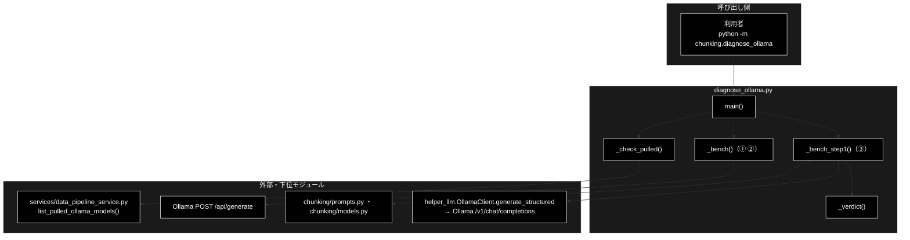
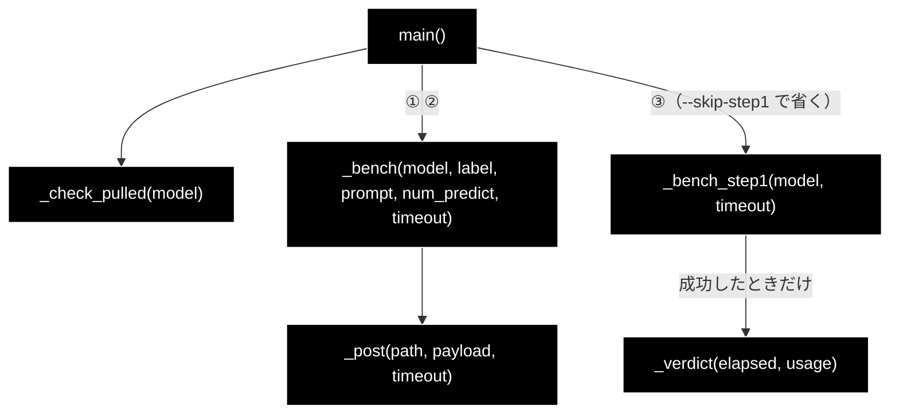
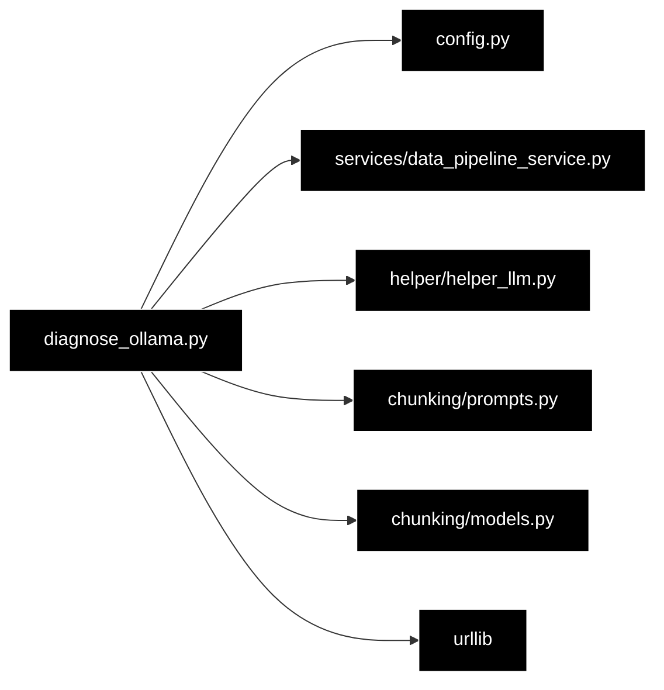

# diagnose_ollama.py - チャンク化が遅い・止まらないときの Ollama 診断 ドキュメント

**Version 1.1** | 最終更新: 2026-10-13

---

## 目次

1. [概要](#概要)
2. [アーキテクチャ構成図](#1-アーキテクチャ構成図)
3. [モジュール構成図](#2-モジュール構成図)
4. [所要時間の測り方と切り分け（重点解説）](#3-所要時間の測り方と切り分け重点解説)
5. [クラス・関数一覧表](#4-クラス関数一覧表)
6. [クラス・関数 IPO詳細](#5-クラス関数-ipo詳細)
7. [設定・定数](#6-設定定数)
8. [エクスポート](#7-エクスポート)
9. [変更履歴](#8-変更履歴)
10. [付録: 依存関係図](#付録-依存関係図)

---

## 概要

`chunking/diagnose_ollama.py` は、チャンク化が「遅い」のか「壊れている」のかを **1 回の実行で切り分ける**診断 CLI である
（`python -m chunking.diagnose_ollama`）。タイムアウトを長く取って（既定 900 秒）Ollama に 3 種類の生成を投げ、
生成トークン数・速度・停止理由・本文の有無を表示し、**本番の Step1 リクエストそのもの**（③）の所要時間を既定のタイムアウト（180 秒）と突き合わせる。

> 📎 **2026-10-11 に手順書 `timing.md`（所要時間の測り方と症状別の切り分け）を本書の §3 に統合した**（原本は削除した（2026-10-13。git 履歴に残る））。
> 統合の際、実装と食い違っていた 2 点を直した: `--workers` の既定は 8 ではなく **1**（`config.py::get_default_chunking_workers()`）、
> 全リトライに失敗したブロックは「機械的分割のフォールバック」へ落ちるのではなく**出力から消える**（§3.4）。

### 主な責務

- 診断するモデルが Ollama に pull 済みかを確かめる
- 短い生成（①）と、チャンク化と同じ形の短縮プロンプト（②）で、素の速度・モデルロード時間・停止理由を測る
- 本番の Step1 リクエスト（③）をタイムアウトを外して 1 回流し、既定のタイムアウトに収まるかを判定する
- 結果の読み方を表示する

### 各責務対応のモジュール

| # | 責務 | 対応モジュール | 説明 |
|---|------|--------------|------|
| 1 | pull 済みの確認 | `diagnose_ollama.py` ＋ `services/data_pipeline_service.py` | `_check_pulled()` → `list_pulled_ollama_models()`（`GET /v1/models`）。未 pull なら終了コード 1 |
| 2 | ①② 素の速度 | `diagnose_ollama.py` | `_bench()`（Ollama 固有の `POST /api/generate`。`eval_count` / `eval_duration` / `load_duration` / `done_reason` / `thinking`） |
| 3 | ③ 本番 Step1 と判定 | `diagnose_ollama.py` ＋ `helper/helper_llm.py` / `chunking/prompts.py` / `chunking/models.py` | `_bench_step1()`（`OllamaClient.generate_structured(StructuralResult)`）→ `_verdict()` |
| 4 | 読み方の表示 | `diagnose_ollama.py` | `main()` の末尾 |

### 主要機能一覧

| 機能 | 説明 |
|------|------|
| `python -m chunking.diagnose_ollama` | 既定モデル（`config.py::get_default_ollama_model()`）を ①②③ の順に診断する |
| `--model NAME` | 別のモデルを診断する（未 pull なら ①〜③ を流さず終了コード 1） |
| `--timeout SEC` | 1 回の生成の上限（既定 900 秒） |
| `--skip-step1` | ③ を省く（①② だけ） |

---

## 1. アーキテクチャ構成図

### 1.1 システム全体構成



### 1.2 データフロー

1. `--model`（無ければ既定モデル）と接続先（`OllamaConfig.BASE_URL`）を表示する
2. `_check_pulled()`: pull 済み一覧にモデルが**無い**ときだけ終了コード 1。一覧を取れない・空なら警告を出して先へ進む
3. ①: `"Say hello in one short sentence."` を `num_predict=64` で生成する
4. ②: `SCHEMA_PROMPT`（チャンク化と同じ形の短縮版）を `num_predict=2048` で生成する
5. ③: `PARAGRAPH_SEPARATION_PROMPT` ＋ `STEP1_BLOCK`（2026-09-11 に実際に失敗したブロックの逐語・1000 文字）を、
   本番と同じ `generate_structured(StructuralResult, max_output_tokens=8192)` で 1 回流す。成功したら `_verdict()`
6. 読み方を表示して終了コード 0（①〜③ が失敗しても 0）

---

## 2. モジュール構成図

### 2.1 内部モジュール構成



### 2.2 外部依存関係

| ライブラリ | 用途 |
|-----------|------|
| `urllib.request`（標準） | ①② の `POST /api/generate`（`OLLAMA_BASE_URL` から `/v1` を外した URL） |
| `argparse` / `json` / `time`（標準） | CLI・応答の解析・計測 |

### 2.3 内部依存モジュール

| モジュール | 使うもの |
|-----------|---------|
| `config.py` | `OllamaConfig.BASE_URL` / `get_default_ollama_model()` |
| `services/data_pipeline_service.py` | `list_pulled_ollama_models()`（遅延 import） |
| `helper/helper_llm.py` | `create_llm_client("ollama", default_model=..., timeout=...)`（③。遅延 import） |
| `chunking/prompts.py` / `chunking/models.py` | `PARAGRAPH_SEPARATION_PROMPT` / `StructuralResult`（③。遅延 import） |

---

## 3. 所要時間の測り方と切り分け（重点解説）

> 実測値はすべて開発者の Mac での記録（2026-09-11）。モデル・マシンが変われば値も変わるので、**基準値は自分の環境で測り直す**。

### 3.1 なぜ測るのか

2026-09 に同じ症状を 4 回追いかけた。tqdm の表示から 1 リクエストの秒数を目で拾っていたが、画面を流れて消えるうえ、条件を変えて比べられない。

```
Step1: 段落分割:  0%| | 1/1229 [09:03<185:17:07, 543.18s/it]
```

**543 秒/ブロックは「遅い」ではなく「全部失敗している」。** タイムアウトの既定 180 秒 × リトライ 3 回 ＋ 待ち 1 秒・2 秒 ＝ 543 秒で、1 件も成功していない。
チャンク化の最後に出る「所要時間（実測）」の表（`csv_text_to_chunks_text_csv.py::_log_timing_summary`）で、1 回の実行で判断できる。

### 3.2 小さく回して測る

全件の前に、先頭 20 行だけで 1 件あたりの秒数を掴む（前提: `ollama serve` が動き、`ollama list` にモデルがある）。

```bash
python -m chunking.csv_text_to_chunks_text_csv \
  --input-file OUTPUT/cc_news_2per.csv --output output_chunked --max-rows 20 --verbose
```

最後にこの表が出る（値は 2026-09-11 に `gemma4:12b-mlx`・20 行で 3 段すべてを完走したときの実測。表の形は `_log_timing_summary()` に同じ値を渡して出したもの）:

```
============================================================
所要時間（実測）
============================================================
  モデル: gemma4:12b-mlx / 並列ワーカー数: 1
  Step1 段落分割               3319.0 秒  /     55 件  =    60.35 秒/件
  Step2 意味的分割              4006.2 秒  /     79 件  =    50.71 秒/件
  Step3 連続性チェック            1446.1 秒  /    204 件  =     7.09 秒/件
------------------------------------------------------------
  合計                       8771.3 秒  /    338 件  =    25.95 秒/件
  ※ 秒/件は待ち時間込み。workers を下げて改善するなら Ollama 側がさばききれていない
============================================================
```

| 段 | 秒/件 | なぜその値か |
|---|---:|---|
| Step1 | 60.35 | 1000 文字を逐語で JSON に書き写す。プロンプト（分割ルール＋スキーマ）も約 2,500 トークンと大きい |
| Step2 | 50.71 | 段落単位なので Step1 よりやや短い |
| Step3 | 7.09 | 隣り合う 2 チャンクがつながるかを判定するだけ。出力が小さい |

- **20 行（54.8K 文字）で 2 時間 26 分。** 件数は 55 ブロック → 79 段落 → 204 チャンク →（連続性で結合）52 →（512 トークン上限で分割）60 チャンク
- **呼び出し件数は段が進むほど増える**（55 → 79 → 204）。1 件が速い Step3 も合計では 24 分かかる
- 行数に比例すると見て、100 行で約 12 時間、500 行（`cc_news_2per.csv` 全件）で約 61 時間。実測前に Step1 だけから外挿した見積もり（36〜48 時間）は小さすぎた（Step2 の件数が入力ブロック数より多いことを織り込めていなかった）。**外挿より実測**
- 単発の基準値（競合なし・`--block-size 1000`）は **1 ブロック約 62.7 秒**（生成 420 トークン・15〜16 tok/s。うち約 35 秒はプロンプト評価で、異常ではない）

> ⚠️ **`--max-rows` と `--resume` では全件を刻めない。** `--max-rows N` は常に先頭 N 行（オフセットが無い）、`--resume` は段単位の再開でしかない。
> 全件を分けて回すときは入力 CSV を先に分ける（[`README_chunking.md`](README_chunking.md) §2）。

### 3.3 数字の読み方

| 秒/件 | 判断 |
|---:|---|
| **540 前後** | **失敗している。** タイムアウト 180 秒 × リトライ 3 回。ログに 404 / timeout が出ているはず |
| **180 前後** | タイムアウト 1 回ぶん。リトライで成功しているが、実質ぎりぎり |
| 数十秒 | ローカル LLM では普通（上の基準値）。遅すぎるならモデルが大きすぎるか、同時実行がさばけていない（§3.5） |
| 数秒 | 速い（Step3 は普通この程度） |

⚠️ **秒/件は待ち時間込み。** 段の経過時間を件数で割っただけなので、Ollama が直列に処理していれば、後続がキューで待った時間も乗る。

### 3.4 失敗しているとき

1. **まず `python -m chunking.diagnose_ollama` を回す**（§5.1）。結論は ③ で出す。② は短縮プロンプトで本番よりずっと軽く、
   2026-09-11 は **② が 74.3 秒で成功したのに、本番は 180 秒で切れ続けていた**（軽い方を測って「動く」と読むのが一番まずい）

   | ③ の結果 | 原因と対処 |
   |---|---|
   | 180 秒超 | `CHUNKING_LLM_TIMEOUT` の既定では必ず落ちる。延ばすか、`--block-size` を下げるか、軽いモデルへ |
   | 生成速度が 1 桁 tok/s | モデルが重すぎる。小さいモデルを試す |
   | 思考だけで本文が空 | 思考モデルで `reasoning_effort="none"` が効いていない（Ollama のバージョン依存）。別モデルへ |
   | 停止理由が `length` | 上限まで生成し切っている。`num_predict`（チャンク化では 8192）がそのまま最悪時間になる |

2. **モデル名** — 表の「モデル:」が `ollama list` に**そのままの文字列で**あるか。実例: `OLLAMA_DEFAULT_MODEL=gemma4:e4b` に対し、
   実在したのは `gemma4:e4b-mlx`。CLI は実行前に pull 済み一覧つきで弾く（一覧を取れないときは素通り）。
   `OLLAMA_DEFAULT_MODEL` の出どころが分からないときは、シェルの環境変数・`find_dotenv()` が拾う親ディレクトリの `.env`・`~/.zshrc` 等を見る
3. **ログの 404 / timeout** — `model '...' not found` なら 2 に戻る
4. **中断メッセージ** — 連続失敗が `CHUNKING_ABORT_AFTER_FAILURES`（既定 3）回に達すると `ChunkingAbortedError` で止まる（残りのブロックの時間を捨てる前に止める）
5. **タイムアウトを延ばす** — モデルが遅いだけなら `CHUNKING_LLM_TIMEOUT=600` のように延ばす

> ⚠️ **3 回連続に達しなかった失敗は、黙って本文が消える。** ログには `Failed after 3 retries. Using fallback.` と出るが、
> 代わりの分割は無く、そのブロック（Step2 では段落）の本文は出力 CSV に入らない。終了コードも 0（2026-10-11 に偽サーバで実測。
> [`csv_text_to_chunks_text_csv.md`](csv_text_to_chunks_text_csv.md) §5.3）。ログに `Failed after` が 1 行でもあれば、出力は欠けている。

**Ollama が動いていないとき** — CLI・データ管理タブ・`make_qa_register_qdrant.py` は LLM を呼ぶ前に 1 秒で弾く（終了コード 1）:

```
❌ Ollama に接続できません（http://localhost:11434/v1）: [Errno 61] Connection refused
```

繋がってはいるが応答が変（HTTP エラー・読み取りタイムアウト・形式が想定外）なら止めずに先へ進む（実際には動くジョブを止めないため）。
macOS の `Ollama.app` はサーバ（`ollama serve`）を監視して再起動するので、ポートを空けるには本体を落とす（`pkill -x Ollama`）。

**スキーマをオウム返しされたとき** — `Raw response:` にプロンプトへ載せたスキーマ（`"properties"` / `"required"` …）がそのまま返る。
リトライしても同じなので、`SchemaEchoError` が **1 回目で** `ChunkingAbortedError` にして止める（2026-09-11 の `llama3.2:latest` では 3 回とも同じスキーマが返っていた）。
対処は指示追従の強いモデルに変えるか、Ollama を structured outputs（`json_schema`）対応版へ更新する。
未対応の Ollama では `この Ollama は structured outputs（json_schema）に未対応のため JSON モードへ落とします` という WARNING が出る（出ていなければ制約は効いている）。

### 3.5 並列ワーカーを上げても速くならない

`--workers` の既定は `get_default_chunking_workers()`（`OLLAMA_NUM_PARALLEL`、無ければ **1**）。Ollama は既定で 1 本ずつしか処理しないので、
8 本投げても 7 本はキューで待つだけになる。実測（20 行・55 ブロック・`--workers 8`・`CHUNKING_LLM_TIMEOUT=600`）では完了が 1 本ずつ 50〜90 秒間隔で届き、
509 秒で 7 ブロック（約 73 秒/ブロック）と単発の 62.7 秒とほぼ同じだった。しかも順番待ちが各リクエストのタイムアウトを食い、600 秒ちょうどで期限切れになった。

上げてよいのは Ollama 側も増やしたときだけ（`OLLAMA_NUM_PARALLEL=4 ollama serve`。増えるのはスロットごとの KV キャッシュで、`ollama ps` で実使用量を見る）。
`--workers 1` と上げた値で同じ 20 行を回し、表の「合計 … 秒/件」が**実際に下がった**ことを確かめる。両方 540 前後なら並列度の問題ではない（全リクエストが失敗している）。

---

## 4. クラス・関数一覧表

| 関数 | 概要 |
|------|------|
| `main() -> int` | CLI。①〜③ を流して読み方を出す。未 pull なら 1、それ以外は 0 |
| `_check_pulled(model) -> bool` | pull 済みか（一覧を取れない・空なら `True`） |
| `_bench(model, label, prompt, num_predict, timeout) -> None` | `/api/generate` で 1 回生成して速度・停止理由を表示 |
| `_bench_step1(model, timeout) -> None` | 本番の Step1 リクエストを 1 回流し、成功したら `_verdict()` |
| `_verdict(elapsed, usage) -> None` | 成功した ③ の所要時間を `DEFAULT_TIMEOUT` と比べて推奨を表示 |
| `_post(path, payload, timeout) -> dict` | Ollama のネイティブ API へ JSON を POST |

---

## 5. クラス・関数 IPO詳細

### 5.1 使用例

| # | パターン | いつ使うか | 例 |
|---|---------|-----------|----|
| 1 | **基本**: 既定モデルを診断する | チャンク化の秒/件が 180 の倍数だった・止まらない | 5.1.1 |
| 2 | 別のモデル・未 pull のモデル | モデルを変える前に確かめる | 5.1.2 |
| 3 | Ollama が動いていない | 接続できないときの見え方 | 5.1.3 |
| 4 | ③ の判定だけを見る（Python） | 所要時間からどう判定されるかを確かめる | 5.1.4 |

> 📝 **確かめ方（2026-10-11）**: 5.1.1〜5.1.4 は、Ollama の代わりに偽サーバ（`/v1/models`・`/api/generate`・`/v1/chat/completions` に固定の応答を返す）を立てて実行した。
> **表示の形と終了コードは実物どおりだが、所要時間・速度の数値は偽サーバのもの**で、実際の Ollama の値ではない（実測の目安は §3.2。速度は実行ごとに変わる）。
> 接続先は既定値（`http://localhost:11434/v1`）に置き換えて載せた。

#### 5.1.1 基本: 既定モデルを診断する

```bash
python -m chunking.diagnose_ollama
echo "exit=$?"

# 出力（抜粋。数値は偽サーバのもの）:
#   接続先: http://localhost:11434/v1
#   モデル: gemma4:26b-a4b-it-qat
#   ✅ pull 済み: gemma4:26b-a4b-it-qat
# --- ① 短い生成 (num_predict=64) ---
#   所要:        0.0 秒
#   モデルロード: 1.5 秒
#   生成トークン: 12
#   生成速度:    20.0 tok/s
#   停止理由:    stop
#   本文:        12 文字
# --- ② チャンク化と同じ形（短縮） (num_predict=2048) ---
#   …（① と同じ項目）
# --- ③ 本番 Step1 リクエスト (max_tokens=8192) ---
#   入力ブロック: 1000 文字
#   ✅ 成功: 0.0 秒 / 1 段落
#   生成トークン: 60 / 実効 1582.3 tok/s
#   既定のタイムアウト: 180 秒
#   → 余裕あり。既定のままで回る。
# （このあと「読み方」）
# exit=0
```

> 📌 ③ だけで 1 ブロック分（実測で 60 秒前後）かかる。①② だけで済ませたいときは `--skip-step1`、遅いモデルで 900 秒を超えるなら `--timeout 1800` のように延ばす。

#### 5.1.2 別のモデル・未 pull のモデル

```bash
python -m chunking.diagnose_ollama --model nope:latest
echo "exit=$?"

# 出力（末尾）:
#   ❌ 'nope:latest' は pull されていません
#      pull 済み: gemma4:26b-a4b-it-qat
# exit=1
```

#### 5.1.3 Ollama が動いていない

```bash
OLLAMA_BASE_URL=http://localhost:11499/v1 python -m chunking.diagnose_ollama
echo "exit=$?"

# 出力（抜粋）:
#   ⚠️  pull 済み一覧が空（Ollama 停止中の可能性）
# --- ① 短い生成 (num_predict=64) ---
#   ❌ 失敗: <urlopen error [Errno 111] Connection refused>
# --- ③ 本番 Step1 リクエスト (max_tokens=8192) ---
#   ❌ 0.0 秒で失敗: APIConnectionError: Connection error.
#   ⚠️ 途中で失敗したので所要時間は速度の目安にならない。
# exit=0
```

> ⚠️ **接続できなくても終了コードは 0。** 一覧を取れないときは「判定不能」として先へ進み、①〜③ の失敗も終了コードに反映しない。
> チャンク化 CLI（接続できなければ 1）と違うので、スクリプトから呼ぶときは出力の `❌` を見る。

#### 5.1.4 ③ の判定だけを見る

```python
from chunking.diagnose_ollama import _verdict

for sec in (62.7, 120.0, 250.0):      # 成功した ③ の所要時間（秒）
    print(f"--- {sec}")
    _verdict(sec, {"output_tokens": 420})

# 実行結果:
# --- 62.7
#   生成トークン: 420 / 実効 6.7 tok/s
#   既定のタイムアウト: 180 秒
#   → 余裕あり。既定のままで回る。
# --- 120.0
#   生成トークン: 420 / 実効 3.5 tok/s
#   既定のタイムアウト: 180 秒
#   ⚠️ 既定に収まってはいるが余裕がない。ブロックが長いと落ちる。
#      CHUNKING_LLM_TIMEOUT=360 程度を推奨。
# --- 250.0
#   生成トークン: 420 / 実効 1.7 tok/s
#   既定のタイムアウト: 180 秒
#   ⚠️ **既定のタイムアウトを超えている。** このままでは全ブロックが
#      失敗する（180 秒 × リトライ 3 回 = 540 秒/ブロック）。次のどれかを採る:
#      - CHUNKING_LLM_TIMEOUT=500 を設定する
#      - --block-size を下げて 1 リクエストの出力量を減らす
#      - もっと小さいモデルにする（llama3.2:latest 等）
```

> 📌 境目は `DEFAULT_TIMEOUT`（180 秒）の半分（90 秒）と 180 秒。推奨のタイムアウトは、余裕が無いとき所要時間の 3 倍、超えているとき 2 倍。

### 5.2 `main`

```python
def main() -> int
```

| 項目 | 内容 |
|------|------|
| **Input** | CLI 引数 `--model`（既定 `None` → `get_default_ollama_model()`）、`--timeout`（既定 900.0）、`--skip-step1` |
| **Process** | 接続先・モデルを表示 → `_check_pulled()` が `False` なら 1 を返す → ① `_bench(..., 64)` → ② `_bench(SCHEMA_PROMPT, 2048)` → ③ `_bench_step1()`（`--skip-step1` なら省く）→ 読み方を表示 |
| **Output** | 終了コード（未 pull のときだけ 1、それ以外は 0） |

使用例は 5.1.1〜5.1.3。

### 5.3 `_check_pulled`

| 項目 | 内容 |
|------|------|
| **Input** | `model: str` |
| **Process** | `list_pulled_ollama_models()` を呼ぶ。例外 → 警告して `True`。空 → 警告して `True`。含む → `True`。含まない → pull 済み一覧を出して `False` |
| **Output** | `bool`（`False` は「一覧が取れて、そこに無い」ときだけ） |

### 5.4 `_bench`

```python
def _bench(model: str, label: str, prompt: str, num_predict: int, timeout: float) -> None
```

| 項目 | 内容 |
|------|------|
| **Input** | モデル・見出し・プロンプト・`num_predict`・タイムアウト |
| **Process** | `POST /api/generate`（`stream: false`・`temperature: 0.1`）。`URLError` / `TimeoutError` は `❌` を表示して戻る。成功なら所要・ロード時間・生成トークン・速度（`eval_count / eval_duration`）・停止理由・本文の文字数・思考の文字数・本文の先頭 120 字を表示。`done_reason == "length"` と「思考だけで本文が空」には警告を足す |
| **Output** | なし（表示のみ） |

### 5.5 `_bench_step1`

| 項目 | 内容 |
|------|------|
| **Input** | `model`, `timeout` |
| **Process** | `f"{PARAGRAPH_SEPARATION_PROMPT}\n\n【入力テキスト】\n{STEP1_BLOCK}"` を `create_llm_client("ollama", default_model=model, timeout=timeout).generate_structured(prompt, StructuralResult, model, max_output_tokens=8192)` で 1 回流す。例外なら所要時間と例外を表示し、所要がタイムアウトの 9 割以上なら「重すぎる」、それ未満なら「所要時間は目安にならない」と出す（接続拒否は 1 秒未満で返るため、失敗を速さとして読まない） |
| **Output** | なし（成功なら段落数を表示して `_verdict(elapsed, client.last_usage)`） |

### 5.6 `_verdict`

```python
def _verdict(elapsed: float, usage: dict) -> None
```

| 項目 | 内容 |
|------|------|
| **Input** | 成功した ③ の所要秒、`usage`（`output_tokens` があれば実効 tok/s を表示） |
| **Process** | `elapsed <= 90` → 余裕あり。`<= 180` → `CHUNKING_LLM_TIMEOUT=elapsed×3` を推奨。それ以上 → 全ブロック失敗の警告と `elapsed×2`・`--block-size`・小さいモデルの 3 案 |
| **Output** | なし（表示のみ） |

使用例は 5.1.4。

### 5.7 `_post`

| 項目 | 内容 |
|------|------|
| **Input** | `path`（`/api/generate`）、`payload`、`timeout` |
| **Process** | `OllamaConfig.BASE_URL` の末尾 `/v1` を外した URL へ JSON を POST する（`urllib`。プロキシの環境変数は urllib の既定どおりに効く） |
| **Output** | 応答の JSON（dict） |

---

## 6. 設定・定数

| 定数・変数 | 値 | 説明 |
|-----------|----|------|
| `STEP1_MAX_TOKENS` | `8192` | ③ の出力上限（`chunks_all_async` の `max_output_tokens` と同じ） |
| `DEFAULT_TIMEOUT` | `180.0` | `_verdict()` が比べる既定のタイムアウト（`helper_llm` の Ollama の既定） |
| `SCHEMA_PROMPT` | 英文 2 行＋スキーマの短縮プロンプト | ② |
| `STEP1_BLOCK` | 1000 文字の英文 | ③。2026-09-11 に 543 秒で失敗した `cc_news_2per.csv` の block_24 の逐語 |

| 環境変数 | 既定 | 効果 |
|---------|------|------|
| `OLLAMA_BASE_URL` | `http://localhost:11434/v1` | 接続先 |
| `OLLAMA_DEFAULT_MODEL` | 未設定（`gemma4:26b-a4b-it-qat`） | `--model` を省いたときのモデル（`config.py::get_default_ollama_model()`。アプリ全体の既定も変わる） |
| `CHUNKING_LLM_TIMEOUT` | 未設定（`helper_llm` の既定 180 秒） | チャンク化の 1 リクエストの期限。**本 CLI は見ない**（`--timeout` を使う） |
| `CHUNKING_ABORT_AFTER_FAILURES` | `3` | チャンク化が連続失敗で中断する回数（`0` で無効）。本 CLI は見ない |
| `OLLAMA_NUM_PARALLEL` | Ollama 側の既定 | サーバの同時処理数。チャンク化の `--workers` の既定もこれに従う |

---

## 7. エクスポート

`__all__` は無い。`chunking/__init__.py` は再エクスポートしない（`python -m chunking.diagnose_ollama` で使う）。

```python
main
SCHEMA_PROMPT
STEP1_MAX_TOKENS
DEFAULT_TIMEOUT
STEP1_BLOCK
```

> 📌 直接のテストは無い（2026-10-11 grep）。

---

## 8. 変更履歴

| バージョン | 日付 | 変更内容 |
|---|---|---|
| 1.0 | 2026-10-11 | 新規作成（`chunking/docs/` の構成整理。それまで専用の文書が無かった）。手順書 `timing.md` を §3 に統合し、原本を `archive/` へ移した。統合時に `--workers` の既定（8 → 1）と、失敗したブロックの扱い（フォールバックではなく欠落）を実装に合わせて直した。§5.1 の使用例は偽サーバで実行して確かめ、接続できなくても終了コード 0 になることを記録した |
| 1.1 | 2026-10-13 | docs/archive/ を削除したのに追随（旧文書への参照を「2026-10-13 に削除。git 履歴に残る」へ） |

---

## 付録: 依存関係図


