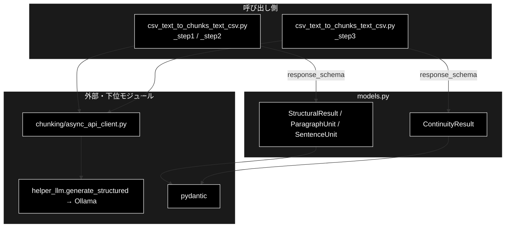
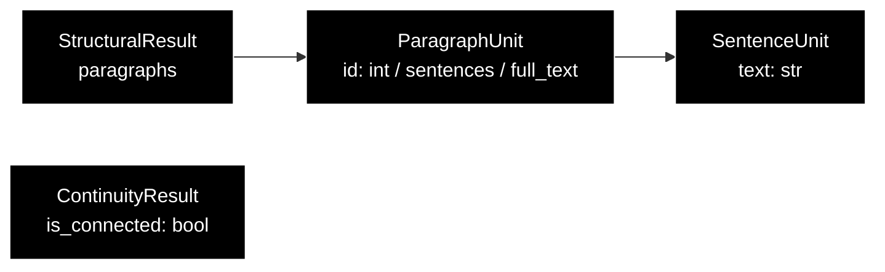
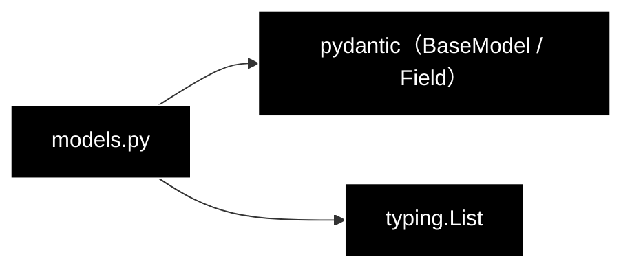

# models.py - チャンク化の構造化出力スキーマ（Pydantic）ドキュメント

**Version 1.0** | 最終更新: 2026-10-11

---

## 目次

1. [概要](#概要)
2. [アーキテクチャ構成図](#1-アーキテクチャ構成図)
3. [モジュール構成図](#2-モジュール構成図)
4. [クラス・関数一覧表](#3-クラス関数一覧表)
5. [クラス・関数 IPO詳細](#4-クラス関数-ipo詳細)
6. [設定・定数](#5-設定定数)
7. [エクスポート](#6-エクスポート)
8. [変更履歴](#7-変更履歴)
9. [付録: 依存関係図](#付録-依存関係図)

---

## 概要

`chunking/models.py` は、チャンク化の 3 段階で LLM に返させる **JSON の形（スキーマ）を Pydantic で定義する**モジュールである。
Step1（段落分割）と Step2（意味的分割）は `StructuralResult`（段落 → 文の 2 階層）、Step3（連続性チェック）は `ContinuityResult`（つながるか）を使う。
`AsyncAPIClient.generate_content(response_schema=...)` に渡すと、`helper_llm.OllamaClient.generate_structured()` がスキーマをプロンプトに足し、
`response_format={"type": "json_schema"}`（スキーマ制約付きデコード）で JSON を求め、`model_validate_json()` で検証する。

> 📌 docstring の「Gemini APIのレスポンススキーマとして使用」は移植前の記述で、現在の LLM はローカル LLM（Ollama）
> （`chunking/async_api_client.py` 経由）。スキーマ自体はプロバイダに依存しない。

### 主な責務

- 段落 → 文の 2 階層の構造（Step1・Step2 の出力）の定義
- 段落内の文を改行でつないだ本文の提供
- 隣り合うチャンクがつながるかの判定結果（Step3 の出力）の定義

### 各責務対応のモジュール

| # | 責務 | 対応モジュール | 説明 |
|---|------|--------------|------|
| 1 | 2 階層の構造の定義 | `models.py` | `SentenceUnit`（文）・`ParagraphUnit`（段落・`id` と `sentences`）・`StructuralResult`（`paragraphs`） |
| 2 | 段落の本文 | `models.py` | `ParagraphUnit.full_text`（文を `"\n"` でつなぐプロパティ） |
| 3 | 連続性の判定結果 | `models.py` | `ContinuityResult.is_connected`（`Field` の `description` が LLM への判定基準を兼ねる） |

### 主要機能一覧

| 機能 | 説明 |
|------|------|
| `StructuralResult` | `{"paragraphs": [{"id": int, "sentences": [{"text": str}]}]}` |
| `ParagraphUnit.full_text` | 段落内の文を改行でつないだ文字列 |
| `ContinuityResult` | `{"is_connected": bool}` |

---

## 1. アーキテクチャ構成図

### 1.1 システム全体構成



### 1.2 データフロー

1. 各段が `client.generate_content(..., response_schema=StructuralResult)` を呼ぶ
2. `OllamaClient.generate_structured()` が `model_json_schema()`（`$defs` / `$ref` を展開したもの）をプロンプトに足し、`json_schema` の `response_format` で JSON を求め、返った文字列を `model_validate_json()` で検証する。スキーマ定義そのものが返ってきたら `SchemaEchoError`（`AsyncAPIClient` は再試行せず `ChunkingAbortedError` にする）
3. `AsyncAPIClient` は検証済みのインスタンスを `model_dump_json()` で文字列に戻して返す
4. 各段は `StructuralResult.model_validate_json(...)` で読み直し、`para.full_text` を段落（チャンク）の本文にする

---

## 2. モジュール構成図

### 2.1 内部モジュール構成



### 2.2 外部依存関係

| ライブラリ | 用途 |
|-----------|------|
| `pydantic`（v2） | `BaseModel` / `Field`・JSON の検証（`model_validate_json`）とスキーマ（`model_json_schema`） |

---

## 3. クラス・関数一覧表

| クラス | フィールド | 概要 |
|--------|-----------|------|
| `SentenceUnit` | `text: str` | 1 つの文、または意味の最小単位 |
| `ParagraphUnit` | `id: int`, `sentences: List[SentenceUnit]`、プロパティ `full_text` | 段落 |
| `StructuralResult` | `paragraphs: List[ParagraphUnit]` | Step1・Step2 の出力 |
| `ContinuityResult` | `is_connected: bool` | Step3 の出力（前後のテキストがつながるか） |

---

## 4. クラス・関数 IPO詳細

### 4.1 使用例

| # | パターン | いつ使うか | 例 |
|---|---------|-----------|----|
| 1 | **基本**: LLM の応答 JSON を検証して段落の本文を得る | 各段の結果を読む（パイプラインと同じ使い方） | 4.1.1 |
| 2 | スキーマを見る・不正な応答を弾く | LLM に渡るスキーマの確認・失敗時の挙動の確認 | 4.1.2 |

> 📝 **確かめ方（2026-10-11）**: 4.1.1・4.1.2 は LLM を使わずに実行した（JSON を手で与えた）。

#### 4.1.1 基本: 応答 JSON を検証して段落の本文を得る

```python
from chunking.models import ContinuityResult, StructuralResult

raw = '{"paragraphs":[{"id":0,"sentences":[{"text":"住民票は区役所で取れます。"},{"text":"手数料は300円です。"}]}]}'
result = StructuralResult.model_validate_json(raw)
for para in result.paragraphs:
    print(para.id, repr(para.full_text))      # 文は改行でつながる

print(ContinuityResult.model_validate_json('{"is_connected": true}').is_connected)

# 実行結果:
# 0 '住民票は区役所で取れます。\n手数料は300円です。'
# True
```

#### 4.1.2 スキーマを見る・不正な応答を弾く

```python
from pydantic import ValidationError
from chunking.models import ContinuityResult, StructuralResult

schema = StructuralResult.model_json_schema()
print(list(schema["$defs"]), schema["required"])

try:
    ContinuityResult.model_validate_json("{}")   # is_connected が無い
except ValidationError as e:
    print(type(e).__name__, e.error_count())

# 実行結果:
# ['ParagraphUnit', 'SentenceUnit'] ['paragraphs']
# ValidationError 1
```

> 📌 パイプラインは検証に失敗した応答を `パース失敗` の警告で飛ばす。Step1・Step2 ではその段落の本文が**出力から消え**、
> Step3 では「つながらない」扱いで次のチャンクを残す（[`csv_text_to_chunks_text_csv.md`](csv_text_to_chunks_text_csv.md) §5.3）。

### 4.2 `ParagraphUnit.full_text`

```python
@property
def full_text(self) -> str
```

| 項目 | 内容 |
|------|------|
| **Input** | なし（`self.sentences`） |
| **Process** | `"\n".join(s.text for s in self.sentences)` |
| **Output** | `str`。文が 0 件なら空文字 |

> 改行でつなぐのは、Step2・Step3 が文の区切りを読みやすくするため（docstring）。CSV へ書くときに
> `save_chunks_as_csv(normalize_whitespace=True)` が改行を空白に置き換える。

---

## 5. 設定・定数

なし。

---

## 6. エクスポート

`__all__` は無い。`chunking/__init__.py` が 4 クラスすべてを再エクスポートする。

```python
SentenceUnit
ParagraphUnit
StructuralResult
ContinuityResult
```

> 📌 直接のテストは無い（2026-10-11 grep）。

---

## 7. 変更履歴

| バージョン | 日付 | 変更内容 |
|---|---|---|
| 1.0 | 2026-10-11 | 新規作成（`chunking/docs/` の構成整理。それまで専用の文書が無かった）。§4.1 の使用例 2 本を実行して確かめた |

---

## 付録: 依存関係図


