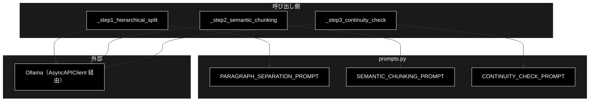
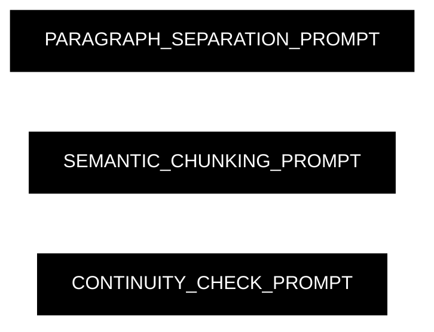
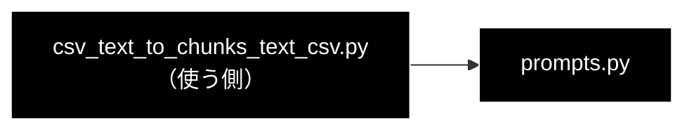

# prompts.py - チャンク化 3 段階のプロンプト定義 ドキュメント

**Version 1.0** | 最終更新: 2026-10-11

---

## 目次

1. [概要](#概要)
2. [アーキテクチャ構成図](#1-アーキテクチャ構成図)
3. [モジュール構成図](#2-モジュール構成図)
4. [クラス・関数一覧表](#3-クラス関数一覧表)
5. [クラス・関数 IPO詳細](#4-クラス関数-ipo詳細)
6. [設定・定数](#5-設定定数)
7. [エクスポート](#6-エクスポート)
8. [変更履歴](#7-変更履歴)
9. [付録: 依存関係図](#付録-依存関係図)

---

## 概要

`chunking/prompts.py` は、チャンク化の 3 段階で LLM に渡す**指示文（プロンプト）の文字列定数を 3 つだけ持つ**モジュールである。
関数・クラスは無い。各段はこの定数の後ろに入力テキストを足して LLM に渡す。

> 📌 docstring の「Gemini API用プロンプト定義」は移植前の記述で、現在の LLM はローカル LLM（Ollama）。
> 応答の形（JSON スキーマ）はプロンプトではなく [`models.py`](models.md) が決め、`helper_llm.OllamaClient.generate_structured()` がプロンプトの後ろに足す（`json_schema` の `response_format` も付ける）。

### 主な責務

- Step1（段落分割）の指示: **空行だけ**で段落を分け、段落の中を文に分ける
- Step2（意味的分割）の指示: 改行や文字数ではなく**話題の転換点**で分ける
- Step3（連続性チェック）の指示: 前後のテキストが一つの話題としてつながるかを判定する

### 各責務対応のモジュール

| # | 責務 | 対応モジュール | 説明 |
|---|------|--------------|------|
| 1 | Step1 の指示 | `prompts.py` | `PARAGRAPH_SEPARATION_PROMPT`（`_step1_hierarchical_split` が使う。応答は `StructuralResult`） |
| 2 | Step2 の指示 | `prompts.py` | `SEMANTIC_CHUNKING_PROMPT`（`_step2_semantic_chunking`。応答は `StructuralResult`） |
| 3 | Step3 の指示 | `prompts.py` | `CONTINUITY_CHECK_PROMPT`（`_step3_continuity_check`。応答は `ContinuityResult`） |

### 主要機能一覧

| 定数 | 文字数 | 要点 |
|------|------:|------|
| `PARAGRAPH_SEPARATION_PROMPT` | 1037 | 空行（`\n\n`）だけを分割基準にする。見出しは直後の本文と同じ段落。章が変わっても空行が無ければ分けない。原文をそのまま保持（要約しない） |
| `SEMANTIC_CHUNKING_PROMPT` | 541 | 文字数・改行は無視し、話題の転換点で分ける。章の変わり目は転換点として分ける。原文を一言一句変えない |
| `CONTINUITY_CHECK_PROMPT` | 515 | Next が Prev の用語・文脈を前提にする／単独で意味が不完全 → True。章の変わり目・別の話題・単独で理解できる → False |

> 文字数は 2026-10-11 に `len()` で数えた値。

---

## 1. アーキテクチャ構成図

### 1.1 システム全体構成



### 1.2 データフロー

各段は次の形でプロンプトを組み立てる（`csv_text_to_chunks_text_csv.py`）:

| 段 | 組み立て |
|----|---------|
| Step1 | `f"{PARAGRAPH_SEPARATION_PROMPT}\n\n【入力テキスト】\n{block}"`（`block` は `--block-size` 文字ごとのブロック） |
| Step2 | `f"{SEMANTIC_CHUNKING_PROMPT}\n\n【入力テキスト】\n{para}"`（Step1 の段落 1 つ） |
| Step3 | `f"{CONTINUITY_CHECK_PROMPT}\n\n【前のテキスト】\n{chunks[i]}\n\n【次のテキスト】\n{chunks[i + 1]}"`（隣り合う 2 チャンク） |

---

## 2. モジュール構成図

### 2.1 内部モジュール構成



### 2.2 外部依存関係

なし（文字列定数だけ）。

---

## 3. クラス・関数一覧表

クラス・関数は無い。定数は §1 の「主要機能一覧」のとおり。

---

## 4. クラス・関数 IPO詳細

### 4.1 使用例

| # | パターン | いつ使うか | 例 |
|---|---------|-----------|----|
| 1 | **基本**: パイプラインと同じ形でプロンプトを組み立てる | LLM に何が渡るかを確かめる | 4.1.1 |

> 📝 **確かめ方（2026-10-11）**: LLM を使わずに実行した（組み立てた文字列を表示するだけ）。

#### 4.1.1 パイプラインと同じ形でプロンプトを組み立てる

```python
from chunking.prompts import CONTINUITY_CHECK_PROMPT, PARAGRAPH_SEPARATION_PROMPT

block = "住民票は区役所で取れます。\n\n戸籍謄本は本籍地で請求します。"
prompt = f"{PARAGRAPH_SEPARATION_PROMPT}\n\n【入力テキスト】\n{block}"
print(prompt.strip().splitlines()[0])
print(prompt.splitlines()[-3:])

pair = f"{CONTINUITY_CHECK_PROMPT}\n\n【前のテキスト】\n住民票は区役所で取れます。\n\n【次のテキスト】\nその手数料は300円です。"
print(pair.strip().splitlines()[-4:])

# 実行結果:
# あなたはテキスト構造化エンジンです。入力されたテキストを以下の【分割ルール】に従って解析し、階層構造（段落 > 文）に変換してください。
# ['住民票は区役所で取れます。', '', '戸籍謄本は本籍地で請求します。']
# ['住民票は区役所で取れます。', '', '【次のテキスト】', 'その手数料は300円です。']
```

> ⚠️ Step1 のプロンプトは「**空行だけ**で段落を分ける」と指示するが、パイプラインはその前に `_preprocess_text()` で文ごとに改行を入れ、
> `--block-size` 文字ごとにブロックへ切る（文の途中でも切る）。ブロックの境目は空行ではないので、LLM には見えない切れ目になる
> （[`csv_text_to_chunks_text_csv.md`](csv_text_to_chunks_text_csv.md) §5.3 の既知の問題）。

---

## 5. 設定・定数

§1 の「主要機能一覧」のとおり。プロンプトを変えると、チャンクの切れ方が変わる（既存の `output_chunked/*.csv` とは比べられなくなる）。

---

## 6. エクスポート

`__all__` は無い。`chunking/__init__.py` が 3 定数を再エクスポートする。

```python
PARAGRAPH_SEPARATION_PROMPT
SEMANTIC_CHUNKING_PROMPT
CONTINUITY_CHECK_PROMPT
```

---

## 7. 変更履歴

| バージョン | 日付 | 変更内容 |
|---|---|---|
| 1.0 | 2026-10-11 | 新規作成（`chunking/docs/` の構成整理。それまで専用の文書が無かった）。各段のプロンプトの組み立て方を実装から写し、§4.1 の使用例を実行して確かめた |

---

## 付録: 依存関係図


