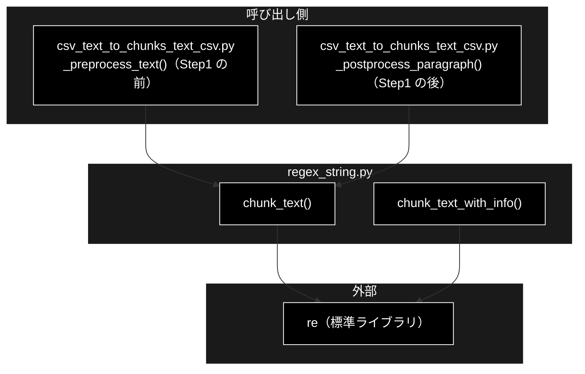
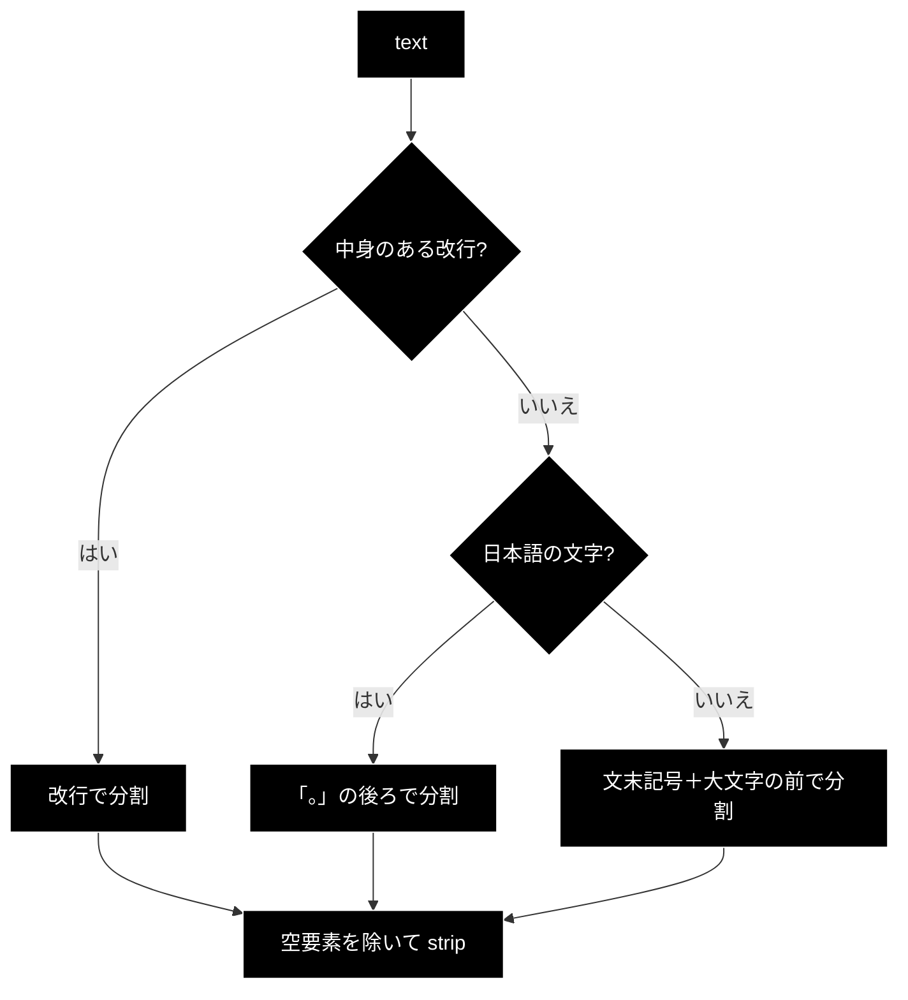
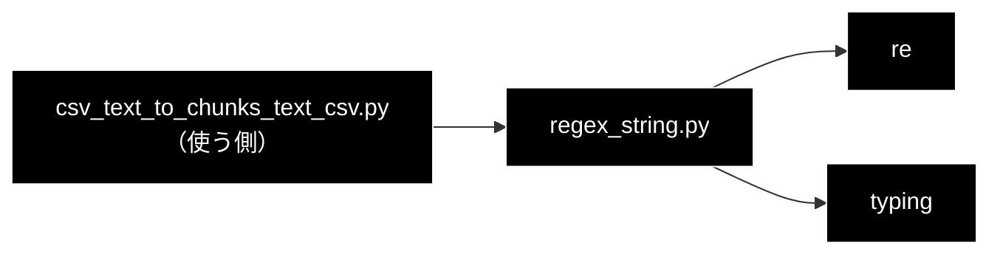

# regex_string.py - 正規表現による文分割（日本語・英語）ドキュメント

**Version 1.0** | 最終更新: 2026-10-11

---

## 目次

1. [概要](#概要)
2. [アーキテクチャ構成図](#1-アーキテクチャ構成図)
3. [モジュール構成図](#2-モジュール構成図)
4. [クラス・関数一覧表](#3-クラス関数一覧表)
5. [クラス・関数 IPO詳細](#4-クラス関数-ipo詳細)
6. [設定・定数](#5-設定定数)
7. [エクスポート](#6-エクスポート)
8. [変更履歴](#7-変更履歴)
9. [付録: 依存関係図](#付録-依存関係図)

---

## 概要

`chunking/regex_string.py` は、テキストを**正規表現だけで文（または行）に分ける**小さなモジュールである。LLM は使わない。
チャンク化の Step1 の前処理 `_preprocess_text()` と後処理 `_postprocess_paragraph()`（`csv_text_to_chunks_text_csv.py`）が
`chunk_text(..., keep_delimiter=True)` を呼び、LLM に渡す前・受け取った後のテキストを 1 文 1 行に整える。

> 📌 名前は「chunk」だが、作るのは**文**の単位で、チャンク化パイプラインの「チャンク」（Step3 の出力）とは別物。
> `chunk_text_with_info()` と `main()`（デモ）はパッケージ内外から呼ばれていない（2026-10-11 grep）。

### 主な責務

- 改行があれば行で、無ければ日本語は「。」・英語は文末記号で分ける
- 区切り記号を残すかどうかの切り替え
- 分割方法・言語・件数などの情報を付けて返す（デモ・調査用）

### 各責務対応のモジュール

| # | 責務 | 対応モジュール | 説明 |
|---|------|--------------|------|
| 1 | 行・文への分割 | `regex_string.py` | `chunk_text()`。改行の有無 → 日本語文字の有無で分け方を選ぶ |
| 2 | 区切り記号の扱い | `regex_string.py` | `keep_delimiter`（既定 `True`。後読み `(?<=。)` で記号を前の文に残す） |
| 3 | 情報付きの分割 | `regex_string.py` | `chunk_text_with_info()`（`method` / `language` / `count` / `original_length`） |

### 主要機能一覧

| 機能 | 説明 |
|------|------|
| `chunk_text(text, keep_delimiter=True)` | 行・文のリスト（空要素は除き、各要素は前後の空白を削る） |
| `chunk_text_with_info(text, keep_delimiter=True)` | 上と同じ分割に、方法・言語・件数・元の長さを付けた辞書 |
| `main()` | 日本語・英語・改行あり／なしの 4 例を表示するデモ（`python -m chunking.regex_string`） |

---

## 1. アーキテクチャ構成図

### 1.1 システム全体構成



### 1.2 データフロー

1. 前後の空白を削る。空なら `[]`
2. 中身のある改行（`\n` の後に空白以外）があれば、**改行だけで**分ける（行の中は文に分けない）
3. 改行が無ければ、ひらがな・カタカナ・漢字（`[ぁ-んァ-ヶー一-龠]`）があるかで日本語か英語かを決める
4. 日本語は「。」の後ろで、英語は `.` `!` `?` の後ろ（空白を挟んで大文字が続く位置）で分ける
5. 空要素を除き、各要素の前後の空白を削る

---

## 2. モジュール構成図

### 2.1 内部モジュール構成



### 2.2 外部依存関係

| ライブラリ | 用途 |
|-----------|------|
| `re`（標準） | 改行・言語の判定と分割 |

---

## 3. クラス・関数一覧表

| 関数 | 概要 |
|------|------|
| `chunk_text(text, keep_delimiter=True) -> List[str]` | 行・文のリスト |
| `chunk_text_with_info(text, keep_delimiter=True) -> Dict[str, any]` | 分割結果と情報の辞書 |
| `main()` | デモ表示 |

---

## 4. クラス・関数 IPO詳細

### 4.1 使用例

| # | パターン | いつ使うか | 例 |
|---|---------|-----------|----|
| 1 | **基本**: 日本語の 1 行を文に分ける（パイプラインと同じ `keep_delimiter=True`） | Step1 の前処理・後処理と同じ分け方を確かめる | 4.1.1 |
| 2 | 改行がある・英語・記号を落とす | 分け方の違いを確かめる | 4.1.2 |
| 3 | 情報付きで分ける | 判定された言語・方法を見る | 4.1.3 |

> 📝 **確かめ方（2026-10-11）**: 4.1.1〜4.1.3 を実行した（LLM・ネットワーク不要）。

#### 4.1.1 基本: 日本語の 1 行を文に分ける

```python
from chunking.regex_string import chunk_text

print(chunk_text("住民票は区役所で取れます。手数料は300円です。"))
print(chunk_text("   "))

# 実行結果:
# ['住民票は区役所で取れます。', '手数料は300円です。']
# []
```

#### 4.1.2 改行がある・英語・記号を落とす

```python
from chunking.regex_string import chunk_text

# 改行があると改行だけで分け、行の中は分けない
print(chunk_text("住民票は区役所で取れます。\n手数料は300円です。郵送もできます。"))
# 英語: 文末記号の後ろに大文字が続く位置で分ける（略語は考慮されない）
print(chunk_text("Dr. Smith arrived. He was late! Was he? yes."))
# keep_delimiter=False は「。」を落とす
print(chunk_text("住民票は区役所で取れます。手数料は300円です。", keep_delimiter=False))

# 実行結果:
# ['住民票は区役所で取れます。', '手数料は300円です。郵送もできます。']
# ['Dr.', 'Smith arrived.', 'He was late!', 'Was he? yes.']
# ['住民票は区役所で取れます', '手数料は300円です']
```

> ⚠️ ソースのコメントは「略語（Dr., Mr., e.g. …）を避ける」と書くが、実際は `Dr.` の後ろで分かれる（上の 2 行目）。
> 小文字で始まる次の文（`yes.`）とは分けない。Step1 の前処理は**行ごとに**呼ぶので、1 行に複数文がある日本語は文に分かれる。

#### 4.1.3 情報付きで分ける

```python
from chunking.regex_string import chunk_text_with_info

print(chunk_text_with_info("The fee is 3.5 dollars. It is cheap."))

# 実行結果:
# {'chunks': ['The fee is 3.5 dollars.', 'It is cheap.'], 'method': 'period_en', 'language': 'english', 'count': 2, 'original_length': 36}
```

> 📌 小数点（`3.5`）は、後ろが大文字でないので分かれない。

### 4.2 `chunk_text`

```python
def chunk_text(text: str, keep_delimiter: bool = True) -> List[str]
```

| パラメータ | 型 | デフォルト | 説明 |
|------------|------|-----------|------|
| `text` | str | - | 分割するテキスト |
| `keep_delimiter` | bool | `True` | 区切り記号（`。` `.` `!` `?`）を前の文に残すか |

| 項目 | 内容 |
|------|------|
| **Input** | `text`, `keep_delimiter` |
| **Process** | §1.2 の手順。日本語: `re.split(r'(?<=。)', text)`（`keep_delimiter=False` は `text.split('。')`）。英語: `re.split(r'(?<=[.!?])\s*(?=[A-Z])', text)`（`False` は `r'[.!?]\s*(?=[A-Z])'`） |
| **Output** | `List[str]`（空要素なし・各要素 strip 済み） |

使用例は 4.1.1・4.1.2。

### 4.3 `chunk_text_with_info`

```python
def chunk_text_with_info(text: str, keep_delimiter: bool = True) -> Dict[str, any]
```

| 項目 | 内容 |
|------|------|
| **Input** | `text`, `keep_delimiter` |
| **Process** | `chunk_text()` と同じ分け方。言語は改行の有無に関係なく日本語の文字の有無で決める |
| **Output** | `{"chunks", "method"("newline" / "period_ja" / "period_en"、空なら "none"), "language"("japanese" / "english"、空なら "unknown"), "count", "original_length"}` |

使用例は 4.1.3。

### 4.4 `main`

**概要**: 日本語・英語それぞれ改行あり／なしの 4 例を `chunk_text()` で分けて表示するデモ。`python -m chunking.regex_string` で動く。引数・戻り値なし。

---

## 5. 設定・定数

| 項目 | 値 |
|------|----|
| 日本語の判定 | `[ぁ-んァ-ヶー一-龠]` が 1 文字でもあれば日本語 |
| 改行の判定 | `\n\s*\S`（空白だけの行は改行とみなさない） |

---

## 6. エクスポート

`__all__` は無い。`chunking/__init__.py` は再エクスポートしない（`from chunking.regex_string import chunk_text` で使う）。

```python
chunk_text
chunk_text_with_info
main
```

> 📌 直接のテストは無い（2026-10-11 grep）。

---

## 7. 変更履歴

| バージョン | 日付 | 変更内容 |
|---|---|---|
| 1.0 | 2026-10-11 | 新規作成（`chunking/docs/` の構成整理。それまで専用の文書が無かった）。§4.1 の使用例 3 本を実行して確かめ、略語で分かれること（コメントと食い違う）を記録した |

---

## 付録: 依存関係図


