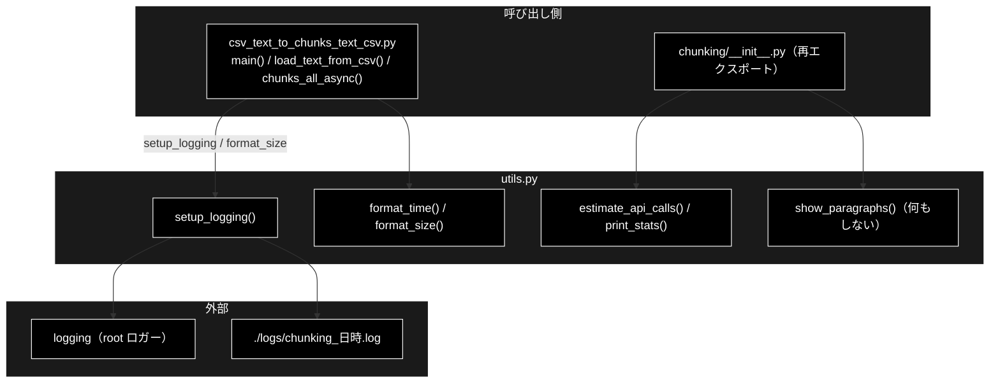
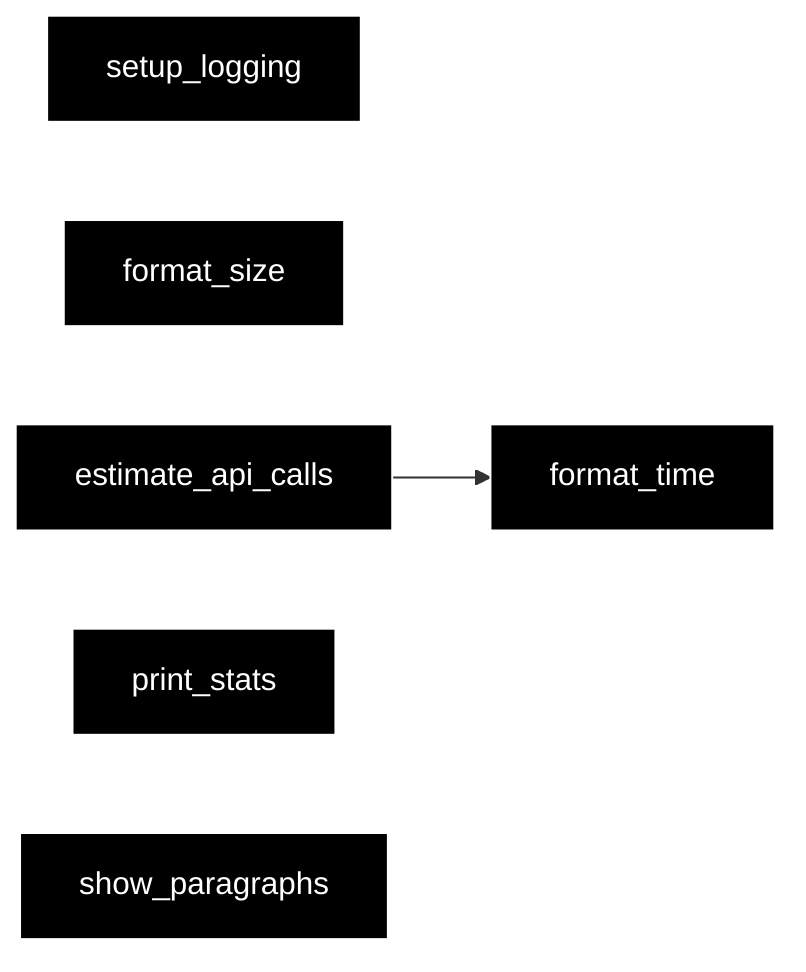
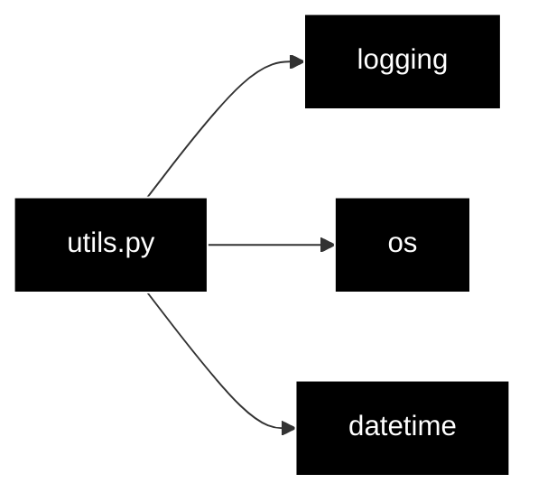

# utils.py - チャンク化の補助関数（ログ設定・表示の整形・見積もり）ドキュメント

**Version 1.0** | 最終更新: 2026-10-11

---

## 目次

1. [概要](#概要)
2. [アーキテクチャ構成図](#1-アーキテクチャ構成図)
3. [モジュール構成図](#2-モジュール構成図)
4. [クラス・関数一覧表](#3-クラス関数一覧表)
5. [クラス・関数 IPO詳細](#4-クラス関数-ipo詳細)
6. [設定・定数](#5-設定定数)
7. [エクスポート](#6-エクスポート)
8. [変更履歴](#7-変更履歴)
9. [付録: 依存関係図](#付録-依存関係図)

---

## 概要

`chunking/utils.py` は、チャンク化 CLI の**ログ設定**と、文字数・時間の**表示の整形**、LLM 呼び出し回数の**大まかな見積もり**を持つ小さなモジュールである。
本番で使われているのは `setup_logging()`（CLI の `main()`）と `format_size()`（ログの文字数表示）の 2 つだけ（2026-10-11 grep）。

> ⚠️ **`setup_logging()` は root ロガーのハンドラを全部外してから付け直す**（`root_logger.handlers.clear()`）。
> チャンク化 CLI では問題にならないが、ほかのプログラムから呼ぶと、そのプログラムのログ設定が消える。
> データ管理タブ・`make_qa_register_qdrant.py` の `.txt` 入力は `chunks_all_async()` を直接呼ぶので、`setup_logging()` は通らない。

### 主な責務

- ログファイルとコンソールへの出力の設定
- 秒数・文字数を読みやすい文字列にする
- テキストの長さから LLM 呼び出し回数と時間を見積もる
- 統計の辞書を整形して表示する

### 各責務対応のモジュール

| # | 責務 | 対応モジュール | 説明 |
|---|------|--------------|------|
| 1 | ログの設定 | `utils.py` | `setup_logging()`（`./logs/chunking_<日時>.log` と標準エラー） |
| 2 | 表示の整形 | `utils.py` | `format_time()` / `format_size()` |
| 3 | 呼び出し回数の見積もり | `utils.py` | `estimate_api_calls()`（固定の仮定による概算） |
| 4 | 統計の表示 | `utils.py` | `print_stats()`。`show_paragraphs()` は**中身がコメントアウトされていて何もしない** |

### 主要機能一覧

| 機能 | 説明 |
|------|------|
| `setup_logging(verbose=False, log_dir="./logs", log_prefix="chunking")` | ログファイルのパスを返す |
| `format_time(seconds)` | `"42.0秒"` / `"2.5分"` / `"2.0時間"` |
| `format_size(chars)` | `"800文字"` / `"12.3K文字"` / `"2.5M文字"` |
| `estimate_api_calls(text_length, block_size=2000)` | ブロック数・段落数・チャンク数・呼び出し回数・直列時間の見積もり |
| `print_stats(stats, title="Statistics")` | `=== title ===` と `  key: value` を表示 |
| `show_paragraphs(paragraphs, title=None)` | 何もしない（`pass`） |

---

## 1. アーキテクチャ構成図

### 1.1 システム全体構成



### 1.2 データフロー

1. CLI の `main()` が最初に `setup_logging(verbose=args.verbose)` を呼び、`./logs/` に日時つきのログファイルを作る
2. 以降のログは、ファイルへは DEBUG 以上、コンソールへは INFO 以上（`--verbose` なら DEBUG 以上）が出る
3. 読み込み・チャンク化の途中で、文字数を `format_size()` で整形してログに出す

---

## 2. モジュール構成図

### 2.1 内部モジュール構成



### 2.2 外部依存関係

| ライブラリ | 用途 |
|-----------|------|
| `logging` / `os` / `datetime`（標準） | ログのハンドラ・ログディレクトリ・ファイル名の日時 |

---

## 3. クラス・関数一覧表

| 関数 | 概要 | 本番の呼び出し元 |
|------|------|----------------|
| `setup_logging(verbose, log_dir, log_prefix) -> str` | ログ設定。ログファイルのパスを返す | CLI `main()` |
| `format_time(seconds) -> str` | 秒数の整形 | `estimate_api_calls()` だけ |
| `format_size(chars) -> str` | 文字数の整形 | `load_text_from_csv()` / `chunks_all_async()` / `main()`・`_step1` のログ |
| `estimate_api_calls(text_length, block_size=2000) -> dict` | 呼び出し回数の見積もり | なし |
| `print_stats(stats, title="Statistics")` | 統計の表示 | なし（`__init__` も再エクスポートしない） |
| `show_paragraphs(paragraphs, title=None)` | 何もしない | なし |

---

## 4. クラス・関数 IPO詳細

### 4.1 使用例

| # | パターン | いつ使うか | 例 |
|---|---------|-----------|----|
| 1 | **基本**: 文字数・時間を整形し、呼び出し回数を見積もる | チャンク化の前に規模を掴む | 4.1.1 |
| 2 | CLI と同じログ設定にする | 自作のスクリプトから `chunks_all_async()` を呼ぶとき、CLI と同じログを残したい | 4.1.2 |

> 📝 **確かめ方（2026-10-11）**: 4.1.1・4.1.2 を空の一時ディレクトリで実行した（LLM・ネットワーク不要）。

#### 4.1.1 基本: 整形と見積もり

```python
from chunking.utils import estimate_api_calls, format_size, format_time, print_stats

print(format_time(42.0), format_time(150), format_time(7200))
print(format_size(800), format_size(12345), format_size(2_500_000))

est = estimate_api_calls(12000, block_size=1000)   # CLI の既定 --block-size と同じ 1000 を渡す
print(est["batch_count"], est["total_api_calls"], est["estimated_time_serial"])
print_stats({"chunks": 4, "avg_tokens": 17.25}, title="結果")

# 実行結果:
# 42.0秒 2.5分 2.0時間
# 800文字 12.3K文字 2.5M文字
# 12 131 4.4分
#
# === 結果 ===
#   chunks: 4
#   avg_tokens: 17.25
```

> ⚠️ `estimate_api_calls()` は「1 ブロック平均 4 段落」「1 段落平均 1.5 チャンク」「1 呼び出し 2 秒・直列」の**固定の仮定**による概算で、
> 並列数（`--workers`）もリトライも考えない。関数の既定 `block_size=2000` は CLI の既定（1000）と違うので、見積もるときは明示して渡す。
> ⚠️ **ローカル LLM では時間の見積もりは使えない。** Ollama の実測は 1 呼び出し数十秒（Step1 で約 62.7 秒/ブロック。[`diagnose_ollama.md`](diagnose_ollama.md) §4）で、
> 2 秒の仮定とは桁が違う。時間は CLI が最後に出す「所要時間（実測）」の表の秒/件から見積もる。呼び出し回数（`total_api_calls`）の見積もりは使える。

#### 4.1.2 CLI と同じログ設定にする

```python
import logging
from chunking.utils import setup_logging

path = setup_logging(verbose=False, log_dir="logs", log_prefix="my_chunking")
logging.getLogger("demo").debug("ファイルにだけ出る")
logging.getLogger("demo").info("両方に出る")
print(path.startswith("logs/my_chunking_"), len(logging.getLogger().handlers))
print(open(path, encoding="utf-8").read().count("demo"))

# 実行結果（標準エラーには INFO の 2 行が出る）:
# True 2
# 2
```

> ⚠️ root ロガーの既存ハンドラは消える（§概要）。呼ぶたびに新しいログファイルができ、`./logs/` は自動では片付かない。

### 4.2 `setup_logging`

```python
def setup_logging(verbose: bool = False, log_dir: str = "./logs", log_prefix: str = "chunking") -> str
```

| 項目 | 内容 |
|------|------|
| **Input** | `verbose`（コンソールを DEBUG にするか）、`log_dir`、`log_prefix` |
| **Process** | 1. `log_dir` を作る<br>2. `<log_dir>/<log_prefix>_<YYYYMMDD_HHMMSS>.log` の FileHandler（DEBUG）と StreamHandler（INFO、`verbose` なら DEBUG）を作る。書式 `%(asctime)s [%(levelname)s] %(name)s: %(message)s`<br>3. root を DEBUG にし、**既存のハンドラをすべて外して**から 2 つを付ける |
| **Output** | `str`: ログファイルのパス |

### 4.3 `format_time` / `format_size`

| 関数 | 規則 |
|------|------|
| `format_time(seconds)` | 60 未満 → `"{秒:.1f}秒"`、3600 未満 → `"{分:.1f}分"`、それ以上 → `"{時間:.1f}時間"` |
| `format_size(chars)` | 1000 未満 → `"{n}文字"`、100 万未満 → `"{n/1000:.1f}K文字"`、それ以上 → `"{n/1000000:.1f}M文字"` |

使用例は 4.1.1。

### 4.4 `estimate_api_calls`

```python
def estimate_api_calls(text_length: int, block_size: int = 2000) -> dict
```

| 項目 | 内容 |
|------|------|
| **Input** | `text_length`（文字数）、`block_size` |
| **Process** | ブロック数 = ⌈文字数 / block_size⌉、段落数 = ブロック数 × 4、チャンク数 = int(段落数 × 1.5)、呼び出し回数 = ブロック数 + 段落数 + (チャンク数 − 1)、直列時間 = 呼び出し回数 × 2 秒 |
| **Output** | `{"text_length", "block_size", "batch_count", "estimated_paragraphs", "estimated_chunks", "total_api_calls", "estimated_time_serial_seconds", "estimated_time_serial"}` |

使用例は 4.1.1。

### 4.5 `print_stats` / `show_paragraphs`

| 関数 | 内容 |
|------|------|
| `print_stats(stats, title)` | 空行・`=== title ===`・`  key: value`（float は小数 2 桁）・空行を `print` する |
| `show_paragraphs(paragraphs, title)` | 本体がすべてコメントアウトされており、**何も表示せず `None` を返す**。`chunking/__init__.py` が再エクスポートしているが、呼び出し元は無い |

---

## 5. 設定・定数

| 項目 | 値 |
|------|----|
| ログの置き場所 | `./logs/`（カレントディレクトリ基準） |
| ログの書式 | `%(asctime)s [%(levelname)s] %(name)s: %(message)s`（日時 `%Y-%m-%d %H:%M:%S`） |

---

## 6. エクスポート

`__all__` は無い。`chunking/__init__.py` が `show_paragraphs` / `setup_logging` / `format_time` / `format_size` / `estimate_api_calls` を再エクスポートする（`print_stats` はしない）。

```python
show_paragraphs
setup_logging
format_time
format_size
estimate_api_calls
print_stats
```

> 📌 直接のテストは無い（2026-10-11 grep）。

---

## 7. 変更履歴

| バージョン | 日付 | 変更内容 |
|---|---|---|
| 1.0 | 2026-10-11 | 新規作成（`chunking/docs/` の構成整理。それまで専用の文書が無かった）。§4.1 の使用例 2 本を実行して確かめ、`setup_logging()` が root のハンドラを外すこと・`show_paragraphs()` が何もしないこと・`estimate_api_calls()` の既定が CLI と違うことを記録した |

---

## 付録: 依存関係図


