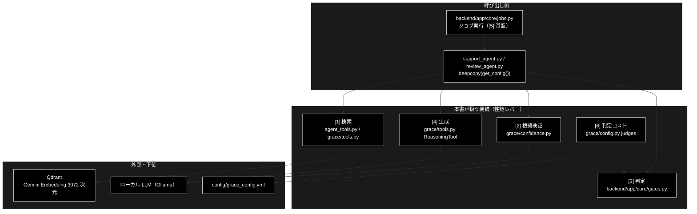
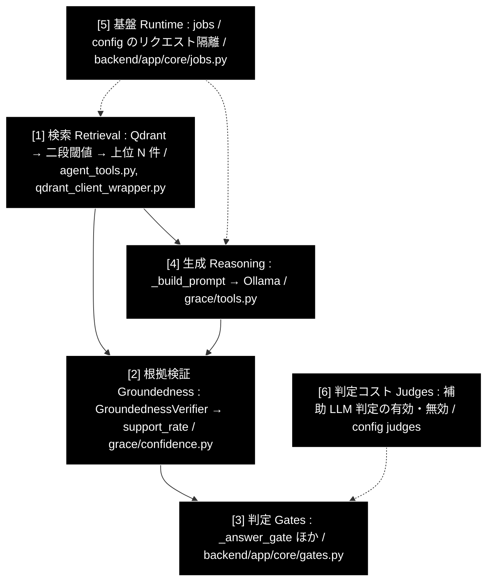

# 性能改善レバー — 回答品質とレイテンシを決めている箇所

**Version 2.9** | 最終更新: 2026-10-13

---

## 目次

0. [概要](#概要)
1. [性能を決める層](#1-性能を決める層)
2. [レバーの現況一覧](#2-レバーの現況一覧)
3. [実装済みレバーの要点](#3-実装済みレバーの要点)
4. [未実装で残るレバー](#4-未実装で残るレバー)
5. [ローカル LLM 特有のレイテンシ・レバー](#5-ローカル-llm-特有のレイテンシレバー)
6. [GRACE-Review 側のレバー](#6-grace-review-側のレバー)
7. [実施順序と注意](#7-実施順序と注意)
8. [検証方法](#8-検証方法)
9. [関連ドキュメント](#9-関連ドキュメント)
10. [変更履歴](#10-変更履歴)

---

## 概要

本書は「**性能（回答品質・レイテンシ）を決めているコード上の箇所**」と、**まだ手を付けていない改善候補**の TODO である（種別 C）。
2026-10-13 に、実装済みレバーの経緯・検証手順の詳細を要約して縮めた（全文は git 履歴の v2.8）。
モードの全体像と判定（ガードレール）の詳細は [`core_process_flow.md` §4](../backend/app/core/docs/core_process_flow.md)。

技術スタック: LLM = ローカル LLM（Ollama・既定 `gemma4:26b-a4b-it-qat`）／
Embedding = Gemini（`gemini-embedding-001`）。

> ⚠️ **行番号は書かない。** 実装への参照はすべて「ファイル名 + シンボル名」で示す（v1.7 の行番号参照は全滅していた）。

### 主な責務

- 検索で回答に使うチャンクを選ぶ（二段閾値・上位 N 件・許可コレクション順）
- 回答が出典で支持される割合（support_rate）を測る
- 閾値と照合して answer / escalate を決める
- プロンプトを組み立てて回答を生成する
- 補助 LLM 判定（judges）の有効・無効を切り替え、ローカル LLM の呼び出し回数（レイテンシ）を決める
- リクエストごとに設定を隔離し、並行実行で閾値やモデルが混ざらないようにする

### 各責務対応のモジュール

| # | 責務 | 対応モジュール | 説明 |
|---|------|--------------|------|
| 1 | 検索（層 [1]） | `agent_tools.py` / `grace/tools.py` / `qdrant_client_wrapper.py` | `select_by_similarity`（P-04）・`_apply_allowed_collections`（P-03）・`config.AgentConfig.RAG_SEARCH_LIMIT`（P-06） |
| 2 | 根拠検証（層 [2]） | `grace/confidence.py` / `grace/executor.py` | `GroundednessVerifier`・`_extract_source_texts`（P-01） |
| 3 | 判定（層 [3]） | `backend/app/core/gates.py` / `backend/app/core/verticals.py` | `_answer_gate` と業界プロファイルの閾値（P-07） |
| 4 | 生成（層 [4]） | `grace/tools.py` | `ReasoningTool._build_prompt`（W-2 / W-2b / P-10） |
| 5 | 判定コスト（層 [6]） | `grace/config.py` / `config/grace_config.yml` | `judges`（`JudgeConfig`）による補助 LLM 判定の有効・無効（J-1 / M-5。§5） |
| 6 | 設定の隔離（層 [5]） | `backend/app/core/support_agent.py` / `backend/app/core/review_agent.py` | `copy.deepcopy(get_config())`（P-08）。ジョブ実行は `backend/app/core/jobs.py` |

### アーキテクチャ構成図

性能を決める 6 層の依存は [§1](#1-性能を決める層) にある。ここでは各層がシステムのどこに置かれているかを 3 層で示す。



**データフロー**:

1. ジョブごとにコアが設定を複製し（P-08）、検索 → 生成 → 根拠検証 → 判定の順に進める
2. 検索は Qdrant から候補を取り、二段閾値で採用件数を決める（回答品質への影響が最大）
3. 生成と根拠検証はローカル LLM を呼ぶ。1 問あたりの秒数は LLM の呼び出し回数でほぼ決まる（§5）
4. 判定は閾値との照合が基本で、補助 LLM 判定を呼ぶかどうかは [6] の `judges` で切り替える

---

## 1. 性能を決める層



**回答品質へのレバーの大きさは [1] > [2] >> [3] > [4] の順。**
しきい値（[3]）は最も手軽に触れるが、[1][2] が壊れている状態で調整すると
**誤った最適化**になる（§7）。

**レイテンシへのレバーは [6] が支配的**（ローカル LLM では 1 判定に 90〜250 秒）。
v1.7 の時点では層として立てていなかったが、Ollama へ移行してから最大の要因になった。

### 有効スコアの定義

**有効スコア** = 回答品質（自己解決率・根拠なし回答率・誤エスカレ率）への寄与度を 0〜10。
併せて **確度**（コード上の確実性）を示す。

| 確度 | 意味 |
|:--:|---|
| ★★★ | コードを追って確認済み。実行環境に依存しない |
| ★★☆ | コード上は明白だが、発火条件がデータ／環境に依存する |
| ★☆☆ | 推定を含む |

---

## 2. レバーの現況一覧

2026-09-02 に全項目を実コードへ当てて確認した。

| # | レバー | 層 | 実装 | 状態 | スコア |
|---|---|:--:|---|:--:|:--:|
| P-01 | groundedness に本文を渡す | [2] | `executor.py` `_extract_source_texts` / `_collect_source_texts` | ✅ 実装済み | 10 |
| P-01b | executor 内部（自己評価・ブレンド）にも本文 | [2] | `ExecutionState.get_completed_source_texts` | ✅ 実装済み | 9 |
| P-04 | 二段構え閾値（0.7 → 不足時 0.5） | [1] | `agent_tools.select_by_similarity` | ✅ 実装済み | 9 |
| P-03 | 検索順序の是正（許可リスト順を優先） | [1] | `grace/tools.py` `_apply_allowed_collections` | ✅ 実装済み | 8 |
| P-03b | コレクション横断ランキング（`break` の廃止） | [1] | — | ❌ **未実装** | 6 |
| P-06 | `RAG_SEARCH_LIMIT` 3 → 5 | [1] | `config.AgentConfig.RAG_SEARCH_LIMIT` | ✅ **実装済み**（v1.7 の記載は誤り） | 7 |
| P-08 | config のリクエスト隔離 | [5] | `support_agent.py` / `review_agent.py` の `copy.deepcopy(get_config())` | ✅ 実装済み | 6 |
| W-2 | 担当範囲の明示（生成側で担保） | [4] | `verticals.SCOPE_POLICY` → `build_prompt_addendum` | ✅ 実装済み | 7 |
| W-2b | 範囲外の断りを構成ルールの**後ろ**へ | [4] | `llm.prompt_closing` / `build_closing_instruction` | ✅ 実装済み | 7 |
| M-3 | 適合性チェックの軽量化 | [1] | `executor.relevance_check_model` | ✅ 実装済み | 5 |
| M-4 | groundedness の結果キャッシュ | [2] | `GroundednessVerifier._cache`（`_CACHE_SIZE = 4`） | ✅ 実装済み | 4 |
| M-5 | 0-(A) の解析を 1 回の LLM 呼び出しへ統合 | [6] | `gates.create_question_analyzer`（`IN:` / `OUT:`） | ✅ 実装済み | 4 |
| M-6 | クエリベクトルの再利用（N コレクション） | [1] | `grace/tools.py` の RAG 検索 | ✅ 実装済み | 3 |
| **J-1** | **補助 LLM 判定の停止**（`judges.enabled`） | [6] | `config/grace_config.yml` `judges` | ✅ **既定 false** | — （§5） |
| P-02 | RRF / コサインの閾値体系を分離 | [1] | — | ❌ 未実装（実測で再現せず） | 3 |
| P-05 | リランカー復活 | [1] | `agent_tools.rerank_results`（**呼び出し元なし**） | ❌ 未実装 | 7 |
| P-07 | しきい値の再チューニング | [3] | `verticals.py` gov の `notify_th=0.8` | ❌ 未実装（**最後にやる**） | 6 |
| P-09 | 業界スコープ失効の可視化 | [1] | `support_agent.py`（ログのみ） | △ 部分的 | 5 |
| P-10 | reasoning の本文 1000 字切り詰め | [4] | `grace/tools.py` `_build_prompt` | ❌ 未実装 | 5 |
| P-11 | Dynamic Thresholding（top≥0.98 で 1 件化） | [1] | `grace/tools.py` | ❌ 未実装（実質デッドコード） | 4 |

---

## 3. 実装済みレバーの要点

経緯と実測の詳細は git 履歴（本書 v2.8 §3）。ここには「何をしたか」と「守っているテスト」だけを残す。

| # | 何をしたか | 教訓・注意 | テスト |
|---|---|---|---|
| P-01 / P-01b | 根拠検証に出典の**本文**を渡す（`Executor._extract_source_texts` / `ExecutionState.get_completed_source_texts`）。以前は出典ファイル名だけを渡しており全主張が neutral になっていた | ④-救済と ⑤ はこの欠陥への対症療法として作られていた | `test_groundedness_sources.py` |
| P-04 | 二段構え閾値。一次 0.7 で `MIN_RESULTS_BEFORE_RELAX`（2）件未満のときだけ 0.5 で再選抜。緩和で足すのは首位から `RELAXED_SCORE_MARGIN`（0.10）以内だけ（`agent_tools.select_by_similarity`） | **P-03 より先に入れて回帰した。** 緩和だけの結果はフォールバックとして保留し、探索を続ける。依存関係のあるレバーは順序を守る | `test_similarity_selection.py` |
| P-03 | 検索順序を業界プロファイルの許可リスト順に（`grace/tools.py::_apply_allowed_collections`） | 先頭コレクションが一次ヒットを返すと後続を見ない構造は残る（P-03b） | `test_collection_selection.py` |
| P-06 | `AgentConfig.RAG_SEARCH_LIMIT` = 5 | 増やすと reasoning のプロンプトが長くなり、ローカル LLM では秒数に直結する | — |
| P-08 | 設定のリクエスト隔離（`copy.deepcopy(get_config())`。Support / Review とも） | 同時リクエストで検索スコープが混ざっていた | `test_config_isolation.py` |
| W-2 / W-2b | 担当範囲を生成側で担保（`SCOPE_POLICY` を `build_prompt_addendum` で注入、断りは `llm.prompt_closing` で構成ルールの**後ろ**へ。モデルが断らなければ `ensure_out_of_scope_notice` が追記） | 検索スコープは内部 RAG にしか効かず、Web にはドメイン制限が無い | `test_reasoning_prompt_order.py` |

**P-03b（未実装）**: コレクションを打ち切らず全スコープを横断してスコアを統合する方式。並列検索の実装 `ParallelSearchEngine` は
Legacy ReAct 経路とともに 2026-10-10 に削除した（git 履歴に残る）ので、作るときはそれを参考に作り直す。

---

## 4. 未実装で残るレバー

### P-05 — リランカーが不在（スコア 7 / 確度 ★★★）

`rerank_results` は `agent_tools.py` に**関数として残っているが、呼び出し元が
モジュール docstring だけ**（実行経路からは呼ばれない）。現在は生のベクトルスコア順で
候補 → 上位 N 件を選抜している。

**改善案**: cross-encoder リランクの復活。RAG では定番かつ効果が大きい。
⚠️ ただしローカル LLM 環境ではリランクもコストになる。**軽量なローカル
cross-encoder を使うか、Embedding だけ Gemini のままリランクは外部 API にする**か、
方式の選択が先。

### P-10 — reasoning の本文 1000 字切り詰め（スコア 5 / 確度 ★★★）

`_build_prompt` が参照情報の `content` を 1000 文字で打ち切る。長い手続き文書が
途中で切れ、根拠が欠落する。

**改善案**: 切り詰め前に要約する、または `reasoning_max_sources` とのバランスで
「件数を減らして 1 件あたりを長く」する。

### P-11 — Dynamic Thresholding（スコア 4 / 確度 ★★★）

`grace/tools.py` に「Top 1 が 0.98 以上なら他を切り捨てる」処理が残っている。
コサインで 0.98 は稀で、**実質デッドコード**。発火した場合は根拠を 1 件に削るため
逆効果（P-04 と方向が逆）。削除が妥当。

### P-09 — 業界スコープの静かな失効（スコア 5 / 確度 ★★★ / △ 部分的）

登録済みコレクションが 1 つも無いと**制限なしで全件横断**にフォールバックする。
gov の質問が wikipedia で回答され、**失敗に気づけない**。

現状は 0-(B) のログに「未登録コレクションは自動的に無視」と出るだけ。
**改善案**: 許可コレクションが 0 件になったら警告を出す、または escalate に倒す。

> ✅ **同じ失効を起こす経路のうち「Qdrant 未起動」だけは塞いだ**（2026-09-02）。
> 接続失敗時に `_get_all_collections_dynamic` が `search_priority`（実在の裏付けが
> 無い希望リスト）を返しており、それが `allowed_collections` と一致しないため
> スコープ制限が解除され、無関係な汎用コーパスを走査していた。現在は接続失敗を
> `agent_tools.is_qdrant_connection_error` で「0 件」と区別し、空を返して
> `RAGSearchTool.execute` が理由付きで打ち切る。回帰テスト
> `tests/test_qdrant_unavailable.py`。
> **登録漏れ（接続はできるがコレクションが無い）側は未対処。**

### P-02 — RRF / コサインの閾値体系（スコア 3 / 確度 ★☆☆）

**実測で再現しなかった項目**（v1.2 で 9 → 3 へ格下げ）。ハイブリッド検索でも観測
スコアは 0.80 台（コサイン尺度）で、足切りは正常に機能していた。ただしコード上の
型不整合（RRF スコアとコサイン閾値を同一視できる構造）は残っており、Qdrant の
バージョンや sparse 設定で将来再燃し得る。`score_type` を明示する防御的
リファクタは依然有効。

### P-07 — しきい値の再チューニング（スコア 6 / **最後にやる**）

`verticals.py` の gov は `notify_th=0.8` / `confirm_th=0.5` と 3 業種で最も厳しい。
P-01 が直った今なら再調整の余地があるが、**§7 の順序を守ること**。

---

## 5. ローカル LLM 特有のレイテンシ・レバー

Ollama では、回答品質より先に**レイテンシ**が問題になる（内訳は [`local_llm_timeout_budget.md`](local_llm_timeout_budget.md)）。

| # | レバー | 状態 | 要点 |
|---|---|:--:|---|
| J-1 | 補助 LLM 判定の停止 | ✅ 既定 | `judges.enabled: false` / `step_confidence_llm: false`。1 判定 90〜250 秒かかるため、G3 / G6 / G7 の第 2 段は常に `None`（キーワード判定だけ）。**品質とのトレードオフ**で、精度を優先するなら `true` に戻す（1 問あたり分単位で伸びる）。`multi_question: true` だけは代替が無いので残す |
| M-3 | RAG 適合性チェックを軽量モデルへ | ✅ | `executor.relevance_check_model`（既定 = `llm.light_model`）。呼び出し箇所の巻き戻しは `test_scope_and_models.py` が捕まえる |
| M-4 | 根拠検証の結果キャッシュ | ✅ | `GroundednessVerifier`（`_CACHE_SIZE = 4`）。失敗はキャッシュしない。検証器は executor と共有する |
| M-5 | 0-(A) の解析を 1 回の LLM 呼び出しへ | ✅ | 効果は約 2.2 秒 / 69 秒（3%）。当初の見積もり 18.9 秒のうち 16.3 秒はモデルのウォームアップで、統合しても消えない |
| M-6 | クエリベクトルの再利用 | ✅ | 複数コレクションでも Embedding（Gemini）は 1 回 |

- **タイムアウトの不変条件**: `llm.timeout`（180）< `planner.step_timeout_seconds`（240）。逆転するとリトライできずにステップごと失敗する（`test_timeout_budget.py`）。
- **P-09 の一部（Qdrant 未起動）は塞いだ**: 接続失敗を `agent_tools.is_qdrant_connection_error` で「0 件」と区別し、スコープ制限が外れないようにした（`test_qdrant_unavailable.py`）。登録漏れの側は未対処（§4）。

---

## 6. GRACE-Review 側のレバー

- **ローカル LLM では detect の回数がそのまま実行時間になる。** セグメント × 候補ルールごとに 1 回呼ばれ、実測 2026-08-31 の NG 例
  （100 文字・4 セグメント）で判定 16 回 = 3 分 16 秒。`MAX_LLM_CALLS`（300）が上限（[`core_process_flow.md` §2.5](../backend/app/core/docs/core_process_flow.md)）。
- `detect_model(config)` は設定 `get_config().llm` を正とする（定数を直接使うと 404。同 §4.3）。

---

## 7. 実施順序と注意

残っているレバーの推奨順序。

```
第1波（検索品質・依存の少ないもの）
  P-11  Dynamic Thresholding の削除     ← デッドコードの除去。副作用が小さい
  P-09  スコープ失効の可視化            ← 失敗に気づけるようにする
  ↓ KPI 再測定

第2波（検索品質の本丸）
  P-03b コレクション横断ランキング       ← break の廃止。P-05 の前提
  P-10  切り詰めの見直し
  ↓ KPI 再測定

第3波（仕上げ）
  P-05  リランカー復活                  ← 方式選定が先（ローカル環境のコスト）
  P-02  score_type の明示（防御的）
  P-07  しきい値の再チューニング         ← 必ず最後
```

> ⚠️ **P-07（しきい値調整）を先にやってはならない。**
> 最も手軽に見えるが、検索・検証が整っていない状態で `notify_th` を下げると、
> 「**根拠を検証できていないのに回答する**」方向へ倒れる。これは KPI の
> 「根拠なし回答率（0 に近いほど良い）」を直接悪化させる、最も避けるべき変更である。

> ⚠️ **P-05（リランカー）は P-03b の後。** 先頭コレクションで打ち切っている状態では、
> 並べ替える候補がそもそも揃っていない。

### KPI との対応

| KPI | 主に効くレバー |
|---|---|
| 自己解決率（deflection） | P-01 ✅, P-03 ✅, P-03b, P-04 ✅ |
| 出典付与率 | P-01 ✅, P-04 ✅, P-06 ✅ |
| **根拠なし回答率**（0 に近いほど良い） | P-01 ✅（改善）／P-07 を先行すると**悪化** |
| エスカレーション適合率 | P-01 ✅, P-07 |
| 平均応答時間 | J-1, M-3 ✅, M-4 ✅, M-5 ✅, M-6 ✅, P-03b（並列化） |

---

## 8. 検証方法

`./run_dev.sh` で動かし、backend のログで次を見る（手順の詳細は git 履歴の v2.8 §8）。

| 確かめること | 見る行 | 異常のサイン |
|---|---|---|
| 支持率が出ているか（P-01） | `[groundedness] supported=… / total=…` | `supported=0 / total=N`（本文が渡っていない） |
| 足切り（P-04 / P-06） | `コサイン類似度フィルタ: …` | 緩和が毎回発火する（一次閾値が高い → P-07 候補）／`-> 1件` で終わる |
| 探索順（P-03） | `allowed_collections で検索範囲を限定: [...]` / `…保留し探索を継続` | 許可リストの順になっていない |
| スコープの失効（P-09） | `curl -s http://localhost:6333/collections` | 業界のコレクションが 1 つも無い（制限なしで全件を探す） |
| レイテンシの内訳（§5） | `HTTP Request: POST http://localhost:11434/...` の時刻差 | LLM 呼び出しの回数 × 1 回の秒数が支配的（Qdrant・Embedding は誤差） |

---

## 9. 関連ドキュメント

| ドキュメント | 内容 |
|---|---|
| [`backend/app/core/docs/core_process_flow.md`](../backend/app/core/docs/core_process_flow.md) | Support / Review の流れ・3 モードの対照・ガードレール（§4） |
| [`local_llm_timeout_budget.md`](local_llm_timeout_budget.md) | ローカル LLM のタイムアウト設計と遅さの内訳 |
| [`backend/app/core/docs/gates.md`](../backend/app/core/docs/gates.md) | `_answer_gate` 等の判定純関数（P-07 の対象） |
| [`grace/docs/tools.md`](../grace/docs/tools.md) | 検索と回答生成（P-03・P-10・P-11 の対象） |

---

## 10. 変更履歴

| バージョン | 日付 | 変更内容 |
|---|---|---|
| 1.0 | — | 初版。性能を決める 5 層、S 級 3 件・A 級 3 件・B 級 5 件を有効スコア付きで列挙 |
| 1.1 | — | P-01 を実装（`StepResult.source_texts`） |
| 1.2 | — | 実測ログに基づく評価の見直し（P-02 格下げ／P-04 格上げ）＋ P-01b を実装 |
| 1.3 | — | P-04 を二段構えで実装（`select_by_similarity`） |
| 1.4 | — | P-04 の回帰を修正。緩和のみの結果はフォールバックとして保留。**教訓: 依存関係のあるレバーは順序を守る** |
| 1.5 | — | P-03 案①（検索順序）を実装。`allowed` の並びを優先 |
| 1.6 | — | P-08（config の並行汚染）を実装。`copy.deepcopy(get_config())` によるリクエスト単位のコピー |
| 1.7 | — | W-2（担当範囲の明示）と M-3（適合性チェックの軽量化）を実装 |
| 2.0 | — | **全レバーを実コードへ当てて再確認**。①**P-06 を「未実装」から「実装済み」へ訂正**（`RAG_SEARCH_LIMIT = 5`。v1.7 の記載が誤りだった）。②**行番号参照を全廃**（突き合わせで全滅を確認）。③ローカル LLM 特有のレイテンシ・レバー（J-1 `judges` / M-3〜M-6 / タイムアウト不変条件）を §5 として新設。④GRACE-Review 側のレバー（組合せ爆発ガード・detect の回数）を §6 として新設。⑤P-03 を「順序の是正（実装済み）」と「横断ランキング（P-03b・未実装）」に分離。⑥層の図に [6] 判定コストを追加し、技術スタックを Ollama へ更新。⑦実施順序を「残っているもの」基準へ書き直した |
| 2.1 | 2026-09-24 | `a_cross_doc_md_format.md`（横断文書・種別 A）に準拠（2026-09-24）。概要（主な責務／各責務対応のモジュール／3 層のアーキテクチャ構成図）を追加し、冒頭の説明文を概要へ移した。本文の章番号は変えていない |
| 2.2 | 2026-09-24 | §6 の組合せ爆発の見積もり「200 セグメント × 21 ルール」を実測のルール数 23 へ是正（2026-09-24） |
| 2.3 | 2026-10-08 | 現在の既定モデルの記載 `gemma4:12b-mlx` を、2026-10-03 の変更後の値 `gemma4:26b-a4b-it-qat`（`config.py::get_default_ollama_model()` の戻り値）へ是正（冒頭の技術スタック）（2026-10-08） |
| 2.4 | 2026-10-08 | 既定モデル名の一元化（`grace_config.yml` にモデル名を書かない）に合わせ、「yml を正とする」「yml 経由で `llm.model` を読む」を「設定（`get_config().llm`）を正とする」へ改めた（2026-10-08） |
| 2.5 | 2026-10-10 | Legacy ReAct 経路（`services/agent_service.py`・`agent_parallel_search.py`・`agent_cache.py`・`executor._execute_legacy_agent_step`・`run_legacy_agent` アクション）を 2026-10-10 に削除したのに追随 |
| 2.6 | 2026-10-10 | テストの所在を `backend/tests/` からリポジトリ直下の `tests/` へ移したのに追随（パス・コマンド・import の表記） |
| 2.7 | 2026-10-11 | backend のモジュール文書を `backend/docs/reference/` から `backend/app/docs/`・`backend/app/api/docs/`・`backend/app/core/docs/` へ移したのに追随（リンクの付け替え） |
| 2.8 | 2026-10-13 | 削除した文書（archive/agent_parallel_search・multi_question_handling）への参照を付け替え |
| 2.9 | 2026-10-13 | 種別 C（改善候補 TODO）へ縮小。実装済みレバー（§3）・ローカル LLM のレバー（§5）・Review（§6）・検証方法（§8）を表に要約（全文は git 履歴の v2.8）。削除した横断文書への参照を付け替え |
