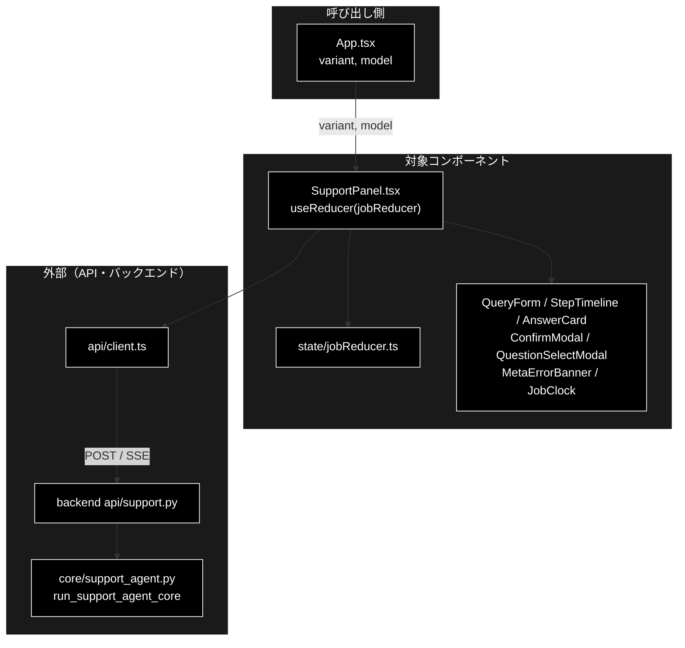
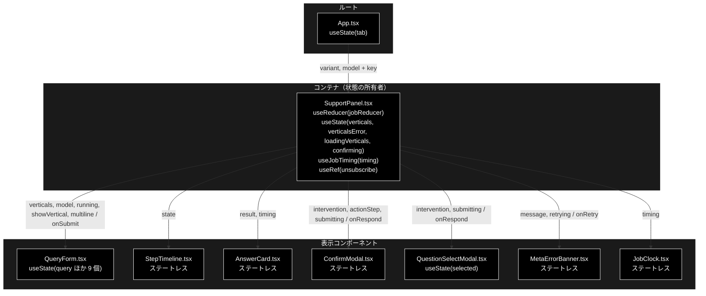
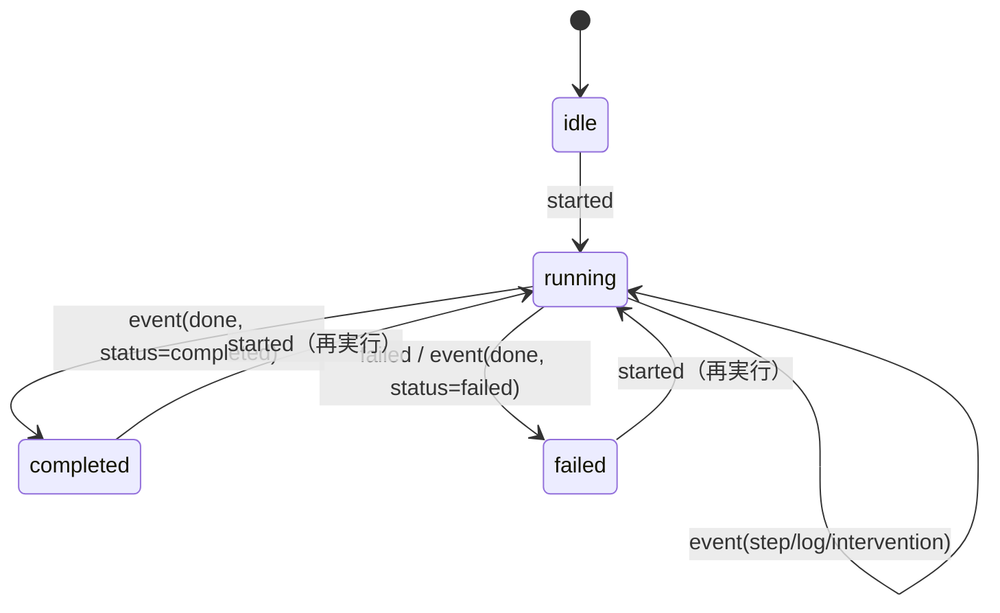
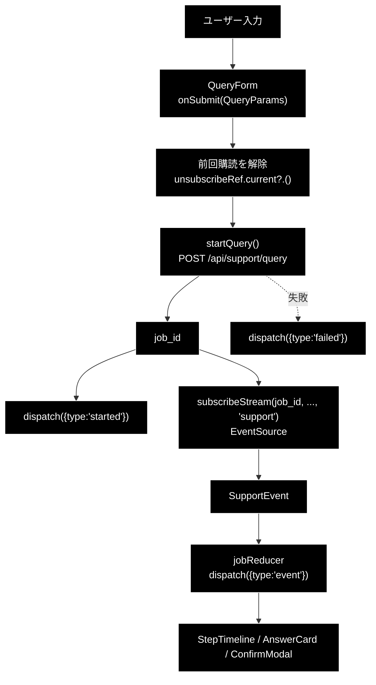
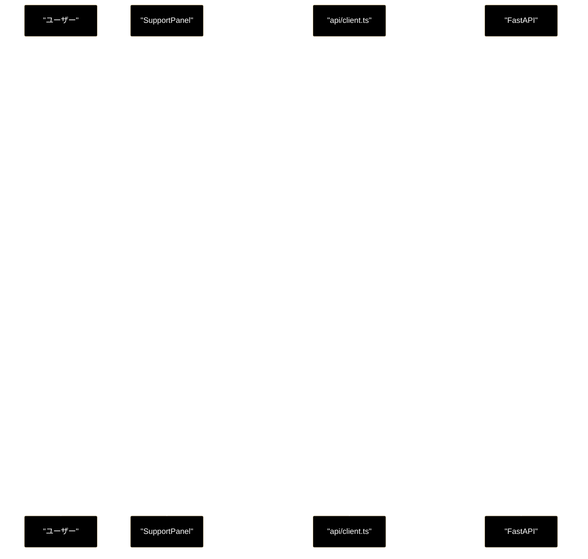
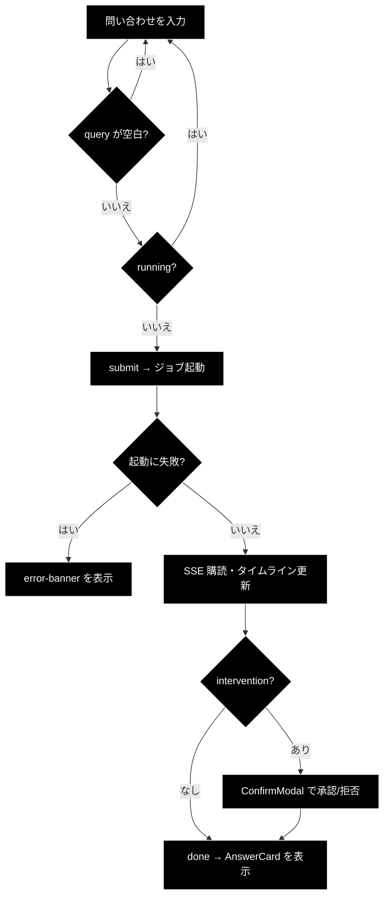

# SupportPanel.tsx - 問い合わせ → 回答 パネル ドキュメント

**Version 1.9** | 最終更新: 2026-10-13

---

## 目次

1. [概要](#概要)
2. [コンポーネントツリー図](#12-コンポーネントツリー図)
3. [Props インターフェース](#2-props-インターフェース)
4. [状態管理](#3-状態管理)
5. [データフロー・副作用](#4-データフロー副作用)
6. [API 通信・SSE イベント](#5-api-通信sse-イベント)
7. [ユーザー操作フロー](#6-ユーザー操作フロー)
8. [型定義とバックエンド対応](#7-型定義とバックエンド対応)
9. [スタイル・アクセシビリティ](#8-スタイルアクセシビリティ)
10. [テスト](#9-テスト)
11. [変更履歴](#10-変更履歴)

---

## 概要

| 項目 | 内容 |
|---|---|
| ファイル | `frontend/src/components/SupportPanel.tsx` |
| 種別 | **コンテナコンポーネント**（reducer・副作用・API 呼び出しを束ねる） |
| 親 | `App.tsx` |
| 子 | `QueryForm` / `StepTimeline` / `AnswerCard` / `ConfirmModal` / `QuestionSelectModal` / `MetaErrorBanner` / `JobClock`（`JobStartLine` / `JobFinishLine`） |
| 主な依存 | `../api/client` / `../state/jobReducer` / `../state/interventionKind` / `../state/metaFetch` / `../state/useJobTiming` |
| 対応バックエンド | `backend/app/core/support_agent.py`（`run_support_agent_core` / `STEP_IDS`） |

**基本版タブと GRACE-Support タブで共用**するパネル。両者はまったく同じパイプライン
（`run_support_agent_core`）を通り、違いは**業界特化（`VerticalProfile`）を使うかどうか**
だけなので、画面を 2 つに複製せず `variant` で振り分ける。

| `variant` | 業界特化 | 挙動 |
|---|---|---|
| `"basic"` | なし | `/api/verticals` を**取得しない**。`vertical` は常に `null` |
| `"vertical"`（既定） | あり | プロファイル一覧を取得し、セレクタを出す |

> ⚠️ **ここを 2 コンポーネントへ複製しないこと。** 同一パイプラインの画面が 2 つになると、
> ルート `README.md` §2.4 の操作対応表もテストも二重管理になる。

### 主な責務

- 入力フォームから受けたパラメータでジョブを起動する（`POST /api/support/query`）
- SSE を購読し、届いたイベントを reducer へ流す
- HITL CONFIRM の承認 / 拒否をバックエンドへ送る
- `variant` に応じて業界プロファイル一覧の取得可否とフォームの表示を切り替える
- 実行中バナー・エラーバナーを出す
- 業界プロファイル取得の**失敗理由**を `MetaErrorBanner` で伝え、再取得させる
- ジョブの開始・完了時刻を保持し、開始行 / 完了行として表示する

### 各責務対応のモジュール

| # | 責務 | 対応モジュール | 説明 |
|---|---|---|---|
| 1 | ジョブの起動 | `SupportPanel.tsx` / `api/client.ts` | `startQuery` → `POST /api/support/query` |
| 2 | SSE 購読と状態の畳み込み | `SupportPanel.tsx` / `state/jobReducer.ts` | `subscribeStream` の戻り値を `useEffect` のクリーンアップで返す |
| 3 | HITL の承認 / 拒否 | `SupportPanel.tsx` / `ConfirmModal.tsx` / `QuestionSelectModal.tsx` / `state/interventionKind.ts` | `confirmIntervention`。action / question の出し分けは `interventionKind()` |
| 4 | `variant` による切替 | `SupportPanel.tsx` / `QueryForm.tsx` | `basic` は `/api/verticals` を取得せず、セレクタも出さない |
| 5 | 実行中・エラーのバナー | `SupportPanel.tsx` | `phase` と `error` から表示 |
| 6 | 業界プロファイル取得の失敗通知 | `SupportPanel.tsx` / `state/metaFetch.ts` / `MetaErrorBanner.tsx` | `fetchVerticals` の失敗を `metaErrorMessage` で文言化 |
| 7 | 開始・完了時刻の表示 | `SupportPanel.tsx` / `state/useJobTiming.ts` / `JobClock.tsx` | `JobStartLine` / `JobFinishLine` |

### 主要機能一覧

| 機能 | 実装 | 説明 |
|---|---|---|
| ジョブ起動 | `submit(params)` | `startQuery()` → `dispatch('started')` → `subscribeStream()` |
| SSE 購読 | `subscribeStream(..., 'support')` | 解除関数を `unsubscribeRef` に保持 |
| 多重購読の防止 | `unsubscribeRef.current?.()` | **新しい送信の直前**に前回の購読を切る |
| HITL 応答 | `respond(approve)` | `confirmIntervention()` → `dispatch('confirm_sent')` |
| 二重送信の防止 | `running` prop | `state.phase === 'running'` を `QueryForm` へ渡す |
| リード文の切替 | `LEAD[variant]` | 基本版 / Support で説明文を変える |
| 承認待ちの種別判定 | `interventionKind(state.intervention)` | `'question'` → `QuestionSelectModal` / `'action'` → `ConfirmModal` |
| メタ取得失敗の可視化 | `metaErrorMessage()` + `MetaErrorBanner` | **握りつぶさない**。理由を出し `onRetry` で再取得 |
| 所要時間の表示 | `useJobTiming(state.phase)` | 開始は押下時、完了は phase の決着で自動記録 |
| 複数行入力 | `multiline={variant === 'basic'}` | 基本版のみ textarea |

---

## 1. アーキテクチャ構成図

### 1.1 システム全体での位置づけ



**データフロー**:

1. フォームの送信で `startQuery` を呼び、`job_id` を受け取る
2. `subscribeStream` で SSE を購読し、イベントを `jobReducer` へ流して各子コンポーネントへ配る
3. 承認待ちは種別に応じて `ConfirmModal` / `QuestionSelectModal` で処理し、`confirmIntervention` で返す

### 1.2 コンポーネントツリー図



---

## 2. Props インターフェース

```typescript
export type SupportVariant = 'basic' | 'vertical';

export function SupportPanel({
  variant = 'vertical',
  model = '',
}: {
  variant?: SupportVariant;
  /** ヘッダー（App）で選んだモデル。空文字 = サーバーの既定値。 */
  model?: string;
})
```

| Prop | 型 | 必須 | 既定値 | 説明 |
|---|---|:---:|---|---|
| `variant` | `SupportVariant` | | `'vertical'` | 業界特化の有無。`'basic'` で素のパイプライン |
| `model` | `string` | | `''` | ヘッダー（`App`）で選んだモデル。基本版と Support で**別々の値**が渡る。空文字はサーバーの既定値 |

### 子へ渡す props

| 子 | 渡す props |
|---|---|
| `QueryForm` | `verticals` / `model`（素通し）/ `running`（`phase === 'running'`）/ `showVertical` / `multiline`（基本版のみ `true`）/ `onSubmit` |
| `StepTimeline` | `state`（`JobState` 全体） |
| `AnswerCard` | `result`（`state.result` が非 null のときだけ描画）/ `timing` |
| `ConfirmModal` | `intervention` / `actionStep`（`state.steps.action`）/ `submitting` / `onRespond` |
| `QuestionSelectModal` | `intervention` / `submitting` / `onRespond`（**0-(A) の主質問選択**） |
| `MetaErrorBanner` | `message`（`verticalsError`）/ `retrying`（`loadingVerticals`）/ `onRetry` |
| `JobStartLine` / `JobFinishLine` | `timing` |

### コールバックの契約

| コールバック | 呼ばれる条件 | 本コンポーネントの責務 |
|---|---|---|
| `onSubmit`（← `QueryForm`） | フォーム submit かつ `query` が空白でなく `running === false` | 前回購読の解除 → ジョブ起動 → SSE 購読開始 |
| `onRespond`（← `ConfirmModal`） | 承認 / 拒否ボタンの `click` | `confirmIntervention()` を送り、モーダルを閉じる |
| `onRespond`（← `QuestionSelectModal`） | 主質問を選んで送信 | 第 2 引数 `selectedOption` に選択肢を載せて送る（既定 `null` で従来と互換） |
| `onRetry`（← `MetaErrorBanner`） | 「再取得」ボタンの `click` | `loadVerticals()` を再実行する |

---

## 3. 状態管理

### 3.1 ローカル state（`useState` / `useRef`）

| 変数 | 型 | 初期値 | 更新契機 | 説明 |
|---|---|---|---|---|
| `verticals` | `VerticalInfo[]` | `[]` | `loadVerticals()` | セレクタの選択肢。**基本版では取得しないので空のまま** |
| `verticalsError` | `string \| null` | `null` | `loadVerticals()` の成否 | 取得失敗の理由。非 null で `MetaErrorBanner` を出す |
| `loadingVerticals` | `boolean` | `false` | `loadVerticals()` の前後 | 再取得中。バナーのボタンを `disabled` にする |
| `confirming` | `boolean` | `false` | `respond()` の前後 | 承認送信中。モーダルのボタンを `disabled` にする |
| `timing` | `JobTiming` | `EMPTY_TIMING` | `beginTiming()` / `observeTiming()` | 開始・完了時刻。`useJobTiming(state.phase)` が返す（実体は `useState`） |
| `unsubscribeRef` | `useRef<(() => void) \| null>` | `null` | 購読開始時 | SSE 解除関数の保持（**再レンダリングで消えないよう ref**） |

> 📝 **`unsubscribeRef` が `useState` ではなく `useRef` である理由**: 解除関数は
> 描画に関係しない。`useState` にすると更新のたびに再レンダリングが走る。

### 3.2 reducer state（`useReducer(jobReducer, initialJobState)`）

`state/jobReducer.ts` が SSE イベント列を畳み込む。**純関数・副作用ゼロ**（vitest 7 件）。

| フィールド | 型 | 初期値 | 説明 |
|---|---|---|---|
| `jobId` | `string \| null` | `null` | 起動中ジョブの ID |
| `phase` | `'idle' \| 'running' \| 'completed' \| 'failed'` | `'idle'` | ジョブ全体の進行状態 |
| `steps` | `Record[StepId, StepState]` | 全 `pending` | 9 ステップの個別状態 |
| `intervention` | `InterventionInfo \| null` | `null` | HITL CONFIRM の承認待ち |
| `result` | `SupportResult \| null` | `null` | 最終結果 |
| `error` | `string \| null` | `null` | エラーメッセージ |
| `logs` | `string[]` | `[]` | ステップに紐づかないログ |

#### アクション一覧

| アクション | ペイロード | 効果 |
|---|---|---|
| `started` | `jobId` | 状態を初期化し `phase='running'`、`steps` を作り直す |
| `event` | `SupportEvent` | 種別に応じて `steps` / `intervention` / `result` / `error` / `phase` を更新 |
| `confirm_sent` | — | `intervention` をクリア（モーダルを閉じる） |
| `failed` | `message` | `phase='failed'`、`error` を設定 |
| `reset` | — | 初期状態へ戻す（**どこからも dispatch していない**。[`state/jobReducer.md`](state/jobReducer.md) §3.2） |

#### 状態遷移図



### 3.3 親から渡る状態（props 由来）

| 値 | 供給元 | 本コンポーネントでの扱い |
|---|---|---|
| `variant` | `App.tsx` の `useState(tab)` | 読み取りのみ。`showVertical` の導出に使う |
| `model` | `App.tsx` の `headerModels.basic` / `headerModels.support` | `QueryForm` へ素通しするだけ（空文字 = サーバーの既定値） |

### 3.4 派生値

| 値 | 導出 | 用途 |
|---|---|---|
| `showVertical` | `variant === 'vertical'` | プロファイル取得の可否・`QueryForm` への受け渡し |
| `running` | `state.phase === 'running'` | `QueryForm` の入力無効化 |
| 承認待ちの種別 | `interventionKind(state.intervention)` | `QuestionSelectModal` と `ConfirmModal` の出し分け |
| `multiline` | `variant === 'basic'` | 基本版だけ textarea（複数行入力） |

---

## 4. データフロー・副作用

### 4.1 副作用一覧（`useEffect`）

| # | 目的 | 依存配列 | クリーンアップ | 備考 |
|---|---|---|---|---|
| 1 | 業界プロファイル一覧の取得 | `[showVertical, loadVerticals]` | `() => unsubscribeRef.current?.()` | **基本版（`showVertical=false`）では取得せず、クリーンアップだけ返す** |

取得の本体は `useCallback` に切り出してある。`MetaErrorBanner` の「再取得」からも
同じ関数を呼ぶためで、`useEffect` の中に直書きすると再取得の経路が作れない。

```tsx
const loadVerticals = useCallback(() => {
  setLoadingVerticals(true);
  setVerticalsError(null);
  return fetchVerticals()
    .then((list) => {
      setVerticals(list);
      setVerticalsError(null);
    })
    .catch((error: unknown) => {
      // 空配列に倒すのは正しい（古い選択肢を残すより安全）。
      // 足りていなかったのは「なぜ空なのか」を伝えること。
      setVerticals([]);
      setVerticalsError(metaErrorMessage(error, '業界プロファイル'));
    })
    .finally(() => setLoadingVerticals(false));
}, []);

useEffect(() => {
  // 基本版は業界プロファイルを使わないので取得しない。
  if (!showVertical) return () => unsubscribeRef.current?.();
  void loadVerticals();
  return () => unsubscribeRef.current?.();
}, [showVertical, loadVerticals]);
```

> 📝 **モデルの選択肢・既定モデルはここでは取得しない**（2026-09-23 以降）。
> 選択はヘッダー（`App`）に移り、選んだ値を `model` prop で受け取って
> `QueryForm` へ素通しするだけである。

> ⚠️ **早期 return でもクリーンアップを返している。** `if (!showVertical) return;` と
> 書くとアンマウント時に `EventSource` が閉じず、購読が残る。**両方の分岐で同じ
> クリーンアップを返すこと。**

> ⚠️ **取得失敗を握りつぶさない（v1.3 で修正した不具合）。** 以前は
> `.catch(() => setVerticals([]))` だけで、バックエンド（:8000）が落ちていても画面には
> 「業界プロファイル: （なし）」としか出ず、**なぜ選べないのかが利用者に伝わらなかった**。
> 空配列に倒すこと自体は正しい（古い選択肢を残すより安全）が、**理由を必ず添える**。
> 文言の組み立ては `state/metaFetch.ts` の `metaErrorMessage()`（純関数・vitest 10 件）。

| # | 目的 | 依存配列 | 備考 |
|---|---|---|---|
| 2 | ジョブ決着の検知 | `useJobTiming` 内部（`[phase]`） | `phase` が `completed` / `failed` になった瞬間に完了時刻を確定する |

### 4.2 多重購読の防止（2 段構え）

| 段 | 場所 | 効果 |
|---|---|---|
| 1 | `submit()` 冒頭の `unsubscribeRef.current?.()` | **新しい送信の直前**に前回の購読を切る |
| 2 | `useEffect` のクリーンアップ | **アンマウント時**（タブ切替）に切る |

`App.tsx` が `key={tab}` を与えているため、基本版 ⇄ Support の切替では
このパネル自体が作り直され、reducer 状態も初期化される。

### 4.3 データフロー図



---

## 5. API 通信・SSE イベント

### 5.1 呼び出す API

| 関数 | メソッド | パス | 用途 | 呼ぶ条件 |
|---|---|---|---|---|
| `fetchVerticals` | GET | `/api/verticals` | 業界プロファイル一覧 | **`variant === 'vertical'` のときだけ**。失敗は `MetaErrorBanner` へ |
| `startQuery` | POST | `/api/support/query` | ジョブ起動（202） | フォーム送信時 |
| `subscribeStream` | GET(SSE) | `/api/support/stream/{job_id}` | ステップ進捗の購読 | 起動成功後 |
| `confirmIntervention` | POST | `/api/support/confirm/{job_id}` | HITL CONFIRM への承認/拒否 | モーダルのボタン押下 |

`subscribeStream` の第 4 引数 `kind` に **`'support'`** を渡す（Review は `'review'`）。
イベント形式は両者同一なので購読関数自体は共用である。

### 5.2 SSE イベント種別（`SupportEvent.type`）

| type | 意味 | 主なフィールド | reducer の扱い |
|---|---|---|---|
| `step` | ステップの開始・終了・スキップ | `step`, `status`, `title`, `data` | 該当 `StepState.status` と `data` を更新 |
| `log` | 進捗ログ 1 行 | `step`, `message` | ステップ付きなら `logs` へ、無ければ `state.logs` へ |
| `intervention` | HITL CONFIRM 要求 | `status`, `data: InterventionInfo` | `waiting` で設定（モーダル表示）、それ以外で `null` |
| `result` | 最終結果 | `data: SupportResult` | `result` を設定 |
| `error` | エラー | `message` | `error` を設定 |
| `done` | 配信終了 | `status` | `phase` を `completed` / `failed` に。`intervention` もクリア |

> ⚠️ **`done` を受けたら `api/client.ts` が `source.close()` する。** 閉じないと
> `EventSource` が自動再接続し、同じジョブのイベントを再送させてしまう。

### 5.2.1 接続の見張りと張り直し（`state/streamWatch.ts`）

切断（`onerror`）や 60 秒の無音では `subscribeStream` が張り直し、リプレイ分は `seq` で読み飛ばす（2026-10-08〜）。
本パネルの `jobReducer` には同じイベントが二度届かない。何も受け取れないまま 5 回失敗したときだけ `onError` が呼ばれ、
`dispatch({type:'failed'})` になる。詳細は [`api/client.md`](api/client.md) §3.2・[`state/streamWatch.md`](state/streamWatch.md)。

### 5.3 シーケンス図



---

## 6. ユーザー操作フロー

### 6.1 イベントハンドラ一覧

| 要素 | イベント | ハンドラ | 効果 | 無効化条件 |
|---|---|---|---|---|
| 送信（`QueryForm` 内） | `submit` | `submit(params)` | ジョブ起動 → SSE 購読 | `running` または `query` が空白のみ |
| 承認 / 拒否（`ConfirmModal` 内） | `click` | `respond(approve)` | `confirmIntervention()` | `confirming`（送信中） |

`respond()` は `state.jobId` か `state.intervention` が無ければ**何もせず return** する
（モーダルが閉じた後の遅延クリック対策）。

### 6.2 表示の出し分け

| 表示 | 条件 |
|---|---|
| `MetaErrorBanner` | `verticalsError` が非 null（業界プロファイル取得に失敗） |
| `div.error-banner` | `state.error` が非 null |
| `div.running-banner`「実行中…」 | `phase === 'running'` **かつ** `intervention` が無い |
| `JobStartLine` | 常時（`timing` に開始時刻が入ってから中身が出る） |
| `AnswerCard`（完了行を内包） | `state.result` が非 null |
| `JobFinishLine`（単独） | `state.result` が **null**（＝失敗時） |
| `QuestionSelectModal` | `intervention` が非 null **かつ** `interventionKind() === 'question'` |
| `ConfirmModal` | `intervention` が非 null **かつ** `interventionKind() === 'action'` |

> 📝 **承認待ちの間は「実行中…」を出さない。** モーダルが最前面に出ているため、
> 背後で実行中バナーが重なると「動いているのか待っているのか」が分からなくなる。

> 📝 **完了行の置き場所が 2 通りあるのは失敗時のため。** 通常は `AnswerCard` の末尾に出すが、
> **失敗するとカード自体が無い**ので、そのときだけパネル直下へ出す
> （決着したのに時刻が消える、を防ぐ）。

> ⚠️ **承認待ちの 2 種類を `ConfirmModal` の中で見分けない。** vitest は `.test.tsx` を
> 収集しないため、コンポーネント内の分岐はテストできない。判定は必ず
> `state/interventionKind.ts`（純関数・vitest 4 件）に置く。

### 6.3 操作フロー図



---

## 7. 型定義とバックエンド対応

| TS 型（`src/types.ts` ほか） | 対応する Python | 定義元 |
|---|---|---|
| `QueryParams` | `QueryRequest` | `backend/app/schemas.py` |
| `SupportEvent` | SSE ペイロード | `backend/app/core/jobs.py`（`Job.emit`） |
| `SupportResult` | `SupportResult` | `backend/app/core/support_agent.py` |
| `VerticalInfo` | `VerticalInfo` | `backend/app/schemas.py` |
| `InterventionInfo` | intervention イベントの `data` | `backend/app/core/intervention_bridge.py` |
| `StepId` / `STEP_IDS` | `STEP_IDS` | `backend/app/core/support_agent.py` |
| `SupportVariant` | — | 本ファイル（UI 内部のみ） |

> ⚠️ **バックエンドのスキーマを変えたら `src/types.ts` も必ず追随させる。**
> `frontend` は blocking な CI ゲート（`tsc --noEmit`）なので、型がズレると
> **PR がマージできなくなる**。

---

## 8. スタイル・アクセシビリティ

| 項目 | 内容 |
|---|---|
| スタイル方式 | プレーン CSS（`src/styles.css`） |
| 主要クラス | `.panel-lead`, `.error-banner`, `.running-banner` |
| ダークモード | 未対応 |

### アクセシビリティ・チェック

| 観点 | 状態 | 補足 |
|---|:--:|---|
| エラーが支援技術へ通知されるか | ✅ | `.error-banner` に `role="alert"` |
| 実行中であることが伝わるか | ✅ | `.running-banner` 自体は視覚のみだが、**`Timeline` が `sr-only` の `aria-live="polite"` で「実行中: <ステップ名>」を読み上げている**（`state/timelineAnnounce.ts`）。バナーにもライブ領域を足すと**二重読み上げ**になるため、付けない |
| 二重送信が防げるか | ✅ | `running` で送信ボタンを `disabled` |
| 承認の二重送信が防げるか | ✅ | `confirming` でモーダルのボタンを `disabled` |
| キーボードのみで送信・承認できるか | ✅ | すべて `<button>` / `<input>` 要素 |

---

## 9. テスト

本パネルが依存する純関数のテスト（**2026-10-12 に `npx vitest run` で実測した値**）。各モジュールの規則は `state/*.md` にある。

| テストファイル | 対象 | 件数 |
|---|---|---:|
| `src/state/jobReducer.test.ts` | reducer の畳み込み（[`state/jobReducer.md`](state/jobReducer.md)） | 7 |
| `src/state/queryParams.test.ts` | 送信ペイロードの組み立て（[`state/queryParams.md`](state/queryParams.md)） | 27 |
| `src/state/interventionKind.test.ts` | 承認待ちの種別判定（[`state/interventionKind.md`](state/interventionKind.md)） | 4 |
| `src/state/metaFetch.test.ts` | メタ取得失敗の文言（[`state/metaFetch.md`](state/metaFetch.md)） | 10 |
| `src/state/elapsed.test.ts` | 所要時間の整形（[`state/elapsed.md`](state/elapsed.md)） | 22 |
| `src/state/serverTiming.test.ts` | サーバ権威タイムスタンプの反映（同上） | 16 |
| `src/state/submitKey.test.ts` | 送信キー（IME 変換中は送信しない）（[`state/submitKey.md`](state/submitKey.md)） | 10 |
| `src/state/formMemory.test.ts` | タブ切替時の入力退避（[`state/formMemory.md`](state/formMemory.md)） | 13 |
| `src/api/client.test.ts` | SSE の張り直し（[`api/client.md`](api/client.md)） | 6 |

`tests/test_api.py` が呼び先の API（ジョブ起動・SSE・confirm）を押さえる
（`uv run pytest tests`）。

> 📌 **フロント全体は 26 ファイル / 368 件**（同上の実測）。件数は記憶で書かず、
> 変更時に `npx vitest run` を実行して数え直すこと。

### テスト方針

- **純ロジックを優先してテストする。** `@testing-library/react` は未導入のため、
  `SupportPanel` 自体のレンダリングテストは持たない。
- reducer（`jobReducer`）とペイロード組み立て（`queryParams`）を切り出して
  テストすることで、コンポーネントに残るのは**配線だけ**にしている。
- CI は `npm run lint`（tsc）→ `npm test`（vitest）→ `npm run build` の順で
  **いずれも blocking**。

> ⚠️ **購読解除の漏れはテストで捕まらない。** `useEffect` のクリーンアップや
> `submit()` 冒頭の `unsubscribeRef.current?.()` を消しても、型検査も vitest も通る。
> 変更時は実際に連続送信・タブ往復をして、イベントが二重に流れないことを確認すること。

---

## 10. 変更履歴

| バージョン | 日付 | 変更内容 |
|---|---|---|
| 1.0 | 2026-08-01 | 初版作成。基本版 / GRACE-Support で共用する `variant` 方式に基づく。早期 return でもクリーンアップを返す必要があること、多重購読を 2 段で防いでいること、承認待ち中は実行中バナーを出さないことを明記 |
| 1.2 | 2026-08-29 | 承認待ちモーダルを 2 種類に分岐（`state/interventionKind.ts` の純関数で判定）。0-(A) の主質問選択は `QuestionSelectModal`、従来のアクション承認は `ConfirmModal`。`respond` が `selectedOption` を受け取るようになった（既定 `null` で従来呼び出しと互換）。SSE イベントを `observeTiming` へ渡し、開始・完了時刻をサーバ時計から取れるようにした |
| 1.3 | 2026-09-20 | **業界プロファイル取得の silent failure を解消。** 以前は `.catch(() => setVerticals([]))` で握りつぶしており、バックエンド未起動時に「セレクタが空」としか見えなかった。取得を `loadVerticals`（`useCallback`）へ切り出し、失敗理由を `state/metaFetch.ts::metaErrorMessage`（vitest 10 件）で対処可能な文言へ変換し、`MetaErrorBanner` で理由と再取得ボタンを出す。空配列へ倒すこと自体は従来どおり（古い選択肢を残すより安全） |
| 1.4 | 2026-09-21 | `.error-banner` に `role="alert"` を付け、エラーが支援技術へ通知されるようにした。`.running-banner` に `role` を足さないのは従来どおり**意図的**（`StepTimeline` の `aria-live` と二重読み上げになるため）。あわせてヘッダーの版を 1.0 から実態（1.3 まで進んでいた）へ揃えた |
| 1.5 | 2026-09-23 | **モデル選択をヘッダー（`App`）へ移した**（grace_v2 と同じ変更）。`models` / `modelInfo` の state と取得の副作用を削除し、`model` prop を受け取って `QueryForm` へ渡すだけにした |
| 1.6 | 2026-09-24 | `a_react_page_md_format.md` v1.1 に追随（2026-09-24）。概要に「各責務対応のモジュール」（主な責務と 1:1）を追加し、`## 1.` を「アーキテクチャ構成図」として **1.1 システム全体での位置づけ（3 層）** と 1.2 コンポーネントツリー図の 2 枚構成にした。Mermaid の `classDef subgraphStyle` の欠落を補った。概要の「子」「主な依存」「主な責務」を実装に合わせた（`QuestionSelectModal` / `JobClock` / `state/interventionKind` / `state/useJobTiming` と、メタ取得失敗の通知・開始完了時刻の表示の 2 責務が抜けていた） |
| 1.7 | 2026-10-10 | テストの所在を `backend/tests/` からリポジトリ直下の `tests/` へ移したのに追随（パス・コマンド・import の表記） |
| 1.8 | 2026-10-12 | **本文を実装へ追随させた（v1.3〜1.6 の変更が本文に入っていなかった）。** §3.1 に `verticalsError` / `loadingVerticals` / `timing`、§4.1 に `loadVerticals`（`useCallback`）と依存配列 `[showVertical, loadVerticals]`（`.catch(() => setVerticals([]))` の修正前のコードを載せたままだった）、子へ渡す props・コールバックの契約に `QuestionSelectModal` / `MetaErrorBanner` / `JobClock` と `onRetry`、§6.2 に表示の出し分け 4 行を反映。§8 の「実行中であることが伝わるか ❌」を ✅ に訂正（`Timeline` の `aria-live` が読み上げており、v1.4 の判断と矛盾していた）。§5.2.1（SSE の張り直し）を追加。§9 のテスト件数を実測へ更新（`queryParams` 19 → 27 ほか。全体 26 ファイル / 368 件）し、新設した `state/*.md` へリンク |
| 1.9 | 2026-10-13 | 直下 README.md の組み直し（v4.0・タブ単位の構成）に合わせて、旧節番号への参照を新しい節へ付け替えた |
