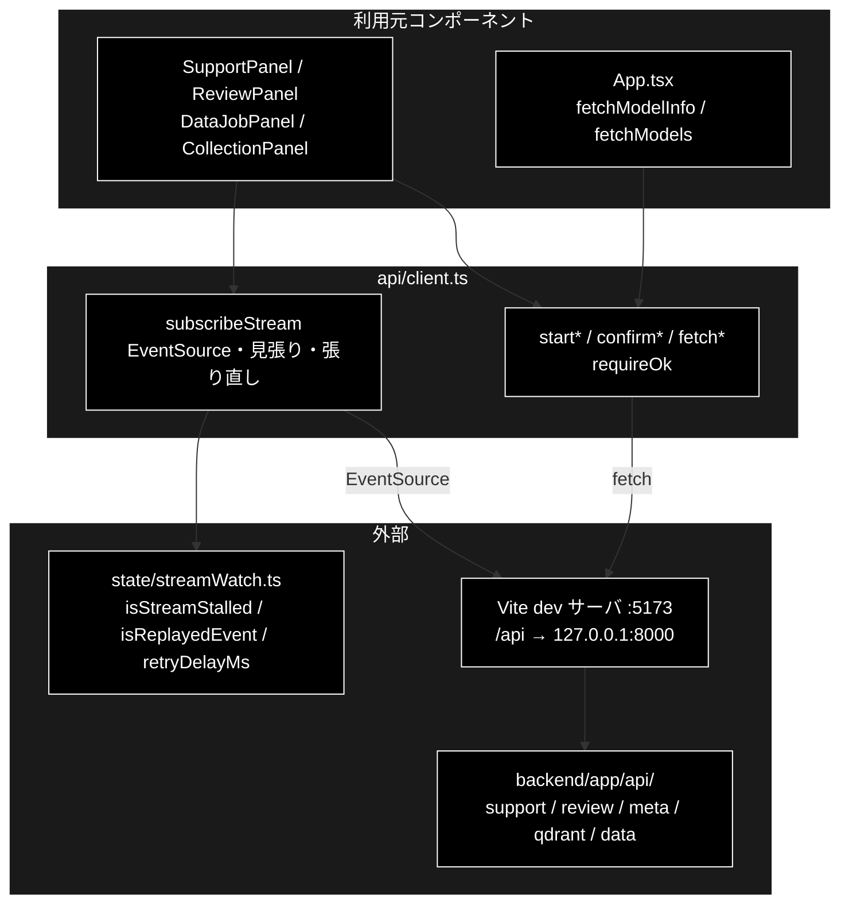

# client.ts - backend API クライアント ドキュメント

**Version 1.0** | 最終更新: 2026-10-12

---

## 目次

- [概要](#概要)
- [1. アーキテクチャ構成図](#1-アーキテクチャ構成図)
- [2. エクスポート一覧](#2-エクスポート一覧)
- [3. 判断の規則](#3-判断の規則)
- [4. テスト](#4-テスト)
- [5. 変更履歴](#5-変更履歴)

---

## 概要

| 項目 | 内容 |
|---|---|
| ファイル | `frontend/src/api/client.ts`（370 行） |
| 種別 | 純ロジック（API クライアント。`fetch` / `EventSource` を包む） |
| 利用元 | `App.tsx`（モデル情報）/ `components/SupportPanel.tsx` / `ReviewPanel.tsx` / `DataJobPanel.tsx` / `CollectionPanel.tsx` |
| 対応バックエンド | `backend/app/api/`（`support.py` / `review.py` / `meta.py` / `qdrant.py` / `data.py`）。Vite の dev サーバが `/api` を `http://127.0.0.1:8000` へ転送する |

frontend と backend の通信は**すべてここを通る**。表示コンポーネントは `fetch` を呼ばない（README §4）。
ジョブは 3 種（Support / Review / データ準備）とも「POST で起動 → SSE で進捗を購読 → 承認待ちなら POST で応答」の同じ流れで、
SSE の購読関数 `subscribeStream` は 1 本を共用する。

### 主な責務

- HTTP エラーを `API エラー (status): body` の `Error` に変える
- ジョブを起動し、承認待ちに応答する（3 種）
- メタ情報・Qdrant の状態・入力ファイルを取得する
- SSE で進捗を購読し、切断・無音のときに張り直す（リプレイ分は読み飛ばす）

### 各責務対応のモジュール

| # | 責務 | 対応モジュール | 説明 |
|---|---|---|---|
| 1 | エラーの変換 | `requireOk`（非公開） | `response.ok` でなければ本文（無ければ `statusText`）を入れて投げる。`state/metaFetch.ts` がこの形を読む |
| 2 | 起動と承認の応答 | `startQuery` / `confirmIntervention` / `startReview` / `confirmReviewIntervention` / `startChunking` / `startQaGeneration` / `startRegister` / `startDelete` / `confirmDataIntervention` | 起動は `{ job_id, stream_url }` を返す。削除は HTTP DELETE ではなく POST（承認を経ずに消える経路を作らない） |
| 3 | 取得 | `fetchModels` / `fetchModelInfo` / `fetchVerticals` / `fetchRuleSets` / `fetchQdrantHealth` / `fetchCollections` / `fetchCollectionDetail` / `fetchCollectionPoints` / `fetchInputFiles` / `fetchDataJobStatus` | パスの部品は `encodeURIComponent` する |
| 4 | 進捗の購読 | `subscribeStream` | 判断は `state/streamWatch.ts`。戻り値の解除関数をアンマウント・再送信で呼ぶ |

---

## 1. アーキテクチャ構成図

### 1.1 位置づけ



---

## 2. エクスポート一覧

すべて `async`（`subscribeStream` を除く）。HTTP エラーは `Error('API エラー (status): body')` を投げる。

| 分類 | 関数（シグネチャ） | メソッド・パス | 戻り値 |
|---|---|---|---|
| Support | `startQuery(params: QueryParams)` | `POST /api/support/query` | `{ job_id, stream_url }` |
| | `confirmIntervention(jobId, interventionId, approve, selectedOption: string \| null = null)` | `POST /api/support/confirm/{job_id}` | `{ status }`。本文は `{ intervention_id, approve, selected_option }` |
| Review | `startReview(params: ReviewParams)` | `POST /api/review/submit` | `{ job_id, stream_url }` |
| | `confirmReviewIntervention(jobId, interventionId, approve)` | `POST /api/review/confirm/{job_id}` | `{ status }` |
| メタ | `fetchModels()` | `GET /api/models` | `ModelChoice[]` |
| | `fetchModelInfo()` | `GET /api/model` | `ModelInfo` |
| | `fetchVerticals()` | `GET /api/verticals` | `VerticalInfo[]` |
| | `fetchRuleSets()` | `GET /api/rulesets` | `RuleSetInfo[]` |
| SSE | `subscribeStream(jobId, onEvent, onError, kind: 'support' \| 'review' \| 'data' = 'support')` | `GET /api/{kind}/stream/{job_id}` | 解除関数 `() => void` |
| Qdrant | `fetchQdrantHealth()` | `GET /api/qdrant/health` | `QdrantHealth`（**落ちていても 200**。`available` で判定する） |
| | `fetchCollections()` | `GET /api/qdrant/collections` | `CollectionInfo[]` |
| | `fetchCollectionDetail(name)` | `GET /api/qdrant/collections/{name}` | `CollectionDetail` |
| | `fetchCollectionPoints(name, limit = 50)` | `GET /api/qdrant/collections/{name}/points?limit=` | `CollectionPoints` |
| 入力ファイル | `fetchInputFiles(dir)` | `GET /api/files?dir=` | `InputFileListResponse` |
| データ準備 | `startChunking(params: ChunkingParams)` | `POST /api/chunking/run` | `{ job_id, stream_url }` |
| | `startQaGeneration(params: QaParams)` | `POST /api/qa/generate` | 同上 |
| | `startRegister(params: RegisterParams)` | `POST /api/qdrant/register` | 同上（`recreate: true` のときだけ承認待ちが起きる） |
| | `startDelete(collections: string[])` | `POST /api/qdrant/delete` | 同上（**必ず**承認待ちが起きる） |
| | `confirmDataIntervention(jobId, interventionId, approve)` | `POST /api/data/confirm/{job_id}` | `{ status }`（3 種共通） |
| | `fetchDataJobStatus(jobId)` | `GET /api/data/result/{job_id}` | `DataJobStatusResponse` |

```ts
export function subscribeStream(
  jobId: string,
  onEvent: (event: SupportEvent) => void,
  onError: (message: string) => void,
  kind: 'support' | 'review' | 'data' = 'support',
): () => void
```

> 📌 `fetchDataJobStatus` は**再購読の前に「ジョブがまだ在るか」を確かめる**ために使う。`JobManager` は完了ジョブを 50 件までしか
> 持たない（`MAX_FINISHED_JOBS`）ので、古い `job_id` は 404 になる。SSE で直接つなぐと 404 が `onerror` として届き、
> 「切断されました」という誤ったエラーになる（`DataJobPanel` / `CollectionPanel` の再マウント時。`state/activeJobs.ts`）。

---

## 3. 判断の規則

### 3.1 使用例

呼び方は 2 通りある。node 環境には `EventSource` が無く、`fetch` も相対 URL（`/api/...`）を受け付けないので、
例では最小の偽物を差し込む（`src/api/client.test.ts` と同じ方法）。

| # | パターン | いつ使うか | 例 |
|---|---|---|---|
| 1 | 起動・応答・取得（`fetch`） | ボタンを押したとき・画面を開いたとき | 例 1 |
| 2 | 進捗の購読（`subscribeStream`） | 起動の直後・再マウント時 | 例 2 |

**例 1: ジョブを起動し、HTTP エラーを受ける**

```ts
import { fetchCollectionPoints, startQuery } from '../../src/api/client';

// 送られたリクエストを表示し、パスに応じて応答する偽の fetch
globalThis.fetch = (async (url: string, init?: RequestInit) => {
  console.log(init?.method ?? 'GET', url, init?.body ?? '');
  if (url === '/api/support/query') return new Response(JSON.stringify({ job_id: 'job-1', stream_url: '/api/support/stream/job-1' }), { status: 202 });
  return new Response('Collection not found', { status: 404 });
}) as typeof fetch;

const { job_id } = await startQuery({
  query: 'パスワードを忘れました', vertical: 'saas', model: null,
  dry_run: false, use_web: true, do_action: true, verbose: true, identity: null,
});
console.log(job_id);
try {
  await fetchCollectionPoints('faq ja', 10);
} catch (error) {
  console.log((error as Error).message);
}
```

```text
POST /api/support/query {"query":"パスワードを忘れました","vertical":"saas","model":null,"dry_run":false,"use_web":true,"do_action":true,"verbose":true,"identity":null}
job-1
GET /api/qdrant/collections/faq%20ja/points?limit=10 
API エラー (404): Collection not found
```

**例 2: 進捗を購読し、切断から張り直す**

1 本目の接続で `seq` 0・1 を受けたあと切断され、1 秒後に張り直すとバックエンドが先頭からリプレイする。渡し済みの 0・1 は読み飛ばされる。

```ts
import { subscribeStream } from '../../src/api/client';

class FakeEventSource {
  static all: FakeEventSource[] = [];
  onmessage: ((m: { data: string }) => void) | null = null;
  onerror: (() => void) | null = null;
  constructor(readonly url: string) { FakeEventSource.all.push(this); console.log('接続', url); }
  addEventListener() {}
  close() {}
  emit(e: object) { this.onmessage?.({ data: JSON.stringify(e) }); }
}
(globalThis as { EventSource?: unknown }).EventSource = FakeEventSource;

const stop = subscribeStream('job-1', (e) => console.log('onEvent', e.type, e.seq ?? ''), (m) => console.log('onError', m), 'support');
const first = FakeEventSource.all[0];
first.emit({ seq: 0, type: 'step', step: 'plan', status: 'started' });
first.emit({ seq: 1, type: 'log', step: 'plan', message: '…' });
first.onerror?.();                                   // 切断 → 1 秒後に張り直す

await new Promise((r) => setTimeout(r, 1100));
const second = FakeEventSource.all[1];
for (const seq of [0, 1, 2]) second.emit({ seq, type: 'step', step: 'plan', status: seq === 2 ? 'completed' : 'started' });
second.emit({ type: 'done', status: 'completed' });  // done で購読を閉じる（stop を呼んだのと同じ）
stop();                                              // 2 回呼んでも害は無い
```

```text
接続 /api/support/stream/job-1
onEvent step 0
onEvent log 1
接続 /api/support/stream/job-1
onEvent step 2
onEvent done
```

> 📝 **確かめ方（2026-10-12）**: 2 つの例を esbuild で束ねて node で実行し、出力が一致することを確かめた（偽の `fetch` / `EventSource`）。
> 実際の backend との通信は README §12 の手順（`./run_dev.sh`）で画面から確かめる。

### 3.2 規則

`requireOk(response)`:

| 応答 | 結果 |
|---|---|
| `response.ok` | そのまま返す |
| それ以外 | `Error('API エラー ({status}): {本文}')`。本文が空（または読めない）なら `statusText` |

`subscribeStream`（判断の詳細は [`state/streamWatch.md`](../state/streamWatch.md) §3.2）:

| 出来事 | 動作 |
|---|---|
| 呼んだ直後 | `new EventSource('/api/{kind}/stream/{jobId}')`。10 秒ごとの見張りを始める |
| `message` | JSON にして、`seq` が渡し済み以下なら捨てる。渡したら `onEvent`。`done` なら購読を止める。JSON でなければ捨てる |
| `keepalive`（名前付きイベント） | 生きている証拠としてだけ使う（`onEvent` には渡さない） |
| `onerror` | 張り直す（1・2・4・8・10 秒待ち）。閉じた後・古い接続からの通知は無視 |
| 60 秒何も届かない | 張り直す |
| 何も受け取れないまま 5 回失敗 | 購読を止め、`onError` を **1 回だけ**呼ぶ |
| 解除関数を呼ぶ | 接続を閉じ、タイマーを止める。以後は張り直さない |

> ⚠️ **解除関数は必ず呼ぶ。** 各コンテナは解除関数を ref に持ち、再送信の直前とアンマウント時（`useEffect` のクリーンアップ）に呼ぶ。
> 呼ばないと離れたタブの接続とタイマーが残る（SSE の購読解除漏れはこのプロジェクトで最も起きやすいバグ）。

---

## 4. テスト

| テストファイル | 対象 | 件数 | 実行 |
|---|---|---:|---|
| `src/api/client.test.ts` | `subscribeStream` の張り直し（無音の検知とリプレイの読み飛ばし・keepalive・`onerror`・あきらめ・`done`・解除） | 6 | `npm test` |

起動・取得の関数（`fetch` を包むだけ）にはテストが無い。型は `npm run lint`（`tsc --noEmit`）で検査している。

件数は 2026-10-12 に `npx vitest run` で実測した。

---

## 5. 変更履歴

| バージョン | 日付 | 変更内容 |
|---|---|---|
| 1.0 | 2026-10-12 | 新規作成（`a_react_page_md_format.md` §2.4 の軽量構成）。以前は README §6 と各パネル文書が実質の記述で、個別文書を持っていなかった。使用例 2 本は偽の `fetch` / `EventSource` を差し込んで esbuild + node で実行して確かめた |
