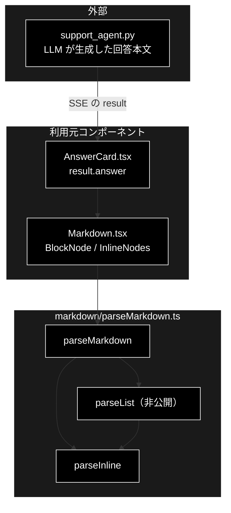

# parseMarkdown.ts - 回答本文の Markdown パーサ ドキュメント

**Version 1.0** | 最終更新: 2026-10-12

---

## 目次

- [概要](#概要)
- [1. アーキテクチャ構成図](#1-アーキテクチャ構成図)
- [2. エクスポート一覧](#2-エクスポート一覧)
- [3. 判断の規則](#3-判断の規則)
- [4. テスト](#4-テスト)
- [5. 変更履歴](#5-変更履歴)

---

## 概要

| 項目 | 内容 |
|---|---|
| ファイル | `frontend/src/markdown/parseMarkdown.ts`（250 行） |
| 種別 | 純ロジック（パーサ。依存ライブラリなし） |
| 利用元 | `components/Markdown.tsx`（`AnswerCard` の回答本文を描画する） |
| 対応バックエンド | なし（LLM が生成した回答本文 `SupportResult.answer` を受ける） |

GRACE-Support の回答本文に出る Markdown のサブセットを、React で描画できるブロック AST に変換する。
描画（React 要素の生成）は `Markdown.tsx` が受け持ち、本モジュールは副作用の無い解析だけを行う。HTML を組み立てないので
`dangerouslySetInnerHTML` を使わずに済む。描画側の説明は [`../Markdown.md`](../Markdown.md)。

### 主な責務

- インライン記法（太字・インラインコード・リンク）をトークン列に分解する
- ブロック（見出し・水平線・リスト・引用・GFM テーブル・段落）に分ける
- 入れ子リストと継続行を、階層を潰さずに解析する

### 各責務対応のモジュール

| # | 責務 | 対応モジュール | 説明 |
|---|---|---|---|
| 1 | インライン | `parseInline` / `Inline` | 太字 → コード → リンクの順で最初に一致した記法を切り出す。入れ子（太字の中のリンク等）は扱わない |
| 2 | ブロック | `parseMarkdown` / `Block` | 上から順に「空行・水平線・見出し・テーブル・リスト・引用・段落」で判定する |
| 3 | 入れ子リスト | `parseList`（非公開）/ `ListBlock` / `ListItem` | 字下げ幅で親子を決める。マーカーの無い字下げ行は直前の項目へ連結する |

> 📌 **対応しない記法**: コードブロック（` ``` `）・斜体（`*x*`）・取り消し線・画像・HTML タグ。これらは段落のテキストとしてそのまま出る。

---

## 1. アーキテクチャ構成図

### 1.1 位置づけ



---

## 2. エクスポート一覧

```ts
export type Inline =
  | { type: 'text'; value: string }
  | { type: 'bold'; value: string }
  | { type: 'code'; value: string }
  | { type: 'link'; value: string; href: string };

export interface ListItem {
  inline: Inline[];
  children?: ListBlock;   // 字下げされた入れ子リスト
}

export interface ListBlock {
  type: 'list';
  ordered: boolean;
  items: ListItem[];
}

export type Block =
  | { type: 'heading'; level: number; inline: Inline[] }
  | { type: 'paragraph'; lines: Inline[][] }
  | { type: 'hr' }
  | ListBlock
  | { type: 'blockquote'; lines: Inline[][] }
  | { type: 'table'; header: Inline[][]; rows: Inline[][][] };

export function parseInline(text: string): Inline[]
export function parseMarkdown(source: string): Block[]
```

---

## 3. 判断の規則

### 3.1 使用例

`Markdown.tsx` と同じ使い方。実測で問題になった入れ子リストと継続行（§3.2 の注記）を含む回答本文を解析する。

```ts
import { parseInline, parseMarkdown } from '../../src/markdown/parseMarkdown';

console.log(JSON.stringify(parseInline('**住民票**は`窓口`か[オンライン](https://example.jp)で')));

const answer = [
  '## 住民票の取得方法',
  '- **窓口での取得**',
  '  市役所本庁舎・各区役所の窓口でお手続きいただけます。',
  '  - 本人確認書類が必要です',
  '- **郵送での取得**',
  '',
  '| 方法 | 手数料 |',
  '|---|---|',
  '| 窓口 | 300 円 |',
  '```',
  'code',
].join('\n');
for (const b of parseMarkdown(answer)) {
  if (b.type === 'list') {
    for (const it of b.items) {
      console.log('list', it.inline.map((t) => t.value).join(''), '/ 子:', it.children?.items.map((c) => c.inline.map((t) => t.value).join('')) ?? []);
    }
  } else if (b.type === 'table') {
    console.log('table', b.header.length, '列', b.rows.length, '行');
  } else {
    console.log(b.type, JSON.stringify(b.type === 'heading' ? b.inline : b.type === 'paragraph' ? b.lines : ''));
  }
}
```

```text
[{"type":"bold","value":"住民票"},{"type":"text","value":"は"},{"type":"code","value":"窓口"},{"type":"text","value":"か"},{"type":"link","value":"オンライン","href":"https://example.jp"},{"type":"text","value":"で"}]
heading [{"type":"text","value":"住民票の取得方法"}]
list 窓口での取得 市役所本庁舎・各区役所の窓口でお手続きいただけます。 / 子: [ '本人確認書類が必要です' ]
list 郵送での取得 / 子: []
table 2 列 1 行
paragraph [[{"type":"text","value":"```"}],[{"type":"text","value":"code"}]]
```

> 📝 **確かめ方（2026-10-12）**: 上の例を esbuild で束ねて node で実行し、出力が一致することを確かめた。
> 最後の段落は、コードブロック（` ``` `）に対応していないことを示している。

### 3.2 規則

`parseMarkdown(source)` のブロック判定（行ごとに上から順に試す）:

| 順 | 行の形 | ブロック |
|---|---|---|
| 1 | 空行 | 段落の区切り |
| 2 | `---` / `***` / `___`（3 個以上・間の空白可） | `hr` |
| 3 | `#` 〜 `######` ＋空白 | `heading`（`level` = `#` の数） |
| 4 | `\| … \|` の次の行が区切り行（`\|---\|---\|`） | `table`（以降の `\| … \|` 行が `rows`） |
| 5 | `-` / `*` ＋空白、`1.` ＋空白 | `list`（§下表） |
| 6 | `>` | `blockquote`（連続する `>` 行をまとめる） |
| 7 | それ以外 | `paragraph`（連続行は同じ段落の別の行。描画で `<br>`） |

- 改行は `\r\n` / `\r` を `\n` にそろえる。`source` が `null` / `undefined` でも落ちない（`''` 扱い）。空文字は `[]`。

リスト（`parseList`）:

| 行 | 結果 |
|---|---|
| 同じ字下げの項目 | 兄弟の項目 |
| より深い字下げの項目 | 直前の項目の `children`（入れ子） |
| 浅い字下げの項目 | このレベルのリストを終え、親へ戻る |
| 番号付きと箇条書きが切り替わる（同じ字下げ） | 別のリストブロック |
| マーカーの無い行で、このリストより深く字下げされている | **直前の項目の本文へ空白 1 つで連結**（継続行） |
| マーカーの無い字下げの無い行・空行・水平線 | リストを終える |

> ⚠️ **字下げと継続行を捨てない**（実測の不具合から）:
> - 以前は先頭空白ごと読み飛ばし、項目の型も平坦だったため、**入れ子リストが兄弟項目へ潰れて**いた（2026-08-30・本リポジトリ）。
> - 継続行（`- **窓口での取得**` の次の字下げ行）がリストを打ち切って段落になり、**箇条書き → 段落 → 箇条書き**とブツ切りに描画されていた（姉妹リポジトリ grace_v2）。

`parseInline(text)`:

| 入力 | 結果 |
|---|---|
| `**x**` | `{ type: 'bold', value: 'x' }` |
| `` `x` `` | `{ type: 'code', value: 'x' }` |
| `[t](u)` | `{ type: 'link', value: 't', href: 'u' }` |
| 記法の間の文字 | `{ type: 'text' }` |
| 記法が無い | 1 つの `text` |
| 空文字 | `[{ type: 'text', value: '' }]`（空配列にしない） |

> ⚠️ **リンクの `href` は検査しない**（`javascript:` もそのまま入る）。描画側の `Markdown.tsx` も `<a href={node.href}>` にそのまま渡すので、
> LLM の回答本文に `[x](javascript:…)` が出るとクリックで実行されうる（2026-10-12 にコードで確認。React 18 は警告を出すだけで止めない）。
> `Markdown.md` §4.4 は前提つきで許容としている。README §13 の残課題にも載せた。

---

## 4. テスト

| テストファイル | 対象 | 件数 | 実行 |
|---|---|---:|---|
| `src/markdown/parseMarkdown.test.ts` | `parseInline` 2 件・`parseMarkdown` 14 件（入れ子・継続行・水平線でリストを終える・記法の切り替え・テーブル・引用・段落・空文字） | 16 | `npm test` |

件数は 2026-10-12 に `npx vitest run` で実測した。

---

## 5. 変更履歴

| バージョン | 日付 | 変更内容 |
|---|---|---|
| 1.0 | 2026-10-12 | 新規作成（`a_react_page_md_format.md` §2.4 の軽量構成）。以前は `Markdown.md` が解析も担当していた（描画側の説明はそちらに残す）。使用例は esbuild + node で実行して確かめた |
