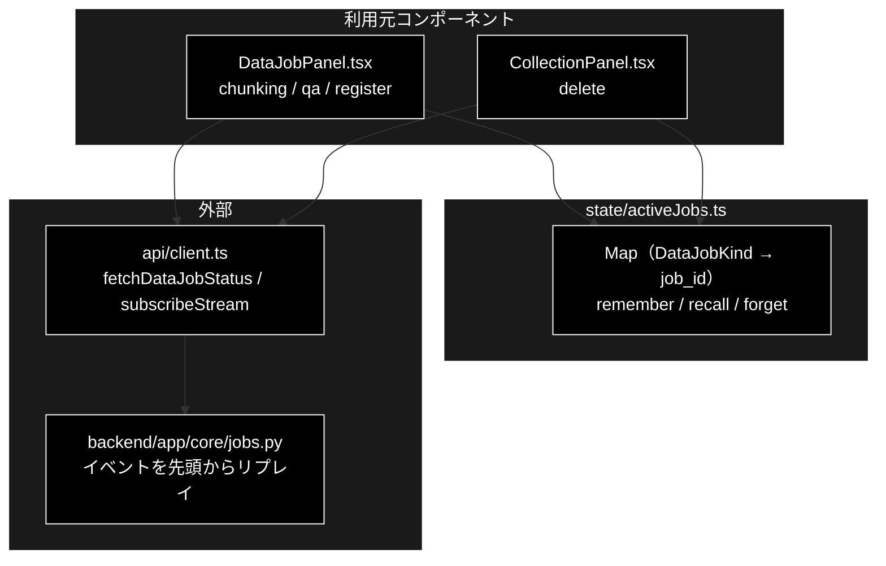

# activeJobs.ts - 実行中データジョブの job_id ストア ドキュメント

**Version 1.0** | 最終更新: 2026-10-12

---

## 目次

- [概要](#概要)
- [1. アーキテクチャ構成図](#1-アーキテクチャ構成図)
- [2. エクスポート一覧](#2-エクスポート一覧)
- [3. 判断の規則](#3-判断の規則)
- [4. テスト](#4-テスト)
- [5. 変更履歴](#5-変更履歴)

---

## 概要

| 項目 | 内容 |
|---|---|
| ファイル | `frontend/src/state/activeJobs.ts`（45 行） |
| 種別 | 純ロジック（モジュールスコープのストア） |
| 利用元 | `components/DataJobPanel.tsx` / `components/CollectionPanel.tsx` |
| 対応バックエンド | `backend/app/core/jobs.py`（`Job.stream_events()` が先頭からリプレイする） |

タブ（とデータ管理のサブタブ）は**アンマウントで切り替える**ので、離れるとパネルの reducer 状態と SSE 購読が消える。
ジョブはバックエンドで走り続けるが、`job_id` を失うと戻っても進捗を追えない。本モジュールが `job_id` をコンポーネントより長く覚えておき、
再マウント時に購読し直せるようにする（バックエンドはイベントを先頭からリプレイするので、タイムラインごと復元される）。

### 主な責務

- 起動したデータジョブの `job_id` を種別ごとに覚える
- 再マウント時に種別から `job_id` を引く
- ジョブが消えていた（サーバ再起動・GC）ときに捨てる

### 各責務対応のモジュール

| # | 責務 | 対応モジュール | 説明 |
|---|---|---|---|
| 1 | `job_id` を覚える | `rememberJob` | 起動の直後に呼ぶ。同じ種別は上書き |
| 2 | `job_id` を引く | `recallJob` | マウント時の `useEffect` で呼び、あれば再購読する |
| 3 | 捨てる | `forgetJob` | `GET /api/data/result/{job_id}` が失敗した（ジョブが無い）とき・削除をやり直すとき |

> 📌 **ブラウザストレージは使わない**（メモリ上のみ）。ページを再読み込みすれば消える。復元先のジョブがサーバ再起動で
> 消えている可能性があり、`sessionStorage` に残すとかえって不整合を招くため（ソース冒頭のコメント）。

---

## 1. アーキテクチャ構成図

### 1.1 位置づけ



---

## 2. エクスポート一覧

```ts
export function rememberJob(kind: DataJobKind, jobId: string): void
export function recallJob(kind: DataJobKind): string | undefined
export function forgetJob(kind: DataJobKind): void
export function clearAllJobs(): void   // テスト用
```

| 名前 | 種別 | 説明 |
|---|---|---|
| `rememberJob` | 関数 | 種別 → `job_id` を記録する（上書き） |
| `recallJob` | 関数 | 記録が無ければ `undefined` |
| `forgetJob` | 関数 | 記録を消す。無い種別でも例外にしない |
| `clearAllJobs` | 関数 | 全消去（テストの `beforeEach` 用） |

`DataJobKind` は `types.ts` の `'chunking' | 'qa' | 'register' | 'delete'`。

---

## 3. 判断の規則

### 3.1 使用例

`DataJobPanel` / `CollectionPanel` と同じ順（起動 → タブを離れる → 戻って引く → 消えていたら捨てる）で呼ぶ。

```ts
import { forgetJob, recallJob, rememberJob } from '../../src/state/activeJobs';

rememberJob('chunking', 'job-1');        // 起動直後（startChunking の戻り値）
rememberJob('register', 'job-2');        // 種別ごとに独立
console.log(recallJob('chunking'));      // 再マウント時 → 再購読に使う
console.log(recallJob('qa'));            // 起動していない種別
rememberJob('chunking', 'job-3');        // 同じ種別を再実行 → 上書き
console.log(recallJob('chunking'));
forgetJob('chunking');                   // GET /api/data/result が失敗した（GC 済み）
console.log(recallJob('chunking'), recallJob('register'));
```

```text
job-1
undefined
job-3
undefined job-2
```

> 📝 **確かめ方（2026-10-12）**: 上の例を esbuild で束ねて node で実行し、出力が一致することを確かめた。

### 3.2 規則

| 入力（呼び出し） | 結果 |
|---|---|
| `rememberJob(k, id)` のあと `recallJob(k)` | `id` |
| 一度も覚えていない種別を `recallJob` | `undefined` |
| 種別 A を覚えても種別 B は変わらない | 種別ごとに独立（チャンク化と登録を同時に走らせられる） |
| 同じ種別をもう一度 `rememberJob` | 新しい `job_id` で上書き |
| `forgetJob(k)` のあと `recallJob(k)` | `undefined` |
| 覚えていない種別を `forgetJob` | 何もしない（例外にしない） |
| `forgetJob(A)` | B の記録は残る |
| 呼び出しをまたぐ | モジュールスコープなので残る（コンポーネントの寿命と無関係） |

---

## 4. テスト

| テストファイル | 対象 | 件数 | 実行 |
|---|---|---:|---|
| `src/state/activeJobs.test.ts` | §3.2 の 8 行 | 8 | `npm test` |

件数は 2026-10-12 に `npx vitest run` で実測した。

---

## 5. 変更履歴

| バージョン | 日付 | 変更内容 |
|---|---|---|
| 1.0 | 2026-10-12 | 新規作成（`a_react_page_md_format.md` §2.4 の軽量構成）。使用例は esbuild + node で実行して確かめた |
