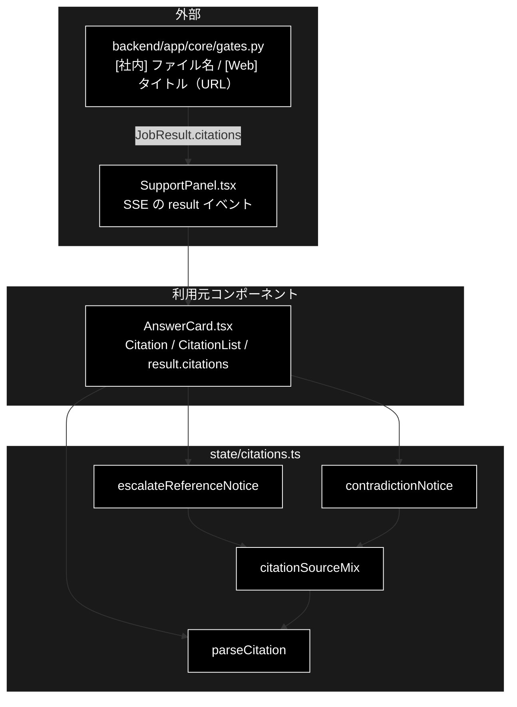

# citations.ts - 出典の解析と表示文言 ドキュメント

**Version 1.0** | 最終更新: 2026-10-12

---

## 目次

- [概要](#概要)
- [1. アーキテクチャ構成図](#1-アーキテクチャ構成図)
- [2. エクスポート一覧](#2-エクスポート一覧)
- [3. 判断の規則](#3-判断の規則)
- [4. テスト](#4-テスト)
- [5. 変更履歴](#5-変更履歴)

---

## 概要

| 項目 | 内容 |
|---|---|
| ファイル | `frontend/src/state/citations.ts`（105 行） |
| 種別 | 純ロジック（表示用の派生値） |
| 利用元 | `components/AnswerCard.tsx`（出典リスト・矛盾の注意書き・エスカレ時の前置き） |
| 対応バックエンド | `backend/app/core/gates.py`（出典を `[社内] …` / `[Web] タイトル（URL）` の接頭辞つき文字列で返す） |

GRACE-Support の回答カードに出す出典を解析し、出典の内訳によって変わる固定文言を決める。
表示文言が「社内」を名乗ってよいかはこの内訳で決まるので、判定規則をコンポーネント側に散らさない。

> ⚠️ **姉妹リポジトリ grace_v2 の同名ファイルとは中身が違う。** こちらは Web 出典の末尾の `（URL）` を取り出してリンクにする
> `parseCitation` を持つ（grace_v2 は接頭辞を落とすだけの `isWebCitation` / `citationBody`）。コピーで行き来させない（CLAUDE.md §5）。

### 主な責務

- 出典 1 件を解析し、種別（社内 / Web）・表示ラベル・リンク先 URL を取り出す
- 出典リスト全体の内訳（社内 / Web / 混在 / なし）を判定する
- エスカレ時の前置きを、内訳に合わせて決める（Web だけなのに「社内ナレッジ」と名乗らない）
- 矛盾検知時の注意書きを、内訳に合わせて決める

### 各責務対応のモジュール

| # | 責務 | 対応モジュール | 説明 |
|---|---|---|---|
| 1 | 1 件の解析 | `parseCitation` / `ParsedCitation` | URL は**末尾の括弧（全角・半角）だけ**から取る。取れなければ `url = null` でラベルだけ |
| 2 | 内訳 | `citationSourceMix` / `CitationSourceMix` | `[Web]` 以外はすべて社内として数える |
| 3 | エスカレ時の前置き | `escalateReferenceNotice` | 4 分岐。どれにも「方針により有人対応へ引き継ぎます。」が付く |
| 4 | 矛盾の注意書き | `contradictionNotice` | 混在のときだけ「社内ナレッジと Web 情報」と書く |

> 📌 **きっかけ（実測）**: 「明日の東京の天気は？」で社内 RAG が 0 件（採用閾値 0.64 未達）・出典 9 件がすべて Web だったのに、
> エスカレ時の固定文言が「以下は**社内ナレッジ**に基づく参考情報です」と出た。
> Web の情報を社内ナレッジと偽らない方針（`grace/tools.py` の出典ルール 3）を、LLM の生成文だけでなくアプリの固定文言にも適用する。

---

## 1. アーキテクチャ構成図

### 1.1 位置づけ



---

## 2. エクスポート一覧

```ts
export interface ParsedCitation {
  kind: 'web' | 'internal';   // Web 検索由来か、社内ナレッジ由来か
  label: string;              // 表示用のラベル（タイトル or ファイル名）。URL は含まない
  url: string | null;         // リンク先。取り出せなければ null（ラベルだけ出す）
}
export function parseCitation(text: string): ParsedCitation

export type CitationSourceMix = 'internal' | 'web' | 'mixed' | 'none';
export function citationSourceMix(citations: string[]): CitationSourceMix

export function escalateReferenceNotice(citations: string[]): string
export function contradictionNotice(citations: string[]): string
```

`AnswerCard` の `Citation` は `url` があれば `<a href={url} target="_blank" rel="noreferrer noopener">` にし、無ければラベルだけを出す。

---

## 3. 判断の規則

### 3.1 使用例

`AnswerCard` と同じ使い方。出典の文字列はバックエンドが返す形。

```ts
import {
  citationSourceMix, contradictionNotice, escalateReferenceNotice, parseCitation,
} from '../../src/state/citations';

const web = ['[Web] 東京の天気（https://weathernews.jp/onebox/tenki/tokyo/）', '[Web] 東京の天気'];
const mixed = ['[社内] qa_pairs_combined_chunks.csv', ...web];

for (const c of [...web, mixed[0], '[Web] https://example.com の解説（https://example.org/a?b=1）']) {
  console.log(JSON.stringify(parseCitation(c)));
}
console.log(citationSourceMix(web), citationSourceMix(mixed), citationSourceMix([]));
console.log(escalateReferenceNotice(web));   // Web だけ → 社内を名乗らない
console.log(contradictionNotice(mixed));
```

```text
{"kind":"web","label":"東京の天気","url":"https://weathernews.jp/onebox/tenki/tokyo/"}
{"kind":"web","label":"東京の天気","url":null}
{"kind":"internal","label":"qa_pairs_combined_chunks.csv","url":null}
{"kind":"web","label":"https://example.com の解説","url":"https://example.org/a?b=1"}
web mixed none
以下は Web 検索結果に基づく参考情報です（社内ナレッジには該当がありませんでした）。方針により有人対応へ引き継ぎます。
⚠️ 注意: 社内ナレッジと Web 情報で食い違いの可能性があります。
```

> 📝 **確かめ方（2026-10-12）**: 上の例を esbuild で束ねて node で実行し、出力が一致することを確かめた。
> 4 件目はタイトル中の URL をリンクにせず、末尾の括弧の URL だけを取ることを示している。

### 3.2 規則

`parseCitation(text)`（前後の空白は落とす）:

| 入力 | `kind` | `label` | `url` |
|---|---|---|---|
| `[Web] タイトル（https://…）`（全角括弧） | `web` | タイトル | 括弧内の URL（クエリ文字列も含む） |
| `[Web] タイトル(https://…)`（半角括弧） | `web` | タイトル | 同上 |
| `[Web] タイトル`（URL なし） | `web` | タイトル | `null` |
| `[社内] ファイル名` | `internal` | ファイル名 | `null`（リンクにしない） |
| 接頭辞なし | `internal` | 全体 | 末尾に括弧の URL があれば取る |
| タイトル中に URL があり、末尾の括弧にも URL | — | タイトル（中の URL は文字のまま） | 末尾の括弧の URL だけ |
| `[Web] （https://…）`（ラベルが空） | `web` | URL 自体 | URL |

`citationSourceMix(citations)` と、それで決まる 2 つの文言:

| 内訳 | 条件 | `escalateReferenceNotice` の前半 | `contradictionNotice` |
|---|---|---|---|
| `internal` | すべて `[Web]` 以外 | 以下は社内ナレッジに基づく参考情報です。 | 複数の情報源の間で食い違い… |
| `web` | すべて `[Web]` | 以下は Web 検索結果に基づく参考情報です（社内ナレッジには該当がありませんでした）。 | 複数の情報源の間で食い違い… |
| `mixed` | 両方ある | 以下は社内ナレッジと Web 検索結果に基づく参考情報です。 | **社内ナレッジと Web 情報で**食い違い… |
| `none` | 空（強制エスカレ） | 以下は参考情報です（出典は取得できていません）。 | 複数の情報源の間で食い違い… |

- `escalateReferenceNotice` はどの分岐でも末尾に `方針により有人対応へ引き継ぎます。` が付く。
- `contradiction` はバックエンドで Web どうしの矛盾でも立つので、混在のときだけ社内を名乗る。

---

## 4. テスト

| テストファイル | 対象 | 件数 | 実行 |
|---|---|---:|---|
| `src/state/citations.test.ts` | `parseCitation` 9 件（実測で取得された 9 件のリンク化を含む）・内訳 4 件・前置き 5 件・注意書き 2 件 | 20 | `npm test` |

件数は 2026-10-12 に `npx vitest run` で実測した。

---

## 5. 変更履歴

| バージョン | 日付 | 変更内容 |
|---|---|---|
| 1.0 | 2026-10-12 | 新規作成（`a_react_page_md_format.md` §2.4 の軽量構成）。使用例は esbuild + node で実行して確かめた |
