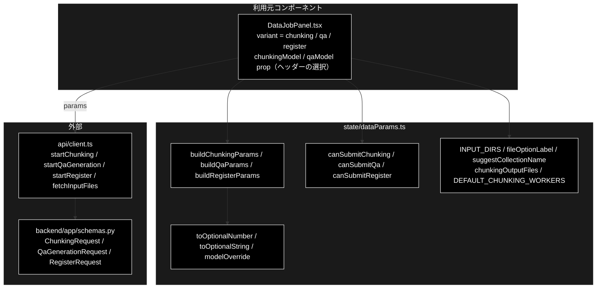

# dataParams.ts - データ準備フォームの送信パラメータ ドキュメント

**Version 1.0** | 最終更新: 2026-10-12

---

## 目次

- [概要](#概要)
- [1. アーキテクチャ構成図](#1-アーキテクチャ構成図)
- [2. エクスポート一覧](#2-エクスポート一覧)
- [3. 判断の規則](#3-判断の規則)
- [4. テスト](#4-テスト)
- [5. 変更履歴](#5-変更履歴)

---

## 概要

| 項目 | 内容 |
|---|---|
| ファイル | `frontend/src/state/dataParams.ts`（244 行） |
| 種別 | 純ロジック（送信パラメータの組み立て・送信可否・表示文字列） |
| 利用元 | `components/DataJobPanel.tsx`（① チャンキング / ② Q/A 作成 / ③ Qdrant 登録） |
| 対応バックエンド | `POST /api/chunking/run` / `POST /api/qa/generate` / `POST /api/qdrant/register`（`backend/app/schemas.py` の `ChunkingRequest` / `QaGenerationRequest` / `RegisterRequest`）・`GET /api/files`（`ALLOWED_INPUT_DIRS`） |

データ管理タブのフォームの入力から、3 つのジョブの起動 API に送るパラメータを組み立てる。数値の空欄・trim・`null` 化・モデル未選択の扱いを
ここに集め、フォーム側に散らさない（`queryParams.ts` と同じ方針）。入力ファイルの選択肢の表示文字列もここで作る。

### 主な責務

- 空欄・空白の入力を `null` にする（数値の空欄を 0 にしない）
- モデル未選択のときは `model` キーごと落とす
- 3 つのジョブの送信パラメータを組み立てる
- 送信ボタンを押せるかを判定する
- 入力ファイルの選択肢とコレクション名の既定値の表示文字列を作る
- チャンク化の出力ファイル名を、実行前に画面へ出すために求める
- チャンク化の既定の並列ワーカー数をローカル LLM に合わせて持つ

### 各責務対応のモジュール

| # | 責務 | 対応モジュール | 説明 |
|---|---|---|---|
| 1 | 空欄の `null` 化 | `toOptionalNumber` / `toOptionalString` | `Number('')` は 0 になるので、そのまま送ると「最大 0 件」になる |
| 2 | モデル未選択 | `modelOverride` | 空なら `{}`。空文字を送るとサーバーの `Field(default=…)` が効かず 422 になる |
| 3 | パラメータの組み立て | `buildChunkingParams` / `buildQaParams` / `buildRegisterParams` と各 `*FormState` | 出力先が空なら既定（`output_chunked` / `qa_output`）。Embedding は `gemini` 固定 |
| 4 | 送信可否 | `canSubmitChunking` / `canSubmitQa` / `canSubmitRegister` | 実行中は不可。登録はコレクション名も要る。**モデル欄は空でも可** |
| 5 | 表示文字列 | `INPUT_DIRS` / `INPUT_DIR_LABELS` / `suggestCollectionName` / `formatFileSize` / `formatModified` / `fileOptionLabel` | コレクション名にサフィックス（`_anthropic` 等）を勝手に付けない |
| 6 | 出力ファイル名 | `chunkingOutputFiles` / `ChunkingOutputFiles` / `DEFAULT_CHUNKING_OUTPUT_DIR` | `<出力先>/<入力の stem>_chunks.csv` と `_chunks_simple.csv`。**バックエンド（`chunking/csv_text_to_chunks_text_csv.py`）の規則の写し** |
| 7 | 既定の並列数 | `DEFAULT_CHUNKING_WORKERS` | **1**（`config.py::get_default_chunking_workers()` と同じ値）。Ollama は既定で 1 本ずつしか処理しない |

---

## 1. アーキテクチャ構成図

### 1.1 位置づけ



---

## 2. エクスポート一覧

```ts
export const INPUT_DIRS = ['OUTPUT', 'output_chunked', 'qa_output', 'datasets'] as const;  // backend の ALLOWED_INPUT_DIRS と 1:1
export const DEFAULT_CHUNKING_WORKERS = 1;   // config.py::get_default_chunking_workers() と同じ
export type InputDir = (typeof INPUT_DIRS)[number];
export const INPUT_DIR_LABELS: Record<string, string>;

export function toOptionalNumber(value: string): number | null
export function modelOverride(model: string): { model?: string }
export function toOptionalString(value: string): string | null

export interface ChunkingFormState {
  inputFile: string; outputDir: string; model: string; workers: number; blockSize: number;
  textColumn: string; maxRows: string; combineRows: boolean; resume: string; verbose: boolean;
}
export function buildChunkingParams(state: ChunkingFormState): ChunkingParams

export const DEFAULT_CHUNKING_OUTPUT_DIR = 'output_chunked';
export interface ChunkingOutputFiles {
  main: string;    // メタデータ付き CSV（<入力の stem>_chunks.csv）。Q/A 作成の入力になる
  simple: string;  // Text 列だけの簡易 CSV（<入力の stem>_chunks_simple.csv）
}
export function chunkingOutputFiles(inputFile: string, outputDir: string): ChunkingOutputFiles | null

export interface QaFormState {
  inputFile: string; outputDir: string; model: string; maxDocs: string; useCelery: boolean;
  concurrency: number;   // 表示用（起動コマンドとログ）。実際の並列数はワーカー起動時の -c で決まる
  analyzeCoverage: boolean; verbose: boolean;
}
export function buildQaParams(state: QaFormState): QaParams
export function canSubmitQa(state: QaFormState, running: boolean): boolean

export interface RegisterFormState {
  inputFile: string; collection: string; recreate: boolean; batchSize: number; embedWorkers: number;
  textCol: string; domain: string; maxDocs: string; verbose: boolean;
}
export function buildRegisterParams(state: RegisterFormState): RegisterParams
export function canSubmitChunking(state: ChunkingFormState, running: boolean): boolean
export function canSubmitRegister(state: RegisterFormState, running: boolean): boolean

export function suggestCollectionName(inputFile: string): string
export function formatFileSize(bytes: number): string
export function formatModified(epochSeconds: number): string
export function fileOptionLabel(file: InputFileInfo): string
```

---

## 3. 判断の規則

### 3.1 使用例

`DataJobPanel` と同じ使い方（② Q/A 作成でモデルを選ばずに送る → ① チャンキングの出力ファイル名を実行前に出す → ③ 登録でファイル名からコレクション名を作る）。

```ts
import {
  buildQaParams, buildRegisterParams, canSubmitQa, chunkingOutputFiles, fileOptionLabel, suggestCollectionName,
} from '../../src/state/dataParams';

const qa = {
  inputFile: ' output_chunked/cc_news_1per_chunks.csv ', outputDir: '', model: '',
  maxDocs: '', useCelery: false, concurrency: 8, analyzeCoverage: true, verbose: true,
};
console.log(canSubmitQa(qa, false), canSubmitQa(qa, true));   // モデル欄が空でも押せる・実行中は不可
const params = buildQaParams(qa);
console.log('model' in params, params.output_dir, params.max_docs, params.input_file);

const file = 'qa_output/cc_news_1per_qa.csv';
console.log(fileOptionLabel({ name: 'cc_news_1per_qa.csv', size: 1_536_000 } as never), suggestCollectionName(file));
console.log(chunkingOutputFiles('OUTPUT/cc_news.1per.csv', 'output_chunked/'), chunkingOutputFiles('', ''));
const reg = buildRegisterParams({
  inputFile: file, collection: suggestCollectionName(file), recreate: false,
  batchSize: 32, embedWorkers: 4, textCol: ' ', domain: '', maxDocs: '100', verbose: false,
});
console.log(reg.collection, reg.provider, reg.text_col, reg.max_docs);
```

```text
true false
false qa_output null output_chunked/cc_news_1per_chunks.csv
cc_news_1per_qa.csv（1.5 MB） cc_news_1per_qa
{
  main: 'output_chunked/cc_news.1per_chunks.csv',
  simple: 'output_chunked/cc_news.1per_chunks_simple.csv'
} null
cc_news_1per_qa gemini null 100
```

> 📝 **確かめ方（2026-10-12）**: 上の例を esbuild で束ねて node で実行し、出力が一致することを確かめた。

### 3.2 規則

空欄の扱い:

| 関数 | 入力 | 結果 |
|---|---|---|
| `toOptionalNumber` | `''` / 空白 | `null`（0 にしない） |
| | `'100'` | `100` |
| | 数値にならない文字列 | `null` |
| `toOptionalString` | `''` / 空白 | `null` |
| | `' x '` | `'x'` |
| `modelOverride` | `''` / 空白 | `{}`（**キーごと落とす**） |
| | `'m'` | `{ model: 'm' }` |

パラメータの組み立て（3 つに共通: `input_file` は trim）:

| 関数 | 既定・固定の値 | 空欄で `null` になる項目 |
|---|---|---|
| `buildChunkingParams` | `output_dir` が空なら `output_chunked` | `text_column` / `max_rows` / `resume` |
| `buildQaParams` | `output_dir` が空なら `qa_output`（入れ子にすると `GET /api/files` が拾わず ③ の選択肢に出ない） | `max_docs` |
| `buildRegisterParams` | `provider: 'gemini'`（Embedding は Gemini 固定）・`normalize_filename: true`・`create_ui_csv: true`・`ui_output_dir: 'qa_output'`。`collection` は trim | `text_col` / `domain` / `max_docs` |

> 📌 `buildRegisterParams` はモデルを送らない（登録は Embedding だけで、モデルは `config.py::ModelConfig.EMBEDDING_MODEL` の 1 か所で決まる）。

送信可否:

| 関数 | 条件 |
|---|---|
| `canSubmitChunking` | 実行中でない かつ 入力ファイルが空でない |
| `canSubmitQa` | 同上（**モデル欄が空でも可**。空 = サーバーの既定値） |
| `canSubmitRegister` | 同上 かつ コレクション名が空でない |

> 📌 モデル欄が空でも送れるのは、`buildQaParams` / `buildChunkingParams` が `model` キーごと落とし、サーバーが既定モデル
> （`default_factory=get_default_ollama_model`）で解決するから。空文字を送ると既定値が働かず、空のモデル名でローカル LLM を呼びに行ってしまう。

表示文字列:

| 関数 | 入力 → 結果 |
|---|---|
| `suggestCollectionName` | `qa_output/cc_news_1per_qa.csv` → `cc_news_1per_qa`（ディレクトリと拡張子を落とすだけ。サフィックスを付けない）。`''` → `''` |
| `formatFileSize` | 1024 未満は `B`、1 MiB 未満は `KB`（小数 1 桁）、それ以上は `MB` |
| `formatModified` | エポック秒 → `ja-JP` の `YYYY/MM/DD HH:MM`（ブラウザのタイムゾーン）。不正な値は `-` |
| `fileOptionLabel` | `{name}（{formatFileSize(size)}）` |

`chunkingOutputFiles(inputFile, outputDir)`（チャンキングの画面に、実行前に出力先を出す）:

| 入力 | 結果 |
|---|---|
| `data/news.csv`, `out` | `out/news_chunks.csv` / `out/news_chunks_simple.csv` |
| 入力ファイルが空 | `null` |
| 出力先が空 | 既定の `output_chunked`（送信値と同じ） |
| 出力先の末尾が `/` | `/` を二重にしない |
| `a.b.csv` | 落とす拡張子は最後の 1 つだけ（`a.b_chunks.csv`。Python の `Path.stem` と同じ） |
| `.env` / `name.` / `README` | 先頭・末尾のドットや拡張子なしは名前をそのまま使う（`Path.stem` と同じ） |

> ⚠️ **バックエンドの規則の写しである。** 出力名を決めるのは `chunking/csv_text_to_chunks_text_csv.py` の `generate_output_filename()` と
> `save_chunks_as_csv(save_simple_csv=True)`。規則を変えるときは両方を直す（画面の表示と実際のファイルが食い違う）。

`DEFAULT_CHUNKING_WORKERS = 1` の理由: Ollama は既定で 1 本ずつしか処理しないので、8 本投げても 7 本はキューで待つだけで、
待ち時間が各リクエストのタイムアウトを食いつぶす（2026-09-11 実測・55 ブロックで 509 秒に 7 ブロックしか進まず、後続がタイムアウトして機械的分割へ落ちた）。
**8 に戻さない。** 上げてよいのは `OLLAMA_NUM_PARALLEL` を上げて `ollama serve` を再起動したときだけ。

---

## 4. テスト

| テストファイル | 対象 | 件数 | 実行 |
|---|---|---:|---|
| `src/state/dataParams.test.ts` | 空欄 5 件・チャンキング 4 件・登録 4 件・送信可否 6 件・表示 7 件・`modelOverride` 2 件・Q/A 作成 6 件・`canSubmitQa` 2 件・チャンキングのモデル省略 1 件・`DEFAULT_CHUNKING_WORKERS` 1 件・`chunkingOutputFiles` 6 件 | 44 | `npm test` |

件数は 2026-10-12 に `npx vitest run` で実測した。

---

## 5. 変更履歴

| バージョン | 日付 | 変更内容 |
|---|---|---|
| 1.0 | 2026-10-12 | 新規作成（`a_react_page_md_format.md` §2.4 の軽量構成）。使用例は esbuild + node で実行して確かめた |
