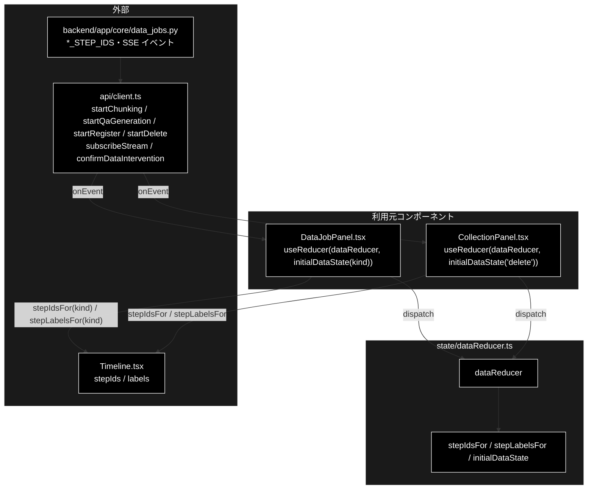
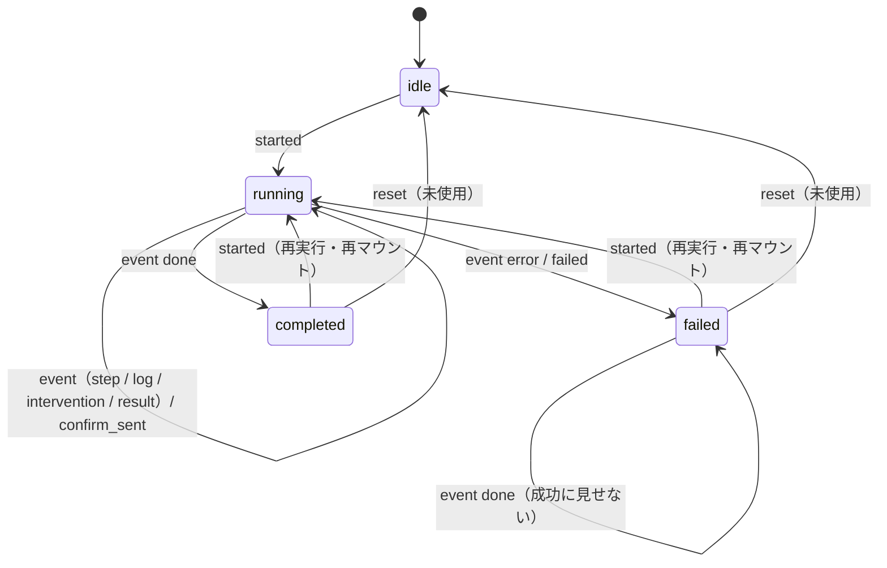

# dataReducer.ts - データ準備ジョブの状態遷移 ドキュメント

**Version 1.0** | 最終更新: 2026-10-12

---

## 目次

- [概要](#概要)
- [1. アーキテクチャ構成図](#1-アーキテクチャ構成図)
- [2. エクスポート一覧](#2-エクスポート一覧)
- [3. 判断の規則](#3-判断の規則)
- [4. テスト](#4-テスト)
- [5. 変更履歴](#5-変更履歴)

---

## 概要

| 項目 | 内容 |
|---|---|
| ファイル | `frontend/src/state/dataReducer.ts`（225 行） |
| 種別 | 純ロジック（reducer） |
| 利用元 | `components/DataJobPanel.tsx`（チャンキング / Q/A 作成 / 登録）/ `components/CollectionPanel.tsx`（削除） |
| 対応バックエンド | `backend/app/core/data_jobs.py`（`CHUNKING_STEP_IDS` / `QA_STEP_IDS` / `REGISTER_STEP_IDS` / `DELETE_STEP_IDS`）・SSE `GET /api/data/stream/{job_id}` |

データ準備ジョブ（チャンキング / Q/A 生成 / Qdrant 登録 / コレクション削除）の SSE イベント列を UI 状態へ畳み込む。副作用は無い。
`jobReducer.ts` / `reviewReducer.ts` と同じ形だが、**ステップ ID の集合がジョブ種別（`kind`）で変わる**ので、定数ではなく `stepIdsFor(kind)` から引く。
結果は種別で形が違う `DataJobResult`。

### 主な責務

- ジョブ種別ごとのステップの並び順と表示名を持つ（バックエンドの `*_STEP_IDS` と 1:1）
- SSE イベントをステップの状態・ログ・承認待ち・結果・エラーへ畳み込む
- 画面側の操作（起動・承認の送信・失敗・リセット）で状態を遷移させる

### 各責務対応のモジュール

| # | 責務 | 対応モジュール | 説明 |
|---|---|---|---|
| 1 | ステップの並びと表示名 | `stepIdsFor` / `stepLabelsFor` / `*_STEP_IDS` / `*_STEP_LABELS` | 4 種別 × 3〜4 ステップ。知らない種別は空 |
| 2 | イベントの畳み込み | `dataReducer`（`event` アクション） | Support / Review と**3 点違う**（§3.4） |
| 3 | 画面操作による遷移 | `dataReducer`（`started` / `confirm_sent` / `failed` / `reset`）/ `initialDataState` | `started` で種別ごとのステップを作り直す |

---

## 1. アーキテクチャ構成図

### 1.1 位置づけ



---

## 2. エクスポート一覧

```ts
export const CHUNKING_STEP_IDS = ['load', 'chunk', 'save'] as const;
export const QA_STEP_IDS = ['load', 'generate', 'coverage', 'save'] as const;
export const REGISTER_STEP_IDS = ['prepare', 'confirm', 'embed', 'upsert'] as const;
export const DELETE_STEP_IDS = ['inspect', 'confirm', 'delete'] as const;
export const CHUNKING_STEP_LABELS: Record<string, string>;
export const QA_STEP_LABELS: Record<string, string>;
export const REGISTER_STEP_LABELS: Record<string, string>;
export const DELETE_STEP_LABELS: Record<string, string>;

export function stepIdsFor(kind: DataJobKind): readonly string[]
export function stepLabelsFor(kind: DataJobKind): Record<string, string>

export type StepStatus = 'pending' | 'running' | 'done' | 'skipped';
export interface DataStepState {
  id: string;
  status: StepStatus;
  logs: string[];
  data: Record<string, unknown>;
}

export type DataPhase = 'idle' | 'running' | 'completed' | 'failed';
export interface DataJobState {
  jobId: string | null;
  kind: DataJobKind;
  phase: DataPhase;
  steps: Record<string, DataStepState>;
  intervention: InterventionInfo | null;
  result: DataJobResult | null;
  error: string | null;
  logs: string[];          // ステップに紐づかないログ（画面の「その他のログ」）
}

export type DataAction =
  | { type: 'started'; jobId: string; kind: DataJobKind }
  | { type: 'event'; event: SupportEvent }
  | { type: 'confirm_sent' }
  | { type: 'failed'; message: string }
  | { type: 'reset' };

export function initialDataState(kind: DataJobKind = 'chunking'): DataJobState
export function dataReducer(state: DataJobState, action: DataAction): DataJobState
```

ステップの表示名:

| 種別 | ID | 表示名 |
|---|---|---|
| `chunking` | `load` / `chunk` / `save` | ① 入力読み込み（CSV / テキスト）/ ② セマンティックチャンク化（LLM・3 段階）/ ③ CSV 出力 |
| `qa` | `load` / `generate` / `coverage` / `save` | ① チャンク済み CSV の読み込み / ② Q/A ペア生成（ローカル LLM）/ ③ カバレージ分析（任意）/ ④ Q/A CSV・JSON 出力 |
| `register` | `prepare` / `confirm` / `embed` / `upsert` | ① 入力検証・コレクション名の決定 / ② HITL CONFIRM（recreate 時のみ）/ ③ Embedding 生成 / ④ Qdrant へ登録 |
| `delete` | `inspect` / `confirm` / `delete` | ① 削除対象の確認 / ② HITL CONFIRM（承認が必要）/ ③ 削除実行 |

---

## 3. 判断の規則

### 3.1 使用例

`DataJobPanel` と同じ順に dispatch する（Q/A 作成。起動 → SSE のイベント → 完了）。2 つ目の例はエラーのあとの `done`。

```ts
import { dataReducer, initialDataState, type DataAction } from '../../src/state/dataReducer';

const ev = (event: object): DataAction => ({ type: 'event', event: event as never });
let s = initialDataState('qa');
for (const a of [
  { type: 'started', jobId: 'job-q1', kind: 'qa' },
  ev({ type: 'step', step: 'generate', status: 'started', data: { total: 10 } }),
  ev({ type: 'step', step: 'generate', status: 'completed', data: { pairs: 42 } }),  // data は置換
  ev({ type: 'step', step: 'coverage', status: 'skipped' }),
  ev({ type: 'log', step: null, message: '出力先: qa_output/' }),                    // その他のログへ
  ev({ type: 'result', data: { kind: 'qa', qa_pairs: 42 } }),
  ev({ type: 'done', status: 'completed' }),
] as DataAction[]) s = dataReducer(s, a);
console.log(Object.keys(s.steps).join(','), s.phase);
console.log(s.steps.generate.status, s.steps.generate.data, s.steps.coverage.status, s.logs);

// エラーのあとの done は failed のまま（成功に見せない）
let d = dataReducer(initialDataState('delete'), { type: 'started', jobId: 'job-d1', kind: 'delete' });
d = dataReducer(d, ev({ type: 'error', message: 'コレクションが見つかりません' }));
console.log(d.phase);
d = dataReducer(d, ev({ type: 'done', status: 'completed' }));
console.log(d.phase, d.error);
```

```text
load,generate,coverage,save completed
done { pairs: 42 } skipped [ '出力先: qa_output/' ]
failed
failed コレクションが見つかりません
```

> 📝 **確かめ方（2026-10-12）**: 上の例を esbuild で束ねて node で実行し、出力が一致することを確かめた。

### 3.2 アクション一覧

| アクション | いつ dispatch するか | 遷移 |
|---|---|---|
| `started` | 起動 API が `job_id` を返した直後・**再マウント時に `activeJobs.ts` から引いたジョブがまだ生きていたとき** | `initialDataState(kind)` から作り直し、`jobId` / `kind` と `phase = 'running'`（前回の結果は消える） |
| `event` | `subscribeStream` の `onEvent` | §3.3 |
| `confirm_sent` | `confirmDataIntervention` を送った直後（`register` の recreate・`delete`） | `intervention = null` |
| `failed` | 起動の失敗・承認の送信の失敗・SSE の `onError` | `phase = 'failed'`、`error = message` |
| `reset` | **どのコンポーネントも dispatch していない**（テストだけが使う。2026-10-12 に grep で確認） | `initialDataState(state.kind)`（種別は保つ） |

### 3.3 イベントの畳み込み（`event` アクション）

| `event.type` | `status` | 変わるもの |
|---|---|---|
| `step` | `started` / `skipped` / それ以外 | そのステップを `running` / `skipped` / `done`。**`data` は置換**。そのジョブ種別に無い ID は無視 |
| `log` | — | `step` がそのジョブのステップならそこへ、無い・知らない ID なら全体の `logs`（「その他のログ」）へ。**捨てない** |
| `intervention` | `waiting` / それ以外 | モーダル用の `intervention` を立てる / `null` |
| `result` | — | `result = data`（`DataJobResult`。`kind` つき） |
| `error` | — | **`phase = 'failed'`**、`error = message`（無ければ `不明なエラー`） |
| `done` | （見ない） | 既に `failed` なら `failed` のまま、そうでなければ `completed`。`intervention = null` |

### 3.4 Support / Review の reducer との違い

| 項目 | `dataReducer` | `jobReducer` / `reviewReducer` |
|---|---|---|
| ステップの `data` | **置換**（`step_finished` の `data` が `step_started` の `data` を丸ごと上書き） | **マージ**（`{ ...current.data, ...patch.data }`） |
| `error` イベント | その場で `phase = 'failed'` | `phase` は変えない（後続の `done` の `status` で決まる） |
| `done` イベント | `status` を見ず、既に `failed` なら `failed` のまま | `status === 'failed'` なら `failed`、それ以外は `completed` |

> ⚠️ ソースのコメント（`applyEvent` の `step` 分岐）は「data は置換（Support / Review と同じ）」と書いているが、
> Support / Review の reducer は**マージ**している（2026-10-12 にコードで確認）。置換であること自体はテスト
> 「data はマージではなく置換」が固定している。コメントの直しはコード変更になるので本文書では行っていない（README §13）。

### 3.5 状態遷移図（`phase`）



---

## 4. テスト

| テストファイル | 対象 | 件数 | 実行 |
|---|---|---:|---|
| `src/state/dataReducer.test.ts` | ステップ定義 2・初期状態 1・`started` 2・`step` 3・`log` 3・`intervention` 3・`result` / `error` / `done` 5・`failed` / `reset` 2・Q/A 生成ジョブ 6（ステップ ID が backend と一致・表示名がそろう・4 ステップの入れ物を含む） | 27 | `npm test` |

件数は 2026-10-12 に `npx vitest run` で実測した。

---

## 5. 変更履歴

| バージョン | 日付 | 変更内容 |
|---|---|---|
| 1.0 | 2026-10-12 | 新規作成（`a_react_page_md_format.md` §2.4 の軽量構成）。使用例は esbuild + node で実行して確かめた。Support / Review の reducer との違い 3 点（§3.4）を実コードで確かめて記載 |
