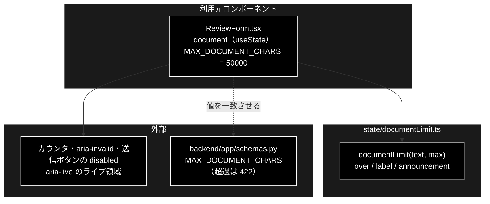

# documentLimit.ts - 文書の文字数上限の判定と文言 ドキュメント

**Version 1.0** | 最終更新: 2026-10-12

---

## 目次

- [概要](#概要)
- [1. アーキテクチャ構成図](#1-アーキテクチャ構成図)
- [2. エクスポート一覧](#2-エクスポート一覧)
- [3. 判断の規則](#3-判断の規則)
- [4. テスト](#4-テスト)
- [5. 変更履歴](#5-変更履歴)

---

## 概要

| 項目 | 内容 |
|---|---|
| ファイル | `frontend/src/state/documentLimit.ts`（52 行） |
| 種別 | 純ロジック（判定＋表示文言） |
| 利用元 | `components/ReviewForm.tsx`（文書欄のカウンタ・送信可否・`aria-invalid`・ライブ領域） |
| 対応バックエンド | `backend/app/schemas.py::MAX_DOCUMENT_CHARS`（50,000。超過は API が 422） |

GRACE-Review の文書欄が上限を超えたかどうかと、そのときに画面へ出す文言・支援技術へ読ませる文言を 1 回の呼び出しで決める。

### 主な責務

- 文字数が上限を超えたかを判定する
- カウンタに出す文言（視覚用）を決める
- 支援技術へ読ませる文言を、超過した瞬間に 1 回だけ鳴る形で決める

### 各責務対応のモジュール

| # | 責務 | 対応モジュール | 説明 |
|---|---|---|---|
| 1 | 超過の判定 | `documentLimit`（`over`） | `text.length > max`。上限ちょうどは超過ではない |
| 2 | 表示文言 | `documentLimit`（`label`） | 千区切りの `N / M 文字`。超過時は対処方法（分割）を添える |
| 3 | アナウンス文言 | `documentLimit`（`announcement`） | 超過中は**長さを含まない固定文**、超過していなければ `null` |

> ⚠️ **`announcement` に文字数を入れない。** 支援技術は `aria-live` 領域のテキストが変わるたびに読み上げる。
> 文字数を混ぜると 1 打鍵ごとに読み上げが走る。固定文なら超えた瞬間の 1 回だけで済む。

---

## 1. アーキテクチャ構成図

### 1.1 位置づけ



---

## 2. エクスポート一覧

```ts
export interface DocumentLimit {
  length: number;               // 現在の文字数
  max: number;                  // 上限
  over: boolean;                // 上限を超えているか。送信の可否と aria-invalid に使う
  label: string;                // カウンタに表示する文言（視覚用）
  announcement: string | null;  // 支援技術へ読ませる文言。null ならライブ領域を空にする
}

export function documentLimit(text: string, max: number): DocumentLimit
```

---

## 3. 判断の規則

### 3.1 使用例

`ReviewForm` と同じ上限（50,000）で呼ぶ。

```ts
import { documentLimit } from '../../src/state/documentLimit';

const ok = documentLimit('あ'.repeat(1234), 50000);
console.log(ok.over, ok.label, ok.announcement);

const over1 = documentLimit('あ'.repeat(50001), 50000);
const over2 = documentLimit('あ'.repeat(60000), 50000);
console.log(over1.over, over1.label);
console.log(over1.announcement === over2.announcement, over1.announcement); // 長さが変わっても同じ文
```

```text
false 1,234 / 50,000 文字 null
true 50,001 / 50,000 文字（上限を超えています。分割して実行してください）
true 文字数が上限を超えています。分割して実行してください。
```

> 📝 **確かめ方（2026-10-12）**: 上の例を esbuild で束ねて node で実行し、出力が一致することを確かめた。

### 3.2 規則

| 入力 | `over` | `label` | `announcement` |
|---|:--:|---|---|
| 空文字 | false | `0 / 50,000 文字` | `null` |
| ちょうど上限（境界） | false | `50,000 / 50,000 文字` | `null` |
| 上限 + 1（境界） | true | `50,001 / 50,000 文字（上限を超えています。分割して実行してください）` | 固定文 |
| さらに増える | true | 文字数だけ変わる | **同じ固定文**（再読み上げしない） |
| 上限を変える | 境界が追随する | — | — |
| サロゲートペア（`😀` など） | `String.length`（UTF-16 単位）で数える。`😀` は 2 | — | — |

> 📌 **数え方は API と完全には一致しない。** UI は `String.length`（UTF-16 単位）で `😀` を 2 と数え、API 側の Python の `len()` は 1 と数える。
> UI のほうが多めに数えるので、UI で送信できる文書は API でも 422 にならない（逆に、上限ぎわで絵文字が多い文書は UI が先に止める）。
> テストのコメントにあるとおり、ここは「過剰に賢くしない」として合わせていない。

---

## 4. テスト

| テストファイル | 対象 | 件数 | 実行 |
|---|---|---:|---|
| `src/state/documentLimit.test.ts` | §3.2（境界 2 件・アナウンスの固定文・千区切り・サロゲートペア） | 10 | `npm test` |

件数は 2026-10-12 に `npx vitest run` で実測した。

---

## 5. 変更履歴

| バージョン | 日付 | 変更内容 |
|---|---|---|
| 1.0 | 2026-10-12 | 新規作成（`a_react_page_md_format.md` §2.4 の軽量構成）。使用例は esbuild + node で実行して確かめた |
