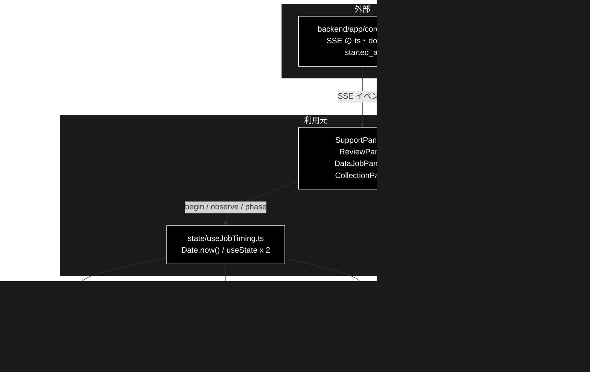

# elapsed.ts - 開始・完了時刻と所要時間 ドキュメント

**Version 1.0** | 最終更新: 2026-10-12

---

## 目次

- [概要](#概要)
- [1. アーキテクチャ構成図](#1-アーキテクチャ構成図)
- [2. エクスポート一覧](#2-エクスポート一覧)
- [3. 判断の規則](#3-判断の規則)
- [4. テスト](#4-テスト)
- [5. 変更履歴](#5-変更履歴)

---

## 概要

| 項目 | 内容 |
|---|---|
| ファイル | `frontend/src/state/elapsed.ts`（180 行） |
| 種別 | 純ロジック（時刻の畳み込み・整形） |
| 利用元 | `state/useJobTiming.ts`（4 つのコンテナが使うフック）/ `components/JobClock.tsx`（`formatClock` / `formatDuration` / `elapsedMs`）/ `components/AnswerCard.tsx`（`JobTiming` 型） |
| 対応バックエンド | `backend/app/core/jobs.py`（SSE の各イベントの `ts`、`done` の `started_at`。どちらもエポック秒） |

「送信してから結果が出るまでどれくらい掛かったか」を画面に出すための時刻の扱いをまとめる。
`Date.now()` は呼ぶたびに値が変わる副作用なので reducer の中では呼ばない（StrictMode は reducer を 2 回呼ぶ）。
時刻は reducer の外（`useJobTiming` の `useState`）に持ち、**判断と整形だけ**を本モジュールの純関数に置く。

ブラウザの時計（送信の瞬間）とサーバの時計（SSE の `ts`）の 2 組を持ち、取れていればサーバの組を丸ごと使う。
タブを離れて戻った再購読やリロードでは送信の瞬間を見ていないが、バックエンドはイベントを先頭からリプレイするので、
サーバの組なら所要時間を出せる。

### 主な責務

- ブラウザの時計で開始・完了時刻を記録する（再実行で前回の完了を消す・二重確定しない）
- 時刻と所要時間を、ロケールに依存しない固定の書式にする
- サーバの時刻（`ts` / `started_at`）を畳み込む
- 表示に使う組（サーバ / ブラウザ）を、2 つの時計を混ぜずに選ぶ

### 各責務対応のモジュール

| # | 責務 | 対応モジュール | 説明 |
|---|---|---|---|
| 1 | ブラウザの時計 | `startTiming` / `finishTiming` / `EMPTY_TIMING` / `JobTiming` | 確定済みなら同じ参照を返す（`setState` が再レンダーしない） |
| 2 | 書式 | `formatClock` / `formatDuration` / `elapsedMs` | `2026-08-13 10:24:35`（ローカル時刻）/ `00:01:23`。両端が揃わなければ所要は `null`（推測値を出さない） |
| 3 | サーバの時刻 | `applyServerEvent` / `secondsToMs` / `ServerTimedEvent` | 最初のイベントの `ts` を暫定の開始、`done` の `started_at`（受付時刻）で上書き、`done` の `ts` を完了 |
| 4 | 組の選択 | `preferServerTiming` | サーバの開始が取れていればサーバの組。ただしサーバだけ完了を知らないならブラウザの組 |

---

## 1. アーキテクチャ構成図

### 1.1 位置づけ



---

## 2. エクスポート一覧

```ts
export interface JobTiming {
  startedAt: number | null;   // エポックミリ秒。未確定は null
  finishedAt: number | null;
}
export const EMPTY_TIMING: JobTiming;   // { startedAt: null, finishedAt: null }

export function startTiming(now: number): JobTiming
export function finishTiming(prev: JobTiming, now: number): JobTiming
export function formatClock(ms: number): string
export function formatDuration(ms: number): string
export function elapsedMs(timing: JobTiming): number | null

export interface ServerTimedEvent {
  type: string;
  ts?: number;                // イベントの発生時刻（エポック秒）。done では実行の完了時刻
  started_at?: number | null; // done だけが持つジョブの受付時刻（エポック秒）
}
export function secondsToMs(ts?: number | null): number | null
export function applyServerEvent(prev: JobTiming, event: ServerTimedEvent): JobTiming
export function preferServerTiming(server: JobTiming, client: JobTiming): JobTiming
```

`ServerTimedEvent` には `types.ts` の `SupportEvent` がそのまま当てはまる。

---

## 3. 判断の規則

### 3.1 使用例

呼び方は 2 通りある。

| # | パターン | いつ使うか | 例 |
|---|---|---|---|
| 1 | ブラウザの時計 | 送信した画面で、送信の瞬間から測る | 例 1 |
| 2 | サーバの時計 | SSE のイベントを受けるたび（再購読・リロードでも復元できる） | 例 2 |

実際の画面では `useJobTiming.ts` が両方を持ち、`preferServerTiming` で選ぶ（例 2 の最後）。

**例 1: ブラウザの時計**

```ts
import { elapsedMs, EMPTY_TIMING, finishTiming, formatClock, formatDuration, startTiming } from '../../src/state/elapsed';

process.env.TZ = 'Asia/Tokyo';                       // formatClock はローカル時刻なので例では固定する
const sent = Date.UTC(2026, 9, 12, 1, 2, 3);         // 送信の瞬間（JST 10:02:03）
let t = startTiming(sent);
t = finishTiming(t, sent + 83_900);                  // 決着（83.9 秒後）
console.log(formatClock(t.startedAt!), formatDuration(elapsedMs(t)!));
console.log(finishTiming(t, sent + 999_000) === t);  // 二重確定しない（同じ参照）
console.log(finishTiming(EMPTY_TIMING, sent) === EMPTY_TIMING, elapsedMs(startTiming(sent)));
```

```text
2026-10-12 10:02:03 00:01:23
true
true null
```

**例 2: サーバの時計（再購読でリプレイを受けた場合）**

```ts
import { applyServerEvent, EMPTY_TIMING, formatDuration, elapsedMs, preferServerTiming, type ServerTimedEvent } from '../../src/state/elapsed';

// タブを離れて戻った再購読: ブラウザは送信の瞬間を知らない（開始 null）が、完了は phase 監視で入っている
const client = { startedAt: null, finishedAt: 1_760_230_000_000 };
const replay: ServerTimedEvent[] = [
  { type: 'step', ts: 1_760_229_905 },                             // 最初のイベント → 暫定の開始
  { type: 'log' },                                                 // 時刻なし → 同じ参照
  { type: 'done', ts: 1_760_229_990, started_at: 1_760_229_900 },  // 受付時刻で開始を上書き・完了
];
let server = EMPTY_TIMING;
for (const e of replay) {
  const next = applyServerEvent(server, e);
  console.log(e.type, next === server ? '(変化なし)' : `${next.startedAt} → ${next.finishedAt}`);
  server = next;
}
const shown = preferServerTiming(server, client);
console.log(shown === server, formatDuration(elapsedMs(shown)!));
```

```text
step 1760229905000 → null
log (変化なし)
done 1760229900000 → 1760229990000
true 00:01:30
```

> 📝 **確かめ方（2026-10-12）**: 2 つの例を esbuild で束ねて node で実行し、出力が一致することを確かめた。

### 3.2 規則

ブラウザの時計:

| 関数 | 入力 | 結果 |
|---|---|---|
| `startTiming(now)` | — | `{ startedAt: now, finishedAt: null }`（前回の完了を消す） |
| `finishTiming(prev, now)` | 開始していない | `prev`（再購読で開始が不明） |
| | 既に完了している | `prev`（同じ参照。完了時刻が後ろへずれない） |
| | それ以外 | `{ ...prev, finishedAt: now }` |
| `elapsedMs(t)` | 両端が揃う | 差（ミリ秒） |
| | どちらかが `null` | `null`（所要時間を出さない） |

書式:

| 関数 | 入力 | 結果 |
|---|---|---|
| `formatClock(ms)` | — | `YYYY-MM-DD HH:MM:SS`（ローカル時刻・ゼロ詰め。`toLocaleString` を使わずロケールに依存しない） |
| `formatDuration(ms)` | 1,900 | `00:00:01`（秒未満は切り捨て） |
| | 負の値 | `00:00:00`（端末の時刻が巻き戻った場合の保険） |
| | 100 時間超 | 時の桁を切らない（`100:00:00` など） |

サーバの時計（`applyServerEvent(prev, event)`）:

| イベント | 開始 | 完了 |
|---|---|---|
| 最初の `ts` つきイベント | 暫定でその `ts` | — |
| 2 件目以降 | 変えない | — |
| `done`（`started_at` あり） | **`started_at` で上書き**（受付から最初のイベントまでの待ちも含める） | `ts`（無ければ変えない） |
| `done` をもう一度 | — | 変えない |
| 時刻を 1 つも持たない | 同じ参照を返す（再レンダーしない） | — |

`secondsToMs(ts)`: `undefined` / `null` / 非有限なら `null`（推測値を作らない）。

組の選択（`preferServerTiming(server, client)`）:

| サーバの開始 | サーバの完了 | ブラウザの完了 | 使う組 |
|---|---|---|---|
| `null` | — | — | ブラウザ |
| あり | あり | — | サーバ（時計を混ぜない） |
| あり | `null` | `null`（実行中） | サーバ |
| あり | `null` | あり | **ブラウザ**（時刻を持たない `done` の旧バックエンドで完了行が消えた。2026-08-29 実測） |

> ⚠️ **片方ずつ混ぜない。** サーバの完了とブラウザの開始を引き算すると、2 つの時計の差がそのまま誤差になる。必ず組ごと選ぶ。

---

## 4. テスト

| テストファイル | 対象 | 件数 | 実行 |
|---|---|---:|---|
| `src/state/elapsed.test.ts` | ブラウザの時計・書式・一連の流れ | 22 | `npm test` |
| `src/state/serverTiming.test.ts` | サーバの時計（`secondsToMs` / `applyServerEvent` / `preferServerTiming` / `done` の時刻） | 16 | `npm test` |

> ⚠️ `serverTiming.test.ts` が検証するのは本モジュール（`state/serverTiming.ts` は存在しない）。

件数は 2026-10-12 に `npx vitest run` で実測した。

---

## 5. 変更履歴

| バージョン | 日付 | 変更内容 |
|---|---|---|
| 1.0 | 2026-10-12 | 新規作成（`a_react_page_md_format.md` §2.4 の軽量構成）。使用例 2 本は esbuild + node で実行して確かめた |
