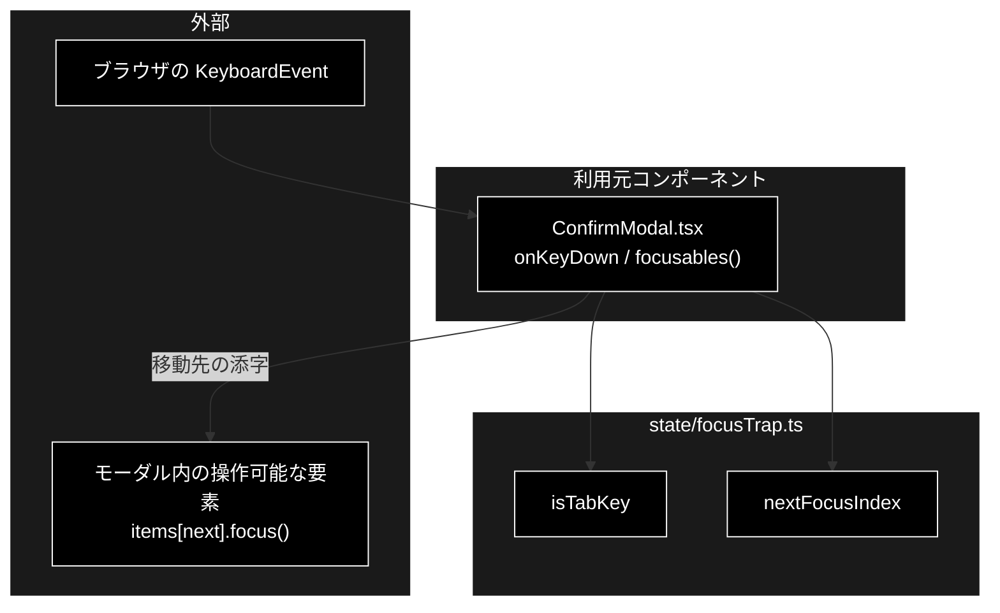

# focusTrap.ts - モーダル内の Tab 移動先 ドキュメント

**Version 1.0** | 最終更新: 2026-10-12

---

## 目次

- [概要](#概要)
- [1. アーキテクチャ構成図](#1-アーキテクチャ構成図)
- [2. エクスポート一覧](#2-エクスポート一覧)
- [3. 判断の規則](#3-判断の規則)
- [4. テスト](#4-テスト)
- [5. 変更履歴](#5-変更履歴)

---

## 概要

| 項目 | 内容 |
|---|---|
| ファイル | `frontend/src/state/focusTrap.ts`（62 行） |
| 種別 | 純ロジック（キー判定・移動先の計算） |
| 利用元 | `components/ConfirmModal.tsx`（HITL 承認モーダル。Support / Review / データ管理の 4 か所で共用） |
| 対応バックエンド | なし |

`aria-modal="true"` は「背後は不活性」と支援技術へ伝えるだけで、ブラウザのフォーカス順は変えない。
`ConfirmModal` では Tab で背後のページへ焦点が抜けていた。HITL 承認は「承認なしにアクションを実行しない」関門なので、
キーボード利用者が承認 / 拒否のボタンへ確実に届く必要がある。焦点を閉じ込める移動先の計算を本モジュールが持つ
（`focus()` の呼び出しはコンポーネント側）。2026-09-21 に追加した（同月 24 日に姉妹リポジトリ grace_v2 へ移植）。

### 主な責務

- フォーカス移動として扱う Tab 押下かを判定する
- Tab / Shift+Tab の移動先を、端で巻き戻して計算する

### 各責務対応のモジュール

| # | 責務 | 対応モジュール | 説明 |
|---|---|---|---|
| 1 | Tab 押下の判定 | `isTabKey` | Tab（Shift 付きも可）。Ctrl / ⌘ / Alt 付きはブラウザ操作なので `false` |
| 2 | 移動先の計算 | `nextFocusIndex` | 最後 → 最初、最初 → 最後へ巻き戻す。焦点がモーダル外なら前進は先頭・後退は末尾へ入れる |

> ⚠️ **Escape では閉じない**（判断のうえで未対応。`ConfirmModal.md` §8 と README §13）。本モジュールは Tab だけを扱う。

---

## 1. アーキテクチャ構成図

### 1.1 位置づけ



---

## 2. エクスポート一覧

```ts
export interface TabKeyEvent {
  key: string;
  shiftKey?: boolean;
  ctrlKey?: boolean;
  metaKey?: boolean;
  altKey?: boolean;
}

export function isTabKey(event: TabKeyEvent): boolean

export function nextFocusIndex(
  count: number,
  currentIndex: number,
  shiftKey = false,
): number
```

| 引数（`nextFocusIndex`） | 説明 |
|---|---|
| `count` | 閉じ込める要素の数。0 以下なら `-1`（移動先なし） |
| `currentIndex` | いま焦点のある要素の添字。モーダル外・不明なら `-1` |
| `shiftKey` | Shift を押しているか（逆方向） |

---

## 3. 判断の規則

### 3.1 使用例

`ConfirmModal` の `onKeyDown` と同じ使い方（`isTabKey` が真なら移動先を計算し、`-1` でなければ `preventDefault()` して `focus()`）。
承認・拒否の 2 ボタンのモーダルを想定する。

```ts
import { isTabKey, nextFocusIndex } from '../../src/state/focusTrap';

console.log(isTabKey({ key: 'Tab', shiftKey: true }), isTabKey({ key: 'Tab', ctrlKey: true }));
console.log(nextFocusIndex(2, 0));        // 承認 → 拒否
console.log(nextFocusIndex(2, 1));        // 拒否 → 承認（巻き戻す）
console.log(nextFocusIndex(2, 0, true));  // Shift+Tab: 承認 → 拒否（巻き戻す）
console.log(nextFocusIndex(2, -1, true)); // 焦点がモーダル外 → 末尾へ入れる
console.log(nextFocusIndex(0, -1));       // 要素なし
```

```text
true false
1
0
1
1
-1
```

> 📝 **確かめ方（2026-10-12）**: 上の例を esbuild で束ねて node で実行し、出力が一致することを確かめた。

### 3.2 規則

`isTabKey(event)`:

| 入力 | 結果 |
|---|---|
| `Tab` / Shift+`Tab` | `true` |
| `Tab` 以外 | `false` |
| Ctrl / ⌘ / Alt 付きの `Tab` | `false`（Ctrl+Tab などのブラウザ操作を奪わない） |

`nextFocusIndex(count, currentIndex, shiftKey)`:

| 条件 | 結果 |
|---|---|
| 前進（`shiftKey = false`） | `currentIndex + 1`。末尾の次は `0` |
| 後退（`shiftKey = true`） | `currentIndex - 1`。先頭の前は `count - 1` |
| `currentIndex` が `-1`・範囲外 | 前進なら `0`、後退なら `count - 1`（外へ出ても次の Tab で戻れる） |
| `count = 1` | 常に `0`（外へ出さない） |
| `count <= 0` | `-1` |

---

## 4. テスト

| テストファイル | 対象 | 件数 | 実行 |
|---|---|---:|---|
| `src/state/focusTrap.test.ts` | `isTabKey` 4 件・`nextFocusIndex` 8 件 | 12 | `npm test` |

件数は 2026-10-12 に `npx vitest run` で実測した。

---

## 5. 変更履歴

| バージョン | 日付 | 変更内容 |
|---|---|---|
| 1.0 | 2026-10-12 | 新規作成（`a_react_page_md_format.md` §2.4 の軽量構成）。使用例は esbuild + node で実行して確かめた |
