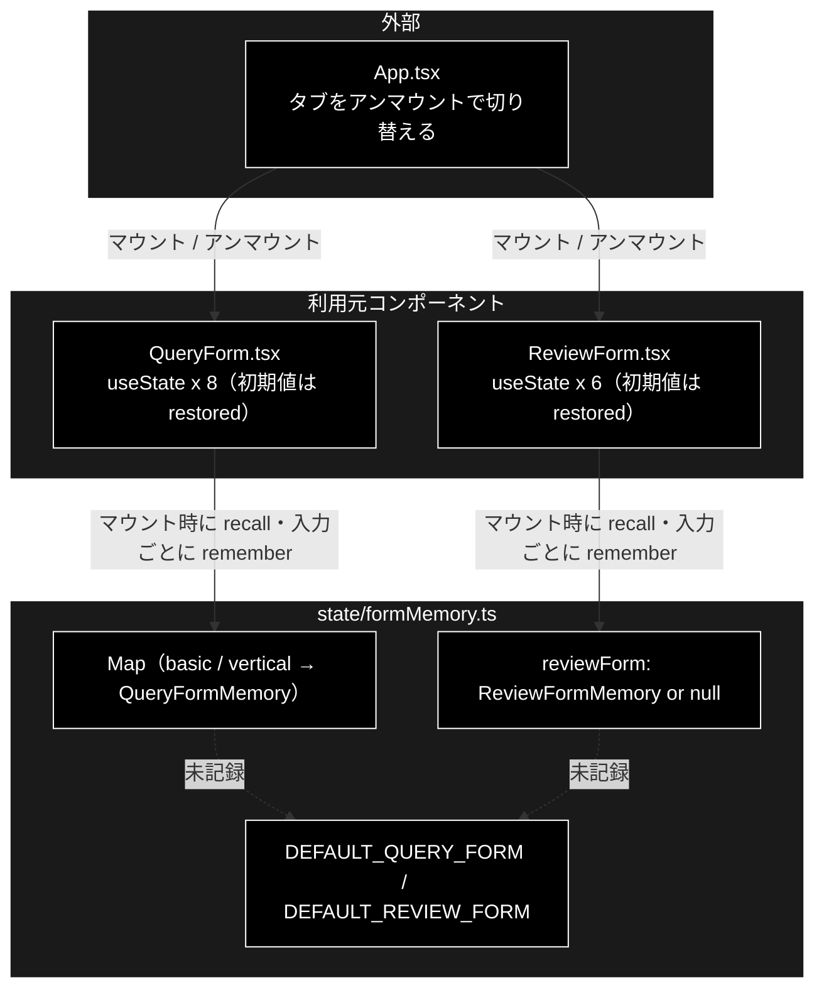

# formMemory.ts - タブ切替時のフォーム入力の退避 ドキュメント

**Version 1.0** | 最終更新: 2026-10-12

---

## 目次

- [概要](#概要)
- [1. アーキテクチャ構成図](#1-アーキテクチャ構成図)
- [2. エクスポート一覧](#2-エクスポート一覧)
- [3. 判断の規則](#3-判断の規則)
- [4. テスト](#4-テスト)
- [5. 変更履歴](#5-変更履歴)

---

## 概要

| 項目 | 内容 |
|---|---|
| ファイル | `frontend/src/state/formMemory.ts`（123 行） |
| 種別 | 純ロジック（モジュールスコープのストア） |
| 利用元 | `components/QueryForm.tsx`（基本版 / GRACE-Support）/ `components/ReviewForm.tsx`（GRACE-Review） |
| 対応バックエンド | なし（既定値は API の既定と合わせている。§3.2） |

タブは**アンマウントで切り替える**（離れた側の `EventSource` を確実に閉じるため）。副作用として、フォームの `useState` が
すべて初期値に戻り、入力した問い合わせ文や貼り付けた文書まで消える。dry-run や Web フォールバックのチェックが勝手に戻るのは
実行結果を左右するので特に危険である。アンマウントは保ったまま、入力内容だけを本モジュールに退避して再マウント時に戻す。
`activeJobs.ts` と同じ方針。

> ⚠️ **モデルの選択はここに入れない。** ヘッダー（`App`）のセレクタが持ち、`App` はアンマウントされないので退避が要らない（`headerModel.ts`）。
>
> 📌 ブラウザストレージは使わない（メモリ上のみ）。ページを再読み込みすれば既定値から始まる。

### 主な責務

- `QueryForm` の入力を、基本版と GRACE-Support で別々に退避・復元する
- `ReviewForm` の入力を退避・復元する
- 各フォームの `useState` 初期値（既定値）を 1 か所で持つ

### 各責務対応のモジュール

| # | 責務 | 対応モジュール | 説明 |
|---|---|---|---|
| 1 | `QueryForm` の退避・復元 | `recallQueryForm` / `rememberQueryForm` / `QueryFormKey` | キーは `'basic'` / `'vertical'`。片方の設定がもう片方へ漏れない |
| 2 | `ReviewForm` の退避・復元 | `recallReviewForm` / `rememberReviewForm` | 1 枠だけ |
| 3 | 既定値 | `DEFAULT_QUERY_FORM` / `DEFAULT_REVIEW_FORM` | 未記録時に `recall*` が返す。値の理由は §3.2 |

---

## 1. アーキテクチャ構成図

### 1.1 位置づけ



---

## 2. エクスポート一覧

```ts
export interface QueryFormMemory {
  query: string;
  vertical: string;
  dryRun: boolean;
  verbose: boolean;
  useWeb: boolean;
  doAction: boolean;
  orderId: string;
  email: string;
}
export const DEFAULT_QUERY_FORM: QueryFormMemory
export type QueryFormKey = 'basic' | 'vertical';
export function recallQueryForm(key: QueryFormKey): QueryFormMemory
export function rememberQueryForm(key: QueryFormKey, state: QueryFormMemory): void

export interface ReviewFormMemory {
  document: string;
  title: string;
  ruleset: string;
  useWeb: boolean;
  dryRun: boolean;
  verbose: boolean;
}
export const DEFAULT_REVIEW_FORM: ReviewFormMemory
export function recallReviewForm(): ReviewFormMemory
export function rememberReviewForm(state: ReviewFormMemory): void

export function clearFormMemory(): void   // テスト用。全消去
```

> ⚠️ 未記録のとき `recall*` は共有の `DEFAULT_*` **そのもの**を返す（コピーではない）。呼び出し側は `useState` の初期値に
> 使うだけで書き換えない前提である。`remember*` には新しいオブジェクトを渡す（`{ ...restored, dryRun: true }` のように）。

---

## 3. 判断の規則

### 3.1 使用例

`QueryForm` と同じ流れ（マウント時に 1 度だけ引く → 入力が変わるたびに退避 → タブを離れて戻ったら同じ値が出る）。

```ts
import {
  DEFAULT_QUERY_FORM, recallQueryForm, recallReviewForm, rememberQueryForm, rememberReviewForm,
} from '../../src/state/formMemory';

// 1 回目のマウント（GRACE-Support タブ）: 未記録なので既定値
const first = recallQueryForm('vertical');
console.log(first === DEFAULT_QUERY_FORM, first.dryRun, first.useWeb);

// 入力が変わるたびに退避（QueryForm の useEffect）
rememberQueryForm('vertical', { ...first, query: 'パスワードを忘れました', vertical: 'saas', useWeb: false });

// タブを離れて戻る（再マウント）→ 同じ値が出る。基本版は独立
const back = recallQueryForm('vertical');
console.log(back.query, back.vertical, back.useWeb);
console.log(recallQueryForm('basic').useWeb);

// GRACE-Review: 貼り付けた文書が残る
rememberReviewForm({ ...recallReviewForm(), document: '今だけ半額！', dryRun: true });
console.log(recallReviewForm().document, recallReviewForm().ruleset, recallReviewForm().dryRun);
```

```text
true false true
パスワードを忘れました saas false
true
今だけ半額！ ec_ad true
```

> 📝 **確かめ方（2026-10-12）**: 上の例を esbuild で束ねて node で実行し、出力が一致することを確かめた。

### 3.2 規則

| 入力（呼び出し） | 結果 |
|---|---|
| 未記録で `recallQueryForm(key)` | `DEFAULT_QUERY_FORM` |
| `rememberQueryForm(key, s)` のあと `recallQueryForm(key)` | `s`（チェック・テキストとも残る） |
| `'basic'` と `'vertical'` | 独立（片方の設定がもう片方へ漏れない） |
| 同じキーへ再保存 | 上書き（最後の入力が勝つ） |
| `recall` の結果を広げて `remember` | `DEFAULT_*` は書き換わらない |
| 未記録で `recallReviewForm()` | `DEFAULT_REVIEW_FORM` |
| `rememberReviewForm(s)` のあと | `s`（文書・ruleset・チェック） |
| `clearFormMemory()` | 両方まとめて消える |

既定値（各フォームの `useState` 初期値と 1:1）:

| フォーム | 項目 | 既定 | 理由 |
|---|---|---|---|
| `QueryForm` | `dryRun` | `false` | アクションは ⑥ の HITL CONFIRM で承認してから実行する |
| | `verbose` | `true` | ステップトレースで各段の判断根拠を追えるように |
| | `useWeb` / `doAction` | `true` / `true` | — |
| | `query` / `vertical` / `orderId` / `email` | `''` | — |
| `ReviewForm` | `ruleset` | `'ec_ad'` | 定義済みのルールセットは 1 つ（`backend/app/core/rulesets.py`） |
| | `useWeb` | `false` | 2026-10-01 に ON から変更（API の `ReviewRequest.use_web` と同じ）。検索結果の裏取りの価値が小さい一方、全体を最大 5 秒待たせる |
| | `dryRun` / `verbose` | `false` / `true` | 起票は ⑦ の HITL CONFIRM で承認してから |
| | `document` / `title` | `''` | — |

---

## 4. テスト

| テストファイル | 対象 | 件数 | 実行 |
|---|---|---:|---|
| `src/state/formMemory.test.ts` | QueryForm 6 件・ReviewForm 4 件・`clearFormMemory` 1 件・既定値とコンポーネントの初期値の一致 2 件 | 13 | `npm test` |

件数は 2026-10-12 に `npx vitest run` で実測した。

---

## 5. 変更履歴

| バージョン | 日付 | 変更内容 |
|---|---|---|
| 1.0 | 2026-10-12 | 新規作成（`a_react_page_md_format.md` §2.4 の軽量構成）。使用例は esbuild + node で実行して確かめた |
