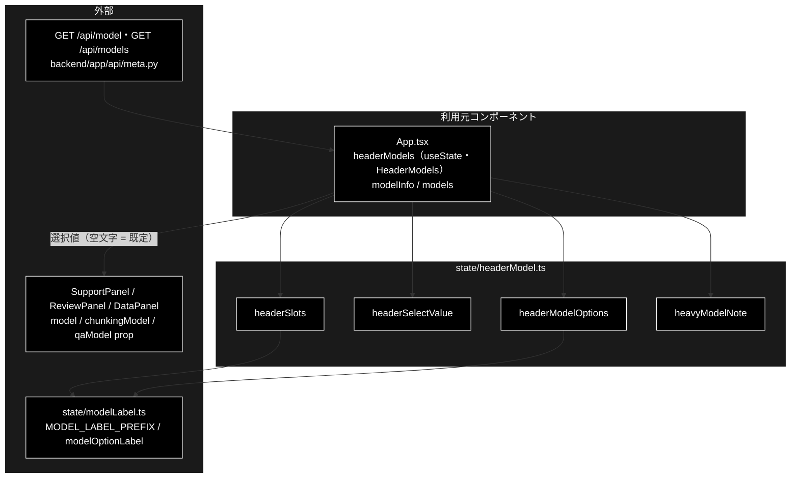

# headerModel.ts - ヘッダーのモデルセレクタ ドキュメント

**Version 1.0** | 最終更新: 2026-10-12

---

## 目次

- [概要](#概要)
- [1. アーキテクチャ構成図](#1-アーキテクチャ構成図)
- [2. エクスポート一覧](#2-エクスポート一覧)
- [3. 判断の規則](#3-判断の規則)
- [4. テスト](#4-テスト)
- [5. 変更履歴](#5-変更履歴)

---

## 概要

| 項目 | 内容 |
|---|---|
| ファイル | `frontend/src/state/headerModel.ts`（128 行） |
| 種別 | 純ロジック（表示用の派生値） |
| 利用元 | `App.tsx`（ヘッダーのモデルセレクタ。全タブ） |
| 対応バックエンド | `GET /api/model`（`ModelInfo`）/ `GET /api/models`（`ModelChoice[]`）— `backend/app/api/meta.py` |

モデルは「そのタブで何を使って走るか」という画面全体の設定なので、ヘッダー（タイトル横）で選ぶ（2026-09-23 にフォーム内から移した）。
タブごとにどのセレクタを並べ、何を表示し、どんな選択肢を出すかを本モジュールが決める。選択の値は `App` の state（`HeaderModels`）に持つ。
`App` はアンマウントされないので、タブを切り替えても選択は残る。

> ⚠️ **空文字は「サーバーの既定値を使う」。** 送信時に `queryParams.ts` / `dataParams.ts` / `ReviewForm` が null 化（またはキー省略）し、
> サーバーが既定モデル（`config.py::get_default_ollama_model()` の解決結果）で走る。**既定のモデル名を frontend に書かない**（値は `GET /api/model` から来る）。
>
> ⚠️ **姉妹リポジトリ grace_v2 の同名ファイルとは既定値の取り方が違う**（こちらはデータ管理タブの 2 つとも `ModelInfo.model`。
> `ModelInfo` に `chunking_model` / `qa_model` が無い。サーバーも同じ値で解決する: `core/data_jobs.py::_resolve_model()`）。
> コピーで行き来させない（CLAUDE.md §5）。

### 主な責務

- タブごとにヘッダーへ並べるセレクタ（スロット）を決める
- 未選択のときにサーバーの既定モデル名を表示する
- 選択肢を tool calling の対応可否と注記つきで並べ、既定モデルが一覧に無ければ先頭に足す
- 論理層だけ別モデルへ寄せているときの注記を決める

### 各責務対応のモジュール

| # | 責務 | 対応モジュール | 説明 |
|---|---|---|---|
| 1 | スロットの決定 | `headerSlots` / `HeaderSlot` / `ModelSlot` / `INITIAL_HEADER_MODELS` | エージェントの 3 タブは 1 つ、データ管理タブは工程ごとに 2 つ。既定はどれも `ModelInfo.model` |
| 2 | 表示値 | `headerSelectValue` | 選択があればそれ、無ければ既定モデル名。空欄にしない |
| 3 | 選択肢 | `headerModelOptions` / `HeaderModelOption` | ラベルは `modelLabel.ts::modelOptionLabel`（tool calling 非対応・`notes` を畳み込む）。一覧に無い既定モデルは先頭へ |
| 4 | 論理層の注記 | `heavyModelNote` | `llm.heavy_model` が空でなく、表示中のモデルと違うときだけ `（論理層: …）` |

---

## 1. アーキテクチャ構成図

### 1.1 位置づけ



---

## 2. エクスポート一覧

```ts
export type AppTab = 'basic' | 'support' | 'review' | 'data';
export type ModelSlot = 'basic' | 'support' | 'review' | 'chunking' | 'qa';
export type HeaderModels = Record<ModelSlot, string>;   // 空文字 = 未選択（サーバーの既定値）
export const INITIAL_HEADER_MODELS: HeaderModels;       // すべて ''

export interface HeaderSlot {
  slot: ModelSlot;
  label: string;          // セレクタの見出し（例: `利用モデル名：` / `① チャンキング：`）
  defaultModel: string;   // 未選択時に表示するサーバーの既定モデル名。未取得なら空文字
  showHeavy: boolean;     // 論理層（llm.heavy_model）の注記を出すか。エージェントのタブだけ
}
export function headerSlots(tab: AppTab, info: ModelInfo | null): HeaderSlot[]

export function headerSelectValue(selected: string, defaultModel: string): string

export interface HeaderModelOption {
  id: string;
  label: string;
}
export function headerModelOptions(models: ModelChoice[], defaultModel: string): HeaderModelOption[]

export function heavyModelNote(model: string, heavyModel: string): string | null
```

---

## 3. 判断の規則

### 3.1 使用例

`App.tsx` と同じ組み立て方。`info` は 2026-10-12 時点の `GET /api/model` の応答、`models` は `GET /api/models` の一部。

```ts
import type { ModelChoice, ModelInfo } from '../../src/types';
import {
  headerModelOptions, headerSelectValue, headerSlots, heavyModelNote, INITIAL_HEADER_MODELS,
} from '../../src/state/headerModel';

const info: ModelInfo = { provider: 'ollama', model: 'gemma4:26b-a4b-it-qat', light_model: 'gemma4:26b-a4b-it-qat', heavy_model: '' };
const models: ModelChoice[] = [
  { id: 'gemma4:26b-a4b-it-qat', supports_tool_calls: true, notes: 'デフォルト' },
  { id: 'llama3.2:latest', supports_tool_calls: true, notes: '軽量・高速（2.0 GB）' },
];

const selected = { ...INITIAL_HEADER_MODELS, qa: 'llama3.2:latest' };  // Q/A 作成だけ選んだ
for (const s of headerSlots('data', info)) {
  console.log(s.label, headerSelectValue(selected[s.slot], s.defaultModel));
}
const [agent] = headerSlots('support', info);
console.log(agent.label, headerSelectValue(selected.support, agent.defaultModel), agent.showHeavy);
console.log(headerModelOptions(models, 'gemma4:12b-mlx').map((o) => o.label));  // 一覧に無い既定（環境変数などで指定）
console.log(heavyModelNote('gemma4:26b-a4b-it-qat', ''), heavyModelNote('gemma4:26b-a4b-it-qat', 'gemma4:26b-mlx'));
```

```text
① チャンキング： gemma4:26b-a4b-it-qat
② Q/A 作成： llama3.2:latest
利用モデル名： gemma4:26b-a4b-it-qat true
[
  'gemma4:12b-mlx',
  'gemma4:26b-a4b-it-qat — デフォルト',
  'llama3.2:latest — 軽量・高速（2.0 GB）'
]
null （論理層: gemma4:26b-mlx）
```

> 📝 **確かめ方（2026-10-12）**: 上の例を esbuild で束ねて node で実行し、出力が一致することを確かめた。

### 3.2 規則

`headerSlots(tab, info)`:

| タブ | スロット | 見出し | 既定（`ModelInfo` の項目） | 注記 |
|---|---|---|---|:--:|
| `basic` / `support` / `review` | タブと同名の 1 つ | `利用モデル名：` | `model` | 出す |
| `data` | `chunking` | `① チャンキング：` | `model` | 出さない |
| | `qa` | `② Q/A 作成：` | `model` | 出さない |
| どのタブでも `info = null`（未取得） | 同じ | 同じ | `''`（セレクタ自体は出す） | — |

> 📌 データ管理タブの 2 つとも既定が `model` なのは、サーバーも `ChunkingRequest.model` / `QaGenerationRequest.model` を省略すると同じ値で解決するから（`core/data_jobs.py::_resolve_model()`）。

`headerSelectValue(selected, defaultModel)`: 前後の空白を除いて、選択があればそれ・無ければ既定モデル名・どちらも無ければ `''`。

`headerModelOptions(models, defaultModel)`:

| 条件 | 結果 |
|---|---|
| 通常 | 一覧の順に `{ id, label: modelOptionLabel(m) }`（[`modelLabel.md`](modelLabel.md) §3.2） |
| 既定モデルが一覧に無い（設定ファイルで選択肢外を指す） | 先頭に `{ id, label: id }` を足す（`<select>` の表示が別モデルへずれない） |
| 既定モデルが未取得（`''`） | 足さない |
| 一覧が取れない（`[]`）が既定はある | 既定モデル 1 つだけ |

`heavyModelNote(model, heavyModel)`: `heavyModel` が空、または `model` と同じなら `null`。違えば `（論理層: {heavyModel}）`
（隠すとヘッダーが実挙動について嘘をつく）。

---

## 4. テスト

| テストファイル | 対象 | 件数 | 実行 |
|---|---|---:|---|
| `src/state/headerModel.test.ts` | `headerSlots` 5 件（エージェントの 3 タブを `it.each` で 1 件ずつ・データ管理・未取得）・`INITIAL_HEADER_MODELS` 1 件・`headerSelectValue` 3 件・`headerModelOptions` 4 件・`heavyModelNote` 3 件 | 16 | `npm test` |

件数は 2026-10-12 に `npx vitest run` で実測した。

---

## 5. 変更履歴

| バージョン | 日付 | 変更内容 |
|---|---|---|
| 1.0 | 2026-10-12 | 新規作成（`a_react_page_md_format.md` §2.4 の軽量構成）。使用例は esbuild + node で実行して確かめた |
