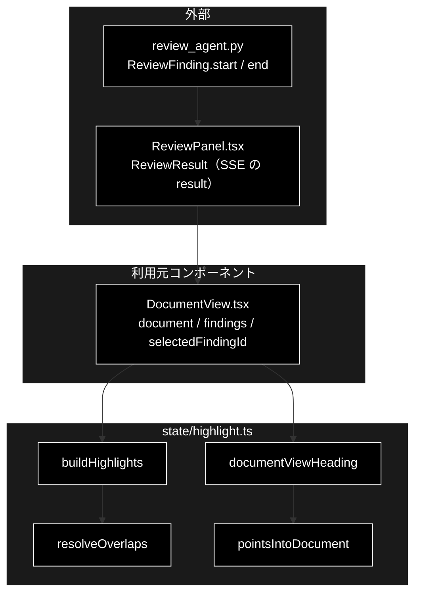

# highlight.ts - 原文ハイライトの分割と見出し ドキュメント

**Version 1.0** | 最終更新: 2026-10-12

---

## 目次

- [概要](#概要)
- [1. アーキテクチャ構成図](#1-アーキテクチャ構成図)
- [2. エクスポート一覧](#2-エクスポート一覧)
- [3. 判断の規則](#3-判断の規則)
- [4. テスト](#4-テスト)
- [5. 変更履歴](#5-変更履歴)

---

## 概要

| 項目 | 内容 |
|---|---|
| ファイル | `frontend/src/state/highlight.ts`（117 行） |
| 種別 | 純ロジック（表示用の派生値） |
| 利用元 | `components/DocumentView.tsx`（GRACE-Review の原文ペイン） |
| 対応バックエンド | `backend/app/core/review_agent.py`（`ReviewFinding.start` / `end` は**原文の文字オフセット**。分割時に正規化しない） |

GRACE-Review の原文を「指摘の無いテキスト」と「指摘スパン」の断片列に分ける。React 要素は作らず**データだけ**を返し、
`DocumentView` が `<mark>` を組み立てる（`dangerouslySetInnerHTML` を使わない。XSS 回避）。
設計は [`backend/docs/review_flow.md`](../../../backend/docs/review_flow.md) §8.2（`ReviewFinding`）。ソースのコメントの `review_agent_spec.md §8.2` は旧名。

### 主な責務

- 重なった指摘を、重大度の高いほうを残して解消する
- 原文を断片列に分割する（連結すると必ず原文に戻る）
- 原文の範囲を指している指摘かを判定する
- 原文ペインの見出しを、原文に場所を持つ指摘と持たない指摘に分けて決める

### 各責務対応のモジュール

| # | 責務 | 対応モジュール | 説明 |
|---|---|---|---|
| 1 | 重なりの解消 | `resolveOverlaps` | `start` 昇順。重なれば重大度の高いほう、同じなら先に始まるほう |
| 2 | 分割 | `buildHighlights` / `HighlightPiece` | 範囲外のオフセットの指摘は無視し、本文を欠落させない |
| 3 | 範囲の判定 | `pointsIntoDocument` | `0 <= start < end <= 原文の長さ` |
| 4 | 見出し | `documentViewHeading` | 表記漏れ（`start = end = 0`）を含むと件数を分けて書く |

---

## 1. アーキテクチャ構成図

### 1.1 位置づけ



---

## 2. エクスポート一覧

```ts
export interface HighlightPiece {
  text: string;                 // 原文の該当部分
  findingId: string | null;     // ハイライト対象なら指摘 ID、通常テキストなら null
  severity: Severity | null;
}

export function resolveOverlaps(findings: ReviewFinding[]): ReviewFinding[]
export function buildHighlights(document: string, findings: ReviewFinding[]): HighlightPiece[]
export function pointsIntoDocument(document: string, finding: ReviewFinding): boolean
export function documentViewHeading(document: string, findings: ReviewFinding[]): string
```

`ReviewFinding` / `Severity` は `types.ts`（`backend/app/schemas.py` の写し）。本モジュールが読むのは
`finding_id` / `start` / `end` / `severity` の 4 項目だけ。

---

## 3. 判断の規則

### 3.1 使用例

`DocumentView` と同じ使い方。「業界No.1」が 2 つのルールに触れて重なり、表記漏れ（原文に場所が無い）が 1 件ある場合。

```ts
import type { ReviewFinding } from '../../src/types';
import { buildHighlights, documentViewHeading } from '../../src/state/highlight';

// 例に要る項目だけを埋め、残りは型を満たす既定値にする
const f = (finding_id: string, start: number, end: number, severity: ReviewFinding['severity']) =>
  ({ finding_id, start, end, severity } as ReviewFinding);

const doc = '業界No.1の品質。今だけ半額！';
const findings = [
  f('f-1', 0, 6, 'medium'),  // 業界No.1（打消し表示）
  f('f-2', 0, 6, 'high'),    // 業界No.1（優良誤認）→ 重なりは high が残る
  f('f-3', 10, 16, 'high'),  // 今だけ半額！
  f('f-4', 0, 0, 'medium'),  // 表記漏れ（原文に場所が無い）
];
for (const p of buildHighlights(doc, findings)) console.log(JSON.stringify(p));
console.log(buildHighlights(doc, findings).map((p) => p.text).join('') === doc);
console.log(documentViewHeading(doc, findings));
```

```text
{"text":"業界No.1","findingId":"f-2","severity":"high"}
{"text":"の品質。","findingId":null,"severity":null}
{"text":"今だけ半額！","findingId":"f-3","severity":"high"}
true
原文（指摘 4 件のうち 3 件が原文の箇所）
```

> 📝 **確かめ方（2026-10-12）**: 上の例を esbuild で束ねて node で実行し、出力が一致することを確かめた。
> 見出しの「3 件」は重なった 2 件を両方数えている（`documentViewHeading` は重なりを解消しない。指摘の件数そのものを数える）。

### 3.2 規則

`resolveOverlaps(findings)`:

| 入力 | 結果 |
|---|---|
| 重なった指摘 | 重大度の高いほう（high > medium > low）を残す |
| 重大度が同じ | 先に始まるほう（先勝ち） |
| 隣接（`end == 次の start`） | 重なりではない（両方残る） |
| `start >= end` | 捨てる |
| 入力配列 | 破壊しない（コピーして並べ替える） |

`buildHighlights(document, findings)`:

| 入力 | 結果 |
|---|---|
| 指摘なし | 原文 1 個の断片 |
| 空文書 | `[]`（空の断片を作らない） |
| 1 件 | 前 / 該当 / 後 の 3 断片。先頭・末尾に接するなら空断片を作らない |
| 複数 | `start` 昇順（入力順に依存しない） |
| `end` が原文の長さを超える・前の断片と重なる | その指摘を無視（本文は欠落しない） |
| どの入力でも | 断片を連結すると原文に戻る |

`documentViewHeading(document, findings)`（`located` = `pointsIntoDocument` が真の件数）:

| 条件 | 見出し |
|---|---|
| 指摘 0 件 | `原文（指摘なし）` |
| すべて原文の箇所 | `原文（N 箇所を指摘）` |
| 一部だけ（表記漏れが混ざる） | `原文（指摘 N 件のうち M 件が原文の箇所）` |
| すべて表記漏れ | `原文（指摘 N 件・原文に該当箇所なし）` |
| 範囲外のオフセット | 原文の箇所として数えない（ハイライトされないため） |

> 📌 以前は件数をそのまま「N 箇所を指摘」と出し、表記漏れを含むと「4 箇所を指摘」なのにハイライトは 1 箇所という食い違いになっていた（2026-10-02 実測）。

---

## 4. テスト

| テストファイル | 対象 | 件数 | 実行 |
|---|---|---:|---|
| `src/state/highlight.test.ts` | `buildHighlights` 8 件・`resolveOverlaps` 5 件・`documentViewHeading` 5 件 | 18 | `npm test` |

件数は 2026-10-12 に `npx vitest run` で実測した。

---

## 5. 変更履歴

| バージョン | 日付 | 変更内容 |
|---|---|---|
| 1.0 | 2026-10-12 | 新規作成（`a_react_page_md_format.md` §2.4 の軽量構成）。使用例は esbuild + node で実行して確かめた |
