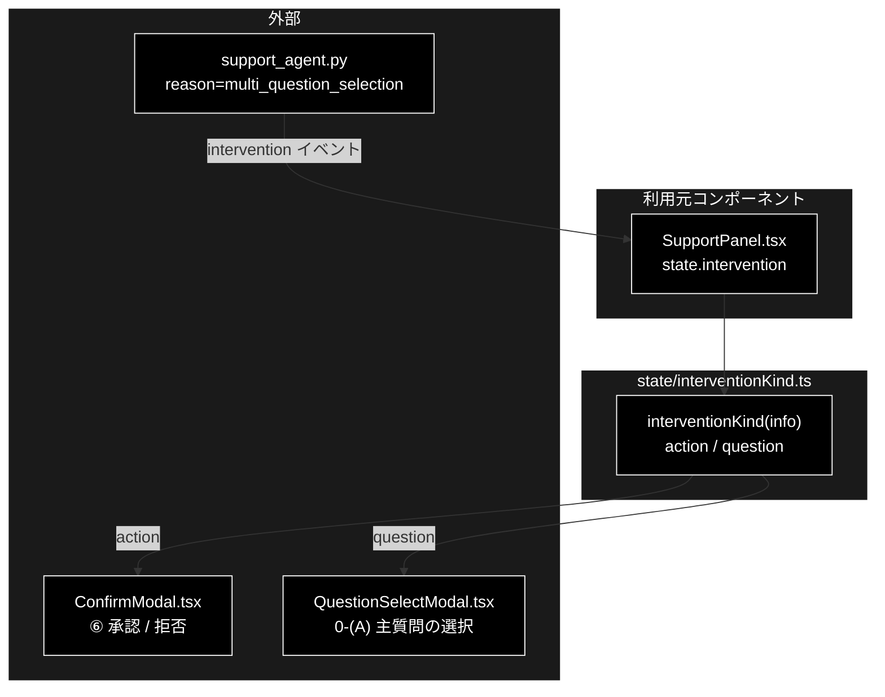

# interventionKind.ts - 承認待ちの種類の判定 ドキュメント

**Version 1.1** | 最終更新: 2026-10-12

---

## 目次

- [概要](#概要)
- [1. アーキテクチャ構成図](#1-アーキテクチャ構成図)
- [2. エクスポート一覧](#2-エクスポート一覧)
- [3. 判断の規則](#3-判断の規則)
- [4. テスト](#4-テスト)
- [5. 変更履歴](#5-変更履歴)

---

## 概要

| 項目 | 内容 |
|---|---|
| ファイル | `frontend/src/state/interventionKind.ts`（36 行） |
| 種別 | 純ロジック（判定関数） |
| 利用元 | `components/SupportPanel.tsx`（`ConfirmModal` と `QuestionSelectModal` の出し分け） |
| 対応バックエンド | `backend/app/core/support_agent.py`（0-(A) で `reason="multi_question_selection"` の承認待ちを出す） |

GRACE-Support の承認待ち（`intervention` イベント）は 2 種類あり、どちらも同じイベントで届く。
⑥ アクション実行の承認（承認 / 拒否の 2 択）と、0-(A) の主質問の選択（N 択）である。どちらのモーダルを出すかを本モジュールが決める。

### 主な責務

- 承認待ちが「アクション承認」か「主質問の選択」かを判定する
- 判断がつかないときはアクション承認（従来のモーダル）に倒す

### 各責務対応のモジュール

| # | 責務 | 対応モジュール | 説明 |
|---|---|---|---|
| 1 | 種類の判定 | `interventionKind` / `MULTI_QUESTION_REASON` | `reason` が `multi_question_selection` で、かつ `options` が 1 件以上なら `question` |
| 2 | 安全側への既定 | `interventionKind` | 上の条件を満たさなければすべて `action` |

> 📌 0-(A) の処理は [`core_process_flow.md` §1.6](../../../backend/app/core/docs/core_process_flow.md)。ソースのコメントが挙げる `docs/multi_question_handling.md §13.2` は、
> 同書に §13 が無い（§11 まで）ので古い参照である。

---

## 1. アーキテクチャ構成図

### 1.1 位置づけ



---

## 2. エクスポート一覧

```ts
export const MULTI_QUESTION_REASON = 'multi_question_selection';

export interface InterventionKindInput {
  reason?: string | null;
  options?: string[] | null;
}

export type InterventionKind = 'action' | 'question';

export function interventionKind(info: InterventionKindInput): InterventionKind
```

| 名前 | 種別 | 説明 |
|---|---|---|
| `MULTI_QUESTION_REASON` | 定数 | バックエンドが主質問の選択に付ける理由。`support_agent.py` の文字列と一致させる |
| `InterventionKindInput` | 型 | 判定に要る 2 項目だけ。`types.ts` の `InterventionInfo` がそのまま当てはまる |
| `InterventionKind` | 型 | 判定結果 |
| `interventionKind` | 関数 | 種類を返す |

---

## 3. 判断の規則

### 3.1 使用例

```ts
import { interventionKind } from '../../src/state/interventionKind';

// 0-(A): 主質問を選ばせる
console.log(interventionKind({ reason: 'multi_question_selection', options: ['返品の方法', '配送日の変更'] }));
// ⑥: アクション承認（理由はアクション名など）
console.log(interventionKind({ reason: 'refund_request', options: null }));
// 理由は合っているが選択肢が空 → 空の N 択は出さない
console.log(interventionKind({ reason: 'multi_question_selection', options: [] }));
```

```text
question
action
action
```

> 📝 **確かめ方（2026-10-12）**: 上の例を esbuild で束ねて node で実行し、出力が一致することを確かめた。

### 3.2 規則

| `reason` | `options` | 結果 | 理由 |
|---|---|---|---|
| `multi_question_selection` | 1 件以上 | `question` | — |
| `multi_question_selection` | `[]` / `null` / 無し | `action` | 空の N 択を出さない |
| それ以外 | 1 件以上 | `action` | `options` は汎用フィールドで、将来アクション側が選択肢を持つこともある。`options` があるだけで質問選択と決めない |
| 無し | 無し | `action` | 従来のアクション承認 |

---

## 4. テスト

| テストファイル | 対象 | 件数 | 実行 |
|---|---|---:|---|
| `src/state/interventionKind.test.ts` | §3.2 の 4 行 | 4 | `npm test` |

件数は 2026-10-12 に `npx vitest run` で実測した。

---

## 5. 変更履歴

| バージョン | 日付 | 変更内容 |
|---|---|---|
| 1.0 | 2026-10-12 | 新規作成（`a_react_page_md_format.md` §2.4 の軽量構成）。使用例は esbuild + node で実行して確かめた |
| 1.1 | 2026-10-12 | backend/docs/ の廃止（2026-10-12）に追随し、参照先を backend/app/docs/README_app.md・backend/app/api/docs/README_api.md・backend/app/core/docs/core_process_flow.md などへ付け替えた（テストの地図は docs/testing.md、実行例の txt は docs/examples/） |
