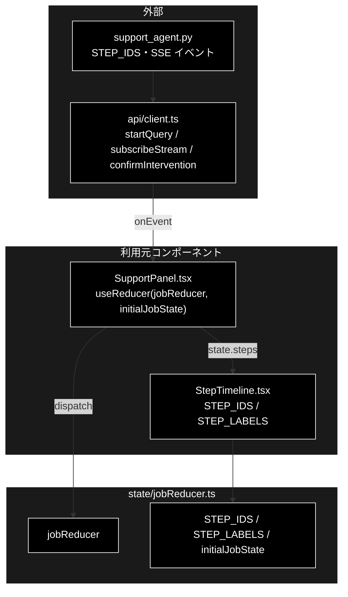
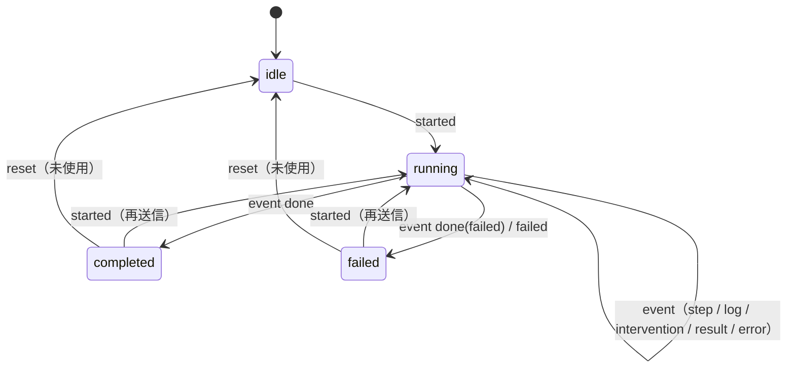

# jobReducer.ts - GRACE-Support ジョブの状態遷移 ドキュメント

**Version 1.0** | 最終更新: 2026-10-12

---

## 目次

- [概要](#概要)
- [1. アーキテクチャ構成図](#1-アーキテクチャ構成図)
- [2. エクスポート一覧](#2-エクスポート一覧)
- [3. 判断の規則](#3-判断の規則)
- [4. テスト](#4-テスト)
- [5. 変更履歴](#5-変更履歴)

---

## 概要

| 項目 | 内容 |
|---|---|
| ファイル | `frontend/src/state/jobReducer.ts`（173 行） |
| 種別 | 純ロジック（reducer） |
| 利用元 | `components/SupportPanel.tsx`（`useReducer`）/ `components/StepTimeline.tsx`（`STEP_IDS` / `STEP_LABELS` / `StepState`） |
| 対応バックエンド | `backend/app/core/support_agent.py::STEP_IDS`（9 ステップ）・SSE `GET /api/support/stream/{job_id}` |

GRACE-Support（基本版タブも同じ）の SSE イベント列を、ステップタイムライン・承認待ち・最終結果の UI 状態へ畳み込む。副作用は無い。
`reviewReducer.ts` / `dataReducer.ts` と同じ形だが、結果の型が違うので無理に共通化しない（`reviewReducer.ts` 冒頭）。

### 主な責務

- 9 ステップの並び順と表示名を持つ（バックエンドの `STEP_IDS` と 1:1）
- SSE イベントをステップの状態・ログ・承認待ち・結果・エラーへ畳み込む
- 画面側の操作（起動・承認の送信・起動失敗・リセット）で状態を遷移させる

### 各責務対応のモジュール

| # | 責務 | 対応モジュール | 説明 |
|---|---|---|---|
| 1 | ステップの並びと表示名 | `STEP_IDS` / `STEP_LABELS` / `StepId` | `analyze` → `profile` → `plan` → `execute` → `confidence` → `gate` → `web` → `no_info` → `action` |
| 2 | イベントの畳み込み | `jobReducer`（`event` アクション） | `step` / `log` / `intervention` / `result` / `error` / `done` の 6 種 |
| 3 | 画面操作による遷移 | `jobReducer`（`started` / `confirm_sent` / `failed` / `reset`）/ `initialJobState` | `started` で 9 ステップを `pending` に作り直す |

---

## 1. アーキテクチャ構成図

### 1.1 位置づけ



---

## 2. エクスポート一覧

```ts
export const STEP_IDS = [
  'analyze', 'profile', 'plan', 'execute', 'confidence', 'gate', 'web', 'no_info', 'action',
] as const;
export type StepId = (typeof STEP_IDS)[number];
export const STEP_LABELS: Record<StepId, string>;

export type StepStatus = 'pending' | 'running' | 'done' | 'skipped';
export interface StepState {
  id: StepId;
  status: StepStatus;
  logs: string[];
  data: Record<string, unknown>;
}

export type JobPhase = 'idle' | 'running' | 'completed' | 'failed';
export interface JobState {
  jobId: string | null;
  phase: JobPhase;
  steps: Record<StepId, StepState>;
  intervention: InterventionInfo | null;
  result: SupportResult | null;
  error: string | null;
  logs: string[];          // ステップに属さないログ
}

export type JobAction =
  | { type: 'started'; jobId: string }
  | { type: 'event'; event: SupportEvent }
  | { type: 'confirm_sent' }
  | { type: 'failed'; message: string }
  | { type: 'reset' };

export const initialJobState: JobState;
export function jobReducer(state: JobState, action: JobAction): JobState
```

`STEP_LABELS`（画面のステップトレースの表示名）:

| ID | 表示名 |
|---|---|
| `analyze` | 0-(A) 入力・質問分析（複数質問の検知） |
| `profile` | 0-(B) 業界プロファイル適用 |
| `plan` | ① Plan（planner） |
| `execute` | ② Execute（内部RAG → reasoning） |
| `confidence` | ③ Groundedness（根拠検証） |
| `gate` | ④ 回答ゲート＋強制エスカレ＋救済 |
| `web` | ⑤ Web フォールバック |
| `no_info` | ④' 情報なし回答検知 |
| `action` | ⑥ Action（本人確認 → HITL CONFIRM → 実行） |

> ⚠️ バックエンドの `STEP_IDS` を足し引きしたら、ここも同じ順で直す。知らないステップ ID のイベントは**黙って捨てる**（`isStepId`）ので、
> 直し忘れてもエラーにならずタイムラインに出ないだけになる。

---

## 3. 判断の規則

### 3.1 使用例

`SupportPanel` と同じ順に dispatch する（起動 → SSE のイベント → 承認待ち → 承認の送信 → 結果 → 完了）。イベントは実際の SSE と同じ形。

```ts
import { initialJobState, jobReducer, type JobAction } from '../../src/state/jobReducer';

const ev = (event: object): JobAction => ({ type: 'event', event: event as never });
const actions: JobAction[] = [
  { type: 'started', jobId: 'job-1' },
  ev({ type: 'step', step: 'plan', status: 'started' }),
  ev({ type: 'log', step: 'plan', message: '計画: 2 ステップ' }),
  ev({ type: 'step', step: 'plan', status: 'completed', data: { steps: 2 } }),
  ev({ type: 'step', step: 'web', status: 'skipped' }),
  ev({ type: 'intervention', status: 'waiting', message: '返金を実行しますか？', data: { action_type: 'refund' } }),
  { type: 'confirm_sent' },
  ev({ type: 'result', data: { answer: '返金を受け付けました。' } }),
  ev({ type: 'done', status: 'completed' }),
];
let state = initialJobState;
for (const a of actions) {
  state = jobReducer(state, a);
  const label = a.type === 'event' ? `event:${(a.event as { type: string }).type}` : a.type;
  console.log(label.padEnd(18), state.phase, state.steps.plan.status, state.steps.web.status, state.intervention ? '承認待ち' : '-');
}
console.log(state.steps.plan.logs, state.steps.plan.data, (state.result as { answer: string }).answer);
```

```text
started            running pending pending -
event:step         running running pending -
event:log          running running pending -
event:step         running done pending -
event:step         running done skipped -
event:intervention running done skipped 承認待ち
confirm_sent       running done skipped -
event:result       running done skipped -
event:done         completed done skipped -
[ '計画: 2 ステップ' ] { steps: 2 } 返金を受け付けました。
```

> 📝 **確かめ方（2026-10-12）**: 上の例を esbuild で束ねて node で実行し、出力が一致することを確かめた。

### 3.2 アクション一覧

| アクション | いつ dispatch するか | 遷移 |
|---|---|---|
| `started` | `startQuery` が `job_id` を返した直後 | `initialJobState` から作り直し、`jobId` と `phase = 'running'`。9 ステップを `pending` に |
| `event` | `subscribeStream` の `onEvent` | §3.3 |
| `confirm_sent` | `confirmIntervention` を送った直後 | `intervention = null`（モーダルを閉じる。バックエンドの `resolved` を待たない） |
| `failed` | 起動の失敗・承認の送信の失敗・SSE の `onError`（張り直しが尽きた） | `phase = 'failed'`、`error = message` |
| `reset` | **どこからも dispatch していない**（コンポーネント・テストとも。2026-10-12 に grep で確認） | `initialJobState` に戻す |

### 3.3 イベントの畳み込み（`event` アクション）

| `event.type` | `status` | 変わるもの |
|---|---|---|
| `step` | `started` | そのステップを `running` |
| | `skipped` | `skipped` |
| | それ以外（`completed` など） | `done`。`data` は既存の `data` に**マージ**する |
| | （`step` が `STEP_IDS` に無い） | 変えない |
| `log` | — | `step` があればそのステップの `logs` に追加、無ければ（または知らない ID なら）全体の `logs` に追加 |
| `intervention` | `waiting` | `intervention = { ...data, message }`（モーダルを出す） |
| | `resolved` / `timeout` | `intervention = null` |
| `result` | — | `result = data` |
| `error` | — | `error = message`（無ければ `実行に失敗しました`）。`phase` は変えない（後続の `done` で決まる） |
| `done` | `failed` | `phase = 'failed'`、`intervention = null` |
| | それ以外 | `phase = 'completed'`、`intervention = null` |

> 📌 **リプレイしても壊れない**: 同じイベント列をもう一度当てても同じ状態になる（`step` は状態を上書きし、`data` はマージ）。
> ただし `log` は 2 回当てれば 2 回追加される。SSE の張り直しで同じイベントが二度届かないのは `api/client.ts` が `seq` で読み飛ばすから
> （`streamWatch.ts::isReplayedEvent`）で、reducer 側では防いでいない。

### 3.4 状態遷移図（`phase`）



---

## 4. テスト

| テストファイル | 対象 | 件数 | 実行 |
|---|---|---:|---|
| `src/state/jobReducer.test.ts` | `started` の初期化・`step` / `log` / `intervention` / `result` / `done` / `error` の畳み込み・リプレイ | 7 | `npm test` |

件数は 2026-10-12 に `npx vitest run` で実測した。

---

## 5. 変更履歴

| バージョン | 日付 | 変更内容 |
|---|---|---|
| 1.0 | 2026-10-12 | 新規作成（`a_react_page_md_format.md` §2.4 の軽量構成）。使用例は esbuild + node で実行して確かめた |
