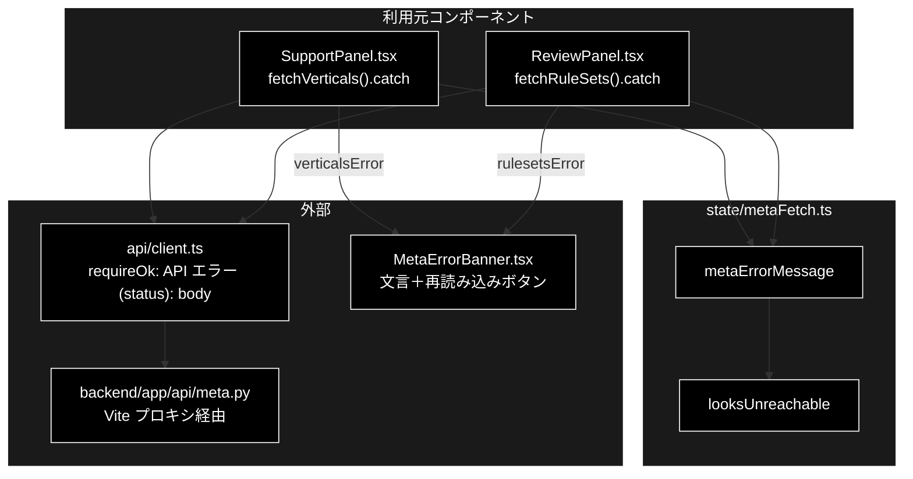

# metaFetch.ts - メタ情報取得失敗の文言 ドキュメント

**Version 1.0** | 最終更新: 2026-10-12

---

## 目次

- [概要](#概要)
- [1. アーキテクチャ構成図](#1-アーキテクチャ構成図)
- [2. エクスポート一覧](#2-エクスポート一覧)
- [3. 判断の規則](#3-判断の規則)
- [4. テスト](#4-テスト)
- [5. 変更履歴](#5-変更履歴)

---

## 概要

| 項目 | 内容 |
|---|---|
| ファイル | `frontend/src/state/metaFetch.ts`（53 行） |
| 種別 | 純ロジック（エラー → 文言） |
| 利用元 | `components/SupportPanel.tsx`（業界プロファイル）/ `components/ReviewPanel.tsx`（ルールセット）→ `MetaErrorBanner` に表示 |
| 対応バックエンド | `GET /api/verticals` / `GET /api/rulesets`（`backend/app/api/meta.py`） |

業界プロファイル・ルールセットのセレクタは、以前は取得失敗を `.catch(() => setState([]))` で握りつぶしていた。
バックエンドが起動していないと空のセレクタだけが出て、なぜ選べないのかが伝わらない（silent failure）。
空配列に倒すこと自体は正しいので残し、「なぜ空なのか」と次にやることを 1 文で伝える。

### 主な責務

- バックエンドへ届いていない可能性が高いエラーかを見分ける
- 取得失敗を、次にやることが分かる 1 文に変える（原因の詳細は必ず残す）

### 各責務対応のモジュール

| # | 責務 | 対応モジュール | 説明 |
|---|---|---|---|
| 1 | 到達不能の判定 | `looksUnreachable` | `TypeError`（fetch 自体の失敗）か、メッセージに `(500)` / `(502)` / `(504)` を含む |
| 2 | 文言への変換 | `metaErrorMessage` / `MetaKind` | 到達不能なら起動手順（`./run_dev.sh`）を添える。どちらでも `（詳細: …）` を付ける |

> 📌 **500 を到達不能とみなす理由**: Vite の dev プロキシは転送先（:8000）へ繋げないとき 500 を返す（ECONNREFUSED）。
> 500 は本物のサーバエラーでもありうるので断定はせず、文言は「確認してください」に留める。
> メッセージの `(500)` は `api/client.ts::requireOk()` が作る `API エラー (500): …` の形に合わせている。

---

## 1. アーキテクチャ構成図

### 1.1 位置づけ



---

## 2. エクスポート一覧

```ts
export type MetaKind = '業界プロファイル' | 'ルールセット';

export function looksUnreachable(error: unknown): boolean

export function metaErrorMessage(error: unknown, kind: MetaKind): string
```

`error` は `catch` で受け取った値をそのまま渡す（`Error` とは限らない）。

---

## 3. 判断の規則

### 3.1 使用例

`SupportPanel` の `fetchVerticals().catch(...)` と同じ使い方。

```ts
import { looksUnreachable, metaErrorMessage } from '../../src/state/metaFetch';

const down = new Error('API エラー (500): ');               // Vite プロキシが :8000 へ繋げない
const notFound = new Error('API エラー (404): Not Found');   // サーバには届いている
console.log(looksUnreachable(down), looksUnreachable(new TypeError('Failed to fetch')), looksUnreachable(notFound));
console.log(metaErrorMessage(down, '業界プロファイル'));
console.log(metaErrorMessage(notFound, 'ルールセット'));
console.log(metaErrorMessage('timeout', 'ルールセット'));  // Error でない値
```

```text
true true false
業界プロファイルを取得できませんでした。バックエンド（http://localhost:8000）が起動しているか確認してください。リポジトリルートで ./run_dev.sh を実行すると backend と frontend が同時に起動します。（詳細: API エラー (500): ）
ルールセットを取得できませんでした。（詳細: API エラー (404): Not Found）
ルールセットを取得できませんでした。（詳細: timeout）
```

> 📝 **確かめ方（2026-10-12）**: 上の例を esbuild で束ねて node で実行し、出力が一致することを確かめた。

### 3.2 規則

`looksUnreachable(error)`:

| 入力 | 結果 |
|---|---|
| `TypeError`（`Failed to fetch`） | `true` |
| メッセージに `(500)` / `(502)` / `(504)` | `true` |
| 4xx | `false`（サーバには届いている） |
| `Error` でない値 | 文字列化して同じ判定（落ちない） |

`metaErrorMessage(error, kind)`:

| 条件 | 文言 |
|---|---|
| 到達不能 | `{kind}を取得できませんでした。` ＋ バックエンドの確認と `./run_dev.sh` の案内 ＋ `（詳細: …）` |
| 到達している | `{kind}を取得できませんでした。（詳細: …）`（起動手順は出さない。的外れな案内をしない） |
| どちらでも | 原因の詳細を必ず残す（握りつぶさない） |

---

## 4. テスト

| テストファイル | 対象 | 件数 | 実行 |
|---|---|---:|---|
| `src/state/metaFetch.test.ts` | `looksUnreachable` 5 件・`metaErrorMessage` 5 件 | 10 | `npm test` |

件数は 2026-10-12 に `npx vitest run` で実測した。

---

## 5. 変更履歴

| バージョン | 日付 | 変更内容 |
|---|---|---|
| 1.0 | 2026-10-12 | 新規作成（`a_react_page_md_format.md` §2.4 の軽量構成）。使用例は esbuild + node で実行して確かめた |
