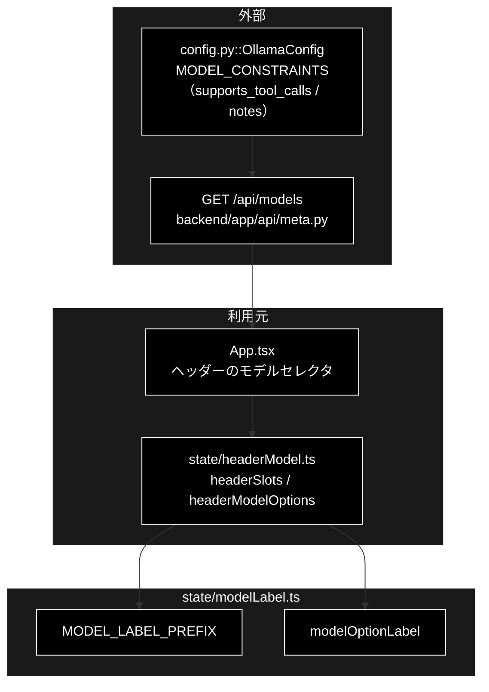

# modelLabel.ts - モデル選択肢のラベル ドキュメント

**Version 1.0** | 最終更新: 2026-10-12

---

## 目次

- [概要](#概要)
- [1. アーキテクチャ構成図](#1-アーキテクチャ構成図)
- [2. エクスポート一覧](#2-エクスポート一覧)
- [3. 判断の規則](#3-判断の規則)
- [4. テスト](#4-テスト)
- [5. 変更履歴](#5-変更履歴)

---

## 概要

| 項目 | 内容 |
|---|---|
| ファイル | `frontend/src/state/modelLabel.ts`（45 行） |
| 種別 | 純ロジック（表示文字列） |
| 利用元 | `state/headerModel.ts`（ヘッダーの見出し・選択肢のラベル） |
| 対応バックエンド | `GET /api/models`（`ModelChoice.supports_tool_calls` / `notes`）— `backend/app/api/meta.py`。値の出どころは `config.py::OllamaConfig.MODEL_CONSTRAINTS` |

ヘッダーのモデルセレクタの見出しと、選択肢 1 つ 1 つのラベルを組み立てる。
`GET /api/models` は `supports_tool_calls` と `notes`（容量・得手不得手・制約）を返す。以前のセレクタは `id` しか出していなかったが、
これらは**選ぶ前に分かるべき情報**なので、ラベルに畳み込む。

> ⚠️ **既定のモデル名をこのファイル（と frontend 全体）に書かない。** 値は必ず API から来る（`config.py::get_default_ollama_model()` の解決結果）。
>
> ⚠️ **姉妹リポジトリ grace_v2 の同名ファイルとは中身が別物**（あちらは入力・出力の単価を添え、Embedding の表示 `embeddingLabel` も持つ）。
> コピーで行き来させない（CLAUDE.md §5）。

### 主な責務

- ヘッダーの見出し文字列を 1 か所で持つ
- 選択肢のラベルに tool calling の対応可否と `notes` を畳み込む

### 各責務対応のモジュール

| # | 責務 | 対応モジュール | 説明 |
|---|---|---|---|
| 1 | 見出し | `MODEL_LABEL_PREFIX` | `利用モデル名：`（エージェントの 3 タブ） |
| 2 | 選択肢のラベル | `modelOptionLabel` | `{id} — {注記}`。tool calling 非対応なら先頭に出す（ReAct 経路で使えない）。`notes` が既に tool calling に触れていれば重ねない |

---

## 1. アーキテクチャ構成図

### 1.1 位置づけ



---

## 2. エクスポート一覧

```ts
export const MODEL_LABEL_PREFIX = '利用モデル名：';

export function modelOptionLabel(choice: ModelChoice): string
```

`ModelChoice`（`types.ts`）は `{ id: string; supports_tool_calls: boolean; notes: string }`。

---

## 3. 判断の規則

### 3.1 使用例

値は 2026-10-12 時点の `GET /api/models` が返すもの（1 件目）と、`OllamaConfig.MODEL_CONSTRAINTS` にある tool calling 非対応のモデル。

```ts
import { MODEL_LABEL_PREFIX, modelOptionLabel } from '../../src/state/modelLabel';

console.log(MODEL_LABEL_PREFIX);
console.log(modelOptionLabel({ id: 'gemma4:26b-a4b-it-qat', supports_tool_calls: true, notes: 'デフォルト。QAT 版 26B-A4B（15 GB）。MLX ではなく GGUF' }));
console.log(modelOptionLabel({ id: 'phi3', supports_tool_calls: false, notes: 'tool calling 非対応。ReAct には使えない' }));  // 重ねない
console.log(modelOptionLabel({ id: 'my-model', supports_tool_calls: false, notes: '' }));                                  // 理由だけ
console.log(modelOptionLabel({ id: ' llama3.2:latest ', supports_tool_calls: true, notes: ' ' }));                       // 付け足さない
```

```text
利用モデル名：
gemma4:26b-a4b-it-qat — デフォルト。QAT 版 26B-A4B（15 GB）。MLX ではなく GGUF
phi3 — tool calling 非対応。ReAct には使えない
my-model — tool calling 非対応
llama3.2:latest
```

> 📝 **確かめ方（2026-10-12）**: 上の例を esbuild で束ねて node で実行し、出力が一致することを確かめた。

### 3.2 規則

`modelOptionLabel(choice)`（`id` と `notes` は前後の空白を落とす）:

| `supports_tool_calls` | `notes` | 結果 |
|---|---|---|
| `true` | あり | `{id} — {notes}` |
| `true` | 空 | `{id}`（区切りだけが残らない） |
| `false` | tool calling に触れていない | `{id} — tool calling 非対応 / {notes}` |
| `false` | `tool call` を含む（大文字小文字・空白の有無を問わない） | `{id} — {notes}`（`MODEL_CONSTRAINTS` の文言と二重にしない） |
| `false` | 空 | `{id} — tool calling 非対応` |

---

## 4. テスト

| テストファイル | 対象 | 件数 | 実行 |
|---|---|---:|---|
| `src/state/modelLabel.test.ts` | 見出し 1 件・`modelOptionLabel` 7 件 | 8 | `npm test` |

件数は 2026-10-12 に `npx vitest run` で実測した。

---

## 5. 変更履歴

| バージョン | 日付 | 変更内容 |
|---|---|---|
| 1.0 | 2026-10-12 | 新規作成（`a_react_page_md_format.md` §2.4 の軽量構成）。使用例は esbuild + node で実行して確かめた |
