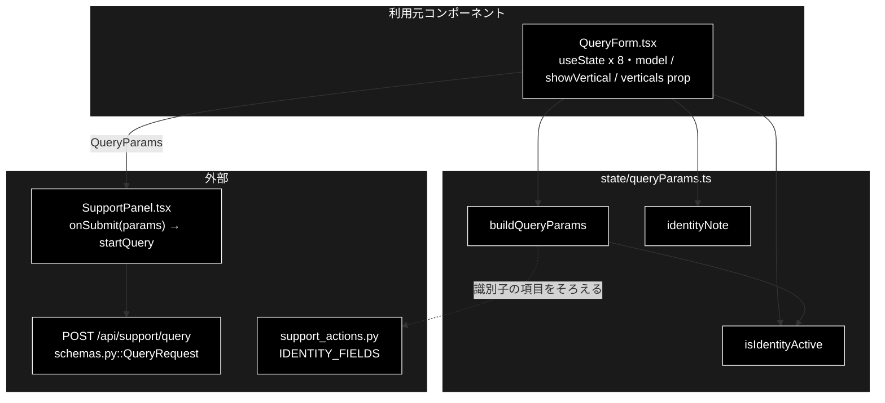

# queryParams.ts - GRACE-Support の送信ペイロード ドキュメント

**Version 1.0** | 最終更新: 2026-10-12

---

## 目次

- [概要](#概要)
- [1. アーキテクチャ構成図](#1-アーキテクチャ構成図)
- [2. エクスポート一覧](#2-エクスポート一覧)
- [3. 判断の規則](#3-判断の規則)
- [4. テスト](#4-テスト)
- [5. 変更履歴](#5-変更履歴)

---

## 概要

| 項目 | 内容 |
|---|---|
| ファイル | `frontend/src/state/queryParams.ts`（126 行） |
| 種別 | 純ロジック（送信ペイロードの組み立て・表示文言） |
| 利用元 | `components/QueryForm.tsx`（基本版 / GRACE-Support の送信・識別子欄の有効 / 無効と案内文） |
| 対応バックエンド | `POST /api/support/query`（`backend/app/schemas.py::QueryRequest`）・`support_actions.py::IDENTITY_FIELDS` |

問い合わせフォームの状態から `POST /api/support/query` の本文（`QueryParams`）を組み立て、本人確認の識別子欄を有効にするか・
その下にどんな案内を出すかを決める。

### 主な責務

- フォームの状態から送信ペイロードを作る（基本版の `vertical` 固定・モデル未選択の `null` 化・trim）
- 本人確認が実際に起動する設定かを判定する（無効な欄の値を送らない）
- 識別子欄の下の案内文を、無効な理由ごとに言い分ける

### 各責務対応のモジュール

| # | 責務 | 対応モジュール | 説明 |
|---|---|---|---|
| 1 | ペイロードの組み立て | `buildQueryParams` / `QueryFormState` | 空の値は `null`。フロントに既定のモデル名を持たないための表現。`model` は全タブ共通で送る |
| 2 | 本人確認の有効判定 | `isIdentityActive` / `IDENTITY_FIELDS` | GRACE-Support タブで `require_identity` のプロファイル（既定では `ec`）を選んだときだけ |
| 3 | 案内文 | `identityNote` / `IdentityNoteInput` | 基本版 / 未選択 / `require_identity=false` / 有効（dry-run の ON / OFF）の 5 通り |

> ⚠️ **`buildQueryParams` は DOM ではなく state からペイロードを組む。** `<fieldset disabled>` の「無効な欄は送信されない」という
> HTML の保護が効かないので、`ec` で識別子を入れてから `gov` へ切り替えたときなど、画面で無効になっている欄の値が残る。
> `isIdentityActive` が偽なら識別子を送らない、でこれを防いでいる。

---

## 1. アーキテクチャ構成図

### 1.1 位置づけ



---

## 2. エクスポート一覧

```ts
export const IDENTITY_FIELDS = ['order_id', 'email'] as const;   // support_actions.py と一致させる

export interface QueryFormState {
  query: string;
  vertical: string;           // 業界プロファイル ID。未選択は空文字
  model: string;              // 使用する LLM。未選択は空文字（= サーバーの既定値）
  useWeb: boolean;
  doAction: boolean;
  dryRun: boolean;
  verbose: boolean;
  orderId: string;
  email: string;
  showVertical: boolean;      // 基本版タブは false。false なら vertical を送らない
  requireIdentity?: boolean;  // 選択中プロファイルの require_identity。未選択・基本版は undefined
}
export function buildQueryParams(state: QueryFormState): QueryParams

export function isIdentityActive(showVertical: boolean, requireIdentity: boolean | undefined): boolean

export interface IdentityNoteInput {
  showVertical: boolean;
  vertical: string;
  requireIdentity?: boolean;
  dryRun: boolean;
  identityVerticals: string[];  // require_identity=true のプロファイル ID 一覧（基本版タブは未取得なので空）
}
export function identityNote(input: IdentityNoteInput): string
```

`QueryParams`（`types.ts`）は `query` / `vertical` / `model` / `dry_run` / `use_web` / `do_action` / `verbose` / `identity`。

---

## 3. 判断の規則

### 3.1 使用例

`QueryForm` と同じ使い方（GRACE-Support タブで `ec` を選び、注文番号を入れた場合と、同じ入力のまま基本版の扱いにした場合）。

```ts
import { buildQueryParams, identityNote, type QueryFormState } from '../../src/state/queryParams';

const form: QueryFormState = {
  query: '  注文をキャンセルしたい  ', vertical: 'ec', model: '',
  useWeb: true, doAction: true, dryRun: false, verbose: true,
  orderId: ' A-123 ', email: '', showVertical: true, requireIdentity: true,
};
console.log(buildQueryParams(form));
console.log(buildQueryParams({ ...form, showVertical: false, requireIdentity: undefined }));   // 基本版
console.log(identityNote({ showVertical: true, vertical: 'gov', requireIdentity: false, dryRun: false, identityVerticals: ['ec'] }));
```

```text
{
  query: '注文をキャンセルしたい',
  vertical: 'ec',
  model: null,
  dry_run: false,
  use_web: true,
  do_action: true,
  verbose: true,
  identity: { order_id: 'A-123', email: '' }
}
{
  query: '注文をキャンセルしたい',
  vertical: null,
  model: null,
  dry_run: false,
  use_web: true,
  do_action: true,
  verbose: true,
  identity: null
}
gov は本人確認を行いません（require_identity=false）。　本人確認を行うプロファイル: ec
```

> 📝 **確かめ方（2026-10-12）**: 上の例を esbuild で束ねて node で実行し、出力が一致することを確かめた。

### 3.2 規則

`buildQueryParams(state)`:

| 項目 | 規則 |
|---|---|
| `query` | trim する（空白だけの入力を弾くのは呼び出し側） |
| `vertical` | GRACE-Support タブでは選んだ ID、未選択（`''`）は `null`。**基本版タブでは常に `null`** |
| `model` | 空文字なら `null`（サーバーの既定値）。**trim はしない**（値はヘッダーのセレクタから来るので空白は入らない。姉妹リポジトリ grace_v2 は trim する） |
| `dry_run` / `use_web` / `do_action` / `verbose` | チェックをそのまま |
| `identity` | 本人確認が有効（`isIdentityActive`）**かつ** `order_id` / `email` のどちらかが（trim 後に）空でなければ `{ order_id, email }`（空の方は `''`）。それ以外は `null`（空文字の辞書を送らない） |

`isIdentityActive(showVertical, requireIdentity)`: `showVertical && requireIdentity === true`。基本版は `vertical` を送らないので常に偽。

`identityNote(input)`（`hint` は `identityVerticals` が空でなければ `　本人確認を行うプロファイル: ec` のように付く）:

| 条件（上から順に判定） | 文言 |
|---|---|
| 基本版タブ | 基本版は業界プロファイルを使わないため本人確認を行いません（GRACE-Support タブで選択してください）。＋`hint` |
| プロファイル未選択 | 業界プロファイルが未選択のため本人確認を行いません。＋`hint`（「このプロファイル」のせいにしない） |
| `require_identity` が真でない | `{vertical}` は本人確認を行いません（require_identity=false）。＋`hint` |
| 有効・dry-run ON | dry-run 中はデモ照合のため、入力値は照合に使われません（dry-run をオフにすると台帳と照合します） |
| 有効・dry-run OFF | SUPPORT_IDENTITY_FILE の顧客台帳と照合します（未設定の場合は常に未確認） |

> 📌 `identityVerticals` が空でも「該当プロファイルは無い」とは書かない（基本版タブは `/api/verticals` を引かないので、単に未取得なだけ）。

---

## 4. テスト

| テストファイル | 対象 | 件数 | 実行 |
|---|---|---:|---|
| `src/state/queryParams.test.ts` | `buildQueryParams` 8 件・identity 5 件・無効な識別子欄 3 件・`isIdentityActive` 4 件・`identityNote` 7 件 | 27 | `npm test` |

件数は 2026-10-12 に `npx vitest run` で実測した。

---

## 5. 変更履歴

| バージョン | 日付 | 変更内容 |
|---|---|---|
| 1.0 | 2026-10-12 | 新規作成（`a_react_page_md_format.md` §2.4 の軽量構成）。使用例は esbuild + node で実行して確かめた |
