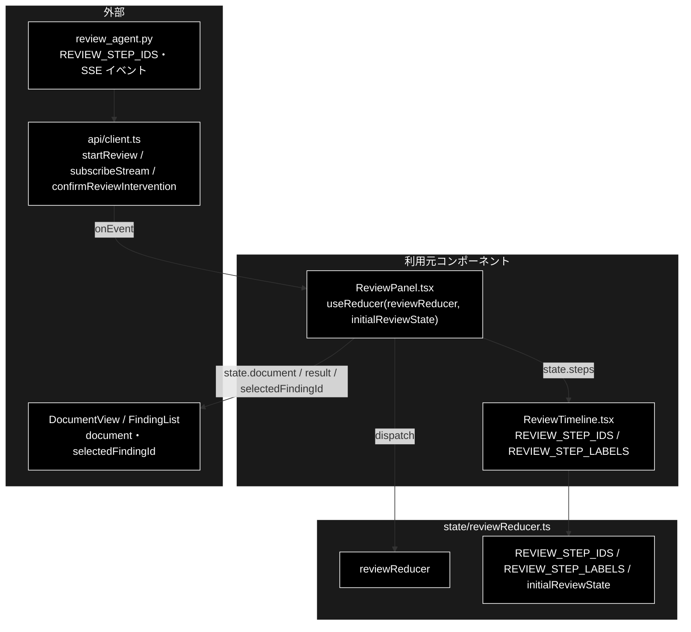
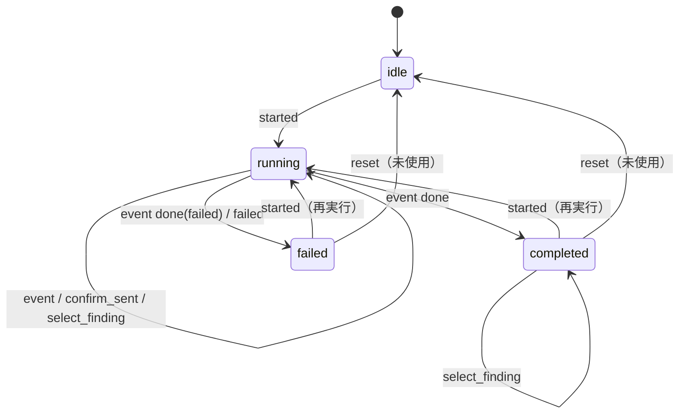

# reviewReducer.ts - GRACE-Review ジョブの状態遷移 ドキュメント

**Version 1.1** | 最終更新: 2026-10-12

---

## 目次

- [概要](#概要)
- [1. アーキテクチャ構成図](#1-アーキテクチャ構成図)
- [2. エクスポート一覧](#2-エクスポート一覧)
- [3. 判断の規則](#3-判断の規則)
- [4. テスト](#4-テスト)
- [5. 変更履歴](#5-変更履歴)

---

## 概要

| 項目 | 内容 |
|---|---|
| ファイル | `frontend/src/state/reviewReducer.ts`（191 行） |
| 種別 | 純ロジック（reducer） |
| 利用元 | `components/ReviewPanel.tsx`（`useReducer`）/ `components/ReviewTimeline.tsx`（`REVIEW_STEP_IDS` / `REVIEW_STEP_LABELS`） |
| 対応バックエンド | `backend/app/core/review_agent.py::REVIEW_STEP_IDS`（9 ステップ）・SSE `GET /api/review/stream/{job_id}` |

GRACE-Review の SSE イベント列を、ステップタイムライン・承認待ち・指摘一覧（`ReviewResult`）の UI 状態へ畳み込む。副作用は無い。
`jobReducer.ts` とほぼ同じ形だが、結果の型（`ReviewResult` / `SupportResult`）が違うので**ジェネリック化しない**。
SSE のイベント形式は Support と同じなので `SupportEvent` をそのまま使う。Support との違いは、原文（`document`）と
選択中の指摘（`selectedFindingId`）を持つこと。設計は [`core_process_flow.md` §2.6](../../../backend/app/core/docs/core_process_flow.md)（データモデル）・
[`README_api.md` §4.1](../../../backend/app/api/docs/README_api.md)（進捗イベント）。

### 主な責務

- 9 ステップの並び順と表示名を持つ（バックエンドの `REVIEW_STEP_IDS` と 1:1）
- SSE イベントをステップの状態・ログ・承認待ち・結果・エラーへ畳み込む
- 原文と選択中の指摘を持つ（原文ハイライト ⇄ 指摘カードの相互ジャンプ）
- 画面側の操作（起動・承認の送信・指摘の選択・失敗）で状態を遷移させる

### 各責務対応のモジュール

| # | 責務 | 対応モジュール | 説明 |
|---|---|---|---|
| 1 | ステップの並びと表示名 | `REVIEW_STEP_IDS` / `REVIEW_STEP_LABELS` / `ReviewStepId` | 番号は Support との対応を示す呼称で、**実行順とは一致しない**（`web` が ⑥、`severity` が ⑤） |
| 2 | イベントの畳み込み | `reviewReducer`（`event` アクション） | `jobReducer` と同じ規則（§3.3） |
| 3 | 原文と選択中の指摘 | `reviewReducer`（`started` / `select_finding`） | 原文は `started` で受け取るので、結果を待たずに表示できる |
| 4 | 画面操作による遷移 | `reviewReducer`（`confirm_sent` / `failed` / `reset`）/ `initialReviewState` | — |

---

## 1. アーキテクチャ構成図

### 1.1 位置づけ



---

## 2. エクスポート一覧

```ts
export const REVIEW_STEP_IDS = [
  'ruleset', 'segment', 'retrieve', 'detect', 'ground', 'suppress', 'web', 'severity', 'action',
] as const;
export type ReviewStepId = (typeof REVIEW_STEP_IDS)[number];
export const REVIEW_STEP_LABELS: Record<ReviewStepId, string>;

export type StepStatus = 'pending' | 'running' | 'done' | 'skipped';
export interface ReviewStepState {
  id: ReviewStepId;
  status: StepStatus;
  logs: string[];
  data: Record<string, unknown>;
}

export type ReviewPhase = 'idle' | 'running' | 'completed' | 'failed';
export interface ReviewJobState {
  jobId: string | null;
  phase: ReviewPhase;
  document: string;                  // 実行対象の原文（ハイライト描画に使う）
  documentTitle: string;
  steps: Record<ReviewStepId, ReviewStepState>;
  intervention: InterventionInfo | null;
  result: ReviewResult | null;
  error: string | null;
  logs: string[];
  selectedFindingId: string | null;  // 原文ハイライト ⇔ 指摘カードの相互ジャンプ用
}

export type ReviewAction =
  | { type: 'started'; jobId: string; document: string; documentTitle: string }
  | { type: 'event'; event: SupportEvent }
  | { type: 'confirm_sent' }
  | { type: 'select_finding'; findingId: string | null }
  | { type: 'failed'; message: string }
  | { type: 'reset' };

export const initialReviewState: ReviewJobState;
export function reviewReducer(state: ReviewJobState, action: ReviewAction): ReviewJobState
```

`REVIEW_STEP_LABELS`（画面の表示名。並びは実行順）:

| ID | 表示名 |
|---|---|
| `ruleset` | S1 ルールセット適用 |
| `segment` | ① Segment（文書を検査単位へ分割） |
| `retrieve` | ② Retrieve（規程を RAG 検索） |
| `detect` | ③ Detect（二段判定で違反候補を検出） |
| `ground` | ④ Ground（指摘の根拠を検証） |
| `suppress` | ④' Suppress（誤検知抑止 + 救済） |
| `web` | ⑥ Web 裏取り（法改正・ガイドライン更新） |
| `severity` | ⑤ Severity（重大度の確定＋強制 high） |
| `action` | ⑦ Action（レポート → HITL CONFIRM → 実行） |

---

## 3. 判断の規則

### 3.1 使用例

`ReviewPanel` と同じ順に dispatch する（起動 → SSE のイベント → 結果 → 完了 → 指摘を選ぶ）。

```ts
import { initialReviewState, reviewReducer, type ReviewAction } from '../../src/state/reviewReducer';

const ev = (event: object): ReviewAction => ({ type: 'event', event: event as never });
const actions: ReviewAction[] = [
  { type: 'started', jobId: 'job-r1', document: '今だけ半額！', documentTitle: 'LP 案' },
  ev({ type: 'step', step: 'segment', status: 'started' }),
  ev({ type: 'step', step: 'segment', status: 'completed', data: { segments: 1 } }),
  ev({ type: 'step', step: 'plan', status: 'started' }),   // Support のステップ ID は無視される
  ev({ type: 'step', step: 'web', status: 'skipped' }),
  ev({ type: 'result', data: { findings: [{ finding_id: 'f-1' }] } }),
  ev({ type: 'done', status: 'completed' }),
  { type: 'select_finding', findingId: 'f-1' },
];
let state = initialReviewState;
for (const a of actions) state = reviewReducer(state, a);
console.log(state.phase, state.document, state.documentTitle);
console.log(state.steps.segment.status, state.steps.segment.data, state.steps.web.status);
console.log('plan' in state.steps, state.selectedFindingId);
```

```text
completed 今だけ半額！ LP 案
done { segments: 1 } skipped
false f-1
```

> 📝 **確かめ方（2026-10-12）**: 上の例を esbuild で束ねて node で実行し、出力が一致することを確かめた。

### 3.2 アクション一覧

| アクション | いつ dispatch するか（`ReviewPanel`） | 遷移 |
|---|---|---|
| `started` | `startReview` が `job_id` を返した直後 | `initialReviewState` から作り直し、`jobId` / `document` / `documentTitle` と `phase = 'running'`。選択中の指摘も消える |
| `event` | `subscribeStream` の `onEvent` | §3.3 |
| `confirm_sent` | `confirmReviewIntervention` を送った直後 | `intervention = null`（応答の往復を待たせない） |
| `select_finding` | 原文ハイライト・指摘カードの選択（`selectionKeys.ts::toggleSelection` の結果） | `selectedFindingId = findingId`（`null` で解除） |
| `failed` | 起動の失敗・承認の送信の失敗・SSE の `onError` | `phase = 'failed'`、`error = message` |
| `reset` | **どのコンポーネントも dispatch していない**（テストだけが使う。2026-10-12 に grep で確認） | `initialReviewState` に戻す |

### 3.3 イベントの畳み込み（`event` アクション）

`jobReducer.ts` §3.3 と同じ規則である。

| `event.type` | `status` | 変わるもの |
|---|---|---|
| `step` | `started` / `skipped` / それ以外 | そのステップを `running` / `skipped` / `done`。`data` はマージ。**`REVIEW_STEP_IDS` に無い ID は無視**（Support のステップが混ざっても壊れない） |
| `log` | — | `step` があればそのステップ、無ければ全体の `logs` に追加 |
| `intervention` | `waiting` / それ以外 | モーダル用の `intervention` を立てる / `null` |
| `result` | — | `result = data`（`ReviewResult`） |
| `error` | — | `error = message`（無ければ `実行に失敗しました`） |
| `done` | `failed` / それ以外 | `phase = 'failed'` / `'completed'`。どちらでも `intervention = null` |

### 3.4 状態遷移図（`phase`）



---

## 4. テスト

| テストファイル | 対象 | 件数 | 実行 |
|---|---|---:|---|
| `src/state/reviewReducer.test.ts` | 6 アクションすべて・未知のステップ ID・全ステップにラベルがあること | 13 | `npm test` |

件数は 2026-10-12 に `npx vitest run` で実測した。

---

## 5. 変更履歴

| バージョン | 日付 | 変更内容 |
|---|---|---|
| 1.0 | 2026-10-12 | 新規作成（`a_react_page_md_format.md` §2.4 の軽量構成）。使用例は esbuild + node で実行して確かめた |
| 1.1 | 2026-10-12 | backend/docs/ の廃止（2026-10-12）に追随し、参照先を backend/app/docs/README_app.md・backend/app/api/docs/README_api.md・backend/app/core/docs/core_process_flow.md などへ付け替えた（テストの地図は docs/testing.md、実行例の txt は docs/examples/） |
