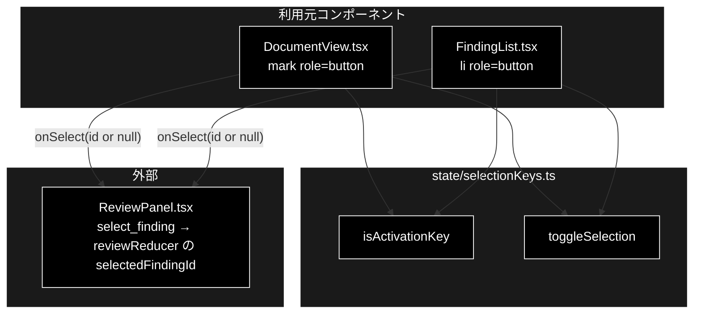

# selectionKeys.ts - 指摘の選択キーと選択トグル ドキュメント

**Version 1.0** | 最終更新: 2026-10-12

---

## 目次

- [概要](#概要)
- [1. アーキテクチャ構成図](#1-アーキテクチャ構成図)
- [2. エクスポート一覧](#2-エクスポート一覧)
- [3. 判断の規則](#3-判断の規則)
- [4. テスト](#4-テスト)
- [5. 変更履歴](#5-変更履歴)

---

## 概要

| 項目 | 内容 |
|---|---|
| ファイル | `frontend/src/state/selectionKeys.ts`（63 行） |
| 種別 | 純ロジック（キー判定・選択状態の遷移） |
| 利用元 | `components/DocumentView.tsx`（原文の `<mark>`）/ `components/FindingList.tsx`（指摘カードの `<li>`） |
| 対応バックエンド | なし |

GRACE-Review の 2 ペイン（原文ハイライト ⇄ 指摘カード）は、どちらも本来はインタラクティブでない要素を `onClick` で選択していた。
`role="button"` と `tabIndex={0}` を付け、Enter / Space でもクリックと同じ動作をさせる（ネイティブの `<button>` と同じ挙動）。
そのキー判定と、選択のトグル規則を本モジュールが持つ。2026-09-21 に追加した（同月 24 日に姉妹リポジトリ grace_v2 へ移植）。

### 主な責務

- Enter / Space をクリック相当とみなす（修飾キー付き・IME 変換中は除く）
- 指摘の選択と選択解除（トグル）の規則を 1 か所で決める

### 各責務対応のモジュール

| # | 責務 | 対応モジュール | 説明 |
|---|---|---|---|
| 1 | クリック相当のキー判定 | `isActivationKey` | Enter と `' '`（Space）。修飾キー付き・`isComposing` は `false` |
| 2 | 選択のトグル | `toggleSelection` | 同じ指摘をもう一度選ぶと解除。原文側とカード側で同じ規則 |

---

## 1. アーキテクチャ構成図

### 1.1 位置づけ



---

## 2. エクスポート一覧

```ts
export interface ActivationKeyEvent {
  key: string;
  ctrlKey?: boolean;      // 修飾キー。いずれか押されていれば発火しない
  metaKey?: boolean;
  altKey?: boolean;
  shiftKey?: boolean;
  isComposing?: boolean;  // IME の変換中か。省略時は false 扱い
}

export function isActivationKey(event: ActivationKeyEvent): boolean

export function toggleSelection(
  selectedFindingId: string | null,
  findingId: string,
): string | null
```

---

## 3. 判断の規則

### 3.1 使用例

`FindingList` の `onClick` / `onKeyDown` と同じ使い方（キーが当たれば `preventDefault()` してトグルの結果を親へ返す）。

```ts
import { isActivationKey, toggleSelection } from '../../src/state/selectionKeys';

console.log(isActivationKey({ key: 'Enter' }), isActivationKey({ key: ' ' }));
console.log(isActivationKey({ key: 'Enter', ctrlKey: true }), isActivationKey({ key: 'Enter', isComposing: true }));

let selected: string | null = null;
selected = toggleSelection(selected, 'f-1'); console.log(selected); // 選択
selected = toggleSelection(selected, 'f-2'); console.log(selected); // 乗り換え
selected = toggleSelection(selected, 'f-2'); console.log(selected); // 同じものを再度 → 解除
```

```text
true true
false false
f-1
f-2
null
```

> 📝 **確かめ方（2026-10-12）**: 上の例を esbuild で束ねて node で実行し、出力が一致することを確かめた。

### 3.2 規則

`isActivationKey(event)`:

| 入力 | 結果 |
|---|---|
| `Enter` / `' '`（Space） | `true` |
| それ以外のキー（`Spacebar` を含む。旧 IE の値は受けない） | `false` |
| Ctrl / ⌘ / Alt / Shift のいずれか付き | `false`（ブラウザ・アプリのショートカットを奪わない） |
| `isComposing = true` | `false`（日本語入力の確定 Enter を選択と取り違えない） |
| 修飾・`isComposing` を省略 | 押されていない扱い |

`toggleSelection(selected, id)`:

| いまの選択 | 操作した指摘 | 結果 |
|---|---|---|
| `null` | `id` | `id`（選択） |
| 別の指摘 | `id` | `id`（乗り換え） |
| `id` | `id` | `null`（解除） |

---

## 4. テスト

| テストファイル | 対象 | 件数 | 実行 |
|---|---|---:|---|
| `src/state/selectionKeys.test.ts` | `isActivationKey` 6 件・`toggleSelection` 3 件 | 9 | `npm test` |

件数は 2026-10-12 に `npx vitest run` で実測した。

---

## 5. 変更履歴

| バージョン | 日付 | 変更内容 |
|---|---|---|
| 1.0 | 2026-10-12 | 新規作成（`a_react_page_md_format.md` §2.4 の軽量構成）。使用例は esbuild + node で実行して確かめた |
