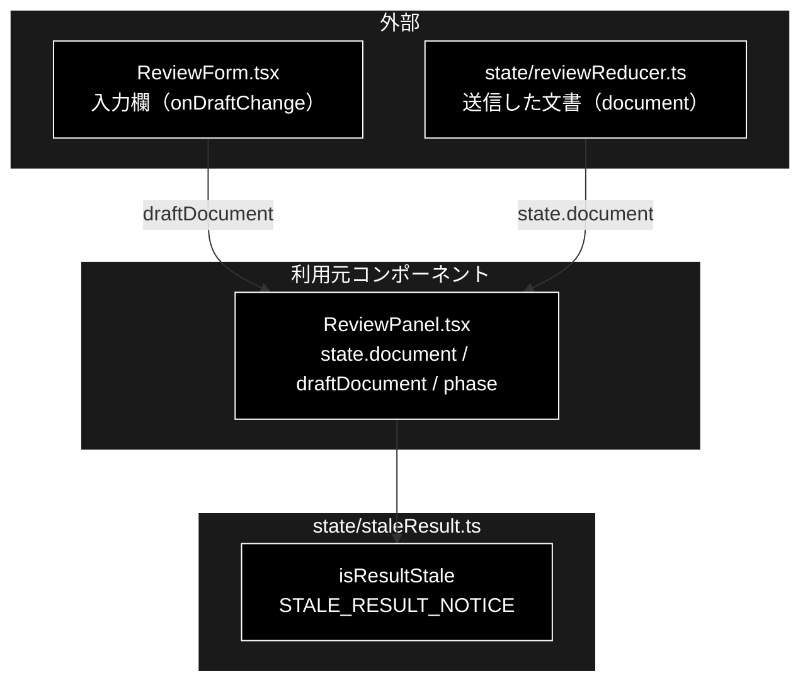

# staleResult.ts - GRACE-Review の結果が古いかの判定 ドキュメント

**Version 1.0** | 最終更新: 2026-10-12

---

## 目次

- [概要](#概要)
- [1. アーキテクチャ構成図](#1-アーキテクチャ構成図)
- [2. エクスポート一覧](#2-エクスポート一覧)
- [3. 判断の規則](#3-判断の規則)
- [4. テスト](#4-テスト)
- [5. 変更履歴](#5-変更履歴)

---

## 概要

| 項目 | 内容 |
|---|---|
| ファイル | `frontend/src/state/staleResult.ts`（28 行） |
| 種別 | 純ロジック（判定関数＋文言） |
| 利用元 | `components/ReviewPanel.tsx` |
| 対応バックエンド | なし（画面だけの判定） |

GRACE-Review の例文ボタン（「OK 例」など）は入力欄の文書を差し替えるだけで実行はしない。結果欄に前回の結果が残ったままになり、
「OK 例が NG になった」と読み違えられた（2026-10-03 実測）。結果が入力欄の文書のものでないときに、それを画面に出すための判定である。

### 主な責務

- 結果欄が入力欄の文書の結果かどうかを判定する
- 古いときに出す文言を 1 か所で持つ

### 各責務対応のモジュール

| # | 責務 | 対応モジュール | 説明 |
|---|---|---|---|
| 1 | 古いかの判定 | `isResultStale` | 送信した文書と入力欄の文書を前後の空白を除いて比べる |
| 2 | 文言 | `STALE_RESULT_NOTICE` | `ReviewPanel` が `role="status"` の警告として出し、結果を薄く表示する |

---

## 1. アーキテクチャ構成図

### 1.1 位置づけ



---

## 2. エクスポート一覧

```ts
export const STALE_RESULT_NOTICE =
  'この結果は前にチェックした文書のものです。入力欄の文書はまだチェックしていません。' +
  '「表示チェックを実行」を押してください。';

export function isResultStale(
  checkedDocument: string,
  draftDocument: string | null,
  running: boolean,
): boolean
```

| 引数 | 説明 |
|---|---|
| `checkedDocument` | 結果を出した文書（送信した文書）。未送信なら空文字 |
| `draftDocument` | いま入力欄にある文書。まだ受け取っていなければ `null` |
| `running` | 実行中か（実行中はこれから結果が出るので古いとは言わない） |

---

## 3. 判断の規則

### 3.1 使用例

```ts
import { isResultStale } from '../../src/state/staleResult';

const checked = '今だけ半額！最安値保証';
console.log(isResultStale(checked, '送料無料（一部地域を除く）', false)); // 例文ボタンで差し替えた
console.log(isResultStale(checked, `  ${checked}\n`, false));             // 前後の空白だけ違う
console.log(isResultStale(checked, '別の文書', true));                    // 実行中
console.log(isResultStale('', '入力中の文書', false));                    // まだ一度も実行していない
```

```text
true
false
false
false
```

> 📝 **確かめ方（2026-10-12）**: 上の例を esbuild で束ねて node で実行し、出力が一致することを確かめた。

### 3.2 規則

| 条件 | 結果 |
|---|---|
| 送信した文書と入力欄の文書が違う（実行していない） | `true`（古い） |
| 同じ文書 | `false` |
| 前後の空白だけが違う | `false`（同じ文書とみなす） |
| 実行中（`running = true`） | `false`（これから新しい結果が出る） |
| まだ何も実行していない（`checkedDocument = ''`）／入力欄の値を受け取っていない（`null`） | `false` |
| 文言 | 「まだチェックしていない」ことと次の操作（「表示チェックを実行」）を伝える |

---

## 4. テスト

| テストファイル | 対象 | 件数 | 実行 |
|---|---|---:|---|
| `src/state/staleResult.test.ts` | §3.2 の 6 行 | 6 | `npm test` |

件数は 2026-10-12 に `npx vitest run` で実測した。

---

## 5. 変更履歴

| バージョン | 日付 | 変更内容 |
|---|---|---|
| 1.0 | 2026-10-12 | 新規作成（`a_react_page_md_format.md` §2.4 の軽量構成）。使用例は esbuild + node で実行して確かめた |
