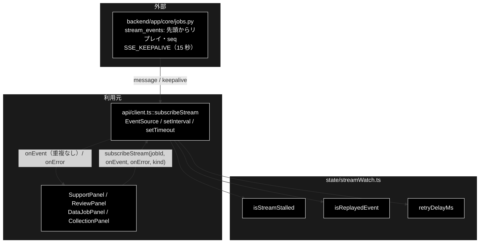

# streamWatch.ts - SSE の見張りと張り直しの判断 ドキュメント

**Version 1.0** | 最終更新: 2026-10-12

---

## 目次

- [概要](#概要)
- [1. アーキテクチャ構成図](#1-アーキテクチャ構成図)
- [2. エクスポート一覧](#2-エクスポート一覧)
- [3. 判断の規則](#3-判断の規則)
- [4. テスト](#4-テスト)
- [5. 変更履歴](#5-変更履歴)

---

## 概要

| 項目 | 内容 |
|---|---|
| ファイル | `frontend/src/state/streamWatch.ts`（59 行） |
| 種別 | 純ロジック（判定・定数） |
| 利用元 | `api/client.ts::subscribeStream`（3 種のジョブの SSE 購読で共用） |
| 対応バックエンド | `backend/app/core/jobs.py`（`Job.stream_events()` が**先頭からリプレイ**・各イベントに通し番号 `seq`・15 秒ごとの `SSE_KEEPALIVE`） |

進捗ストリーム（SSE）が切れた・黙って止まったときに張り直すための判断を集める。タイマーと `EventSource` の生成は
`subscribeStream` 側に残し、「いつ止まったとみなすか」「どのイベントを捨てるか」「どれだけ待って張り直すか」をここで決める。

> 📌 **きっかけ（2026-10-08）**: 本リポジトリ（ローカル LLM）のチャンク化（約 70 分）で、Step 2 が 38 分ログを出さない間に
> 画面への配信が**エラーなしで**止まった（`onerror` も来ない）。バックエンドは最後まで処理していたのに画面だけ途中で固まった。
> バックエンドはつなぎ直すと先頭からリプレイするので、「止まったら張り直す」「リプレイ分は `seq` で読み飛ばす」だけで、
> 各パネルの reducer を変えずに続きから表示できる。同日、姉妹リポジトリ grace_v2 へも移植した。

### 主な責務

- 接続が黙って止まったかを判定する
- 張り直したときのリプレイで、すでに渡したイベントかを判定する
- 張り直すまでの待ち時間を決める

### 各責務対応のモジュール

| # | 責務 | 対応モジュール | 説明 |
|---|---|---|---|
| 1 | 止まったかの判定 | `isStreamStalled` / `STREAM_STALL_MS` / `STREAM_CHECK_INTERVAL_MS` | 最後に何か届いてから 60 秒を**超えた**ら止まった。10 秒ごとに確かめる |
| 2 | リプレイ分の判定 | `isReplayedEvent` | `seq` がこれまでに渡した最大値以下なら捨てる。`seq` の無い `done` は常に渡す |
| 3 | 待ち時間 | `retryDelayMs` / `STREAM_MAX_RETRIES` | 1・2・4・8 秒…と延ばし 10 秒で頭打ち。何も受け取れないまま 5 回失敗したらあきらめる |

---

## 1. アーキテクチャ構成図

### 1.1 位置づけ



---

## 2. エクスポート一覧

```ts
export const STREAM_STALL_MS = 60_000;
export const STREAM_MAX_RETRIES = 5;
export const STREAM_CHECK_INTERVAL_MS = 10_000;

export function isStreamStalled(
  lastActivityMs: number,
  nowMs: number,
  stallMs: number = STREAM_STALL_MS,
): boolean

export function isReplayedEvent(seq: number | undefined, lastSeq: number): boolean

export function retryDelayMs(attempt: number): number
```

| 定数 | 値 | その値にした理由 |
|---|---:|---|
| `STREAM_STALL_MS` | 60,000 | バックエンドは新イベントが無い間も 15 秒ごとに keepalive を送る。**4 回ぶん**届かなければ異常とみなす（数回の取りこぼしでは誤判定しない） |
| `STREAM_CHECK_INTERVAL_MS` | 10,000 | 止まってから最大 70 秒で気づく。タブが凍結されてタイマーが止まっても、戻った最初の確認で張り直す |
| `STREAM_MAX_RETRIES` | 5 | 何も受け取れないまま 5 回（待ち 1 + 2 + 4 + 8 + 10 秒）失敗したらバックエンドが落ちているとみなす。何か届けば回数は 0 に戻る |

> ⚠️ **keepalive は名前付きイベントでなければ見えない。** コメント行（`: keepalive`）は `EventSource` が捨てるので、
> 生きている接続まで「止まった」と誤判定し、1 分ごとに張り直すことになる。バックエンドの `jobs.py::SSE_KEEPALIVE` は
> `event: keepalive` を送り、`subscribeStream` は `addEventListener('keepalive', …)` で受けて「生きている証拠」としてだけ使う。

---

## 3. 判断の規則

### 3.1 使用例

`subscribeStream` と同じ使い方。張り直してリプレイを受けたとき、渡し済みの `seq` を読み飛ばす。

```ts
import { isReplayedEvent, isStreamStalled, retryDelayMs } from '../../src/state/streamWatch';

// 1 本目の接続で seq 0〜2 を渡したあと、黙って止まった
let lastSeq = 2;
const last = 1_000_000;
console.log(isStreamStalled(last, last + 60_000), isStreamStalled(last, last + 60_001));

// 張り直すまでの待ち（失敗 0, 1, 2, 3, 4 回目）
console.log([0, 1, 2, 3, 4].map(retryDelayMs).join(','));

// 2 本目の接続: 先頭からリプレイされる
const replay = [{ seq: 0 }, { seq: 1 }, { seq: 2 }, { seq: 3 }, { type: 'done' }] as { seq?: number; type?: string }[];
for (const e of replay) {
  if (isReplayedEvent(e.seq, lastSeq)) continue;     // 渡し済み → 捨てる
  if (typeof e.seq === 'number') lastSeq = e.seq;
  console.log('渡す', e.seq ?? e.type);
}
```

```text
false true
1000,2000,4000,8000,10000
渡す 3
渡す done
```

> 📝 **確かめ方（2026-10-12）**: 上の例を esbuild で束ねて node で実行し、出力が一致することを確かめた。
> `subscribeStream` 全体（張り直し・`onError`）の例は [`api/client.md`](../api/client.md) §3.1 にある。

### 3.2 規則

`isStreamStalled(lastActivityMs, nowMs, stallMs)`:

| 経過（`nowMs - lastActivityMs`） | 結果 |
|---|---|
| `stallMs` ちょうどまで | `false` |
| `stallMs` を超えた | `true` |
| `stallMs` を引数で渡す | その値で判定する |

`isReplayedEvent(seq, lastSeq)`（`lastSeq` はまだ何も渡していなければ `-1`）:

| `seq` | 結果 |
|---|---|
| `lastSeq` 以下 | `true`（捨てる） |
| `lastSeq` より大きい（`lastSeq = -1` なら 0 から） | `false`（渡す） |
| 無い（終端の `done`） | `false`（常に渡す。受けたら購読を閉じるので二重にならない） |

`retryDelayMs(attempt)`: `min(10000, 1000 × 2^max(0, attempt))`。負の回数は 1 秒。

`subscribeStream` での使われ方:

| 出来事 | 動作 |
|---|---|
| `message` / `keepalive` を受けた | 最後に届いた時刻を更新し、失敗回数を 0 に戻す |
| `onerror`（閉じた後・古い接続からのものは無視） | 張り直す |
| 10 秒ごとの確認で `isStreamStalled` | 張り直す |
| 張り直すとき失敗回数が `STREAM_MAX_RETRIES` に達している | 購読を止めて `onError('進捗ストリームが切断されました。バックエンドの起動を確認してください。')` |
| `done` を渡した | 購読を止める |

---

## 4. テスト

| テストファイル | 対象 | 件数 | 実行 |
|---|---|---:|---|
| `src/state/streamWatch.test.ts` | `isStreamStalled` 3 件・`isReplayedEvent` 3 件・`retryDelayMs` 2 件 | 8 | `npm test` |
| `src/api/client.test.ts` | `subscribeStream` の張り直し・読み飛ばし・あきらめ（偽の `EventSource` で） | 6 | `npm test` |

件数は 2026-10-12 に `npx vitest run` で実測した。

---

## 5. 変更履歴

| バージョン | 日付 | 変更内容 |
|---|---|---|
| 1.0 | 2026-10-12 | 新規作成（`a_react_page_md_format.md` §2.4 の軽量構成）。使用例は esbuild + node で実行して確かめた |
