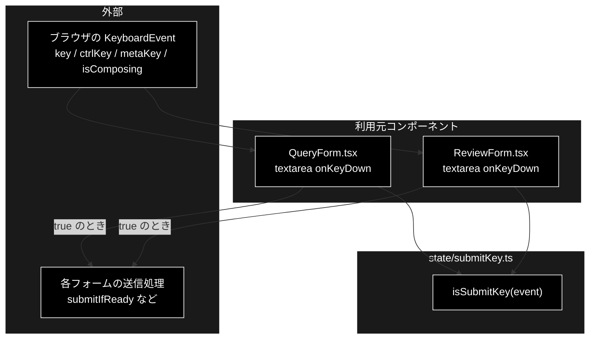

# submitKey.ts - textarea の送信キー判定 ドキュメント

**Version 1.0** | 最終更新: 2026-10-12

---

## 目次

- [概要](#概要)
- [1. アーキテクチャ構成図](#1-アーキテクチャ構成図)
- [2. エクスポート一覧](#2-エクスポート一覧)
- [3. 判断の規則](#3-判断の規則)
- [4. テスト](#4-テスト)
- [5. 変更履歴](#5-変更履歴)

---

## 概要

| 項目 | 内容 |
|---|---|
| ファイル | `frontend/src/state/submitKey.ts`（49 行） |
| 種別 | 純ロジック（キー判定） |
| 利用元 | `components/QueryForm.tsx`（複数行の問い合わせ欄）/ `components/ReviewForm.tsx`（文書欄） |
| 対応バックエンド | なし |

`<textarea>` では Enter が改行になり、`<input>` のような暗黙送信（implicit submission）が効かない。
キーボードだけで送信できるよう Ctrl+Enter / ⌘+Enter を送信に割り当てる。その判定を本モジュールが持つ。

### 主な責務

- Ctrl+Enter / ⌘+Enter を送信とみなす
- IME 変換中のキー操作を送信と取り違えない

### 各責務対応のモジュール

| # | 責務 | 対応モジュール | 説明 |
|---|---|---|---|
| 1 | 送信キーの判定 | `isSubmitKey` | `key === 'Enter'` かつ Ctrl か ⌘。Enter 単独・Shift+Enter は改行のまま |
| 2 | IME 変換中の除外 | `isSubmitKey`（`isComposing`） | 最優先で見る。修飾キー付きの Enter を変換確定に割り当てる IME もあるため |

---

## 1. アーキテクチャ構成図

### 1.1 位置づけ



---

## 2. エクスポート一覧

```ts
export interface SubmitKeyEvent {
  key: string;
  ctrlKey: boolean;
  metaKey: boolean;
  shiftKey?: boolean;     // 送信条件には使わない（Shift+Enter は改行のまま）
  isComposing?: boolean;  // IME の変換中か。省略時は false 扱い
}

export function isSubmitKey(event: SubmitKeyEvent): boolean
```

React の `KeyboardEvent` に依存せず、必要なフィールドだけを受ける（node 環境のテストから素のオブジェクトを渡せる）。
`KeyboardEvent<HTMLTextAreaElement>` はそのまま渡せる。

---

## 3. 判断の規則

### 3.1 使用例

`QueryForm` / `ReviewForm` の `onKeyDown` と同じ使い方（送信なら `preventDefault()` して送る）。

```ts
import { isSubmitKey } from '../../src/state/submitKey';

const key = (k: string, mods: Partial<{ ctrlKey: boolean; metaKey: boolean; shiftKey: boolean; isComposing: boolean }> = {}) =>
  ({ key: k, ctrlKey: false, metaKey: false, ...mods });

console.log(isSubmitKey(key('Enter', { ctrlKey: true })));                    // Ctrl+Enter
console.log(isSubmitKey(key('Enter', { metaKey: true })));                    // ⌘+Enter
console.log(isSubmitKey(key('Enter')));                                       // Enter 単独 → 改行
console.log(isSubmitKey(key('Enter', { ctrlKey: true, isComposing: true }))); // 変換中
```

```text
true
true
false
false
```

> 📝 **確かめ方（2026-10-12）**: 上の例を esbuild で束ねて node で実行し、出力が一致することを確かめた。

### 3.2 規則

| キー | 修飾 | `isComposing` | 結果 |
|---|---|---|---|
| Enter | Ctrl | false / 省略 | `true` |
| Enter | ⌘ | false / 省略 | `true` |
| Enter | なし | — | `false`（改行） |
| Enter | Shift | — | `false`（改行） |
| Enter | Ctrl+Shift | false | `true`（Shift は影響しない） |
| Enter 以外 | Ctrl / ⌘ | — | `false` |
| Enter | Ctrl / ⌘ / なし | **true** | `false`（変換の確定を送信と取り違えない） |

---

## 4. テスト

| テストファイル | 対象 | 件数 | 実行 |
|---|---|---:|---|
| `src/state/submitKey.test.ts` | §3.2（IME 変換中の 3 件と `isComposing` 省略を含む） | 10 | `npm test` |

件数は 2026-10-12 に `npx vitest run` で実測した。

---

## 5. 変更履歴

| バージョン | 日付 | 変更内容 |
|---|---|---|
| 1.0 | 2026-10-12 | 新規作成（`a_react_page_md_format.md` §2.4 の軽量構成）。使用例は esbuild + node で実行して確かめた |
